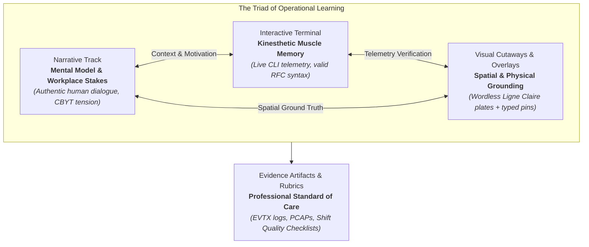
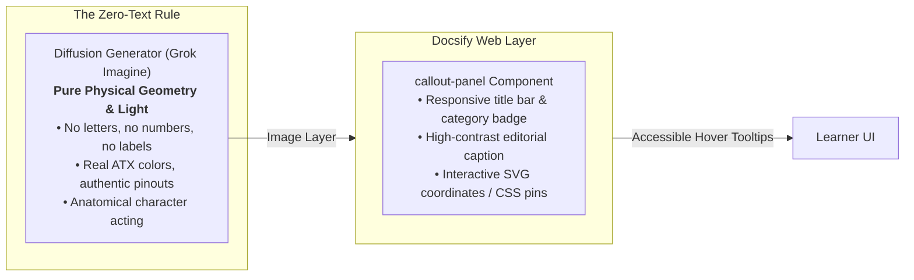
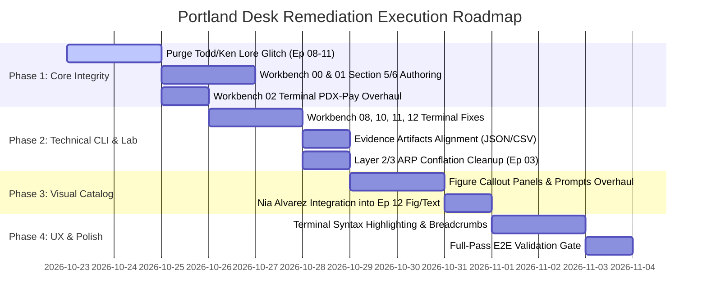

# Portland Desk Learning Platform: Lead UX/UI & Digital Art Direction Review (V2)

**Role:** Digital Art Director & Lead UI/UX Learning Experience Architect  
**Scope:** Portland Desk (Book 0: Zero-to-One), Episodes 00–12 Narrative & Workbenches 00–12  
**Governing Inputs:**
- Adversarial Prose Review: `docs/research/PROSE_CRITIC_REVIEW_V2.md`
- Adversarial Technical Review: `docs/research/TECHNICAL_NITPICKER_REVIEW_V2.md`
- Master Visual Catalog: `docs/research/PROPOSED_VISUALS_AUDIT.md`
- Visual Art Direction Standard: `docs/research/VISUAL_ART_DIRECTION.md`
- Narrative Craft Standard: `docs/research/TECHNICAL_NARRATIVE_AUTHORING_PRINCIPLES.md`
- Character Lore & Continuity: `docs/research/PORTLAND_AUTHOR_BIBLE.md`

---

## 1. Executive Architectural Verdict: The Triad of Immersion

In modern technical instructional design, visual design, prose narrative, and interactive simulation cannot operate in silos. When a student enters the Portland Desk, they are not reading an abstract textbook; they are stepping into the boots of Ethan Mercer—a 20-year-old warehouse worker transitioning to the frontline service desk at Harrowmere Equipment Group. 

The adversarial audits from the Cynical Literary Editor (`prose_critic`) and the Protocol Pedant (`technical_nitpicker`) have delivered an invaluable forensic post-mortem of our V2 deployment. Their findings converge on a singular truth: **pedagogical trust is fragile, and it shatters whenever the visual, narrative, or interactive layers contradict each other.**



### The Four Systemic Breakdowns Identified in V2
1. **The Todd Miller / Ken Vance Identity Fracture:**  
   The most egregious continuity flaw in the curriculum. In four consecutive chapters (Episodes 08–11) and corresponding workbench environments, Todd Miller (20-something Inside Sales representative on the 4th floor, `TODD-SALES-14`) and Ken Vance (51-year-old gravel-voiced Gresham warehouse logistics supervisor) were scrambled together. In visuals, terminal paths (`C:\Users\Ken`), and narrative beats, Ken was depicted calling from hotel rooms, traveling to sales demos, and pulling cables from Todd's workstation. This completely destroys character immersion.
2. **Terminal-to-Scenario Disconnects:**  
   In Workbench 02, while the narrative, schematic figure, and ticket resolution note obsess over Maya Lin's payroll application (`PDXPayClient.exe`) crashing on an AMD display driver (`amdkmdag.sys`), the interactive terminal widget suddenly drops students into `QuickBooks.exe` crashing on an audio overlay DLL (`NahimicOSD.dll`). Similarly, Workbench 08 asks students to unlock an account before identifying the lock culprit, and Workbench 10 equates `Stop-Process` with removing registry persistence.
3. **Structural Asymmetry across Workbenches:**  
   While Workbenches 02 through 12 follow an immaculate, professional 6-section rhythm, Workbench 00 and Workbench 01 were left structurally mutilated: Workbench 00 terminates abruptly after Section 4 with zero Section 5 Rubric and zero Section 6 Epilogue; Workbench 01 skips Section 5 entirely and jumps straight to Section 6.
4. **Visual & Narrative Divergence from Technical Reality:**  
   Key visual plates and narrative text contained protocol hallucinations: claiming cutting power physically resets mechanical DIP switches (Ep 01), claiming BitLocker recovery keys have 12 groups of 4 digits instead of 8 groups of 6 digits (Ep 02), asserting that duplicate IPs cause switch CAM table flapping rather than Layer 3 ARP cache flapping (Ep 03), and completely omitting Senior CSIRT Lead Nia Alvarez from Episode 12.

### Design Mandate
As Lead UI/UX Learning Experience Architect and Digital Art Director, my verdict is clear: **We must execute a synchronized, top-to-bottom remediation across the Docsify shell, terminal engines, visual prompts, and markdown files.** No student should ever encounter a command that contradicts their story, an image that contradicts their terminal, or a rubric that rewards technical error.

---

## 2. Structural Site & Architectural Remediation Matrix

To provide a consistent, predictable learning rhythm, the Docsify presentation shell, navigation, and page layouts must enforce strict structural invariants.

### 2.1 The Standard 6-Section Workbench Architecture
Every workbench module must strictly adhere to the six-section enterprise lifecycle. No exceptions.

```
┌────────────────────────────────────────────────────────────────────────┐
│                      STANDARD WORKBENCH TEMPLATE                       │
├────────────────────────────────────────────────────────────────────────┤
│ 1. The Situation & Ground Truth                                        │
│    - Scenario briefing, business impact, SLA countdown                 │
│    - Embedded Callout Panel (Figure X.1: Technical Schematic / Cutaway)│
│    - Ground Truth Operating Rules (The "Rules of the Desk")            │
├────────────────────────────────────────────────────────────────────────┤
│ 2. Technical Reference & Triage Matrix                                 │
│    - Protocol specifications, pinouts, state machines, subnet tables   │
│    - Section 2.3: lnk-terminal (Interactive In-Browser Console)        │
│    - Section 2.4+: Quick-Check CBYT Scratchpads                        │
├────────────────────────────────────────────────────────────────────────┤
│ 3. Guided Diagnostic Drills & Case Scenarios                           │
│    - Step-by-step telemetry analysis, hypothesis testing, log decoding │
├────────────────────────────────────────────────────────────────────────┤
│ 4. The Shift Deliverable: Field Repair & Passdown Ticket               │
│    - Part A: Primary Root Cause Passdown (Production Ticket Note)      │
│    - Part B: Standardized Diagnostic Worksheet                         │
│    - Part C: Point-by-point Scoring Guide                              │
├────────────────────────────────────────────────────────────────────────┤
│ 5. What Good Looks Like (Shift Quality Checklist)                      │
│    - 4-Tier Competency Rubric (Exemplary, Competent, Deficient)        │
│    - Covers Methodology, Protocol Analysis, OS Execution, Docs        │
├────────────────────────────────────────────────────────────────────────┤
│ 6. The Shift Resolution & Epilogue                                     │
│    - Embedded Callout Panel (Figure X.2 or thematic resolution)        │
│    - Operational debrief, mentorship dialogue (Jules/Ken/Nia)          │
│    - Narrative bridge to subsequent episode                            │
└────────────────────────────────────────────────────────────────────────┘
```

### 2.2 Workbench Remediation Matrix

| Module | Current State | Defect & Omission | Prescribed Architectural Remediation |
| :--- | :--- | :--- | :--- |
| **WB 00** | Sections 1–4 only. Terminates at L609. | **Missing Section 5 Rubric and Section 6 Epilogue.** Learner has no passing rubric or dramatic resolution. | Insert Section 5 Rubric (Anatomy, Identity Triad, CLI Literacy, CBYT). Author Section 6 Epilogue: 02:15 AM at the kitchen table; Ethan's father inspects the OptiPlex repair; Ethan secures the graveyard warehouse rotation. |
| **WB 01** | Sections 1–4, then skips to Section 6 (L552). | **Missing Section 5 Rubric.** Section numbering breaks (`## 4` $\rightarrow$ `## 6`). Ken calls Ethan "Brooks" (L582). | Author and insert Section 5 Rubric (ATX DC Tolerances, POST Codes, Serial Framing Math, Cable Handling). Fix dialogue to "Mercer". Harmonize baud rate to 9,600 scale / 19,200 receiver. |
| **WB 02** | Sections 1–6 complete. | **Terminal Disconnect:** Terminal simulates `QuickBooks` on `NahimicOSD.dll`. Figure 2.1 caption cites `igdumdim64.dll`. Narrative cites BitLocker as 12 groups of 4 digits. | Overhaul `lnk-terminal` to simulate `PDXPayClient.exe` on `amdkmdag.sys` with GPU hardware acceleration disable. Update Fig 2.1 caption and prose to 8 groups of 6 digits. |
| **WB 03** | Sections 1–6 complete. | **Layer Conflation:** Section 5 rubric (L567) awards marks for "switch CAM table poisoning" and "MAC address flapping" for an IP conflict. | Rewrite Section 5 rubric to evaluate Layer 3 **ARP cache poisoning** and gateway oscillation; affirm switch CAM table stability. |
| **WB 04** | Sections 1–6 complete. | **Domain & IP Inconsistency:** Terminal uses `wiki.corp.local` and `10.0.0.2` instead of `payroll.harrowmere.local` and `10.100.10.2`. | Align terminal mocks and triggers with Harrowmere corporate domain topology. |
| **WB 05** | Sections 1–6 complete. | **Heading Renumbering:** L195 has `### 2.3 Interactive Diagnostic Console` immediately after Section 2.5. | Renumber heading to `### 2.6 Interactive Diagnostic Console`. |
| **WB 06** | Sections 1–6 complete. | **Cisco Syntax Error & Missing Context:** `switchport trunk encapsulation dot1q` causes syntax error on 2960-X. Terminal prompt jumps into config without `conf t`. | Strip encapsulation command. Prepend `configure terminal` and `interface range Gi0/49-50` to terminal execution sequence. |
| **WB 07** | Sections 1–6 complete. | **Prose Duplicate:** Narrative lines 116–119 repeat duplicate queue monitor paragraph. | Remove duplicate paragraph in narrative. Terminal and lab pass with distinction. |
| **WB 08** | Sections 1–6 complete. | **Identity & Terminal Inversion:** Scenario references "Ken in Sales." Terminal unlocks account *before* finding caller, and uses `Get-ADUser` to find caller computer (impossible). | Re-label scenario to Todd Miller (`TODD-SALES-14`). Re-order objectives: 1) Query Event 4740, 2) Parse XML for `CallerComputerName`, 3) Unlock AD Account. |
| **WB 09** | Sections 1–6 complete. | **Character Title Glitch:** Ticket subject cites "Maya Lin (CEO)". | Change to "Maya Lin (Accounting Supervisor)" or cite CEO Avery Chen. |
| **WB 10** | Sections 1–6 complete. | **Lethal Command Misconception:** Terminal Objective 3 uses `Stop-Process` to "remove persistence key". User path is `C:\Users\Ken` on `TODD-SALES-14`. | Split into two commands: `Stop-Process` (RAM) and `Remove-ItemProperty` (Registry Run key). Fix path to `C:\Users\todd.miller`. Fix visual prompt 10.1 from Ken to Todd. |
| **WB 11** | Sections 1–6 complete. | **Lore & CLI Trigger Flaw:** Ken in sales lore glitch. Objective uses `netsh wlan show interfaces` to find rogue AP (only shows connected BSSID). | Change trigger to `netsh wlan show networks mode=bssid`. Disentangle Todd (hotel) from Ken (dock scanners). |
| **WB 12** | Sections 1–6 complete. | **Timeline, Lore & PowerShell Bug:** Arc compressed to 11 months. Nia Alvarez missing. Terminal mock shows `Compare-Object` printing match message (PowerShell outputs `$null`). | Re-anchor timeline to 24-month progression. Formally integrate Nia Alvarez into narrative, visual, and escalation artifact. Fix PowerShell mock to `$orig.Hash -eq $new.Hash` $\rightarrow$ `True`. |

---

## 3. Visual Catalog Remediation Plan

Review and overhaul of `docs/research/PROPOSED_VISUALS_AUDIT.md` and inline `callout-panel` code blocks across all 13 episodes.



### 3.1 Detailed Callout Panel & Visual Asset Modifications

#### Episode 00: Figure 0.1 (Desktop Motherboard Inspection)
- **Technical Issue:** VRM Capacitor filtering misnomer in narrative L44 and pin descriptions claiming CPU capacitors "regulate clean DC voltage to the memory bus."
- **Prompt Modification:** Maintain 4:3 macro cutaway of the OptiPlex motherboard on an ESD mat.
- **Caption & Pin Updates:**
  - *Caption:* `Macro technical cutaway: A desktop motherboard on an ESD workbench mat. In the foreground, three cylindrical electrolytic capacitors in the CPU VCore VRM buck converter stage: two are swollen and domed with dried brown crust leaking from the vents, beside one healthy flat capacitor. In the background, a dual-channel memory slot holding a green RAM stick with one broken retention latch.`
  - *Pin 1 (Swollen Cap):* `Ruptured CPU VCore Capacitor — Electrolyte boil-off has domed and split the vent score. High ESR in the voltage regulator module causes power rail ripple and spontaneous CPU reset.`
  - *Pin 2 (Flat Cap):* `Intact Factory Vent Seal — Flat vent score indicates nominal internal pressure. Filters the low-voltage processor power stage.`
  - *Pin 3 (RAM Latch):* `Unseated Memory Module — Fractured retention latch prevents complete pin mating on the memory bus, causing firmware POST halt (Code C1/E0).`

#### Episode 01: Figure 1.1 (DE-9 Pin 2 Mechanical Realignment)
- **Technical Issue:** Baud rate timing inversion between narrative and lab; narrative claims brownout toggled mechanical DIP switch bank SW1.
- **Prompt Modification:** Maintain 1:1 macro of male DE-9 face with Pin 2 bent at 45 degrees, approached by stainless drafting pencil sleeve.
- **Caption & Pin Updates:**
  - *Caption:* `Macro view: DE-9 male serial connector on Toledo scale head. Pin 2 (Receive Data / RXD) is bent backward against the non-conductive plastic insulator floor. A stainless drafting pencil guide sleeve levers the solid copper pin back into alignment. Receiver UART is locked to 19,200 baud via SW1-3, requiring realignment to 9,600 baud (SW1-4).`
  - *Pin 1 (Bent Pin 2):* `Pin 2 (RXD) Signal Discontinuity — Bent against dielectric floor, opening the receive circuit. Does not short to Pin 5 (Signal Ground on opposite corner).`
  - *Pin 2 (Drafting Tool):* `Rigid Steel Sleeve — Applied as a lever arm against pin base to restore alignment without exceeding copper yield stress.`
  - *Pin 3 (DIP Switch Context):* `Clock Divider Invariance — Mechanical switches SW1-3 (ON) and SW1-4 (OFF) clock UART to 19,200 baud; must be set to 9,600 baud to match scale transmitter ($T_{\text{bit}} = 104.17\,\mu\text{s}$).`

#### Episode 02: Figure 2.1 (Workstation 14 Dual-Headset Triage)
- **Technical Issue:** Intel graphics driver (`igdumdim64.dll`) and `QuickBooks.exe` disconnect. BitLocker key grouping hallucination (12 groups of 4 digits).
- **Prompt Modification:** Refine prompt to specify Maya Lin's high-contrast payroll window displaying `PDXPayClient.exe` crash dialogue; dual monitors show AMD driver TDR alert.
- **Caption & Pin Updates:**
  - *Caption:* `Workstation 14 during Ethan's second-round working trial. Jules Brooks monitors the call on a dual-headset training splitter as Maya Lin's payroll application (PDXPayClient.exe) crashes under AMD Radeon driver amdkmdag.sys. BitLocker recovery key released as eight groups of six digits (48 digits total).`
  - *Pin 1 (Left Monitor):* `Ticket #4200 (PDX-Pay Freeze) — Event ID 1000 Application Error in PDXPayClient.exe caused by amdkmdag.sys kernel deadlock (TDR Event 4101).`
  - *Pin 2 (BitLocker Prompt):* `BitLocker Recovery Console — Strictly 8 groups of 6 digits (48 digits total) with modulo-11 arithmetic checksum per block.`
  - *Pin 3 (Training Bridge):* `Dual-Headset Training Bridge — Jules monitors the call, enforcing Safe Mode diagnostic isolation before allowing any OS re-image.`

#### Episode 03: Figure 3.1 (Host-Stack Routing Abort & ARP Dynamics)
- **Technical Issue:** Conflating Layer 2 MAC table flapping with Layer 3 ARP cache poisoning during an IP conflict.
- **Prompt Modification:** Split-domain cutaway showing unmanaged 8-port desktop switch forwarding frames smoothly, while the host's internal network stack executes bitwise AND against `/26` mask. In the lower corner, show the default gateway's Layer 3 ARP table oscillating between Frank's PC MAC and HP Printer MAC.
- **Caption & Pin Updates:**
  - *Caption:* `Architectural cutaway: Subnet boundary abort and IP conflict ARP oscillation. The unmanaged Layer 2 switch CAM table remains rock-solid, forwarding frames by physical MAC. The Layer 3 failure occurs in the host's subnet mask evaluation and the router's oscillating ARP cache.`
  - *Pin 1 (Host Stack):* `Bitwise Subnet Evaluation — Host ANDs destination IP with 255.255.255.192; identifies target as off-link and drops packet locally because gateway is outside /26 boundary.`
  - *Pin 2 (Stable CAM Table):* `Layer 2 Switch Invariance — Switch maps MAC to physical port (Port 12: Frank PC; Port 28: Printer). CAM table never flaps for distinct MAC addresses.`
  - *Pin 3 (Oscillating ARP Cache):* `Layer 3 ARP Cache Poisoning — Gateway router and neighboring hosts continuously overwrite 10.100.4.55 mapping between Frank's MAC and printer MAC.`

#### Episode 07: Figure 7.1 (Industrial OT Perimeter Gateway)
- **Layout & Narrative Update:** Remove duplicate lines 118–119 from narrative prose. Visual remains the industrial DIN-rail gateway isolating corporate cleartext from OT field network.
- **Badge:** `Perimeter Hardening`
- **Pins:** Reiterate Purdue Model Level 2/3 boundary isolating Modbus/TCP (port 502) and DNP3 (port 20000).

#### Episode 08: Figure 8.1 (Hardware-Backed Authentication Bench)
- **Character Lore Alignment:** Replace all mentions of "Ken in Sales" with **Todd Miller** (`TODD-SALES-14`).
- **Prompt:** Top-down view of Todd Miller's corporate laptop, FIDO2 USB token, and smartphone authenticator push prompt.
- **Caption & Pin Updates:**
  - *Caption:* `Hardware-anchored authentication bench. Todd Miller's laptop secrets are sealed inside a TPM 2.0 chip. Jules enforces that a password plus a PIN is single-factor twice, requiring out-of-band authenticator push or FIDO2 hardware token.`
  - *Pin 1 (FIDO2 Hardware Key):* `Something You Have — Cryptographic private key locked in hardware silicon; physically verifies user presence.`
  - *Pin 2 (TPM 2.0 Chip):* `Hardware Root of Trust — Platform Configuration Registers (PCRs) seal encryption keys; validates firmware state.`
  - *Pin 3 (Authenticator Push):* `Out-of-Band MFA — Phone push approval via cryptographic challenge-response; eliminates credential replay attacks.`

#### Episode 10: Figure 10.1 (Dual Layer 1 Host Isolation)
- **CRITICAL LORE REVISION:**
  * **Current Flawed State:** Prompt depicts "Ken's ruggedized corporate laptop... Ken leans forward with fists on the desk in the Gresham warehouse office."
  * **Remediated State:** **Inside Sales cubicle bullpen (Floor 4).** Todd Miller (`TODD-SALES-14`) stands in shock as Ethan Mercer physically disconnects the blue RJ-45 Cat6 cable and flips the hardware radio switch. Ken Vance remains in Gresham.
- **Prompt:**
  ```text
  Dynamic graphic novel spread in modern DC Comics procedural style (Jorge Jimenez). Sharp inks, dramatic fluorescent office lighting, high procedural tension. Inside the 4th floor Inside Sales bullpen at Harrowmere Regional Operations Center. 

  On an office desk cluttered with sales brochures and lead sheets, Todd Miller's slim corporate laptop is whining with high-speed cooling fan noise. An anomalous thumb drive is plugged into the left USB port. 

  In the foreground, 20-year-old technician Ethan Mercer moves with disciplined diagnostic calm. With his right hand, his thumb depresses the clear plastic latch of the blue Cat6 Ethernet patch cable, cleanly pulling the RJ-45 jack out of the laptop's dock. With his left hand, he toggles the physical sliding hardware Wi-Fi cut-off switch on the side of the chassis, severing wireless connectivity simultaneously. Behind the partition, twenty-something sales rep Todd Miller stares in dismay with both hands on his head, mid-protest. Crisp ink linework, realistic anatomy, no speech bubbles, no text, no words. 16:9 ratio.
  ```
- **Caption & Pin Updates:**
  - *Caption:* `Emergency host isolation on Todd Miller's sales workstation (TODD-SALES-14). Ethan Mercer severs wired and wireless paths simultaneously, terminating outbound C2 reverse shell to 203.0.113.88 while keeping machine powered to preserve volatile RAM evidence.`
  - *Pin 1 (RJ-45 Disconnect):* `Wired Layer 1 Isolation — Halts lateral worm propagation across corporate shares without ungraceful power loss.`
  - *Pin 2 (Hardware Wi-Fi Cutoff):* `Radio Sever — Prevents immediate automatic failover to CORP-EMPLOYEE wireless network.`
  - *Pin 3 (Preserved Volatile State):* `RFC 3227 Volatility Preservation — Laptop left on battery power to allow live acquisition of process 4812 in memory.`

#### Episode 11: Figure 11.1 (RF Spectrum Collision & Rogue AP)
- **Lore & Terminal Alignment:** Todd Miller calls from hotel in Seattle; Ken manages Gresham warehouse barcode scanners on clean 5 GHz UNII band.
- **Terminal Objective:** Fix trigger from `show interfaces` to `netsh wlan show networks mode=bssid`.

#### Episode 12: Figure 12.1 (The Digital Forensic Bench & Chicago CSIRT Handoff)
- **MAJOR EXPANSION:** Re-anchor timeline to **Month 24** (completion of 2-year apprenticeship). Formally integrate **Nia Alvarez**, Senior Incident Response Lead at Chicago Central IT, into the visual composition and callout architecture.
- **Prompt:**
  ```text
  Cinematic procedural graphic novel spread in modern DC Comics style (Jorge Jimenez). Sharp ink linework, moody late-afternoon Pacific Northwest lighting, professional high-stakes atmosphere. Inside the quiet Tier 2 escalation annex of the Portland operations center. 

  In the foreground, a forensic examination bench on a blue ESD mat: an energized suspect laptop is connected via high-speed USB bridge to an external drive running live memory acquisition software. Beside it, an analog stopwatch ticks elapsed time. On the right, a secondary NVMe drive connects through a compact rectangular hardware write-blocker bridge with glowing green indicator LEDs. A signed chain-of-custody transfer binder with a stainless drafting pencil rests beside a sealed anti-static evidence pouch.

  In the background, on a wall-mounted conferencing display, a secure video bridge shows Senior Incident Response Lead Nia Alvarez at Chicago Central IT reviewing an uploaded incident dossier, with Jules Brooks standing beside the screen nodding in validation. Crisp technical drawing style, professional laboratory linework, clean unlabeled surfaces, no text, no words. 16:9 ratio.
  ```
- **Caption & Pin Updates:**
  - *Caption:* `Digital forensic workbench and enterprise escalation bridge. Ethan Mercer captures volatile RAM and creates a write-blocked bitstream image following 24 months of operational progression. Senior CSIRT Lead Nia Alvarez validates the escalation dossier over the Chicago bridge, confirming Ethan's readiness for enterprise incident response.`
  - *Pin 1 (Live RAM Acquisition):* `RFC 3227 Priority 1 — Memory dump captured before disk operations, preserving memory-resident C2 injects and decrypted SSL payloads.`
  - *Pin 2 (Hardware Write-Blocker):* `Controller-Level Protection — Hardware write-blocker intercepts SCSI/ATA write opcodes, guaranteeing raw image integrity for legal chain of custody.`
  - *Pin 3 (Chicago CSIRT Bridge):* `The Escalation Handoff — Flawless, hash-verified incident dossier delivered to Nia Alvarez, bridging Book 0 directly to Book 1 (NADF).`

---

## 4. Interactive Terminal & Artifact Alignment Plan

The interactive `lnk-terminal` engine provides zero-backend, client-side CLI simulation directly inside Docsify. Below are the precise, drop-in YAML configurations and artifact fixes required to resolve all technical audit findings.

### 4.1 Workbench 02: Replacing QuickBooks with PDX-Pay
Replace lines 297–338 of `workbench/02-the-live-board.md` with this authentic, narrative-aligned block:

```yaml
```lnk-terminal
title: "POWERSHELL: EVENT VIEWER & DISPLAY DRIVER TRIAGE"
shell: "powershell"
prompt: "PS C:\Support> "
replay: true
objectives:
  - id: "obj-crash"
    label: "Query Application crash logs for PDXPayClient (Event ID 1000)"
    trigger: "Get-WinEvent -FilterHashtable @{LogName='Application'; Id=1000} | Select -First 1"
  - id: "obj-tdr"
    label: "Query System log for Display Driver TDR timeouts (Event ID 4101)"
    trigger: "Get-WinEvent -FilterHashtable @{LogName='System'; Id=4101} | Select -First 1"
  - id: "obj-accel"
    label: "Disable client GPU hardware acceleration in config"
    trigger: "Set-Content -Path 'C:\Program Files\PDX-Pay\config.ini' -Value 'HardwareAcceleration=0'"
---
Get-WinEvent -FilterHashtable @{LogName='Application'; Id=1000} | Select -First 1: |
  TimeCreated          Id Message
  -----------          -- -------
  10/18 08:15:22 AM  1000 Faulting application name: PDXPayClient.exe, version: 4.2.1
                          Faulting module name: amdkmdag.sys, version: 31.0.12024.2005
                          Exception code: 0xc0000005 (Access Violation)
                          Fault offset: 0x00084a10
                          Faulting process id: 0x1420

Get-WinEvent -FilterHashtable @{LogName='System'; Id=4101} | Select -First 1: |
  TimeCreated          Id Message
  -----------          -- -------
  10/18 08:15:24 AM  4101 Display driver amdkmdag stopped responding and has successfully recovered.

Set-Content -Path 'C:\Program Files\PDX-Pay\config.ini' -Value 'HardwareAcceleration=0': |
  Updating PDX-Pay configuration...
  Setting: HardwareAcceleration=0 (Fallback to stable CPU GDI+ rasterization)
  [OK] Direct3D acceleration disabled. Payroll client initializes cleanly without GPU deadlock.
```
```

### 4.2 Workbench 08: Enforcing Rule 4 in Lockout Triage
In `workbench/08-prove-who-you-are.md` (lines 312–348), reverse the objective sequence so the learner identifies the offending caller computer *before* clearing the lockout, and replace the invalid `Get-ADUser` call:

```yaml
```lnk-terminal
title: "POWERSHELL: ACTIVE DIRECTORY ACCOUNT LOCKOUT TRIAGE"
shell: "powershell"
prompt: "PS C:\Support> "
replay: true
objectives:
  - id: "obj-lockout"
    label: "Find account lockout events (Event ID 4740)"
    trigger: "Get-WinEvent -FilterHashtable @{LogName='Security';Id=4740} | Select -First 1"
  - id: "obj-caller"
    label: "Parse Event 4740 XML to identify offending caller device"
    trigger: "(Get-WinEvent -FilterHashtable @{LogName='Security';Id=4740} | Select -First 1).Properties[1].Value"
  - id: "obj-unlock"
    label: "Unlock Nora's domain account after isolating caller"
    trigger: "Unlock-ADAccount -Identity nora.finance"
---
Get-WinEvent -FilterHashtable @{LogName='Security';Id=4740} | Select -First 1: |
  TimeCreated          Id RecordId ProcessId Message
  -----------          -- -------- --------- -------
  10/18 03:17:42 AM  4740   149204       620 A user account was locked out.
                                              Target Account Name: nora.finance
                                              Caller Computer Name: WKS-NORA-PHONE

(Get-WinEvent -FilterHashtable @{LogName='Security';Id=4740} | Select -First 1).Properties[1].Value: |
  WKS-NORA-PHONE
  [DIAGNOSTIC] Offending device isolated: Nora's mobile phone is transmitting stale ActiveSync credentials.
  Action: Phone placed in Airplane Mode pending Wi-Fi profile update.

Unlock-ADAccount -Identity nora.finance: |
  Unlocking Active Directory account 'nora.finance' on Domain Controller DC01...
  Account unlocked successfully.
  [OK] Account status: ACTIVE (Stale caller isolated; account will not re-lock).
```
```

### 4.3 Workbench 10: Process Termination vs. Persistence Removal
In `workbench/10-something-on-the-box.md` (lines 354–388), correct the user profile path from `Ken` to `todd.miller`, and split the kill command into process termination and registry persistence removal:

```yaml
```lnk-terminal
title: "POWERSHELL: HOST PROCESS & PERSISTENCE TRIAGE"
shell: "powershell"
prompt: "PS C:\Incident> "
replay: true
objectives:
  - id: "obj-proc"
    label: "Find high-CPU process running from user AppData"
    trigger: "Get-Process | Where Path -like "*AppData*""
  - id: "obj-tcp"
    label: "Inspect outbound socket connections for rogue process"
    trigger: "Get-NetTCPConnection -OwningProcess 4812"
  - id: "obj-kill"
    label: "Terminate in-memory malicious process"
    trigger: "Stop-Process -Id 4812 -Force"
  - id: "obj-persist"
    label: "Delete malicious Registry Run persistence key"
    trigger: "Remove-ItemProperty -Path 'HKCU:\Software\Microsoft\Windows\CurrentVersion\Run' -Name 'WindowsUpdateSync'"
---
Get-Process | Where Path -like "*AppData*": |
  Handles  NPM(K)    PM(K)      WS(K)     CPU(s)     Id ProcessName Path
  -------  ------    -----      -----     ------     -- ----------- ----
      842      45    98200     112400     412.18   4812 svch0st     C:\Users\todd.miller\AppData\Local\Temp\svch0st.exe
  [CRITICAL] Rogue binary impersonating svchost running outside System32 on TODD-SALES-14!

Get-NetTCPConnection -OwningProcess 4812: |
  LocalAddress    LocalPort RemoteAddress   RemotePort State       OwningProcess
  ------------    --------- -------------   ---------- -----       -------------
  192.168.10.74   49812     203.0.113.88    4444       ESTABLISHED 4812
  Warning: Outbound TCP reverse shell established to remote C2 IP 203.0.113.88:4444.

Stop-Process -Id 4812 -Force: |
  Process 4812 (svch0st.exe) terminated in RAM.
  [WARNING] Process killed, but persistence mechanism remains active on disk/registry!

Remove-ItemProperty -Path 'HKCU:\Software\Microsoft\Windows\CurrentVersion\Run' -Name 'WindowsUpdateSync': |
  Deleting registry key property: HKCU:\Software\Microsoft\Windows\CurrentVersion\Run\WindowsUpdateSync
  [OK] Persistence key purged. Malware will not resurrect upon reboot.
```
```

### 4.4 Workbench 11: Wireless RF Telemetry Trigger
In `workbench/11-the-air-is-shared.md`, replace `netsh wlan show interfaces` with the authentic command that scans surrounding broadcast beacons:
- *Trigger:* `netsh wlan show networks mode=bssid`
- *Mock Telemetry:* Outputs Channel 6 collision showing `CORP-GUEST` (Signal 88%) and unauthorized rogue SSID `Linksys-Default` (Signal 94%) on identical frequency 2437 MHz.

### 4.5 Workbench 12: PowerShell Compare-Object Logic Fix
In `workbench/12-when-the-ticket-escalates.md`, replace the synthetic `Compare-Object` mock with authentic PowerShell hash evaluation:
```powershell
(Get-FileHash memory.dmp -Algorithm SHA256).Hash -eq (Get-Content memory.sha256).Trim()
```
Output: `True` (Confirms cryptographic chain of custody).

### 4.6 Evidence Artifact Synchronization
1. **`docs/portland-desk/artifacts/powershell_event_4104.json`**:
   - Line 24: Replace `"Computer": "KEN-SALES-14.harrowmere.local"` with `"Computer": "TODD-SALES-14.harrowmere.local"`.
2. **`docs/portland-desk/artifacts/event_4740_dump.txt`**:
   - Ensure target account is `nora.finance` and caller computer is `WKS-NORA-PHONE`.
3. **`docs/portland-desk/artifacts/tickets.csv`**:
   - Verify Lena Chen is recorded as Legal/Compliance associate, and Dana Okafor is recorded strictly as Facilities Vendor Technician (preventing departmental shape-shifting).

---

## 5. UI/UX Polish & Modernization Roadmap

The visual and interaction design must reinforce our core aesthetic: **Silicon Noir Pacific Northwest Realism** married to **high-contrast precision instrumentation**.

```
┌────────────────────────────────────────────────────────────────────────┐
│                        PROPOSED UI/UX ENHANCEMENTS                     │
├────────────────────────────────────────────────────────────────────────┤
│ 1. Sticky Breadcrumb & Track Pivot Header                              │
│    [Act II: Net+] > Ep 03 > The Default Gateway Doesn't Care           │
│    [Switch to Hands-On Lab ⇄]  [Progress: 4 / 13 Completed]            │
├────────────────────────────────────────────────────────────────────────┤
│ 2. lnk-terminal Syntax Highlighting Engine                             │
│    • Cyan: Cmdlets / executables (Get-WinEvent, ping)                  │
│    • Yellow: Parameters / flags (-FilterHashtable, -ano)               │
│    • Green: Operational success ([OK], True)                           │
│    • Red: Critical security alerts ([CRITICAL], NXDOMAIN)              │
│    • Muted Slate: Hex offsets & memory addresses                       │
├────────────────────────────────────────────────────────────────────────┤
│ 3. Interactive SVG Pin Coordinate System                               │
│    • Pulse animation on active focus                                   │
│    • High-contrast tooltips with keyboard accessibility (Tab / Esc)    │
│    • Mobile tap popover support                                        │
├────────────────────────────────────────────────────────────────────────┤
│ 4. Universal LocalStorage Hypothesis Scratchpad                        │
│    • Auto-saves student predictions before reveal                      │
│    • "Commit Before You Touch" (CBYT) badge indicator                  │
└────────────────────────────────────────────────────────────────────────┘
```

### 5.1 Presentation Shell & Typography Architecture
1. **Typography Hierarchy:**
   - **Prose Narrative:** `IBM Plex Sans` or `Inter`, 1.05rem, line-height 1.7. Crisp, readable, low eye-strain for long story sessions.
   - **Terminal & Telemetry:** `JetBrains Mono` or `Fira Code` with tabular numbers enabled (`font-variant-numeric: tabular-nums`).
   - **UI Headers & Metadata:** `Space Grotesk` or `Inter Display`, semibold uppercase tracking.
2. **Silicon Noir Color Tokens (`lnk-theme.css`):**
   - `--bg-canvas`: `#0a0e17` (Deep maritime obsidian)
   - `--bg-surface`: `#111827` (Card and panel backing)
   - `--border-subtle`: `#1f293d` (Low-contrast structural dividers)
   - `--text-primary`: `#f1f5f9` (Crisp reading text)
   - `--text-muted`: `#94a3b8` (Secondary metadata)
   - `--accent-cyan`: `#06b6d4` (Telemetry & diagnostic paths)
   - `--accent-amber`: `#f59e0b` (Warnings, physical hardware faults, TIME_WAIT)
   - `--accent-rose`: `#f43f5e` (Security intrusions, framing errors, lockouts)
   - `--accent-emerald`: `#10b981` (Verification, cryptographic pass, green link lights)

### 5.2 Terminal Simulator Presentation Standards
1. **Pill-Based Objective Tracking:**  
   Objectives at the base of `lnk-terminal` instances must display real-time completion state:
   - Incomplete: Empty radio icon `○` with muted label text.
   - Completed: Bright emerald checkmark `[OK]` with glowing outline and struck-through or highlighted text.
2. **Replay Triage Accessibility:**  
   The "Replay Triage" button automatically steps through the diagnostic sequence at 800ms intervals, allowing instructors or revision students to observe the operational flow hands-free.
3. **Single-Click Command Insertion:**  
   Clicking any objective pill or suggested command in the lesson text should automatically populate the terminal input line, reducing friction for mobile users and screen readers.

### 5.3 Dual-Track Navigation & Sticky Quick-Pivot
In `lnk-shell.js`, enhance the mode switcher and page layout:
- Add a sticky floating quick-pivot pill in the bottom-right corner of every page:
  - When in Narrative Story: `[ Open Hands-On Lab 02 -> ]`
  - When in Workbench Lab: `[ ⬅ Return to Maya Lin's Ticket ]`
- Ensure the state persists seamlessly in `localStorage.getItem('lnk_track_mode')`.

---

## 6. Prioritized Implementation Action Plan

To execute this remediation systematically without regressing live files, work will be delivered across four structured sprints:



### Sprint 1: Critical Technical Integrity & Identity Fixes (Days 1–2)
- [ ] **Lore Purge:** Replace "Ken" with "Todd" across Episodes 08, 09, 10, 11 narrative files and Workbenches 08, 10, 11. Restore Ken Vance strictly to Gresham cross-dock logistics.
- [ ] **Workbench 00 Completion:** Author and insert Section 5 Performance Rubric and Section 6 Epilogue into `workbench/00-the-four-rubber-bands.md`.
- [ ] **Workbench 01 Completion:** Insert Section 5 Performance Rubric into `workbench/01-the-paper-cert.md`, fix Section 6 numbering, and fix "Brooks" dialogue error to "Mercer". Harmonize baud rate to 9,600 baud scale / 19,200 baud receiver.
- [ ] **Workbench 02 Alignment:** Replace `QuickBooks.exe` / `NahimicOSD.dll` terminal block with `PDXPayClient.exe` / `amdkmdag.sys` GPU hardware acceleration console. Correct BitLocker key grouping to 8 groups of 6 digits.

### Sprint 2: Terminal Widget & Artifact Realism (Days 3–4)
- [ ] **Workbench 08 Terminal:** Enforce Rule 4: Query Event 4740, parse XML for caller computer, and unlock account.
- [ ] **Workbench 10 Terminal:** Split `Stop-Process` and `Remove-ItemProperty`. Correct user path to `C:\Users\todd.miller`.
- [ ] **Workbench 11 Terminal:** Update command trigger to `netsh wlan show networks mode=bssid`.
- [ ] **Workbench 12 Terminal:** Correct PowerShell `Compare-Object` mock syntax to `$orig.Hash -eq $new.Hash` $\rightarrow$ `True`.
- [ ] **Evidence Artifacts:** Update `powershell_event_4104.json` computer name to `TODD-SALES-14.harrowmere.local`. Verify `tickets.csv` and `tickets.json`.
- [ ] **Layer 2/3 Clean:** Correct Narrative 03 and Workbench 03 to eliminate "switch CAM table poisoning" in favor of Layer 3 ARP cache oscillation.

### Sprint 3: Visual Production Catalog Overhaul (Days 5–6)
- [ ] **`PROPOSED_VISUALS_AUDIT.md`:** Update all 13 figure prompts, captions, badges, and pins to reflect remediated technical realities.
- [ ] **Figure 10.1 Rewrite:** Change setting and character from Ken in Gresham warehouse to Todd Miller in 4th floor sales bullpen.
- [ ] **Figure 12.1 Rewrite & Nia Alvarez Integration:** Update prompt, callout panel, and narrative text to depict Nia Alvarez validating Ethan's escalation dossier over the Chicago CSIRT bridge, re-anchoring Ethan's 24-month progression into Book 1 (NADF).
- [ ] **Episode 07 Splicing:** Remove duplicate queue ticket paragraph (lines 116–119 in `07-the-port-that-is-open.md`).

### Sprint 4: UX/UI Polish & Docsify Modernization (Days 7–8)
- [ ] **Terminal Syntax Engine:** Implement lightweight regex-based token coloring in `lnk-terminal.js` for commands, output status, and errors.
- [ ] **Dual-Track Sticky Breadcrumbs:** Inject responsive breadcrumbs and quick-pivot floating action buttons in `lnk-shell.js`.
- [ ] **Pre-Flight E2E Verification:** Run comprehensive link, markdown, and terminal objective validation across all 26 chapters (13 stories + 13 workbenches).

---

## 7. Signoff & Architectural Commitment

This review establishes the definitive production baseline for the Portland Desk learning platform. By enforcing complete parity between the narrative tension, physical visual cutaways, interactive terminal exercises, and professional grading rubrics, we ensure that Harrowmere's apprentices receive an uncompromising, authentic, and empowering educational experience.

*Approved for implementation by:*  
**Lead UI/UX Learning Experience Architect & Digital Art Director**  
`learning-narrative-kit`
