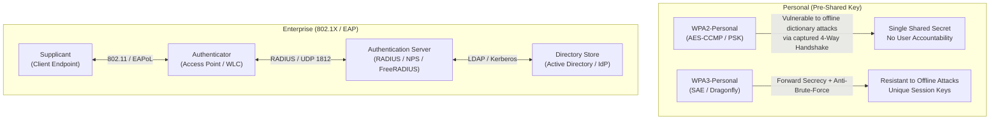
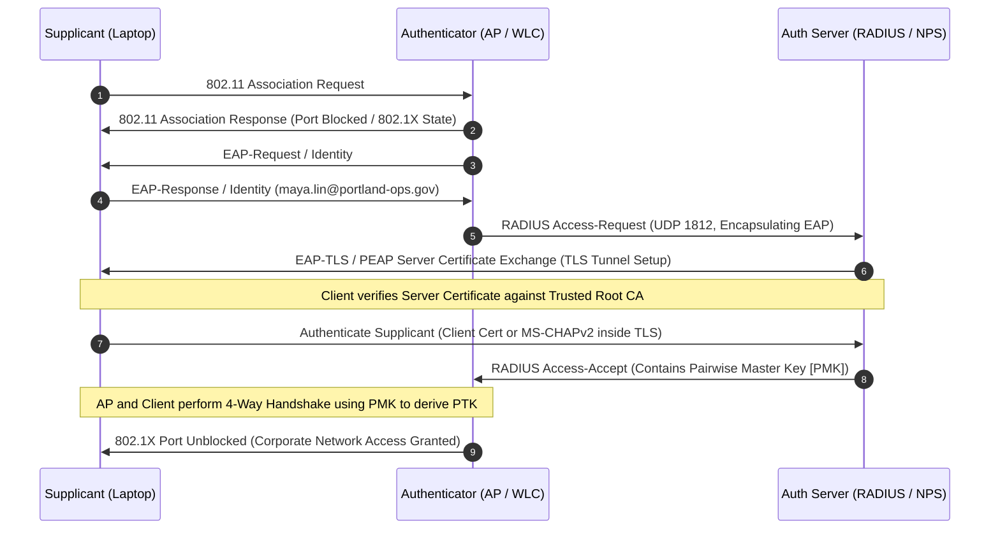

# Portland Desk Lab: Wireless Security, 802.1X Enterprise, & Rogue AP Triage

> **Track:** Portland Desk (Book 0: Zero-to-One)  
> **Unit Companion:** `secplus-wireless-helpdesk` — *The Air Is Shared*  
> **Environment:** Level 1 Service Desk Terminal, Wireless Controller (WLC) Console, & RF Triage Queue  
> **Author:** Ethan Mercer (under Desk Lead Jules Brooks)  
> **Live Artifacts Directory:** [`artifacts/`](artifacts/)

---

## At a Glance

| Attribute | Specification |
| :--- | :--- |
| **Role** | Tier 1 Service Desk Specialist / Junior Network Security Analyst |
| **Target Certification** | CompTIA Security+ (SY0-701) |
| **Primary Domains** | **Domain 2.0 Threats, Vulnerabilities, and Mitigations**<br>• *2.1 Compare and contrast common threat types (Rogue Access Points, Evil Twins, Deauthentication / Disassociation attacks, RF Jamming, Wireless Eavesdropping, War Driving, Replay attacks, Bluejacking, Bluesnarfing)*<br>**Domain 3.0 Security Architecture**<br>• *3.2 Compare and contrast wireless security settings (WPA2-PSK vs. WPA3-SAE, WPA2/WPA3-Enterprise, 802.1X port-based Network Access Control [NAC], EAP methods: EAP-TLS with mutual X.509 PKI certificates vs. PEAP/EAP-MSCHAPv2 with encrypted tunnelled passwords, RADIUS authentication backend, AP placement, power levels, captive portals, guest network segmentation, WPS vulnerabilities, MAC filtering flaws, hidden SSID obscurity)* |
| **Prerequisites** | Understanding of OSI Layer 2 802.11 framing (Management, Control, Data frames), IP networking fundamentals (DHCP DORA lease allocation, Default Gateway routing), Layer 4 UDP transport (RADIUS ports 1812/1813), and Public Key Infrastructure (PKI X.509 server/client certificates). |
| **Estimated Completion** | 35–45 minutes |
| **Core Deliverables** | 1. Wireless Security Architecture & Triage Matrix (WPA2/WPA3 Personal vs. Enterprise, EAP-TLS vs. PEAP, Rogue AP vs. Evil Twin vs. Karma)<br>2. Quick Check / Micro-Drill 1: Decoding 802.11 Association Frames & RADIUS Access-Request Packets<br>3. Quick Check / Micro-Drill 2: Triangulating Rogue BSSID Signal Strength (RSSI / dBm Free Space Path Loss)<br>4. Quick Check / Micro-Drill 3: "Call Your Shot" (CBYT) 5-Case Wireless Incident Prediction Gate<br>5. Performance Deliverable: Formal Tier 1 Rogue AP Containment & Wireless Remediation Ticket Note |

---

## 1. The Situation & Ground Truth

### The Situation
It is 08:35 on a brisk Friday morning on the east side of Portland. Mist clings to the brick facade of the industrial park near the Central Eastside railroad tracks. Inside the service desk bullpen, the morning coffee is fresh, but the dispatch dashboard is flashing amber. Two cubes over sits Jules Brooks, desk lead for nine years, bike helmet resting against her primary monitor arm, methodically parsing tickets.

On the whiteboard beside the dispatch screen, Jules has pinned a faded yellow sticky note:

$$\boxed{\textbf{Which SSID am I actually on?}}$$

Ethan’s desk drawer still holds his port index cards and Active Directory lockout sheets, but Friday's queue is entirely about the invisible medium outside the copper wire: the shared corporate radio frequencies.

Three critical wireless incidents have hit the board simultaneously:
1. **The Warehouse Annex Barcode Outage:** At 08:15, Ken from Sales and the warehouse logistics team reported that six mobile Zebra barcode scanners mounted on forklifts in the Warehouse Annex (Bay 4) abruptly stopped transmitting inventory updates to the Warehouse Management System (`WMS-APP-01` at `10.10.20.5`). The forklift drivers are idling, logistics trucks are backing up at loading docks 3 and 4, and scanner screens display `Connection Timeout - Host Unreachable`.
2. **The Annex DHCP Storm:** Network monitoring flagged a critical DHCP scope anomaly on VLAN 20 (Warehouse Operations). Workstations and mobile scanners in the annex are suddenly dropping their legitimate corporate IP leases (`10.10.20.x`) and picking up bizarre addresses in the `192.168.1.x` pool with a default gateway of `192.168.1.1`—a non-routable consumer address that does not exist on the corporate network map!
3. **Maya Lin and the Lobby Lookalike:** Maya Lin from Accounting walked up to the help desk counter with a corporate loaner laptop. She has an urgent executive finance meeting in fifteen minutes and cannot connect to Wi-Fi. In the Windows network list, right beside the legitimate corporate network `CORP-EMPLOYEE`, sits an unencrypted lookalike named `CORP-EMPLOYE` (missing the trailing "E") transmitting with maximum signal strength, along with an open hotel-style captive portal named `FreeConfQuick`. When Maya tried connecting to the corporate SSID, Windows threw an alarming banner: *"The server certificate presented by the network could not be verified."*

Jules spins her coffee mug and looks directly at Ethan:
> *"Wired networking has a plastic jack and copper patch cord you can trace with your fingers. Wireless has manners, radio physics, and mathematics. When an employee plugs a rogue consumer box into a warehouse drop because their Wi-Fi was weak, or an attacker stands up an evil twin in the parking lot with an amplified antenna, the air does not care who has permission. The air is shared. On this desk, we don't guess SSIDs, we don't click past certificate warnings, and we contain rogues at the switch port before we ask who bought them."*

---

### The Ground Truth Rules of the Desk

1. **The Air Is Shared and Boundary-Free:** Radio frequency (RF) signals do not stop at corporate drywall, perimeter fences, or property lines. Anyone parked on the street with a high-gain directional antenna can capture frames, inject deauthentication packets, or broadcast an identical network identifier. Security must come from cryptographic authentication and link-layer encryption (**WPA2/WPA3-Enterprise 802.1X**), never physical assumptions.
2. **Pre-Shared Keys (PSK) Are Group Secrets; Enterprise 802.1X Binds to Individuals:** In PSK (Personal) mode, every device on the SSID shares the exact same password. If an employee departs or a sticky note leaks, the entire key is compromised and cannot be rotated without manually touching every phone, laptop, and IoT scanner on the campus. **WPA2/WPA3-Enterprise (802.1X)** delegates authentication to a central **RADIUS** server, giving each user unique credentials, individual session encryption keys (**Pairwise Transient Keys / PTK**), and immediate account revocation.
3. **Rogue AP $\neq$ Evil Twin:**
   - A **Rogue Access Point** is an unauthorized physical access point connected directly to the corporate wired infrastructure (e.g., an unmanaged \$40 travel router plugged into a wall jack). It creates an unmonitored backdoor into the corporate LAN and often unleashes a rogue DHCP server that paralyzes legitimate devices.
   - An **Evil Twin** is an RF impersonation attack. An adversary configures a rogue radio with the *exact same SSID* or a deceptive typosquatted lookalike (e.g., `CORP-EMPLOYE`), broadcasting at higher signal strength or transmitting deauthentication frames to force clients off legitimate APs and trick them into connecting to the attacker's interception proxy.
4. **Containment Precedes Investigation:** When an unauthorized access point is bridging untrusted wireless traffic onto the wired enterprise network, do not wander the hallways conducting interviews. Immediately locate the upstream switch port and **shut the interface down administratively** (`shutdown`), or physically yank the cable. Stop the breach and DHCP pollution first; interview the user second.
5. **Certificate Validation Is Non-Negotiable:** When connecting to an 802.1X Enterprise network using PEAP or EAP-TLS, the client operating system must cryptographically validate the RADIUS server's X.509 certificate against the corporate Trusted Root Certification Authority. Clicking "Accept Untrusted Certificate" or bypassing validation surrenders user credentials directly to an evil twin running an EAP proxy.

---

## 2. Technical Reference & Triage Matrix

### Wireless Security Standards & Encryption Architecture

CompTIA Security+ SY0-701 Domain 3.2 requires technicians to distinguish between legacy, personal, and enterprise wireless standards.



| Standard | Authentication Mechanism | Encryption Cipher & Integrity | Vulnerabilities & Operational Tradeoffs | Exam / Help-Desk Mandate |
| :--- | :--- | :--- | :--- | :--- |
| **WEP (Wired Equivalent Privacy)** | Static Shared Key (64/128-bit) | RC4 Stream Cipher with 24-bit Initialization Vector (IV) | **Extremely Broken.** Short 24-bit IV reuse allows attackers to crack keys in under 60 seconds via IV injection attacks (`aircrack-ng`). | **FORBIDDEN.** Never permit WEP on any corporate or vendor device. Isolate legacy equipment on segmented wired drops. |
| **WPA (Wi-Fi Protected Access)** | Pre-Shared Key (PSK) or 802.1X | TKIP (Temporal Key Integrity Protocol) with RC4 | Deprecated interim standard (2003). TKIP vulnerabilities allow frame injection and cryptographic breakdown. | **DEPRECATED.** Replace with WPA2/WPA3. |
| **WPA2-Personal (WPA2-PSK)** | Pre-Shared Key (PSK) | AES-CCMP (Counter Mode CBC-MAC Protocol, 128-bit) | Robust on-the-air encryption, but vulnerable to **offline dictionary attacks**: attackers capture the 4-way handshake using deauth frames and crack the passphrase offline without touching the network. | **Unacceptable for Enterprise Employees.** Acceptable only for isolated IoT devices or small branch offices lacking RADIUS infrastructure. |
| **WPA3-Personal (WPA3-SAE)** | **SAE (Simultaneous Authentication of Equals)** / Dragonfly Handshake | AES-GCMP-128 / AES-GCMP-256 | Replaces PSK with a zero-knowledge password proof (Dragonfly). **Resistant to offline dictionary attacks**; provides **Forward Secrecy** (compromised password cannot decrypt past recorded sessions). | **Current Standard for Personal / IoT.** Mandatory on modern Wi-Fi 6/6E/7 deployments. |
| **WPA2/WPA3-Enterprise (802.1X)** | **IEEE 802.1X** with **RADIUS** authentication backend | AES-CCMP (WPA2) or AES-GCMP (WPA3) + Dynamic per-user Pairwise Master Keys (PMK) | Requires central authentication server (RADIUS) and PKI. Delivers individual user accountability, centralized credential revocation, and per-session dynamic keys. | **Mandatory Enterprise Standard.** Corporate laptops, smartphones, and managed endpoints must use 802.1X. |

---

### EAP (Extensible Authentication Protocol) Methods Comparison

Under IEEE 802.1X, the client (**Supplicant**) and authentication server (**RADIUS Server**) negotiate identity using EAP encapsulated over LAN (**EAPoL**) and RADIUS UDP packets.



| EAP Method | Authentication Mechanism | Certificate Requirements | Security Posture & Attack Resistance | Operational Complexity |
| :--- | :--- | :--- | :--- | :--- |
| **EAP-TLS**<br>*(RFC 5216)* | **Mutual Authentication** via PKI X.509 Certificates | **Certificates on BOTH sides:**<br>1. RADIUS Server Certificate<br>2. Client Endpoint Certificate | **Highest / Gold Standard.** Completely immune to password harvesting, dictionary attacks, and credential forwarding. Evil twins cannot trick clients because the attacker lacks the corporate private key. | High. Requires internal Public Key Infrastructure (Active Directory Certificate Services or SCEP/MDM enrollment). |
| **PEAP**<br>*(Protected EAP / EAP-MSCHAPv2)* | Server Certificate + User Password inside encrypted TLS tunnel | **Server-side Certificate ONLY.** Client authenticates using Active Directory username/password (MS-CHAPv2). | **Moderate to High (if validated).** Client validates the server's certificate before sending MS-CHAPv2 challenge. **Vulnerability:** If users click past untrusted certificate warnings on an evil twin, their MS-CHAPv2 hash is harvested by the rogue AP. | Low to Moderate. Standard corporate Active Directory credential binding without needing client-side certificates. |
| **EAP-TTLS**<br>*(Tunneled TLS)* | Server Certificate + Flexible Inner Authentication | Server-side Certificate required; client can use PAP, CHAP, MS-CHAP, or tokens inside tunnel. | Similar to PEAP, but supports non-Microsoft directory services and legacy authentication backends. Vulnerable to user certificate bypass. | Moderate. Frequently used in cross-platform / Linux enterprise environments. |
| **EAP-FAST**<br>*(Flexible Auth via Secure Tunneling)* | Protected Access Credential (PAC) key exchange | Dynamic PAC key distribution; does not mandate PKI certificates. | Developed by Cisco to replace insecure LEAP. Vulnerable if PAC keys are provisioned anonymously (in-band) without PKI validation. | Moderate. Largely phased out in favor of PEAP and EAP-TLS. |

---

### Attack Mechanics: Rogue AP vs. Evil Twin vs. Karma vs. Deauth

```mermaid
flowchart TD
    subgraph RogueAP["1. Rogue Access Point (Physical Bridge)"]
        R1["Employee / Attacker connects $40 router<br/>to wall drop in Warehouse Annex"] --> R2["Rogue Router connects to Corporate Switch<br/>(Untrusted hardware bridges internal VLAN 20)"]
        R2 --> R3["Rogue DHCP Server activates on 192.168.1.0/24<br/>Paralyzes corporate hosts with rogue gateway"]
    end

    subgraph EvilTwin["2. Evil Twin & Deauthentication Attack"]
        E1["Attacker stands up high-power Wi-Fi radio<br/>SSID: 'CORP-EMPLOYEE' (Same name, rogue BSSID)"] --> E2["Attacker broadcasts 802.11 Deauth frames<br/>to legitimate corporate clients"]
        E2 --> E3["Victim clients get kicked off real AP<br/>and auto-associate with louder Evil Twin"]
        E3 --> E4["Rogue Captive Portal or Fake RADIUS<br/>harvests credentials / session tokens"]
    end

    subgraph Karma["3. Karma / MANA Attack"]
        K1["Victim device broadcasts Probe Requests<br/>for saved networks: 'HomeNet', 'AirportWi-Fi'"] --> K2["Attacker radio (Wi-Fi Pineapple)<br/>answers 'YES, I am HomeNet!' to all probes"]
        K2 --> K3["Device silently connects; traffic proxied"]
    end
```



* **Deauthentication / Disassociation Frames:** In unencrypted 802.11 management frames (prior to 802.11w Protected Management Frames), an attacker can spoof the source MAC address of the legitimate corporate access point and send **Type 0 Subtype 12 (Deauthentication)** frames to client stations. Clients are instantly severed from the legitimate BSSID and immediately scan for the strongest alternative signal—falling into the waiting arms of an **Evil Twin**.
* **Karma Attack (Probe Harvesting):** Mobile devices frequently broadcast 802.11 Probe Request frames asking for networks in their Preferred Network List (PNL). A Karma-enabled rogue device listens for these queries and instantly spoofs an answer for *any* requested SSID, silently associating the victim's device without user interaction.
* **RF Jamming:** An intentional denial-of-service attack transmitting continuous high-power noise, carrier waves, or malformed frames across the 2.4 GHz or 5 GHz band, degrading the Signal-to-Noise Ratio (SNR) to zero so legitimate transceivers cannot arbitrate the medium.

---

### RF Triage & RSSI Triangulation

Signal strength in wireless networks is measured in **dBm** (decibels relative to 1 milliwatt), operating on a negative logarithmic scale:

$$\boxed{\text{Signal Strength (dBm)} = 10 \cdot \log_{10}\left(\frac{P_{\text{mW}}}{1\text{ mW}}\right)}$$

| RSSI Range (dBm) | Signal Quality Level | Operational Reality & Triage Meaning |
| :--- | :--- | :--- |
| **$-30$ to $-50$ dBm** | **Extremely Strong / Immediate Proximity** | Device is within a few inches to a few feet of the transmitting radio. If a suspicious SSID displays $-35$ dBm, the rogue physical hardware is in the immediate room or under the desk. |
| **$-55$ to $-67$ dBm** | **Enterprise Standard / Ideal Coverage** | Target threshold for corporate voice, video, and fast roaming. Signal is clean with high Signal-to-Noise Ratio (SNR). |
| **$-70$ to $-75$ dBm** | **Weak / Roaming Threshold** | Laptops will seek roaming candidates. Packets begin dropping; throughput drops sharply. Acceptable for low-bandwidth telemetry only. |
| **$-80$ to $-90$ dBm** | **Fringe / Borderline Disconnection** | Barely above the background noise floor (typically around $-95$ dBm). Severe frame retransmission and frequent disconnections. |

#### Free Space Path Loss & The Inverse Square Law:
Every **$6\text{ dB}$** decrease in signal strength represents an approximate **halving of the radio wave's voltage amplitude**, which corresponds to a **doubling of the distance** from the transmitter in open free space:

$$\text{Path Loss Delta} \approx 20 \cdot \log_{10}\left(\frac{d_2}{d_1}\right)$$

If an AP detects a rogue transmitter at $-44\text{ dBm}$ and another detects it at $-68\text{ dBm}$ (a difference of $24\text{ dB}$), the second AP is approximately $2^{24/6} = 2^4 = 16\text{ times}$ farther away from the rogue device. By comparing RSSI readings across three managed APs (**Trilateration**) and walking with a directional Wi-Fi analyzer, technicians pinpoint the physical location of unauthorized transmitters.

---

## 3. Quick Checks & Skill Reps

### Drill 1: Decoding 802.11 Association Frames & RADIUS Access-Request

#### The Scenario
Maya Lin's loaner laptop (`00:1A:2B:3C:4D:5E`) attempted to join the corporate network, but the authentication stalled. You pull a packet capture from the Wireless LAN Controller (WLC) management interface filtering for Maya's MAC address and backend RADIUS traffic on UDP port 1812:

```console
caption: Wireshark / tcpdump Trace · Filters: wlan.addr == 00:1a:2b:3c:4d:5e || udp.port == 1812
No.  Time      Source         Destination    Proto    Info
------------------------------------------------------------------------------------------------------------------------
01   08:22:10  00:1a:2b:3c:4d:5e  70:69:79:01:aa:04  802.11   Authentication Request, Open System, Seq=1
02   08:22:10  70:69:79:01:aa:04  00:1a:2b:3c:4d:5e  802.11   Authentication Response, Status=Success, Seq=2
03   08:22:10  00:1a:2b:3c:4d:5e  70:69:79:01:aa:04  802.11   Association Request, SSID='CORP-EMPLOYEE', 
                                                              RSN IE: WPA2-Enterprise, AKM=802.1X, Cipher=AES-CCMP
04   08:22:10  70:69:79:01:aa:04  00:1a:2b:3c:4d:5e  802.11   Association Response, Status=Success, AID=12
05   08:22:11  70:69:79:01:aa:04  00:1a:2b:3c:4d:5e  EAP      Request, Identity
06   08:22:11  00:1a:2b:3c:4d:5e  70:69:79:01:aa:04  EAP      Response, Identity (maya.lin@portland-ops.gov)
07   08:22:11  10.10.10.15    10.10.10.25    RADIUS   Access-Request(1) (id=42, l=128)
                                                              User-Name: maya.lin@portland-ops.gov
                                                              NAS-IP-Address: 10.10.10.15 (WLC-CORE-01)
                                                              NAS-Port: 1042
                                                              Framed-MTU: 1400
                                                              EAP-Message: [EAP-Response/Identity]
08   08:22:12  10.10.10.25    10.10.10.15    RADIUS   Access-Challenge(11) (id=42, l=1024)
                                                              EAP-Message: [EAP-Request/PEAP: TLS Start]
09   08:22:12  00:1a:2b:3c:4d:5e  70:69:79:01:aa:04  EAPoL    EAP-Packet [EAP-Response/PEAP: TLS Client Hello]
10   08:22:13  10.10.10.25    10.10.10.15    RADIUS   Access-Reject(3) (id=43, l=48)
                                                              Reply-Message: "EAP-TLS/PEAP Negotiation Failure: Certificate Untrusted"
```

#### Your Analysis Task
1. Look at Frame 03: What specific cryptographic security mode and cipher suite is requested by the laptop?
2. In Frames 07 and 08: What are the IP addresses and roles of `10.10.10.15` and `10.10.10.25`?
3. In Frame 10: Why did the RADIUS server issue an `Access-Reject`? What failed in the authentication chain?
4. If this were WPA2-Personal (PSK) instead of WPA2-Enterprise, which frames (05 through 10) would be absent, and what handshake would take their place?

<details>
<summary>Reveal Solution & Jules' Review</summary>

**Jules' Analysis:**
1. **Security Mode & Cipher:** Frame 03 contains the RSN IE (Robust Security Network Information Element) specifying **WPA2-Enterprise** with **802.1X Authentication Key Management (AKM)** and **AES-CCMP** encryption.
2. **Device Roles & IPs:**
   - `10.10.10.15` is the **Authenticator** (WLC-CORE-01, our central Wireless LAN Controller).
   - `10.10.10.25` is the **Authentication Server** (RADIUS Server / Microsoft NPS).
   - The AP/WLC encapsulates the client's Layer 2 EAPoL identity response into a Layer 4 UDP 1812 `RADIUS Access-Request` packet and forwards it to the RADIUS server.
3. **Root Cause of Access-Reject:** Frame 10 shows an `Access-Reject` with `Certificate Untrusted`. During the PEAP/TLS negotiation, the client either presented an untrusted/expired client certificate or rejected the RADIUS server's certificate because the loaner laptop's local trust store was missing the enterprise Root CA certificate. The 802.1X port remained blocked, preventing the client from getting an IP address or passing traffic.
4. **WPA2-Personal Difference:** In WPA2-Personal, EAP and RADIUS packets (Frames 05–10) do not exist. Instead, immediately following Association Response (Frame 04), the AP and client execute the **802.11 4-Way Handshake** (EAPoL-Key frames 1 through 4) using the pre-shared key to generate session keys.
</details>

---

### Drill 2: Triangulating Rogue BSSID Signal Strength

#### The Scenario
Zebra barcode scanners across the Warehouse Annex are disconnected. The WLC rogue detection dashboard reports an unauthorized BSSID:

```console
caption: WLC Rogue AP Telemetry Monitor · Filter: State == Uncontained
Rogue MAC (BSSID)    SSID Advertised         Channel   Security   Detected By AP   Reported RSSI
--------------------------------------------------------------------------------------------------
94:10:3e:aa:bb:cc    Warehouse_Annex_Fast    6         None       AP-WH-02 (Dock)  -82 dBm
94:10:3e:aa:bb:cc    Warehouse_Annex_Fast    6         None       AP-WH-03 (Aisle) -68 dBm
94:10:3e:aa:bb:cc    Warehouse_Annex_Fast    6         None       AP-WH-04 (Bay 4) -44 dBm
```

You grab a handheld Wi-Fi analyzer running on a hardened corporate tablet and walk the Warehouse Annex floor to track down the radio transmitter:
* **Location 1 (Loading Dock North, near AP-WH-02):** Signal reads **$-82\text{ dBm}$**.
* **Location 2 (Aisle 12 Center Racks, near AP-WH-03):** Signal rises to **$-66\text{ dBm}$**.
* **Location 3 (Bay 4 Annex Wall, near AP-WH-04):** Signal spikes to **$-42\text{ dBm}$**.
* **Location 4 (Bay 4 Shelf B-12 Supervisor Desk):** Signal hits a deafening **$-31\text{ dBm}$**.

Behind a metal filing cabinet under the wooden supervisor desk at Shelf B-12, you discover a blue Netgear consumer Wi-Fi router plugged into a 120V wall outlet. Its yellow WAN port is empty, but its LAN Port 1 has a blue Cat6 patch cord running directly into RJ-45 wall jack **`WH-B4-D18`**.

```console
caption: Switchport Status · Closet 2B Access Switch (10.10.20.2)
Switch-WH-Closet2B# show mac address-table interface GigabitEthernet 1/0/18
          Mac Address Table
-------------------------------------------
Vlan    Mac Address       Type        Ports
----    -----------       --------    -----
20      94:10:3e:aa:bb:cd DYNAMIC     Gi1/0/18
20      00:11:22:33:44:55 DYNAMIC     Gi1/0/18
20      00:11:22:33:44:66 DYNAMIC     Gi1/0/18
Total Mac Addresses for this criterion: 3
```

#### Your Analysis Task
1. Using the RSSI readings from the three managed APs and the handheld analyzer, explain why the rogue device was clearly located at Shelf B-12 rather than the loading dock. What does a $-31\text{ dBm}$ reading indicate about proximity?
2. What catastrophic network misconfiguration did the rogue router introduce to VLAN 20 by having its LAN port connected to wall jack `WH-B4-D18`?
3. Why are multiple MAC addresses showing up on single switch port `Gi1/0/18`?
4. What is the immediate, mandatory Tier 1 physical and administrative action you must take?

<details>
<summary>Reveal Solution & Jules' Review</summary>

**Jules' Analysis:**
1. **RSSI Proximity:** At $-82\text{ dBm}$, the signal is near the noise floor (30+ meters away through warehouse racking). At $-44\text{ dBm}$, the transmitter is within a few yards. At $-31\text{ dBm}$, the receiver is practically touching the transmitter antennas (under 1–2 feet). The inverse square law and free-space path loss confirm the source is physically situated under the supervisor desk at Shelf B-12.
2. **The DHCP Clash:** Consumer routers ship out of the box with an enabled **DHCP Server** on their LAN ports, configured for `192.168.1.0/24` with default gateway `192.168.1.1`. Because Ken plugged the router's **LAN port** into corporate jack `WH-B4-D18`, the rogue router began answering DHCP Discover broadcasts across VLAN 20 faster than the legitimate corporate DHCP server! The forklift scanners accepted the bogus leases, lost their default gateway (`10.10.20.1`), and were instantly cut off from the WMS server (`10.10.20.5`).
3. **Multiple MAC Addresses on One Port:** The rogue router acts as an unmanaged 4-port Layer 2 switch. Any device associating with `Warehouse_Annex_Fast` or plugged into its other LAN ports has its Layer 2 MAC address bridged directly onto switch port `Gi1/0/18`.
4. **Immediate Actions:**
   - **Administrative:** Instantly execute `interface Gi1/0/18` followed by `shutdown` on switch `Switch-WH-Closet2B` to sever the rogue device from the corporate LAN.
   - **Physical:** Unplug the Cat6 cable from the wall jack and confiscate the rogue router for physical custody and forensics.
   - **Endpoint Remediation:** Issue DHCP lease release and renew commands on the affected forklift barcode scanners (`ipconfig /release` && `ipconfig /renew` or power-cycle) so they acquire legitimate leases from the corporate DHCP server.
</details>

---

### Drill 3: "Call Your Shot" (CBYT) 5-Case Wireless Incident Prediction Gate

Do not look at the answers first. Read each incident, commit to your decision and technical rationale, and verify your prediction against Jules' review.

---

#### Case 1: Forklift Scanner IP Lease Triage — `INC-2026-1101`
* **Incoming Ticket:** Forklift scanner `SCAN-WH-12` in the warehouse cannot scan pallets. Terminal network status shows:
  ```text
  IPv4 Address: 192.168.1.104
  Subnet Mask:  255.255.255.0
  Gateway:      192.168.1.1
  DHCP Server:  192.168.1.1
  DNS Servers:  192.168.1.1
  ```
  Corporate warehouse configuration should be: Subnet `10.10.20.0/24`, Gateway `10.10.20.1`, DNS `10.10.10.10`.
* **Your Triage Action:** [ Reboot scanner / Re-enter Wi-Fi password / Isolate rogue DHCP server and shut switch port ]
* **Threat Classification:**
* **Technical Rationale:**

<details>
<summary>Solution & Jules' Critique</summary>

* **Action:** **ISOLATE ROGUE DHCP SERVER & SHUT DOWN UPSTREAM SWITCH PORT**.
* **Threat Classification:** **Rogue Access Point / Rogue DHCP Server Contamination**.
* **Rationale:** Rebooting the scanner or re-entering the Wi-Fi password does nothing—the scanner will simply broadcast another DHCP Discover and receive another poisoned lease from `192.168.1.1`. An unauthorized consumer router has been plugged into the warehouse VLAN. Identify the rogue server's MAC address from the scanner's ARP cache (`arp -a`), trace it to the access switch port via the MAC address table, administratively shut down the port, and renew leases on affected endpoints.
</details>

---

#### Case 2: Maya Lin's Certificate Prompt Bypass — `INC-2026-1102`
* **Incoming Ticket:** Maya Lin reports: *"I am trying to connect to CORP-EMPLOYEE from the courtyard patio. A window popped up saying 'radius-auth.port1and-ops.com - The server certificate was issued by an untrusted entity.' It gives me a button that says 'Connect Anyway'. Should I click it so I can get into my board meeting?"*
* **Your Triage Action:** [ Tell user to click Connect Anyway / Force WPA2-PSK / DENY connection, verify Root CA, and inspect for Evil Twin ]
* **Threat Classification:**
* **Technical Rationale:**

<details>
<summary>Solution & Jules' Critique</summary>

* **Action:** **STRICTLY FORBID CONNECTION; INSPECT FOR EVIL TWIN / ROGUE RADIUS PROXY**.
* **Threat Classification:** **Evil Twin / Rogue RADIUS Impersonation / Credential Harvesting**.
* **Rationale:** In an 802.1X PEAP network, the server certificate is the *only* barrier protecting the user's credentials. If Maya clicks "Connect Anyway," her laptop will establish a TLS tunnel with an attacker-controlled RADIUS server (notice the typosquatted domain `port1and-ops.com` with a `1` instead of an `l`!). Her client will then transmit her MS-CHAPv2 password hash into the attacker's tunnel, allowing the adversary to crack her domain password offline or execute a pass-the-hash relay. Direct Maya to use a wired dock or mobile hotspot through corporate VPN until the rogue radio is hunted down.
</details>

---

#### Case 3: Deauthentication Storm in the Lobby — `INC-2026-1103`
* **Incoming Ticket:** Dev in Engineering reports his laptop drops Wi-Fi every 45 seconds while working in the lobby cafeteria. WLC syslog shows:
  ```text
  %DOT11-4-DEAUTH_FLOOD: 450 Deauth frames/sec received targeting client 00:28:f8:11:22:33 from spoofed BSSID 70:69:79:01:aa:01. Reason: Class 3 frame received from nonassociated STA (Code 7).
  ```
  Immediately after dropping, Dev's laptop prompts to connect to an open network named `CORP-EMPLOYEE_Fast`.
* **Your Triage Action:** [ Replace laptop wireless NIC / Reboot AP / Escalate active Evil Twin & Deauth Attack to SOC ]
* **Threat Classification:**
* **Technical Rationale:**

<details>
<summary>Solution & Jules' Critique</summary>

* **Action:** **ESCALATE ACTIVE EVIL TWIN & DEAUTH ATTACK TO TIER 2 SOC / WIRELESS OPS; DOCK ENDPOINT**.
* **Threat Classification:** **802.11 Deauthentication Denial-of-Service / Evil Twin Baiting**.
* **Rationale:** An attacker within radio range of the lobby is transmitting spoofed 802.11 management deauthentication frames (Reason Code 7) using the real corporate AP's BSSID as the source MAC. The objective is to kick legitimate clients off the secure 802.1X network and force their devices to associate with the louder, unencrypted Evil Twin lookalike (`CORP-EMPLOYEE_Fast`). Moving Dev to a wired Ethernet dock bypasses the RF interference entirely. Escalate the incident to the SOC with physical coordinates to conduct a physical directional RF sweep.
</details>

---

#### Case 4: Marketing's Hidden SSID & MAC Filtering Request — `INC-2026-1104`
* **Incoming Ticket:** Marketing submitted ticket `INC-2026-1104`: *"We are setting up a private VIP lounge for a product launch next week. To guarantee absolute security against hackers, we want IT to create a Hidden SSID (suppress beacon frames) and configure a MAC Address Whitelist with the 12 laptops of our executives."*
* **Your Triage Action:** [ Approve request as secure / Deny request and educate requester on 802.1X Enterprise & WPA3 ]
* **Threat Classification:**
* **Technical Rationale:**

<details>
<summary>Solution & Jules' Critique</summary>

* **Action:** **DENY REQUEST; EXPLAIN SECURITY BY OBSCURITY; IMPLEMENT SEGMENTED 802.1X / WPA3-ENTERPRISE**.
* **Threat Classification:** **Security through Obscurity Flaw / Ineffective Controls (SSID Suppression & MAC Spoofing)**.
* **Rationale:** 
  1. **Hidden SSIDs are not secure:** Suppressing beacon frames does not hide a network. The SSID is broadcast in cleartext inside 802.11 Probe Requests, Probe Responses, and Association frames whenever legitimate clients connect. Free tools like `kismet` or `airodump-ng` unmask "hidden" SSIDs in seconds. Furthermore, hidden SSIDs force client devices to constantly broadcast probe requests wherever they go, leaking their network history and wasting battery.
  2. **MAC Filtering is trivial to bypass:** MAC addresses are transmitted unencrypted in every 802.11 frame header. An attacker simply sniffs traffic with Wireshark, identifies an authorized MAC address, and spoofs their own network adapter using `macchanger` or Windows registry settings.
  3. **Correct Architecture:** Deploy a segmented VLAN with **WPA3-Enterprise (802.1X)** requiring user authentication, or a dedicated Guest SSID with an isolated client VLAN and captive portal terms-of-service.
</details>

---

#### Case 5: Bluetooth Peripheral Spam & Pairing Request — `INC-2026-1105`
* **Incoming Ticket:** Jordan in dispatch reports: *"My laptop screen just popped up an unsolicited Bluetooth pairing request asking to pair with 'Magic_Keyboard_Pro' with PIN 884129. Two minutes earlier, my phone received an unprompted file transfer notification containing an image named 'free_coffee.jpg'. Am I hacked?"*
* **Your Triage Action:** [ Approve pairing / Reinstall Windows / Decline pairing, turn Bluetooth discovery off, classify Bluejacking ]
* **Threat Classification:**
* **Technical Rationale:**

<details>
<summary>Solution & Jules' Critique</summary>

* **Action:** **DECLINE PAIRING; DISABLE BLUETOOTH DISCOVERABLE MODE; ENFORCE PAIRING HYGIENE**.
* **Threat Classification:** **Bluejacking (Spam / Harassment) with attempted Bluesnarfing / Rogue Peripheral Hijack**.
* **Rationale:**
  - Sending unsolicited messages, business cards, or images over Bluetooth OBEX without authorization is **Bluejacking**. While annoying, Bluejacking does not compromise data on the host by itself.
  - However, the unsolicited keyboard pairing request is a serious threat: if Jordan approves the pairing of `Magic_Keyboard_Pro`, an attacker in the hallway or lobby gains an invisible virtual keyboard that can inject keystrokes, launch PowerShell, and compromise the machine (**BadBluetooth / Rubber Ducky attack**).
  - Triage protocol: Immediately click "Cancel/Decline" on the pairing request, disable Bluetooth discovery mode ("Make this device discoverable to nearby devices" $\rightarrow$ OFF), and instruct users to keep Bluetooth disabled when not actively pairing approved peripherals.
</details>

---

## 4. Your Ticket Notes (What to Put in the Ticket)

### Tier 1 Rogue AP Containment & Wireless Remediation Note

In enterprise support environments, your ticket documentation is a legal and operational record. Below are the two mandatory templates you must master:

#### Part A: Standard Tier 1 Resolution Note (Example: Ken's Rogue AP / INC-2026-1101)

```text
================================================================================
TIER 1 RESOLUTION SUMMARY - PORTLAND SERVICE DESK
================================================================================
Ticket ID:        INC-2026-1101
Requester:        Ken Vance (Warehouse Operations / Logistics Logistics)
Technician:       Ethan Mercer (Tier 1 Support)
Supervising Lead: Jules Brooks (Service Desk Lead)
Date/Time:        2026-10-23 09:15:44 PST
Category:         Wireless & Network Infrastructure / Rogue Device Containment
Severity:         P2 - High (Warehouse Barcode Scanning Operations Halted)
Status:           RESOLVED / REMEDIATED

1. ISSUE SUMMARY:
   Warehouse operations reported multiple forklift barcode scanners (SCAN-WH-08 
   through SCAN-WH-14) unable to communicate with Warehouse Management System 
   (WMS-APP-01 at 10.10.20.5). Forklifts halted at loading docks 3 and 4.

2. ROOT CAUSE ANALYSIS:
   - RF & Network Triage: WLC telemetry identified an unauthorized BSSID 
     (94:10:3e:aa:bb:cc) broadcasting SSID 'Warehouse_Annex_Fast' on Channel 6.
   - Physical Localization: RSSI signal analysis from managed APs (-82 dBm at 
     AP-WH-02, -68 dBm at AP-WH-03, -44 dBm at AP-WH-04) and handheld tablet 
     survey (-31 dBm at Bay 4 Shelf B-12) traced transmitter to supervisor desk.
   - Hardware Identification: Discovered an unmanaged Netgear N300 consumer Wi-Fi 
     router installed by warehouse staff to boost tablet reception.
   - Network Contamination: The rogue router's LAN port was plugged into corporate 
     wall jack WH-B4-D18 (VLAN 20). The router's internal DHCP server issued 
     bogus IP addresses (192.168.1.100-150) and default gateway 192.168.1.1 to 
     corporate endpoints, causing complete routing failure to internal servers.

3. CONTAINMENT & REMEDIATION ACTIONS:
   - Administrative Port Shutdown: Connected to switch Switch-WH-Closet2B 
     (10.10.20.2) and executed 'shutdown' on interface GigabitEthernet 1/0/18.
   - Physical Confiscation: Physically disconnected Cat6 patch cable and removed 
     unauthorized Netgear router from premises; surrendered hardware to IT lockbox.
   - Endpoint Lease Renewal: Dispatched technician to cycle Wi-Fi adapters and 
     renew DHCP leases across all 6 affected forklift scanners. Verified scanners 
     re-acquired valid 10.10.20.0/24 leases (Default Gateway 10.10.20.1).
   - Validation: Confirmed bidirectional ICMP ping and successful barcode pallet 
     scans against WMS-APP-01 (10.10.20.5). Operations restored 09:10 PST.

4. USER GUIDANCE & PREVENTATIVE MEASURES:
   - Coached warehouse lead on Acceptable Use Policy: unmanaged consumer network 
     devices are strictly prohibited on corporate switch drops.
   - Recommended enabling DHCP Snooping and Port Security (sticky MAC limit: 1) 
     on Closet 2B access switch to automatically prevent future rogue DHCP injection.
================================================================================
```

#### Part B: Security Incident Escalation & SOC Handoff Note (Example: Lobby Evil Twin / INC-2026-1102)

```text
================================================================================
SECURITY ESCALATION & THREAT INTEL ADVISORY - TIER 2 SOC / WIRELESS OPS
================================================================================
Incident Tracking: SEC-WLAN-2026-1023
Related Tickets:   INC-2026-1102, INC-2026-1103
Reporter:          Ethan Mercer (Tier 1 Support)
Supervising Lead:  Jules Brooks (Desk Lead)
Target Facility:   Portland Operations Center - East Lobby & Executive Courtyard
Threat Level:      HIGH - Active RF Deauthentication & Credential Interception
MITRE ATT&CK:      T1498.001 (Network DoS: Direct Deauth), T1557.001 (Adversary-in-the-Middle)

1. INCIDENT OVERVIEW:
   A coordinated wireless attack was detected targeting the East Lobby and 
   Executive Courtyard. Multiple endpoints (including CEO Maya Lin's loaner laptop 
   and Engineering staff) reported repeated wireless disconnects followed by 
   untrusted certificate prompts and lookalike network advertisements.

2. FORENSIC TELEMETRY & ATTACK VECTORS:
   - Deauthentication Storm: WLC logs recorded high-rate 802.11 management frame 
     floods (Type 0, Subtype 12 - Deauth) using spoofed source MAC addresses of 
     legitimate AP-LOBBY-01 (70:69:79:01:aa:01), kicking corporate clients offline.
   - Evil Twin Deployment: Handheld RF analyzer detected rogue radio broadcasting:
       * Rogue SSID:     'CORP-EMPLOYE' (Typosquat - omitted trailing 'E')
       * Rogue BSSID:    00:c0:ca:98:76:54 (ALFA Networks High-Gain USB adapter)
       * Frequency/Ch:   2.437 GHz (Channel 6) @ +28 dBm transmission power
       * RSSI in Lobby:  -38 dBm (Stronger than internal corporate APs)
   - Rogue RADIUS Server: Client association attempts triggered untrusted certificate 
     warning issued to 'radius-auth.port1and-ops.com' (typosquatted domain). 
     Attacker attempted to proxy PEAP/EAP-MSCHAPv2 authentication to harvest 
     cleartext user credentials and password hashes.

3. INTERIM MITIGATION:
   - Users instructed via emergency dispatch note to dock onto physical copper drops 
     or use cellular hotspot through corporate VPN. Zero users permitted to join 
     untrusted lookalike SSID.
   - WLC Rogue AP Containment enabled: corporate APs instructed to transmit targeted 
     mitigating frames against rogue BSSID 00:c0:ca:98:76:54.
   - Physical Security dispatched to inspect external courtyard perimeter and parking 
     lot for suspicious parked vehicles with high-gain directional antennas.

4. REQUIRED ACTION ITEMS FOR SOC & NETWORK ENGINEERING:
   1. Physical Security: Review exterior parking lot CCTV footage between 08:00 
      and 09:00 PST focusing on vehicles parked adjacent to the East Courtyard glass.
   2. Threat Intel / Registrar Takedown: Submit immediate domain takedown and DNS 
      RPZ sinkhole for typosquatted domain 'port1and-ops.com'.
   3. Architectural Hardening: Accelerate deployment of 802.11w (Protected Management 
      Frames / PMF) across all corporate WLAN profiles to render spoofed 
      deauthentication frames ineffective against client operating systems.
   4. Supplicant Policy: Push GPO / MDM policy update enforcing strict RADIUS 
      server certificate thumbprint validation and disabling user-level bypass.
================================================================================
```

---

## 5. What Good Looks Like (Shift Quality Checklist)

| Performance Criterion | Exemplary (Full Points) | Satisfactory | Needs Revision |
| :--- | :--- | :--- | :--- |
| **802.11 & 802.1X Architecture Mastery** | Flawlessly contrasts WPA2-PSK, WPA3-SAE, and WPA2/WPA3-Enterprise; explains why PSK is vulnerable to offline dictionary attacks; articulates exact role of Supplicant, Authenticator (AP/WLC), and Authentication Server (RADIUS); distinguishes EAP-TLS (mutual PKI certs) from PEAP (tunnelled password). | Understands difference between personal and enterprise Wi-Fi, but confuses WPA3-SAE mechanics or cannot articulate why EAP-TLS is more resilient than PEAP. | Confuses PSK with 802.1X Enterprise; believes WPA2-Personal provides individual user accountability; unaware of RADIUS backend role. |
| **Threat Classification & Attack Mechanics** | Accurately distinguishes between a Rogue AP (unauthorized physical switch bridge), Evil Twin (RF radio mimic), Karma attack (PNL probe harvesting), and 802.11 Deauth frame floods; articulates why clicking past untrusted certificates destroys PEAP security. | Identifies obvious rogue APs and evil twins, but struggles to explain how deauth attacks force reconnects or confuses Rogue AP with Evil Twin. | Treats all wireless anomalies as generic "bad Wi-Fi"; fails to understand how an evil twin captures MS-CHAPv2 hashes; recommends clicking past certificate warnings. |
| **RF Triage & RSSI Triangulation** | Accurately interprets negative logarithmic dBm scale ($-30\text{ dBm}$ near vs. $-80\text{ dBm}$ far); applies inverse square law and free-space path loss principles to triangulate transmitter locations using multi-AP telemetry and handheld walk tests. | Understands that higher negative numbers mean weaker signal, but cannot estimate physical proximity or explain triangulation principles. | Believes $-80\text{ dBm}$ is stronger than $-40\text{ dBm}$; cannot interpret Wi-Fi analyzer signal telemetry to locate a physical device. |
| **Documentation, Containment & Architectural Remediation** | Delivers structured, professional ticket resolution notes and SOC security escalations; executes immediate port containment (`shutdown`); identifies root cause (rogue DHCP clash); recommends enterprise controls (DHCP Snooping, 802.11w PMF, Port Security). | Notes are accurate but lack standardized enterprise formatting, omission of critical forensic telemetry (BSSIDs/RSSIs), or vague remediation steps. | Fails to shut down switch port; leaves rogue DHCP device running on corporate VLAN; writes vague or uninformative ticket documentation. |

---

*Workbench complete. Test your mastery against the interactive assessment scenarios in [`review.yaml`](review.yaml) and inspect companion network captures in [`artifacts/`](artifacts/).*
