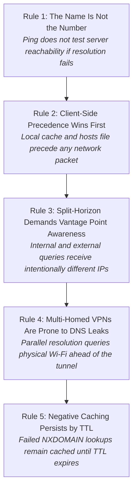
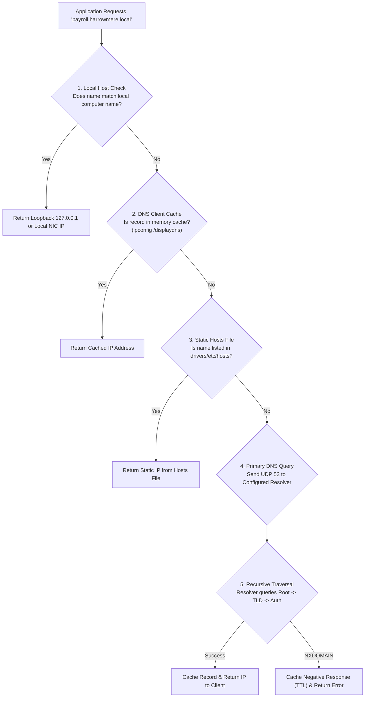
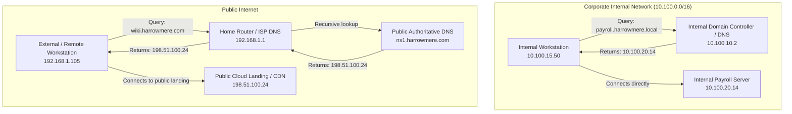
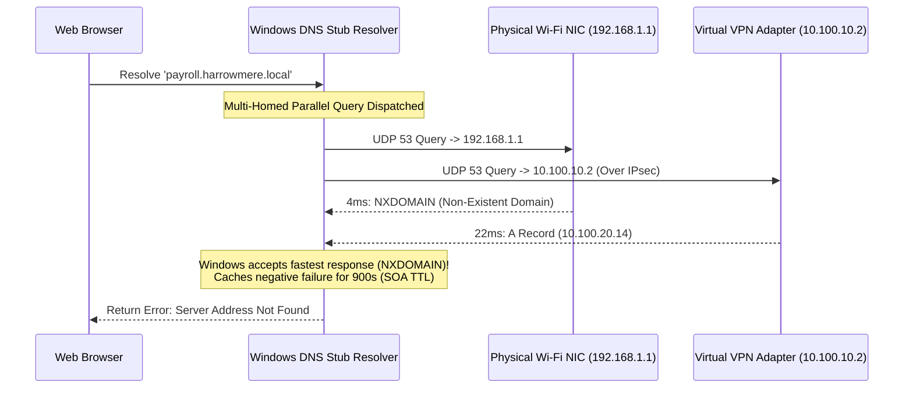

# Portland Desk Lab: DNS Plumbing, Name Resolution Triage, & Split-Horizon Analysis

> **The Situation:** Portland Operations Center • Spring downpour, remote VPN support queue  
> **Your Role:** Level 1 Network Support Specialist (under Jules Brooks & Lena Chen)  
> **The Objective:** Trace why remote VPN users fail to access internal company services while in-office users succeed, resolving split-horizon DNS and rogue hosts file overrides.  
> **Estimated Time:** 40–50 minutes • Name Resolution & DNS Plumbing  


---

<details class="instructor-ref">
<summary>Instructor & Certification Reference (Click to Expand)</summary>

* **Aligned Certification:** CompTIA Network+ (N10-008/009)
* **Exam Domains:** Domain 1.5 (DNS Services, Record Types, Zones) & Domain 5.2 (Troubleshooting Name Resolution & Client Caching)
* **Core Competencies & Deliverables:** DNS Hierarchy & Record Matrix • Command Triage Flow (nslookup vs ping) • Stale Cache Flushing Drill • Rogue Hosts File Hunting Drill • Call Your Shot 5-Case Gate • DNS Resolution & VPN Escalation Note

</details>


---

## 1. The Situation & Ground Truth

```callout-panel
title: "FIGURE 4.1: SPLIT-HORIZON RESOLVER & HOSTS OVERRIDE"
badge: "DNS Architecture"
caption: "Schematic cutaway: The local DNS resolution path. When the resolver queries 127.0.0.1 and hosts file before recursive forwarders, a stale hardcoded IP sends traffic to a retired server."
prompt: "Clean technical cutaway diagram of a computer desktop screen displaying DNS resolution paths under bright, even lighting. Flowchart lines connect local hosts file to DNS resolver cache and recursive domain controllers. Clean instructional style, crisp fine lines, no text, no words. 16:9 ratio."
```


### The Situation
It is 08:30 on an overcast Tuesday morning in East Portland. Outside, rain streams down the high double-paned windows facing the river. Inside the operations center, the incoming service desk ticket queue has spiked with nine critical incidents within twenty minutes.

Remote employees working from home across Multnomah and Washington counties have established secure VPN tunnels into the corporate network. Their network adapters report valid IP addresses on the `10.200.15.0/24` VPN pool. Yet whenever they attempt to browse internal business tools—specifically `payroll.harrowmere.local` and `wiki.harrowmere.local`—their browsers either time out with `DNS_PROBE_FINISHED_NXDOMAIN` or redirect to public registrar parking pages. Meanwhile, workstations physically plugged into the office local area network resolve those exact same resources instantly.

Jared Vance from network operations insists that residential internet service providers are experiencing routing failures. But Desk Lead Jules Brooks and Tier 2 Systems Administrator Lena Chen point out that the encrypted tunnel is fully operational. 

As Jules reminds the desk before anyone touches a configuration:
> *"When a user tells you a website is down, the website is almost never down. The client simply does not know what number to dial. The name is not the number. Trace who answers the question before you assume the wire is broken."*

### The Ground Truth Rules of DNS Triage



1. **Rule 1: The Name Is Not the Number.** Executing `ping hostname` tests two distinct subsystems simultaneously: name resolution and ICMP echo reachability. If the operating system cannot resolve the hostname to an IP address, `ping` fails immediately with `Could not find host`. That failure reveals zero information about network routing, firewall rules, or server health; it proves solely that the resolver failed.
2. **Rule 2: Client-Side Precedence Always Wins First.** An operating system never sends a UDP 53 packet across the network until it has exhausted its internal local checks. If a static entry exists in `C:\Windows\System32\drivers\etc\hosts` or a stale record sits in the local resolver cache, the OS uses that address without ever querying a corporate DNS server.
3. **Rule 3: Split-Horizon Demands Vantage Point Awareness.** Enterprise networks often maintain two distinct versions of the same DNS zone. An internal employee querying `wiki.harrowmere.com` receives a private RFC 1918 IP address (`10.100.40.8`), while an external user on the public internet receives a public CDN proxy IP (`198.51.100.24`). You cannot troubleshoot a resolution ticket without knowing which authoritative zone answered the client.
4. **Rule 4: Multi-Homed VPN Endpoints Are Prone to DNS Leaks.** Modern client operating systems utilize Smart Multi-Homed Name Resolution. When connected to a VPN, the OS sends DNS queries across all network adapters simultaneously. If the physical Wi-Fi interface responds faster than the encrypted virtual adapter, the OS accepts the home router's response, leaking corporate DNS queries to public ISPs and dropping private `.local` lookups.
5. **Rule 5: Negative Caching Persists by TTL.** When a recursive resolver returns an NXDOMAIN (non-existent domain) response, the client stub resolver caches that negative answer for the duration specified in the zone's SOA Minimum TTL. Reconnecting the VPN or refreshing the browser will continue to fail until the client cache is purged via `ipconfig /flushdns`.


---

## 2. Technical Reference & Triage Matrix

### 2.1 The Client-Side Name Resolution Sequence

When an application (such as a web browser or database client) requests a connection to a Fully Qualified Domain Name (FQDN), the Windows DNS client stub resolver evaluates potential answers in strict chronological order:



### 2.2 Comprehensive DNS Resource Record Matrix

Every network technician must distinguish between DNS resource records by transport behavior, payload structure, and troubleshooting impact:

| Record Type | RFC Standard | Functional Description | Typical Production Payload Example | Troubleshooting Significance & Failure Mode |
| :--- | :--- | :--- | :--- | :--- |
| **A** | RFC 1035 | Host IPv4 address mapping (32-bit integer). | `payroll.harrowmere.local. IN A 10.100.20.14` | Client cannot connect to service; verify correct subnet and split-horizon vantage point. |
| **AAAA** | RFC 3596 | Host IPv6 address mapping (128-bit hexadecimal). | `portal.harrowmere.com. IN AAAA 2001:db8:85a3::8a2e:370:7334` | Dual-stack clients prefer IPv6; an unreachable AAAA record causes connection delays before IPv4 fallback. |
| **CNAME** | RFC 1035 | Canonical Name (Alias) pointing one FQDN to another canonical FQDN. | `wiki.harrowmere.com. IN CNAME cloud-proxy.pdx-cdn.net.` | Cannot coexist with other records on the exact same node (RFC 1912); cannot be placed at zone apex (`@`). |
| **MX** | RFC 1035 | Mail Exchanger; specifies mail servers responsible for accepting inbound email, ordered by preference priority. | `harrowmere.com. IN MX 10 mail1.harrowmere.com.`<br>`harrowmere.com. IN MX 20 mail2.harrowmere.com.` | Lower preference number indicates higher priority; missing or mispointed MX records halt inbound corporate email. |
| **TXT** | RFC 1035 | Arbitrary human and machine-readable text; utilized for domain ownership verification, SPF, DKIM, and DMARC. | `harrowmere.com. IN TXT "v=spf1 ip4:10.100.0.0/16 include:_spf.google.com ~all"` | Syntax errors in TXT records cause external mail servers to reject corporate outbound email as spam. |
| **PTR** | RFC 1035 | Pointer record; performs reverse DNS lookups (resolves an IP address to an FQDN) in the `in-addr.arpa` zone. | `14.20.100.10.in-addr.arpa. IN PTR payroll.harrowmere.local.` | Mail servers reject connections from MTAs lacking valid reverse PTR records matching their forward A records. |
| **SRV** | RFC 2782 | Service locator; defines hostname, port number, priority, and weight for specific services (Active Directory, SIP, Kerberos). | `_ldap._tcp.dc._msdcs.portland.local. IN SRV 0 100 389 pdx-dc01.portland.local.` | Missing SRV records prevent domain join operations and trigger "No logon servers available" errors. |
| **SOA** | RFC 1035 | Start of Authority; specifies authoritative server, administrator email, serial number, refresh intervals, and minimum TTL. | `portland.local. IN SOA ns1.portland.local. admin.portland.local. (2026101801 7200 3600 1209600 900)` | Serial number mismatches cause secondary DNS servers to serve stale zone data. Minimum TTL governs negative caching. |


---

### 2.3 Command-Line DNS Triage Toolkit

```console
# 1. Inspect the local client resolver cache
ipconfig /displaydns

# 2. Flush and purge the local resolver cache
ipconfig /flushdns

# 3. View detailed adapter IP, gateway, and DNS configuration
Get-NetIPConfiguration
# or
ipconfig /all

# 4. Interactive nslookup: Specify target server and query record
nslookup
> server 10.100.10.2
> set type=A
> payroll.harrowmere.local
> set type=SRV
> _ldap._tcp.dc._msdcs.harrowmere.local
> exit

# 5. PowerShell Modern DNS Name Resolution Cmdlet
Resolve-DnsName -Name "payroll.harrowmere.local" -Server 10.100.10.2
Resolve-DnsName -Name "wiki.harrowmere.com" -Type CNAME
```


---

### 2.4 Split-Horizon DNS Architecture & VPN Split-Tunnel Leaks

#### Split-Horizon Architecture
In an enterprise environment, internal and external clients query different authoritative name servers for the same domain name:



#### The VPN Split-Tunnel DNS Leak Mechanism
When a VPN client establishes a split tunnel, corporate traffic is routed down the virtual adapter while general internet browsing exits the local physical Wi-Fi interface. If the client operating system is not configured with strict DNS interface binding:




---

## 3. Quick Checks & Skill Reps

### Drill 1: `nslookup` Output Inspection & Internal vs. External IP Comparison

#### Scenario
A field supervisor working remotely on an iPad and Windows laptop claims that `https://wiki.harrowmere.local` is returning an HTTP 404 page, while in-office users see the active technical wiki. 

You execute two targeted `nslookup` queries from the supervisor's remote session:

```console
# Query 1: Default Resolver (Client's active network configuration)
C:\Users\tech> nslookup wiki.harrowmere.local
Server:  router.local
Address:  192.168.1.1

*** router.local can't find wiki.harrowmere.local: Non-existent domain

# Query 2: Explicitly directed to Corporate Domain Controller
C:\Users\tech> nslookup wiki.harrowmere.local 10.100.10.2
Server:  pdx-dc01.harrowmere.local
Address:  10.100.10.2

Name:    wiki.harrowmere.local
Address:  10.100.40.8
```

#### Diagnostic Questions & Analysis
1. **Which server answered Query 1, and why did it fail?**
   * *Answer:* The client's default gateway at `192.168.1.1` (the home Wi-Fi router) answered. It failed with NXDOMAIN because `.local` is a private, non-routable top-level domain not registered in public internet root zones.
2. **What does Query 2 prove about the corporate network and VPN tunnel?**
   * *Answer:* It proves that the VPN tunnel is fully passing traffic, routing to `10.100.10.2` is healthy, and the corporate authoritative DNS server has a valid, active A record mapping `wiki.harrowmere.local` to `10.100.40.8`.
3. **What is the root cause of the supervisor's failure?**
   * *Answer:* The client system is routing DNS queries to its local home router rather than the VPN adapter's assigned DNS servers (a DNS leak in the split-tunnel profile).


---

### Drill 2: Rogue Hosts File Override Hunting

#### Scenario
An accountant's laptop connects to the VPN and resolves `wiki.harrowmere.local` correctly to `10.100.40.8`. However, whenever the accountant attempts to open `payroll.harrowmere.local`, the browser attempts to connect to `192.168.1.50:443` and fails with `ERR_CONNECTION_REFUSED`.

You run the following triage commands:

```console
C:\Windows\System32> nslookup payroll.harrowmere.local 10.100.10.2
Server:  pdx-dc01.harrowmere.local
Address:  10.100.10.2

Name:    payroll.harrowmere.local
Address:  10.100.20.14

C:\Windows\System32> ping payroll.harrowmere.local
Pinging payroll.harrowmere.local [192.168.1.50] with 32 bytes of data:
Reply from 192.168.1.50: Destination host unreachable.
```

#### Investigation Steps
Notice the contradiction: `nslookup` reports `10.100.20.14`, but `ping` attempts to contact `192.168.1.50`!

*Why does this happen?*  
`nslookup` bypasses local client files and directly queries the specified DNS server. Operating system utilities like `ping` and web browsers consult the local client resolver stack—which checks `hosts` before querying DNS.

#### Remediation Protocol
1. Open an elevated command prompt or PowerShell session (Run as Administrator).
2. Inspect the contents of `C:\Windows\System32\drivers\etc\hosts`:
   ```cmd
   type C:\Windows\System32\drivers\etc\hosts
   ```
3. Locate and delete any rogue or obsolete static mapping lines:
   ```text
   # REMOVE THIS LINE:
   192.168.1.50    payroll.harrowmere.local
   ```
4. Flush the resolver cache to purge the static entry from memory:
   ```cmd
   ipconfig /flushdns
   ```
5. Verify resolution with `ping` or `Resolve-DnsName`. The system should now resolve to `10.100.20.14`.


---


### 2.3 Interactive Diagnostic Console: Live Telemetry & Triage

Use the interactive console below to test commands, inspect telemetry, and verify your troubleshooting steps.

```lnk-terminal
title: "COMMAND PROMPT: DNS RESOLUTION & HOSTS FILE TRIAGE"
shell: "cmd"
prompt: "C:\Support> "
replay: true
objectives:
  - id: "obj-nslookup"
    label: "Query DNS for internal wiki portal"
    trigger: "nslookup wiki.corp.local"
  - id: "obj-hosts"
    label: "Inspect local static hosts file overrides"
    trigger: "type C:\Windows\System32\drivers\etc\hosts"
  - id: "obj-flush"
    label: "Flush local resolver cache"
    trigger: "ipconfig /flushdns"
---
nslookup wiki.corp.local: |
  Server:  UnKnown
  Address:  192.168.1.1 (Home Wi-Fi Router)
  
  *** UnKnown can't find wiki.corp.local: Non-existent domain
  Warning: Client is querying local home router DNS instead of internal VPN DC (10.0.0.2).

type C:\Windows\System32\drivers\etc\hosts: |
  # Copyright (c) 1993-2009 Microsoft Corp.
  # Local static host overrides:
  127.0.0.1       localhost
  ::1             localhost
  198.51.100.42   wiki.corp.local    # Stale contractor override from 2021!

ipconfig /flushdns: |
  Windows IP Configuration
  
  Successfully flushed the DNS Resolver Cache.
  Re-querying over active VPN tunnel...
  Name:    wiki.corp.local
  Address: 10.0.0.85 (Internal Wiki DC)
  [OK] Internal portal accessible.

```

---

### Quick Check 3: Call Your Shot: Predict Before You Look

Before running any diagnostic command or altering endpoint configuration, state your prediction:
- **Layer & Failure Point:** What subsystem is failing?
- **Expected CLI Output:** What exact error code or response do you anticipate?
- **Triage Action:** What specific command verifies your hypothesis without destroying evidence?


---
<div class="scratchpad-container">
  <div class="scratchpad-header">
    <span class="scratchpad-title">Interactive Hypothesis Scratchpad</span>
    <span class="scratchpad-save-indicator" id="save-ind-04-cbyt">Saved in browser</span>
  </div>
  <div class="scratchpad-body">
    <textarea id="notes-04-cbyt" placeholder="Type your predicted failure layer, expected command output, and root cause hypothesis here before opening solutions..."></textarea>
  </div>
  <div class="scratchpad-footer">
    <span>Private notes saved locally in your browser. Not graded.</span>
    <button type="button" class="scratchpad-copy-btn" onclick="copyScratchpad('notes-04-cbyt')">Copy Notes</button>
  </div>
</div>


#### Case 3.1: The Stale Local Cache After Server Migration
**Scenario:** The server team migrated `intranet.harrowmere.local` from legacy server `10.100.10.80` to cluster `10.100.10.95`. Users who kept their laptops powered on overnight see a 404 error. Users who just booted their laptops access the new cluster without error.

<details>
<summary>Prediction & Verification Gate (Click to Expand)</summary>

* **Layer & Failure Point:** Layer 7 / Client-side DNS Resolver Cache. The operating system holds a cached A record with remaining TTL pointing to the old IP.
* **Predicted Output:**
  ```cmd
  C:\> ipconfig /displaydns
  Record Name . . . . . : intranet.harrowmere.local
  Record Type . . . . . : 1
  Time To Live  . . . . : 480
  Data Length . . . . . : 4
  Section . . . . . . . : Answer
  A (IPv4) Record . . . : 10.100.10.80
  ```
* **Triage Action:**
  1. Execute `ipconfig /flushdns`.
  2. Query authoritative server directly: `nslookup intranet.harrowmere.local 10.100.10.2`.
  3. Verify client connects to `10.100.10.95`.
</details>


---

#### Case 3.2: Multi-Homed VPN Split-Tunnel DNS Leak
**Scenario:** A remote engineer connected to the VPN can access servers by IP (`\\10.100.20.14`), but typing `\\payroll.harrowmere.local` fails. Running `nslookup payroll.harrowmere.local` reports `Non-existent domain` from server `192.168.1.1`.

<details>
<summary>Prediction & Verification Gate (Click to Expand)</summary>

* **Layer & Failure Point:** Layer 7 DNS / Client Adapter Metric Binding. Split-tunneling without primary DNS routing causes Windows to query the faster local Wi-Fi interface.
* **Predicted Output:**
  ```powershell
  Get-NetIPInterface | Select-Object InterfaceAlias, InterfaceMetric, ConnectionState
  # Wi-Fi shows InterfaceMetric: 25
  # VPN Adapter shows InterfaceMetric: 50 (Higher number = Lower priority!)
  ```
* **Triage Action:**
  1. Lower VPN adapter metric: `Set-NetIPInterface -InterfaceAlias "Portland-VPN" -InterfaceMetric 10`.
  2. Configure DNS suffix search list in VPN connection profile: `Set-DnsClientGlobalSetting -SuffixSearchList @("harrowmere.local")`.
  3. Execute `ipconfig /flushdns` and test lookup.
</details>


---

#### Case 3.3: Missing Active Directory SRV Locator Record
**Scenario:** A technician attempting to join a newly imaged workstation to the domain `portland.local` receives the error: *"An Active Directory Domain Controller (AD DC) for the domain 'portland.local' could not be contacted."* The technician can successfully ping `10.100.10.2`.

<details>
<summary>Prediction & Verification Gate (Click to Expand)</summary>

* **Layer & Failure Point:** Application Layer / Active Directory Service Location. Domain join relies on DNS SRV records (`_ldap._tcp.dc._msdcs.<domain>`) to identify which server provides Kerberos and LDAP authentication on ports 88 and 389.
* **Predicted Output:**
  ```cmd
  C:\> nslookup -type=SRV _ldap._tcp.dc._msdcs.portland.local
  Server:  router.local
  Address:  192.168.1.1
  *** router.local can't find _ldap._tcp.dc._msdcs.portland.local: Non-existent domain
  ```
* **Triage Action:**
  1. Check workstation DNS settings: workstation is set to DHCP DNS (`192.168.1.1` or `8.8.8.8`) rather than internal domain controller `10.100.10.2`.
  2. Change primary DNS on the client adapter to `10.100.10.2`.
  3. Re-run `nslookup -type=SRV _ldap._tcp.dc._msdcs.portland.local` to confirm SRV record resolves to `pdx-dc01.portland.local` on port 389.
</details>


---

#### Case 3.4: Reverse DNS (PTR) Lookup Failure on Outbound Mail
**Scenario:** External recipient organizations report that emails sent from the Portland operations mail gateway are intermittently rejected with SMTP error: *"550 5.7.1 Client host rejected: cannot find your reverse hostname."*

<details>
<summary>Prediction & Verification Gate (Click to Expand)</summary>

* **Layer & Failure Point:** Layer 7 DNS / Reverse DNS Mapping (`in-addr.arpa`). The outbound mail server has a valid forward A record (`mail.harrowmere.com` $\rightarrow$ `198.51.100.50`), but the ISP hosting the public IP block has not created the matching PTR record.
* **Predicted Output:**
  ```cmd
  C:\> nslookup -type=PTR 198.51.100.50
  Server:  8.8.8.8
  Address:  8.8.8.8
  *** 8.8.8.8 can't find 50.100.51.198.in-addr.arpa.: Non-existent domain
  ```
* **Triage Action:**
  1. Confirm the public IP address used by the outbound MTA gateway.
  2. Submit an escalation ticket to the upstream ISP / IP block registrar requesting a PTR record mapping `198.51.100.50` to `mail.harrowmere.com`.
  3. Verify FCrDNS (Forward-Confirmed Reverse DNS) matches in both directions.
</details>


---

#### Case 3.5: Zone Apex CNAME Restriction
**Scenario:** Marketing creates a cloud landing page on AWS CloudFront (`d111111abcdef8.cloudfront.net`) and requests that IT create a CNAME record mapping the apex domain `harrowmere.com` directly to CloudFront.

<details>
<summary>Prediction & Verification Gate (Click to Expand)</summary>

* **Layer & Failure Point:** DNS Zone Architecture / RFC 1912 Violation. A CNAME record cannot exist at the root (apex) of a zone because the apex must contain SOA and NS records, and RFC standards prohibit a CNAME from coexisting with any other record type for the same label.
* **Predicted Output:**
  * Attempting to create `@ IN CNAME d111111abcdef8.cloudfront.net` in standard BIND or Windows DNS fails with error: *"The record cannot be added because a node with this name already contains SOA/NS records."*
* **Triage Action:**
  1. Explain the RFC 1912 restriction to the requester.
  2. Implement an **ALIAS / ANAME** pseudo-record (if supported by DNS provider) or deploy an HTTP 301 redirection service at the apex (`harrowmere.com` $\rightarrow$ `www.harrowmere.com`), placing the CNAME record on the `www` subdomain.
</details>


---

## 4. Your Ticket Notes (What to Put in the Ticket)

<div class="scratchpad-container">
  <div class="scratchpad-header">
    <span class="scratchpad-title">Your Ticket Draft & Resolution Scratchpad</span>
    <span class="scratchpad-save-indicator" id="save-ind-04-ticket">Saved in browser</span>
  </div>
  <div class="scratchpad-body">
    <textarea id="notes-04-ticket" style="min-height: 140px;" placeholder="Draft your ticket notes, diagnosis, and resolution steps here before comparing with the reference standard below..."></textarea>
  </div>
  <div class="scratchpad-footer">
    <span>Private notes saved locally in your browser. Not graded.</span>
    <button type="button" class="scratchpad-copy-btn" onclick="copyScratchpad('notes-04-ticket')">Copy Notes</button>
  </div>
</div>

### Tier 1 DNS Resolution Ticket & VPN Split-Tunnel Escalation Note

Every service desk technician must produce documentation that meets strict operational and security audit standards. Complete both parts below:

#### Part A: Tier 1 Standard Ticket Resolution Note

```text
================================================================================
TIER 1 RESOLUTION SUMMARY - PORTLAND OPERATIONS SERVICE DESK
================================================================================
Ticket ID:        INC-2026-1104
Requester:        Greg Adams (Accounts Payable Specialist)
Technician:       Ethan Mercer (Tier 1 Support Specialist)
Supervising Lead: Jules Brooks (Help Desk Lead)
Date / Time:      2026-10-18 09:15:22 PDT
Category:         Network / Remote Access / Name Resolution
Affected FQDN:    payroll.harrowmere.local
Status:           RESOLVED

1. INCIDENT DESCRIPTION:
   User connected remotely via Portland Corporate VPN from home office in Hillsboro. 
   User reported inability to access the internal payroll portal (payroll.harrowmere.local), 
   receiving browser errors indicating the server address could not be found. 
   Internal users on the physical LAN experienced no service interruption.

2. ROOT CAUSE ANALYSIS:
   Two-stage resolution failure identified on endpoint PORT-LT-0418:
   a. Local Static Override: Examination of C:\Windows\System32\drivers\etc\hosts 
      revealed a legacy test entry mapping payroll.harrowmere.local to obsolete IP 
      192.168.1.50 (left behind by previous development contractor).
   b. VPN Split-Tunnel DNS Leak: After removing the static entry, the client failed 
      to query internal domain controller 10.100.10.2. Interactive nslookup confirmed 
      queries were routed to the local home Wi-Fi gateway (192.168.1.1). The public 
      recursive resolver returned NXDOMAIN for the non-delegated .local namespace. 
      The negative response was cached locally for 900 seconds.

3. REMEDIATION PERFORMED:
   a. Purged obsolete static mapping lines from C:\Windows\System32\drivers\etc\hosts.
   b. Reconnected VPN tunnel following pushed gateway configuration update (enforcing 
      virtual adapter metric 10 and DNS suffix search list for harrowmere.local).
   c. Executed 'ipconfig /flushdns' in elevated prompt to wipe cached NXDOMAIN entry.
   d. Verified resolution: payroll.harrowmere.local resolved successfully to 10.100.20.14.
   e. User verified web application access and confirmed successful timesheet submission.

4. USER EDUCATION & FOLLOW-UP:
   Advised user to disconnect and reconnect VPN if working from new remote locations, 
   and provided one-click cache flush shortcut for desktop. No further action required.
================================================================================
```


---

#### Part B: Tier 2 Infrastructure Escalation Note

```text
================================================================================
SYSTEMS & NETWORK SECURITY ESCALATION NOTE
================================================================================
Escalation ID:    ESC-2026-0488
Originating Desk: Portland Regional Operations Help Desk
Technician:       Ethan Mercer (Tier 1 Specialist)
Escalated To:     Lena Chen (Tier 2 Sysadmin) / Jared Vance (Network Ops)
Priority:         P2 - High (Systemic Remote Access Degradation)
Date / Time:      2026-10-18 09:40:15 PDT
Subject:          VPN Split-Tunnel Profile Configuration Defect (DNS Leak / NXDOMAIN)

1. DEFECT DESCRIPTION:
   Following last night's 02:00 maintenance window updating the AnyConnect/IPsec 
   client profile to enable split-tunneling, 18 remote endpoints reported complete 
   resolution failure for internal .local and .internal resources.

2. TECHNICAL FINDINGS & EVIDENCE:
   a. Metric Disparity: The pushed client XML profile omitted the <InterfaceMetric> 
      tag, allowing the physical Wi-Fi adapter (Metric 25) to maintain higher priority 
      than the virtual VPN adapter (Metric 50).
   b. Multi-Homed Parallel Lookups: Windows 10/11 Smart Multi-Homed Name Resolution 
      dispatched parallel queries across both adapters. Local domestic gateways answered 
      in ~4ms with NXDOMAIN, beating the ~20ms response time across the encrypted tunnel.
   c. Poisoned Client Caches: Windows resolver accepted the fastest negative response 
      and cached the NXDOMAIN failure locally based on the 900-second SOA Minimum TTL, 
      causing persistent browser lockouts even during active tunnel sessions.

3. IMMEDIATE REMEDIATION DEPLOYED:
   - Lena Chen pushed an emergency revision (v2.4.1) to the VPN Concentrator:
     * Enforced <InterfaceMetric>10</InterfaceMetric> on virtual tunnel adapter.
     * Enforced <DNSSuffix>harrowmere.local, harrowmere.internal</DNSSuffix>.
     * Activated <DisableSmartNameResolution>true</DisableSmartNameResolution>.
   - Desk broadcasted mass notification instructing remote staff to disconnect, 
     reconnect, and run 'ipconfig /flushdns'.

4. PREVENTATIVE RECOMMENDATIONS:
   a. Update staging deployment runbook to mandate client DNS leak testing via 
      Resolve-DnsName before promoting VPN profile XML changes to production.
   b. Audit corporate laptop baseline image to ensure C:\Windows\System32\drivers\etc\hosts 
      is locked down with strict NTFS write permissions restricting local user tampering.
================================================================================
```


---

## 5. What Good Looks Like (Shift Quality Checklist)

| Performance Criterion | Exemplary (Full Mastery) | Satisfactory (Competent) | Needs Revision (Deficient) |
| :--- | :--- | :--- | :--- |
| **DNS Hierarchy & Precedence Logic** | Flawlessly explains the complete client resolution path (Local host $\rightarrow$ Cache $\rightarrow$ Hosts file $\rightarrow$ Primary DNS $\rightarrow$ Recursive traversal). Accurately distinguishes between stub resolver queries and recursive lookups. | Explains the resolution order correctly but omits or misplaces the relationship between local cache and static hosts file. | Confuses DNS server lookups with client file evaluation; claims DNS server is contacted before checking local cache. |
| **Record Type Precision & Application** | Correctly identifies and configures all standard record types (A, AAAA, CNAME, MX, TXT, PTR, SRV, SOA). Accurately explains RFC 1912 zone apex restrictions for CNAME records and SRV service mapping for Active Directory. | Identifies common records (A, AAAA, CNAME, MX) accurately, but displays minor hesitation on SRV syntax or reverse PTR delegation. | Confuses record types (e.g., asserts CNAME points directly to an IP address, or confuses PTR with forward A records). |
| **Triage CLI Tool Mastery** | Flawlessly utilizes `ipconfig /displaydns`, `ipconfig /flushdns`, interactive `nslookup` (specifying servers and types), and PowerShell `Resolve-DnsName`. Correctly interprets authoritative vs. non-authoritative answers. | Executes basic `nslookup` and `ipconfig` commands correctly, but relies on trial-and-error syntax or overlooks server selection flags. | Relies solely on `ping` to troubleshoot DNS; cannot interpret terminal error codes such as SERVFAIL, REFUSED, or NXDOMAIN. |
| **Split-Horizon & VPN Architecture** | Completely articulates the mechanics of split-horizon DNS, split-tunneling trade-offs, interface metrics, multi-homed parallel resolution, and DNS leaks. Explains negative caching TTL impact. | Understands that internal and external views differ, but struggles to explain why multi-homed Windows endpoints prioritize domestic Wi-Fi over the VPN adapter. | Fails to recognize split-horizon architecture; assumes external DNS failure is an ISP fiber outage or web server crash. |
| **Documentation & Escalation Quality** | Submits professional, mathematically precise, audit-ready ticket notes and escalation dossiers with clear root causes, observable IoCs/evidence, remediation steps, and preventative controls. | Ticket notes are accurate and complete, but lack formal enterprise structure or omit key troubleshooting outputs. | Documentation is vague, lacks technical detail, omits root-cause analysis, or advises unverified actions (e.g., rebooting client hardware). |


---

*Workbench complete. Ensure all micro-drills and deliverables are reviewed against the evaluation rubric.*


---

## 6. Shift Resolution Epilogue

```callout-panel
title: "FIGURE 4.2: RESOLVED REMOTE ACCESS RESOLUTION"
badge: "Shift Epilogue"
caption: "Operations center bullpen: At 10:15 AM, the remote dispatch queue returns to green. On Greg's remote desktop, the internal payroll timesheet portal renders cleanly over the encrypted tunnel."
prompt: "Clean graphic novel cutaway panel of a corporate IT help desk operations center. Outside the panoramic windows, morning rain clears over the Willamette River. On a large wall-mounted operations monitor, a network traffic graph displays balanced green metrics. A technician types at a dual-monitor workstation. Ligne Claire style, sharp technical lines, no text, no words. 16:9 ratio."
```

With the root cause identified, Lena Chen pulled up the centralized VPN gateway management console on her workstation. She pushed a mandatory client profile revision across the cluster, enforcing an interface metric of 10 on the virtual tunnel adapter, appending `harrowmere.local` to the suffix search list, and disabling multi-homed smart resolution.

"I will handle the queue," I told Maya, opening our mass notification template. I broadcasted the three-step resolution instructions to affected staff: disconnect the client session, reconnect to pull the revised profile from the gateway cluster, and run `ipconfig /flushdns` in an elevated prompt to wipe the negative NXDOMAIN cache.

Within twelve minutes, the gateway logs confirmed that seventy-five remote endpoints had downloaded the corrected configuration. I called Greg back in Hillsboro. I walked him through the reconnection and cache flush, and watched his screen over remote control as he refreshed the browser.

The bright orange GoDaddy parked domain page vanished immediately. It was replaced by the clean green-and-white header of our internal payroll application. Greg let out an audible sigh of relief over the line, murmuring that he could finally submit his department's morning timesheets, and thanked us before hanging up. One by one, the remaining seventeen tickets on the board were updated, verified, and resolved.

Jared walked back past our row with a fresh cup of coffee. He glanced at the green status board, and gave a brief, sheepish shrug before heading back toward the network closet. He did not say another word about CenturyLink backhoes.

Jules smiled faintly and set her empty mug down on the edge of the partition. She unclipped her helmet from the display arm.

"You spent two hours chasing down someone else's bad configuration, Ethan, but you did not spend it guessing," Jules said. "Remember this shift the next time someone tells you an application is broken. The application is almost never broken. Most of the time, the client is just asking the wrong stranger for directions."

I wrote her words down in my technical journal. I saved the ticket escalation notes for Maya's post-incident review, and turned back to the queue as the rain outside softened into a quiet, steady mist.
