# Portland Desk (Book 0: Zero-to-One)

> **From Zero Knowledge to Tier 1 IT Support & Junior Security Analyst Readiness**  
> *A 13-Incident Hands-On Journey Through CompTIA A+, Network+, and Security+ Realities*

---

## Welcome to the Shift

Most IT training begins with an 800-page book of disconnected acronyms, cable lengths, and multiple-choice flashcards. You memorize pin counts for an exam, pass on a Thursday, and freeze on Monday morning when an angry warehouse supervisor is screaming that the barcode sorting line is dead and dropping twenty thousand dollars a minute.

**Portland Desk is different.** 

Here, theory is never taught in a vacuum. You sit alongside **Ethan Brooks**—a 19-year-old moving 50-pound bags of concrete mix in Gresham, Oregon, with \$83 left in his checking account—as he breaks into IT, survives his first live shift under Desk Lead **Jules Mercer**, and learns the tradecraft of troubleshooting, local networking, and security escalation across the Portland operations center, logistics warehouses, and Willamette River water processing plants.

Every module is structured as **an authentic workplace incident**:
1. **The Incident Story:** Read the call, feel the operational pressure, and understand *why* the technology exists and what breaks when humans take shortcuts.
2. **The Hands-On Lab:** Step onto the shift yourself. Examine real ticket queues, inspect terminal dumps (`ipconfig`, `netstat`, `nslookup`), trace Windows Security Event logs (Event IDs 4624, 4625, 4740, 7045), and decompose raw email MIME headers.
3. **🎯 Call Your Shot:** Before looking at the solution, predict what the system should show. Great engineers don't guess after seeing the output—they test falsifiable theories.
4. **Your Ticket Notes & What Good Looks Like:** Write professional resolution notes and security escalation dossiers evaluated against real senior technician benchmarks.

---

## Course Roadmap & The 13 Incidents

```mermaid
flowchart TD
    subgraph Act_I["ACT I: The Local Machine (CompTIA A+ Foundations)"]
        M00["Episode 00: The Four Rubber Bands<br/>(Study Triage & Computer Anatomy)"]
        M01["Episode 01: The Paper Cert<br/>(Hardware, Multimeters & Serial Diagnostics)"]
        M02["Episode 02: The Live Board<br/>(OS Internals & Event Viewer Triage)"]
        M00 --> M01 --> M02
    end

    subgraph Act_II["ACT II: The Wire & The Boundary (CompTIA Network+)"]
        M03["Episode 03: The Default Gateway Doesn't Care<br/>(IP Subnetting, APIPA & ARP Dynamics)"]
        M04["Episode 04: The Name Is Not the Number<br/>(DNS Plumbing, Caching & Split-Horizon)"]
        M05["Episode 05: The Wire Has Two Ends<br/>(TCP Ports, Sockets & Handshakes)"]
        M06["Episode 06: The Portland Flood<br/>★ MIDPOINT CAPSTONE: Campus Disaster Rebuild"]
        M02 --> M03 --> M04 --> M05 --> M06
    end

    subgraph Act_III["ACT III: Identity, Threats & Escalation (CompTIA Security+)"]
        M07["Episode 07: The Port That Is Open<br/>(Cleartext vs. Encrypted Transit Hardening)"]
        M08["Episode 08: Prove Who You Are<br/>(Identity, MFA Traps & AD Lockouts)"]
        M09["Episode 09: Don't Click That<br/>(Phishing, MIME Headers & DMARC Alignment)"]
        M10["Episode 10: Something on the Box<br/>(Host Malware, LOLBins & EDR Persistence)"]
        M11["Episode 11: The Air Is Shared<br/>(Wireless 802.1X Enterprise & Rogue APs)"]
        M12["Episode 12: When the Ticket Escalates<br/>★ FINAL CAPSTONE: Incident Handoff Dossier"]
        M06 --> M07 --> M08 --> M09 --> M10 --> M11 --> M12
    end

    M12 ==>|"Direct Bridge to Book 1"| NADF["NADF: Network Analyst Development Framework<br/>(Junior SOC Triage & Threat Hunting)"]
```

---

## The Ground Truth Rules of the Desk

Throughout your time on the desk, keep Jules Mercer's four sticky notes in mind:

1. **"Start on your side of the glass."**  
   Never blame the WAN, the cloud, or CenturyLink when your own gateway hasn't answered you. Test from the inside out: Loopback $\rightarrow$ Local IP $\rightarrow$ Gateway $\rightarrow$ Remote Server.
2. **"Which decision?"**  
   Opening a port is never just a number; it is a security decision. If a protocol speaks cleartext across an untrusted network, anyone on the wire can harvest credentials.
3. **"Theory names the parts; inspection reveals what happened to them."**  
   Memorizing acronyms gets you through an exam. Probing voltage rails, tracing socket states, and inspecting event IDs gets the machine working.
4. **"Call your shot before you touch."**  
   If you don't know what you expect a command to output before you press Enter, you aren't troubleshooting—you're just sightseeing.

---

## Ready to Begin?

Start at the beginning with **[Episode 00: The Four Rubber Bands](narrative/00-the-four-rubber-bands.md)**, or choose any incident from the sidebar to patch a specific gap in your knowledge.
