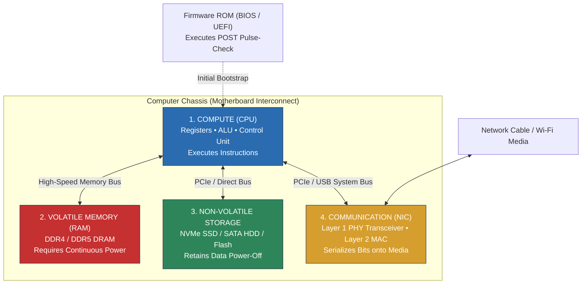

# Portland Desk Lab: The Beginner's Mental Model of a Computer

> **The Situation:** Ethan's kitchen table in East Portland • 11:30 PM with $83 in checking  
> **Your Role:** Aspiring Technician (Pre-Helpdesk, Gresham Warehouse Associate)  
> **The Objective:** Build the four physical computer building blocks (CPU, RAM, Storage, Network) and study triage reflexes so you stop guessing and start diagnosing.  
> **Estimated Time:** 45–60 minutes • Self-paced • Zero prerequisites  


---

<details class="instructor-ref">
<summary>Instructor & Certification Reference (Click to Expand)</summary>

* **Aligned Certification:** CompTIA A+ Core 1 (220-1101) & Core 2 (220-1102) Foundations
* **Exam Domains:** Core 1 Domain 2.0 (Networking) & Domain 3.0 (Hardware Triage); Core 2 Domain 1.0 (OS & CLI) & Domain 3.0 (Troubleshooting)
* **Core Competencies & Deliverables:** Computer Core Systems Matrix • Identity Triad Flow • RAM vs Disk Isolation Drill • Local vs Gateway Triage Drill • Call Your Shot 5-Case Gate • First-Contact Diagnostic Checklist

</details>


---

## 1. The Situation & Ground Truth

```callout-panel
title: "FIGURE 0.1: THE MOTHERBOARD INSPECTION"
badge: "Hardware Anatomy"
caption: "Macro technical cutaway: A desktop motherboard on an ESD workbench mat. In the foreground, three cylindrical electrolytic capacitors: two are prominently swollen and domed with dried brown electrolyte residue leaking from the vent seams, beside one healthy flat capacitor. In the background, a dual-channel memory slot holding a green RAM stick with one broken retention latch."
prompt: "Clean technical cutaway illustration in Pacific Northwest instructional manual style, crisp uniform ink linework, bright even inspection lighting, clean ESD mat background, no heavy dark shadows. Macro technical inspection shot of a desktop PC motherboard interior: in sharp foreground focus are three cylindrical electrolytic capacitors on the green PCB. Two capacitors have prominently domed, bulging silver tops with cracked score lines and dried crusty brown electrolyte residue leaking from the seam. The third capacitor is completely flat and healthy for visual contrast. Directly behind them is a dual-channel memory slot holding a green RAM module with one white plastic retention latch broken off at an angle. Crisp fine ink linework, true component colors, clean unlabeled surfaces, no text, no letters, no words. 4:3 ratio."
```


### The $500 Voucher Anxiety
To an eighteen- or nineteen-year-old working an hourly retail, staging, or warehouse job, the CompTIA A+ certification is not an abstract professional milestone; it is an immense financial gamble. 

The certification consists of two separate examinations:
- **CompTIA A+ Core 1 (220-1101):** Hardware, mobile devices, networking technology, and virtualization ($246 retail voucher fee).
- **CompTIA A+ Core 2 (220-1102):** Operating systems, security principles, software troubleshooting, and operational procedures ($246 retail voucher fee).

Together, the two vouchers total **$492**. When your bank account holds less than one hundred dollars after paying rent, failing an exam does not mean scheduling a casual retake next Tuesday. It means forfeiting two weeks of food money, gas, or rent. 

This financial terror produces a distinct cognitive pathology: **rote flashcard panic**. Stressed candidates purchase eight-hundred-page textbooks and try to memorize every noun, acronym, pin count, and cable specification as if preparing for a spelling bee. They drown in trivia—laser printer corona wires, DDR4 pinouts, and DVI connector variants—while failing to develop the mental models required to troubleshoot a machine in the real world.

### The Passport vs. the Instrument
To survive the exam without losing your mind, you must separate **the Passport** from **the Instrument**:

```
┌─────────────────────────────────────────────────────────────────────────┐
│                           THE CERTIFICATION FILTER                      │
├────────────────────────────────────┬────────────────────────────────────┤
│         THE EXAM PASSPORT          │        THE FIELD INSTRUMENT        │
│        (Red Rubber Band)           │    (Green, Yellow, Blue Bands)     │
├────────────────────────────────────┼────────────────────────────────────┤
│ • Laser printer electrophotography │ • Volatile RAM vs. Non-Volatile    │
│ • Maximum USB 3.2 cable lengths    │   Storage persistence boundaries   │
│ • DVI-D, DVI-I, VGA pin counts     │ • Layer 2 MAC vs Layer 3 IP triage │
│ • Dial-up modem AT command codes   │ • Port doorways & socket mapping   │
│ • RAM clock frequency math         │ • The CBYT diagnostic reflex       │
├────────────────────────────────────┼────────────────────────────────────┤
│ Purpose: Pass the 90-minute HR     │ Purpose: Isolate physical failures │
│ gate; dump from memory in the car. │ on a live terminal on day one.     │
└────────────────────────────────────┴────────────────────────────────────┘
```

The certification voucher buys an HR passport. But once you walk through the corporate lobby and sit at a support desk, nobody asks you how many teeth are on a printer pickup roller. They hand you a dead machine and ask: *Why can't this user reach their files?*

### The Ground Truth Rules for the Zero-to-One Technician
1. **The Machine Has No Magic:** Every computer is a physical state machine constructed of silicon, copper, and electrical current. Software cannot execute without physical registers, memory chips, and power rails. If a system behaves erratically, verify the physical foundation first.
2. **State Is Either Energized or Written:** If data lives in dynamic RAM, cutting electrical power purges it in milliseconds. If data lives on non-volatile NAND flash or magnetic platters, it survives across power cycles. Always distinguish between in-memory execution state and on-disk persistent state.
3. **Layer 2 Stays on the Wire; Layer 3 Crosses the World:** MAC addresses belong to the local Ethernet switch segment. A router never forwards a local MAC address across a wide area network. IP addresses provide the routable logical envelope that navigates across networks.
4. **Ports Are Application Doorways, Not Physical Holes:** A network port number (such as Port 80 for HTTP or Port 443 for HTTPS) is a 16-bit software identifier inside the operating system network stack. It tells the operating system which background program receives the incoming packet.
5. **Never Touch Without a Prediction (CBYT):** The amateur technician clicks random configuration buttons and reboots blindly, destroying diagnostic evidence. The professional technician forms a testable prediction before touching a single wire: *"If the default gateway is down, `ping 192.168.1.1` will fail with Request Timed Out."*


---

## 2. Technical Reference & Triage Matrix

### 2.1 The 4 Core Building Blocks of a Computer
Across microcontrollers, smartphones, enterprise servers, and industrial sorting terminals, all von Neumann digital computers consist of four immutable subsystems:



#### Detailed Subsystem Matrix

| Subsystem | Physical Medium | Volatility | Primary Operational Function | Diagnostic Indicator of Failure |
| :--- | :--- | :--- | :--- | :--- |
| **1. Compute (CPU)** | Microscopic silicon transistors, arithmetic logic units, onboard L1/L2/L3 SRAM cache. | **Volatile** (State cleared on reset). | Fetches binary machine instructions, decodes operational codes, executes arithmetic/logic calculations. | System halts instantly, power fans spin at maximum, motherboard beeps or halts at POST hex code `00`/`FF`. |
| **2. Memory (RAM)** | Dynamic Random Access Memory (DRAM) chips using microscopic transistor-capacitor pairs. | **Volatile** (Requires electrical recharge thousands of times per second; data lost on power loss). | Holds the running operating system kernel, active software execution threads, and open application working sets. | Blue Screen of Death (BSOD) with `MEMORY_MANAGEMENT`, random application crashes, POST memory beep codes (e.g., 3 long beeps). |
| **3. Storage (Disk)** | NAND flash memory floating-gate/charge-trap cells (SSDs) or spinning magnetic platters (HDDs). | **Non-Volatile** (Retains electrical charges or magnetic polarity indefinitely without power). | Preserves persistent operating system binaries, system registry hives, installed applications, and user document files. | "Operating System Not Found", SMART storage drive read/write timeouts, clicking drive sounds, file corruption errors. |
| **4. Communication (NIC)** | Integrated Ethernet controller chip, PCIe daughterboard, or Wi-Fi radio baseband transceiver. | **Mixed** (Firmware MAC is persistent; packet buffers in hardware FIFO are volatile). | Bridges the internal parallel system bus to serial physical network media (copper wire, fiber optics, radio frequencies). | "No Internet Access", link lights completely dark on RJ-45 port, self-assigned APIPA address (`169.254.x.x`), packet loss. |


---

### 2.2 The Identity Triad: MAC (L2) vs. IP (L3) vs. Port (L4)
Whenever two computers communicate across a network, they rely on a three-tier identity structure. Amateurs confuse these layers because they are hidden beneath web browser interfaces.

```
┌─────────────────────────────────────────────────────────────────────────┐
│                      THE NETWORK IDENTITY TRIAD                         │
├─────────────────┬─────────────────┬─────────────────┬───────────────────┤
│ LAYER           │ IDENTIFIER      │ ANALOGY         │ SCOPE & BEHAVIOR  │
├─────────────────┼─────────────────┼─────────────────┼───────────────────┤
│ Layer 2         │ MAC Address     │ Factory Worker  │ Local switch wire │
│ (Data Link)     │ 48-bit Physical │ ID Badge        │ only. Never hops  │
│                 │ (Hexadecimal)   │                 │ past a router.    │
├─────────────────┼─────────────────┼─────────────────┼───────────────────┤
│ Layer 3         │ IP Address      │ Apartment Unit  │ Global logical    │
│ (Network)       │ 32-bit (IPv4) / │ Mailing Address │ routing across the│
│                 │ 128-bit (IPv6)  │ (Tenant-based)  │ entire internet.  │
├─────────────────┼─────────────────┼─────────────────┼───────────────────┤
│ Layer 4         │ Port Number     │ Room Door Inside│ Internal software │
│ (Transport)     │ 16-bit Integer  │ the Apartment   │ socket directing  │
│                 │ (0 to 65,535)   │                 │ traffic to an app.│
└─────────────────┴─────────────────┴─────────────────┴───────────────────┘
```

#### Packet Encapsulation & Hop-by-Hop Transmission
When a user on Host A (`192.168.1.50`) requests a web page from Web Server B (`142.250.190.46`), data is wrapped in successive identity envelopes:

```
[ Application Data: "GET /index.html" ]
   │
   ▼
[ TCP Header: Src Port 51234, Dst Port 80 ] + [ Data ]               <-- Layer 4 (Transport)
   │
   ▼
[ IP Header: Src IP 192.168.1.50, Dst IP 142.250.190.46 ] + [ L4 ]    <-- Layer 3 (Network)
   │
   ▼
[ Ethernet Header: Src MAC Host_A, Dst MAC Gateway_Router ] + [ L3 ]   <-- Layer 2 (Data Link)
```

> **The Golden Rule of Routing:** As a packet travels across the internet, the **Source and Destination IP addresses remain constant from beginning to end**. However, the **Source and Destination MAC addresses are rewritten at every single router hop**. 
> - Host A encapsulates the IP packet inside an Ethernet frame addressed to its **Default Gateway's MAC**.
> - The router strips the incoming Ethernet frame, inspects the destination IP, consults its routing table, and encapsulates the packet into a brand-new Ethernet frame with its own outgoing MAC as the source and the next-hop router's MAC as the destination.


---

### 2.3 The First Command Line: Live System Telemetry
The graphical user interface (GUI) hides operating system mechanics. On the help desk, the command-line interface (CLI) is your primary stethoscope.

#### Command 1: `whoami`
- **What Beginners Think It Does:** Tells you your name.
- **What It Actually Does Under the Hood:** Queries the Windows Local Security Authority Subsystem Service (LSASS) or POSIX process environment to retrieve the exact user identity and Security Identifier (SID) bound to the current process security access token.
- **Help Desk Triage Role:** Determines whether a command prompt is running with restricted Standard User privileges or elevated Administrator (`NT AUTHORITY\SYSTEM`) privileges. If a command fails with "Access Denied", running `whoami` immediately verifies token rights.

```cmd
C:\> whoami
PORTLAND-CORP\emercer

C:\> whoami /priv

PRIVILEGES INFORMATION
----------------------
Privilege Name                Description                          State
============================= ==================================== ========
SeChangeNotifyPrivilege       Bypass traverse checking             Enabled
SeIncreaseWorkingSetPrivilege Increase a process working set       Disabled
```

#### Command 2: `hostname`
- **What Beginners Think It Does:** Prints a random label.
- **What It Actually Does Under the Hood:** Queries the Windows Kernel configuration registry key (`HKLM\SYSTEM\CurrentControlSet\Services\Tcpip\Parameters\Hostname`) or POSIX `uname -n` system call to output the configured NetBIOS/DNS hostname of the local node.
- **Help Desk Triage Role:** When a user calls saying "my computer is broken," you cannot help them until you identify their asset on the corporate Active Directory domain. Asking them to run `hostname` gives you the exact asset tag required for remote desktop connection (`mstsc.exe`).

#### Command 3: `ipconfig` & `ipconfig /all`
- **What Beginners Think It Does:** "Shows internet stuff."
- **What It Actually Does Under the Hood:** Interrogates the TCP/IP kernel driver (`tcpip.sys`) and Network Driver Interface Specification (NDIS) layer to output IPv4/IPv6 addresses, subnet masks, default gateways, DNS servers, and DHCP lease metadata for every bound network adapter.

```cmd
C:\> ipconfig /all

Windows IP Configuration

   Host Name . . . . . . . . . . . . : DESK-WS-014
   Primary Dns Suffix  . . . . . . . : pdx.internal.corp
   Node Type . . . . . . . . . . . . : Hybrid
   IP Routing Enabled. . . . . . . . : No

Ethernet adapter Local Area Connection:

   Connection-specific DNS Suffix  . : pdx.internal.corp
   Description . . . . . . . . . . . : Intel(R) Ethernet Connection I219-LM
   Physical Address. . . . . . . . . : 00-1A-2B-3C-4D-5E   <-- Layer 2 MAC Address
   DHCP Enabled. . . . . . . . . . . : Yes
   IPv4 Address. . . . . . . . . . . : 192.168.10.45       <-- Layer 3 IP Address
   Subnet Mask . . . . . . . . . . . : 255.255.255.0       <-- Defines Local Subnet
   Lease Obtained. . . . . . . . . . : Thursday, July 16, 2026 07:15:22 AM
   Lease Expires . . . . . . . . . . : Friday, July 17, 2026 07:15:22 AM
   Default Gateway . . . . . . . . . : 192.168.10.1        <-- Route out of Subnet
   DHCP Server . . . . . . . . . . . : 192.168.10.254
   DNS Servers . . . . . . . . . . . : 192.168.10.2
```

#### Command 4: `ping`
- **What Beginners Think It Does:** Checks if a website is up.
- **What It Actually Does Under the Hood:** Formulates an Internet Control Message Protocol (ICMP) Type 8 (Echo Request) datagram, transmits it to the destination IP address, and listens for an incoming ICMP Type 0 (Echo Reply), calculating round-trip latency in milliseconds.
- **The Systematic Ping Ladder:**
  1. `ping 127.0.0.1` (Loopback Address): Verifies local TCP/IP protocol stack integrity. Does not touch the network wire.
  2. `ping <Local_Host_IP>` (e.g., `192.168.10.45`): Verifies local NIC driver and IP binding.
  3. `ping <Default_Gateway_IP>` (e.g., `192.168.10.1`): Verifies physical cable/Wi-Fi link to local router.
  4. `ping <Remote_IP>` (e.g., `8.8.8.8`): Verifies wide area routing and internet transit.
  5. `ping <Domain_Name>` (e.g., `google.com`): Verifies Domain Name System (DNS) name resolution.


---

### 2.4 The Technician's Filter: Exam Trivia vs. Diagnostic Reality

```
┌─────────────────────────────────────────────────────────────────────────┐
│                    THE FOUR RUBBER BANDS TRIAGE MATRIX                  │
├─────────┬──────────────────────┬──────────────────────┬─────────────────┤
│ BAND    │ FOCUS                │ COMPTIA EXAM TRIVIA  │ REAL-WORLD DESK │
│ COLOR   │                      │ (MEMORIZE & DISCARD) │ DIAGNOSTIC VALUE│
├─────────┼──────────────────────┼──────────────────────┼─────────────────┤
│ RED     │ The Passport Junk    │ • Laser printer 6    │ Negligible.     │
│         │ (Arbitrary Vendor    │   electrophotographic│ Standard tickets│
│         │ Specifications)      │   cycle stages       │ replace whole   │
│         │                      │ • USB 2.0 (5m) vs    │ assemblies or   │
│         │                      │   USB 3.0 (3m) limits│ escalate to     │
│         │                      │ • DVI-D vs DVI-I pins│ vendor support. │
├─────────┼──────────────────────┼──────────────────────┼─────────────────┤
│ GREEN   │ Core Machine         │ • DDR4 288-pin vs    │ CRITICAL.       │
│         │ Anatomy (Hardware)   │   DDR3 240-pin counts│ Distinguishes   │
│         │ (Compute, Memory,    │ • CPU socket numbers │ RAM lockup from │
│         │ Storage, Bus)        │ • Form factors (ATX) │ storage failure │
│         │                      │ • POST beep codes    │ and POST abort. │
├─────────┼──────────────────────┼──────────────────────┼─────────────────┤
│ YELLOW  │ Identity &           │ • OSI 7 layers names │ CRITICAL.       │
│         │ Addressing           │ • Port numbers list  │ Distinguishes   │
│         │ (MAC, IP, Ports)     │ • IPv6 address types │ local switch    │
│         │                      │   (Link-Local, etc.) │ issues from     │
│         │                      │                      │ gateway/DNS.    │
├─────────┼──────────────────────┼──────────────────────┼─────────────────┤
│ BLUE    │ The Troubleshooting  │ • Memorize exact     │ ESSENTIAL.      │
│         │ Reflex               │   6-step CompTIA text│ Prevents panic, │
│         │ (Scientific Method)  │   definitions        │ random clicks,  │
│         │                      │                      │ and data loss.  │
└─────────┴──────────────────────┴──────────────────────┴─────────────────┘
```


---

## 3. Quick Checks & Skill Reps

### Drill 1: Volatile vs. Non-Volatile Artifact Isolation
**Scenario:** A user reports that their computer opened an unauthorized browser popup at 09:15 AM claiming their files were encrypted. The desktop background changed to a red warning screen. The user panicked, pulled the physical power cord from the wall outlet, and walked the tower down to the help desk.

```
       [ Power Pulled from Outlet (0 Volts) ]
                         │
         ┌───────────────┴───────────────┐
         ▼                               ▼
┌────────────────────────┐      ┌────────────────────────┐
│  VOLATILE MEMORY (RAM) │      │  NON-VOLATILE STORAGE  │
├────────────────────────┤      ├────────────────────────┤
│ • Injected DLLs in     │      │ • Dropped malicious EXE│
│   memory spaces        │      │   in %AppData%         │
│ • Unwritten encryption │      │ • Registry Run keys in │
│   keys in heap         │      │   HKCU / HKLM          │
│ • Active network socket│      │ • Scheduled Task XML   │
│   connections          │      │   definitions          │
├────────────────────────┤      ├────────────────────────┤
│ STATE AFTER POWER CUT: │      │ STATE AFTER POWER CUT: │
│ 100% PURGED / ZEROED   │      │ 100% INTACT & ARMED    │
└────────────────────────┘      └────────────────────────┘
```

#### Diagnostic Evaluation Questions
1. Did pulling the power plug eradicate the malware infection?
2. What vital forensic artifacts were permanently destroyed by cutting power immediately?
3. What will happen the moment you plug the power cable back in and power on the computer?

<details>
<summary>Prediction & Verification (Click to Expand)</summary>

- **Analysis 1 (Persistence vs Memory):** Pulling the plug **did not eradicate the infection**. It only cleared the volatile memory (RAM). The malware dropper almost certainly established non-volatile persistence on disk (e.g., in `HKCU\Software\Microsoft\Windows\CurrentVersion\Run`, a Scheduled Task, or a Windows Service).
- **Analysis 2 (Destroyed Evidence):** Cutting power instantly destroyed all volatile memory artifacts: active process memory dumps, unencrypted network connection sockets to the attacker's Command and Control (C2) server, and potentially the unwritten decryption keys stored in memory heap allocations.
- **Analysis 3 (Reboot Behavior):** The moment power is restored and Windows boots, the operating system reads its non-volatile registry hives, executes the persistence keys, reloads the malicious executable from disk into RAM, and re-infects the active memory space.
- **Correct Procedure:** Isolate the system physically from the network (unplug Ethernet, disable Wi-Fi) to stop C2 communication, but keep the machine powered on if live memory capture is required by security incident response protocols.
</details>


---

### Drill 2: Layer 2 vs. Layer 3 Identity (Local vs. Gateway Traffic)
**Scenario:** Examine the network configuration of Workstation A and determine how it transmits data to two different destination IP addresses:

```
[ Workstation A ]
IP: 192.168.10.45
Subnet Mask: 255.255.255.0 (/24)
Default Gateway: 192.168.10.1
MAC: 00-11-22-33-44-AA
        │
        ▼
   [ Switch ] ──────── [ Default Gateway Router: 192.168.10.1 / MAC: 00-AA-BB-CC-DD-EE ]
        │
        ├─────────────────────────────┐
        ▼                             ▼
 [ Workstation B ]             [ External Server C ]
 IP: 192.168.10.88             IP: 142.250.190.46
 MAC: 00-11-22-33-44-BB        (Outside Subnet / Internet)
```

#### Mathematical Subnet Mask Evaluation
To determine if a destination is local or remote, the host performs a bitwise **AND** calculation:

$$\text{Subnet Base} = \text{IP Address} \land \text{Subnet Mask}$$

For Workstation A ($192.168.10.45 \land 255.255.255.0$):
- Local Subnet Network ID = `192.168.10.0`

#### Destination 1: Sending to Workstation B (`192.168.10.88`)
- $192.168.10.88 \land 255.255.255.0 = 192.168.10.0$ (Matches Local Subnet!)
- Does traffic cross the Default Gateway?
- What destination MAC address appears in the Layer 2 Ethernet frame?

#### Destination 2: Sending to External Server C (`142.250.190.46`)
- $142.250.190.46 \land 255.255.255.0 = 142.250.190.0$ (Does NOT match Local Subnet!)
- Does traffic cross the Default Gateway?
- What destination MAC address appears in the Layer 2 Ethernet frame?

<details>
<summary>Prediction & Verification (Click to Expand)</summary>

- **Destination 1 (Local Host B):**
  - **Route:** Traffic is **purely local**. It does NOT cross the default gateway router.
  - **Layer 2 Framing:** Workstation A broadcasts an Address Resolution Protocol (ARP) request: *"Who has 192.168.10.88? Tell 192.168.10.45."* Host B replies with its MAC address (`00-11-22-33-44-BB`).
  - **Frame Header:** Destination MAC = `00-11-22-33-44-BB` (Host B's MAC). Destination IP = `192.168.10.88`.
- **Destination 2 (External Server C):**
  - **Route:** Traffic is **remote**. It MUST cross the default gateway router (`192.168.10.1`).
  - **Layer 2 Framing:** Workstation A checks its ARP table for the MAC of its **Default Gateway**, NOT Server C!
  - **Frame Header:** Destination MAC = `00-AA-BB-CC-DD-EE` (Default Gateway's MAC). Destination IP = `142.250.190.46` (Server C's IP).
  - **Diagnostic Implication:** If a workstation can ping its coworkers on the same switch (`192.168.10.x`) but cannot open websites on the internet, the Layer 2 local switch is operational, but the Layer 3 Default Gateway configuration is broken or unreachable.
</details>


---


### 2.3 Interactive Diagnostic Console: Live Telemetry & Triage

Use the interactive console below to test commands, inspect telemetry, and verify your troubleshooting steps.

```lnk-terminal
title: "CONSOLE: FIRST CONTACT DIAGNOSTIC TERMINAL"
shell: "cmd"
prompt: "C:\> "
replay: true
objectives:
  - id: "obj-whoami"
    label: "Identify current user context"
    trigger: "whoami"
  - id: "obj-host"
    label: "Verify machine hostname"
    trigger: "hostname"
  - id: "obj-loopback"
    label: "Test internal TCP/IP network stack"
    trigger: "ping 127.0.0.1"
  - id: "obj-ip"
    label: "Inspect active network adapter settings"
    trigger: "ipconfig"
---
whoami: |
  desktop-workbench\ethan

hostname: |
  DESKTOP-STAGE01

ping 127.0.0.1: |
  Pinging 127.0.0.1 with 32 bytes of data:
  Reply from 127.0.0.1: bytes=32 time<1ms TTL=128
  Reply from 127.0.0.1: bytes=32 time<1ms TTL=128
  
  Ping statistics for 127.0.0.1:
      Packets: Sent = 2, Received = 2, Lost = 0 (0% loss)
  [OK] Internal TCP/IP loopback stack is healthy.

ipconfig: |
  Windows IP Configuration
  
  Ethernet adapter Local Area Connection:
     Connection-specific DNS Suffix  . : 
     Link-local IPv6 Address . . . . . : fe80::d50b:8134:2e9b:4a12%12
     IPv4 Address. . . . . . . . . . . : 192.168.1.105
     Subnet Mask . . . . . . . . . . . : 255.255.255.0
     Default Gateway . . . . . . . . . : 192.168.1.1

```

---

### Quick Check 3: Call Your Shot: Predict Before You Look

*Strict Protocol:* Do not expand the verification box until you have written down your predicted failure layer, expected command output, and root cause hypothesis.
<div class="scratchpad-container">
  <div class="scratchpad-header">
    <span class="scratchpad-title">Interactive Hypothesis Scratchpad</span>
    <span class="scratchpad-save-indicator" id="save-ind-00-cbyt">Saved in browser</span>
  </div>
  <div class="scratchpad-body">
    <textarea id="notes-00-cbyt" placeholder="Type your predicted failure layer, expected command output, and root cause hypothesis here before opening solutions..."></textarea>
  </div>
  <div class="scratchpad-footer">
    <span>Private notes saved locally in your browser. Not graded.</span>
    <button type="button" class="scratchpad-copy-btn" onclick="copyScratchpad('notes-00-cbyt')">Copy Notes</button>
  </div>
</div>


#### Case 1: The Dead Screen After Moving Desks
- **Symptom:** A desktop workstation was unplugged and moved across an office floor. When connected to power and turned on, the chassis fans spin loudly, the power LED turns on, but the monitor displays "No Signal" and the motherboard emits **one long beep followed by two short beeps**.
- **Your Task:** Identify which of the 4 core components has failed, determine the layer of failure, and specify the physical action required before replacing any components.

<details>
<summary>Prediction & Verification (Click to Expand)</summary>

- **Failed Component / Layer:** Component 2/3 (Memory or Video Expansion Bus / Layer 1 Physical).
- **Diagnostic Cause:** Motherboard firmware POST beep codes indicate hardware failure during early bootstrap. One long and two short beeps on common AMI/Award BIOS configurations indicates a display adapter (GPU) or memory initialization failure. During the physical desk move, mechanical shock caused an unlatched PCIe graphics card or memory DIMM module to shift slightly in its socket.
- **Immediate Action:** Disconnect AC power, hold the power button for 20 seconds to drain flea power, open the chassis side panel, and firmly reseat the graphics card and RAM modules into their motherboard retention slots until the plastic latches click shut.
</details>


---

#### Case 2: The 169.254.x.x Ghost (APIPA Address)
- **Symptom:** After an office-wide power outage, a user reports that they cannot access network file shares or the internet. Running `ipconfig` outputs:
  ```
  IPv4 Address . . . . . . . . . . . : 169.254.88.192
  Subnet Mask  . . . . . . . . . . . : 255.255.0.0
  Default Gateway  . . . . . . . . . : 
  ```
- **Your Task:** Explain why this specific IP address exists, identify which network service has failed, and formulate a testable diagnostic test.

<details>
<summary>Prediction & Verification (Click to Expand)</summary>

- **Failed Component / Layer:** Component 4 (Network Communication / Layer 3 Logical Addressing).
- **Diagnostic Cause:** The address `169.254.x.x` with subnet mask `255.255.0.0` is an Automatic Private IP Addressing (APIPA) address assigned automatically by Windows when an adapter is configured for DHCP but fails to receive a response to its DHCP Discover broadcast requests.
- **Root Cause Hypothesis:** Following the power outage, the local workstation booted up faster than the central DHCP server or network router, causing DHCP requests to time out.
- **Test to Prove It:** Execute `ipconfig /renew`. If the DHCP server is now online, the command will update the adapter with a valid corporate IP (e.g., `192.168.10.x`). If it times out again with "Unable to contact your DHCP server," verify the physical uplink to the switch or check if the DHCP server VM is halted.
</details>


---

#### Case 3: Local Network Functional, Internet Down
- **Symptom:** A user can print to the shared office network printer at `192.168.1.200` and can ping their desk neighbor at `192.168.1.55`. However, attempting to navigate to `google.com` or pinging `8.8.8.8` returns "Destination host unreachable."
- **Your Task:** Isolate the exact network configuration parameter responsible using the Identity Triad.

<details>
<summary>Prediction & Verification (Click to Expand)</summary>

- **Failed Component / Layer:** Component 4 (Communication / Layer 3 Routing).
- **Diagnostic Cause:** The workstation successfully executes Layer 2 ARP lookups and delivers frames to hosts on its local subnet (`192.168.1.0/24`). However, it cannot deliver packets outside its subnet.
- **Root Cause:** The **Default Gateway** is either missing, configured with an incorrect IP address, or the gateway router's internal interface is offline.
- **Verification:** Run `ipconfig`. Check the Default Gateway field. If it is blank or set incorrectly (e.g., `192.168.2.1` instead of `192.168.1.1`), correct the IP configuration. If correct, ping the default gateway (`ping 192.168.1.1`) to verify router responsiveness.
</details>


---

#### Case 4: Random Freezes 15 Minutes After Boot
- **Symptom:** A computer boots cleanly into Windows, runs fine for roughly 12 to 15 minutes, and then abruptly powers off or freezes solid with no blue screen error. Touching the top of the chassis near the exhaust fan reveals intense heat.
- **Your Task:** Distinguish between a software operating system crash and a physical hardware fault. State which component is failing.

<details>
<summary>Prediction & Verification (Click to Expand)</summary>

- **Failed Component / Layer:** Component 1 (Compute / CPU Physical Thermals).
- **Diagnostic Cause:** A computer that powers off abruptly under a consistent time interval without creating an OS BSOD crash dump is tripping a physical hardware thermal protection cutoff. The CPU has exceeded its maximum operational junction temperature ($T_{\text{junc}} \approx 95^\circ\text{C}$–$100^\circ\text{C}$), and the motherboard firmware automatically cuts power to prevent silicon degradation.
- **Root Cause:** Failed CPU cooling fan, clogged heatsink cooling fins, or thermal paste that has dried out and cracked, eliminating heat transfer between the CPU heat spreader and copper heatsink.
- **Immediate Action:** Boot into BIOS/UEFI setup to observe real-time hardware health telemetry (CPU temperature monitor). Inspect CPU fan rotation; clean dust from heatsink; reapply high-grade thermal compound.
</details>


---

#### Case 5: Web Server Port Conflict
- **Symptom:** A developer installs an internal testing web server on a support workstation. The service fails to start, displaying the error: `System Error: Bind() failed on 0.0.0.0:80. Address already in use.`
- **Your Task:** Explain what "0.0.0.0:80" means in terms of Layer 4 architecture, and name the exact command used to find the conflicting program.

<details>
<summary>Prediction & Verification (Click to Expand)</summary>

- **Failed Component / Layer:** Component 4 / Layer 4 (Transport / Socket Port Binding).
- **Diagnostic Cause:** Network sockets require a unique combination of Protocol (TCP/UDP), IP Address, and Port Number. Port 80 (standard HTTP) can only be bound by a single listening process per IP address. The error indicates another background service (such as World Wide Web Publishing Service / IIS or Skype) has already bound to Port 80 on all local interfaces (`0.0.0.0`).
- **Command to Execute:**
  ```cmd
  netstat -ano | findstr :80
  ```
  This command displays the listening socket and outputs the owning **Process Identifier (PID)** in the rightmost column. You can then cross-reference the PID in Task Manager or execute `tasklist /fi "PID eq <number>"` to identify and stop the conflicting service.
</details>


---

## 4. Your Ticket Notes (What to Put in the Ticket)

<div class="scratchpad-container">
  <div class="scratchpad-header">
    <span class="scratchpad-title">Your Ticket Draft & Resolution Scratchpad</span>
    <span class="scratchpad-save-indicator" id="save-ind-00-ticket">Saved in browser</span>
  </div>
  <div class="scratchpad-body">
    <textarea id="notes-00-ticket" style="min-height: 140px;" placeholder="Draft your ticket notes, diagnosis, and resolution steps here before comparing with the reference standard below..."></textarea>
  </div>
  <div class="scratchpad-footer">
    <span>Private notes saved locally in your browser. Not graded.</span>
    <button type="button" class="scratchpad-copy-btn" onclick="copyScratchpad('notes-00-ticket')">Copy Notes</button>
  </div>
</div>

### Part A: The Beginner's Study Filter (The Four Rubber Bands)
When reviewing CompTIA A+ study objectives, use this classification template to filter syllabus noise from lasting diagnostic models:

| Exam Objective Topic | Rubber Band Category | Immediate Retention Strategy | Real-World Desk Application |
| :--- | :---: | :--- | :--- |
| **Laser Printer Drum Charging (-600V)** | **RED** | Flashcard cram 48 hours prior to test; discard post-exam. | None. Printers receive vendor depot repair or toner replacement. |
| **Volatile RAM vs Non-Volatile NVMe SSD** | **GREEN** | Deep conceptual schema; diagram bus connections. | Core triage: Determines if reboots wipe state or if disk persistence exists. |
| **MAC Address vs Routable IP Address** | **YELLOW** | Trace packet encapsulation through switches and routers. | Essential: Solves 80% of office connectivity and gateway tickets. |
| **Port Numbers (22 SSH, 80 HTTP, 443 HTTPS)** | **YELLOW** | Flashcard drill combined with `netstat -ano` verification. | Firewall rule analysis, service socket debugging, URL routing. |
| **The 6-Step CompTIA Troubleshooting Model** | **BLUE** | Memorize formal terms for exam; practice CBYT in labs. | Prevents random guessing and unverified ticket closures. |


---

### Part B: First-Contact Diagnostic Checklist
Use this standardized intake checklist when logging and triaging your first live support ticket:

```
========================================================================================
FIRST-CONTACT DIAGNOSTIC INTAKE WORKSHEET · TIER 1 SUPPORT
========================================================================================
TICKET REF   : T1-INIT-2026-001             DATE/TIME : 2026-07-16 09:30 PDT
TECHNICIAN   : Ethan Mercer                 STATUS    : UNDER INVESTIGATION
USER NAME    : ____________________________ ASSET TAG : _______________________________

1. SUBSYSTEM ISOLATION (Which core component is failing?):
   [ ] Component 1: COMPUTE (CPU / Thermal / Hardware freeze / Instant shutdown)
   [ ] Component 2: MEMORY (RAM / BSOD / Application memory crash)
   [ ] Component 3: STORAGE (Disk / Boot failure / File corruption)
   [ ] Component 4: COMMUNICATION (NIC / Network / Switch / Gateway / DNS)

2. LAYER TRIAGE & IDENTITY CHECK:
   [ ] Physical (Layer 1): Link lights lit on NIC? Power LEDs on? Cables seated?
   [ ] Data Link (Layer 2): Valid MAC address visible in `getmac`? Local ARP resolving?
   [ ] Network (Layer 3): Valid IP assigned? Subnet mask correct? APIPA detected?
   [ ] Transport (Layer 4): Expected port open in `netstat -ano`? Port conflict?

3. THE FIVE-STEP PING LADDER (Execute in sequence):
   - Step 1: `ping 127.0.0.1`          [ ] PASS   [ ] FAIL (TCP/IP stack corrupted)
   - Step 2: `ping <Host_IP>`          [ ] PASS   [ ] FAIL (NIC driver / binding fault)
   - Step 3: `ping <Gateway_IP>`       [ ] PASS   [ ] FAIL (Local switch / cable broken)
   - Step 4: `ping 8.8.8.8`            [ ] PASS   [ ] FAIL (Internet route down)
   - Step 5: `ping google.com`         [ ] PASS   [ ] FAIL (DNS name resolution down)

4. COMMIT BEFORE YOU TOUCH (CBYT) HYPOTHESIS:
   - Proposed Theory of Cause: _________________________________________________________
   - Verification Test (How to prove it): ____________________________________________________
   - Predicted Test Result If True: ___________________________________________________

5. VERIFICATION & DOCUMENTATION:
   - Action Taken: _____________________________________________________________________
   - System Functionality Verified: [ ] YES  [ ] NO
   - Preventative Advice Given to User: _______________________________________________
========================================================================================
```


---

## 5. What Good Looks Like (Shift Quality Checklist)

Before closing your intake checklist and logging your initial ticket notes, verify your performance against the Portland Desk Shift Quality Standard:

### Shift Quality Checklist
* [ ] **Physical Layer Verification:** Power rails, link carrier LEDs, and hardware integrity confirmed before software changes.
* [ ] **Identity Triad Isolated:** MAC address, IP address, and port number cleanly distinguished in diagnostic notes.
* [ ] **CBYT Hypothesis Formulated:** Testable failure theory committed to writing before issuing commands or touching hardware.
* [ ] **Sequential Ping Ladder:** Diagnostic pings executed in strict hierarchy (Loopback $\rightarrow$ Local Host $\rightarrow$ Default Gateway $\rightarrow$ Remote IP $\rightarrow$ DNS Hostname).
* [ ] **Actionable User Guidance:** Root cause communicated without jargon, and preventative advice documented in ticket closure notes.

---

### Shift Grading Rubric

Use this objective scoring guide to evaluate entry-level diagnostic performance across four core competencies:

| Competency Area | Points | Criteria for Full Credit (Pass) | Criteria for Partial Credit | Criteria for Zero Credit (Fail) |
| :--- | :---: | :--- | :--- | :--- |
| **1. Component Identification** | **25** | Correctly distinguishes between volatile memory (RAM) and non-volatile persistence (storage); explains why rebooting purges memory state but preserves disk persistence. | Identifies RAM as memory but cannot articulate volatility implications during an active infection or crash. | Confuses RAM with disk storage capacity (e.g., "I need more RAM to save my photos"). |
| **2. Layer Isolation & Identity** | **25** | Accurately explains why MAC addresses are stripped at the default gateway while IP addresses persist; calculates whether an IP is local or remote using the subnet mask. | Understands MAC vs IP roles but fails to explain what happens to Layer 2 frames at a router boundary. | Believes MAC addresses route across the internet; unable to define default gateway purpose. |
| **3. Command Telemetry Literacy** | **25** | Correctly interprets outputs from `whoami`, `hostname`, `ipconfig /all`, and `netstat`; identifies an APIPA address (`169.254.x.x`) as a DHCP failure. | Runs command-line tools but requires assistance interpreting subnet masks or process identifier (PID) outputs. | Relies solely on GUI menus; cannot interpret command-line network configuration outputs. |
| **4. Diagnostic Discipline (CBYT)** | **25** | Formulates a clear, testable prediction before altering any hardware or software setting; follows the structured 5-step ping ladder sequentially. | Troubleshoots methodically but occasionally reboots or alters configurations without stating a hypothesis. | Clicks random settings, reboots frantically, or replaces hardware components without testing. |
| **TOTAL** | **100** | **Passing Score: 85 Points or higher** | | |

---

## 6. The Shift Resolution & Epilogue: 02:15 AM

```callout-panel
title: "FIGURE 0.2: THE MIDNIGHT BENCH & FIRST WORKING VOUCHER"
badge: "Shift Epilogue"
caption: "Kitchen table bench: At 02:15 AM, Ethan categorizes his final index card into the Green Band stack while his father inspects the re-soldered power connector on the practice chassis."
prompt: "Grounded graphic novel illustration in Pacific Northwest silicon noir style, cool slate blue and rain-slicked dark grey palette (#0f172a, #1e293b). A quiet duplex kitchen at night under a low pendant lamp. A 19-year-old apprentice sits at a Formica table with four stacks of index cards held by colored rubber bands. Beside him, an older retired machinist in work socks inspects a dismantled PC power supply on a newspaper mat. Rain streaks the dark kitchen window. High contrast, atmospheric, no text, no words. 16:9 ratio."
```

*The following operational debrief records Ethan's transition from exam anxiety to diagnostic discipline:*

The kitchen clock clicked over to 2:15 AM. Outside the casement window, the East Portland rain tapped steadily against the glass.

On the Formica table, the mountain of loose flashcards had disappeared. In their place sat four neat, compact bundles, each bound by a thick colored rubber band: Red for syllabus trivia, Green for machine invariants, Yellow for addresses and ports, and Blue for the troubleshooting reflex.

My father stood by the sink, rinsing his water glass. He dried his hands on a dishtowel and walked over to the table, looking down at the four sorted stacks. He picked up the Green bundle, feeling the thickness of the cards.

"What holds tension?" he asked quietly.

"Volatile memory loses state when the circuit opens," I answered, looking up from the table. "Non-volatile storage holds the magnetic or charge state until you write over it. The bus bridges them, and the processor steps the clock."

My dad set the stack back down in line with the others. A faint, knowing smile touched the corner of his mouth.

"That's a machine," he said. "The rest is just part numbers in a catalog. Get some sleep, Ethan. The warehouse doesn't care how late you studied when the six o'clock bell rings."

Three weeks later, on a gray Thursday morning in Beaverton, I sat in front of the testing center monitor with my palms flat on the laminate desk. When the scoring engine finalized the results, the screen didn't show perfection—it showed a 685. A passing score by ten points. Scraped by on the retake, but the paper certificate was real, and it bought my ticket onto the graveyard maintenance rotation at the Gresham cross-dock.
