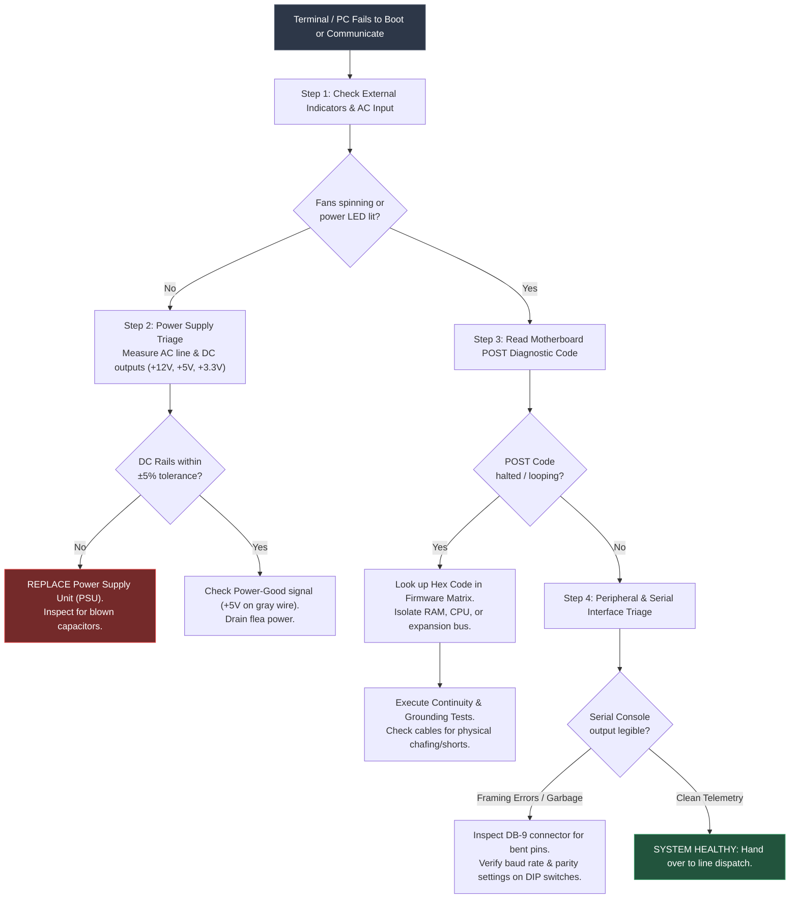

# Portland Desk Lab: Hardware Fault Isolation & Layer 1 Diagnostics

> **The Situation:** Harrowmere Gresham Distribution Warehouse • Graveyard shift, industrial staging floor  
> **Your Role:** Tier 1 Field / Hardware Bench Technician  
> **The Objective:** Isolate hardware faults and Layer 1 physical failures on an automated shipping scale terminal before the 5:00 AM dispatch.  
> **Estimated Time:** 40–50 minutes • Hardware Diagnostics  


---

<details class="instructor-ref">
<summary>Instructor & Certification Reference (Click to Expand)</summary>

* **Aligned Certification:** CompTIA A+ Core 1 (220-1101) & Network+ (N10-008/009)
* **Exam Domains:** A+ Core 1 Domain 3.1 (Motherboard, RAM, CPU, Power) & 3.4 (Peripherals & Serial); Network+ Domain 5.2 (Physical Layer 1 Connectivity)
* **Core Competencies & Deliverables:** Physical Diagnostic Flow • POST Code Triage Matrix • ATX Power Supply Voltage Drill • RS-232 Serial Framing Drill • Call Your Shot 5-Case Gate • Tier 1 Physical Passdown Note

</details>


---

## 1. The Situation & Ground Truth

### The Situation
It is 02:30 on an overcast Thursday morning inside the high-bay cross-dock terminal in Gresham, Oregon. Heavy metal-halide lamps buzz forty feet overhead, battery chargers for electric forklifts hum against the corrugated metal wall, and the cold ambient air smells of diesel fumes and damp cardboard. 

At 02:24, Sorting Line 4 halted without warning. The in-line Toledo weigh deck stopped communicating weight measurements to the automated sorting computer, triggering an immediate line shutdown. Over two hundred cartons are now stacking up on the gravity intake rollers every ten minutes. Five cross-dock tractor-trailers bound for Seattle and Boise must depart loading bays 7 through 9 by 05:00 AM sharp to meet regional distribution contracts. Shift Supervisor Ken calculates downtime penalties at thousands of dollars per hour.

You are equipped with a digital multimeter, basic hand tools, vendor technical manuals, and an eight-position DIP switch reference chart. You do not have the luxury of swapping random components; every diagnostic action must isolate a specific physical variable.

```
       [ Intake Gravity Rollers ]
                   │
                   ▼
       ┌────────────────────────┐
       │ In-Line Toledo Weigh   │──────[ Shielded DB-9 RS-232 Cable ]──────┐
       │ Deck (42.8 lbs load)   │                                          │
       └────────────────────────┘                                          ▼
                   │                                          ┌────────────────────────┐
                   ▼                                          │ Industrial SBC Terminal│
       ┌────────────────────────┐                             │ (NEMA 4X Steel Cabinet)│
       │ Pneumatic Diverter Gate│◄─────[ Digital I/O Bus ]────│  - AMI BIOS Hex POST   │
       │ (Bay 7 vs Bay 9 Route) │                             │  - SW1 DIP Switch Bank │
       └────────────────────────┘                             └────────────────────────┘
```

### The Ground Truth Rules of Hardware Triage
1. **Layer 1 First, Always:** Before touching firmware, drivers, operating system services, or application configurations, verify physical Layer 1 integrity. A severed conductor, a shorted chassis trace, a bent pin, or a loose power molex connector mimics software failure every time.
2. **Make a Testable Prediction ("Commit Before You Touch"):** Never power-cycle or alter hardware settings out of nervous action bias. State explicitly: *"If the 12V power rail has failed, my multimeter will read under 11.40V DC across the yellow wire."* Measure to test the hypothesis; do not guess.
3. **Power Rails Have Tight Operating Tolerances:** Digital logic and high-draw motor controllers require clean, tightly regulated DC power. Standard ATX specifications mandate a strict $\pm 5\%$ tolerance on positive rails (+12V, +5V, +3.3V). A 12V line sagging to 10.2V will cause erratic system freezes, spontaneous restarts, and bus corruption.
4. **Serial Transmission Is Hard Real-Time Timing:** Asynchronous RS-232 communication contains no shared hardware clock wire. Both endpoints must agree identically on symbol timing (baud rate), data word length, parity checking, and stop framing bits (e.g., 9600 8-N-1). A mismatch guarantees immediate framing errors and unintelligible hex garbage.
5. **Bleed Flea Power Before Physical Probing:** Switching power supply filter capacitors store lethal voltage and residual charge ("flea power") long after AC power is disconnected. Flea power can lock motherboard embedded controllers in an unbootable reset loop. Always disconnect AC mains and press the chassis power switch for twenty seconds to drain capacitors to zero before inspecting or servicing circuit boards.


---

## 2. Technical Reference & Triage Matrix

### 2.1 Hardware Fault Diagnostic Flow

When an industrial workstation or embedded terminal fails to complete initialization, execute this systematic diagnostic sequence:




---

### 2.2 Motherboard POST Code Lookup Table (Phoenix / AMI BIOS)

Motherboard firmware writes diagnostic progress bytes to I/O port `80h` during the Power-On Self-Test (POST). On industrial single-board computers (SBCs) and diagnostic PCI/PCIe cards, these appear on a dual-digit seven-segment LED display.

| Hex Code | Subsystem Stage | Firmware Operation / Check | Root Cause of Failure | Immediate Field Triage Action |
| :---: | :--- | :--- | :--- | :--- |
| **`00` / `FF`** | CPU & Core Power | CPU execution has not started. Reset line held low or clock generator inactive. | Power supply `Power-Good` wire dead ($< 4.75\text{V}$), blown VRM capacitor, or CPU not seated. | Test gray wire for $+5\text{V}$ PG signal. Measure CPU Vcore rail. Inspect socket for bent pins. |
| **`C1`** | Memory Detection | Early chipset memory detection and SPD EEPROM read over SMBus. | RAM module unseated due to vibration; damaged memory socket pin; or bus line grounded. | Reseat memory stick into slot A1. Inspect DIMM edge contacts for oxidation. Verify $+3.3\text{V}$ logic supply. |
| **`D3`** | Memory Relocation | Transitioning from cache-as-RAM to system DRAM memory architecture. | Defective memory cell in lower 64KB base RAM; timing mismatch between dual sticks. | Swap to known-good single memory module. Clear CMOS settings to reset memory controller latches. |
| **`E0`** | Expansion Bus Init | Initializing local system bus, PCI/ISA bridging, and peripheral interrupt lines. | Short circuit on address/data bus lines; chafed ribbon cable grounding bus pin to steel frame. | Disconnect all peripheral ribbon cables. Measure resistance to chassis ground on address/data pins. |
| **`2A`** | Video Controller | Initializing primary display adapter and video BIOS ROM extension. | PCI/VGA daughtercard unseated; auxiliary $+12\text{V}$ GPU power lead disconnected. | Reseat display adapter. Inspect video interface cable for crushed pins or broken signal ground. |
| **`45`** | Storage / Controller | Enumerating IDE, SATA, or embedded flash storage devices. | Defective drive controller; crushed 40-pin IDE ribbon cable; failing $+5\text{V}$ drive motor rail. | Disconnect storage cable. Verify drive spins up without head clicking sounds. Replace data ribbon. |
| **`7F`** | POST Hand-Off | POST routines complete; firmware executing `INT 19h` boot loader bootstrap. | Non-bootable storage medium; corrupted Master Boot Record (MBR); missing partition table. | Enter BIOS setup. Confirm boot order lists primary system storage. Check storage interface health. |


---

### 2.3 RS-232 Serial Interface Pinout (DB-9 Standard)

The RS-232 standard defines asynchronous serial data communications between Data Terminal Equipment (DTE, such as the computer) and Data Circuit-Terminating Equipment (DCE, such as the scale head or modem).

```
        DB-9 Male Connector (Front View)
          ┌───────────────────────┐
          \  [1]  [2]  [3]  [4]  [5]  /
           \   [6]  [7]  [8]  [9]   /
            └─────────────────────┘
```

| Pin # | Signal Name | Full Name | Direction (DTE / PC) | Industrial Function | Typical Fault Symptom If Broken |
| :---: | :---: | :--- | :---: | :--- | :--- |
| **1** | **DCD** | Data Carrier Detect | Input $\leftarrow$ DCE | Signals that scale/modem hardware carrier is active. | Software reports *Device Not Attached* or port timeout. |
| **2** | **RxD** | Receive Data | Input $\leftarrow$ DCE | Carries serial weight measurement telemetry into computer. | Console displays zero data or continuous framing errors if bent/shorted. |
| **3** | **TxD** | Transmit Data | Output $\rightarrow$ DCE | Sends tare commands and calibration queries from computer to scale. | Scale fails to tare or zero out; does not respond to computer polling. |
| **4** | **DTR** | Data Terminal Ready | Output $\rightarrow$ DCE | Informs the scale that computer serial UART is powered and active. | Scale stays in standby mode, refusing to stream continuous data. |
| **5** | **GND** | Signal Ground | Common | Electrical reference ground ($0\text{V}$) for all signal lines. | Floating ground produces wild voltage swings, dropped bytes, and hex garbage. |
| **6** | **DSR** | Data Set Ready | Input $\leftarrow$ DCE | Informs computer that scale electronics have completed self-test. | Communication daemon hangs awaiting hardware handshake. |
| **7** | **RTS** | Request to Send | Output $\rightarrow$ DCE | Hardware flow control: computer signals it has buffer space to receive. | Scale pauses transmission indefinitely; buffer overflow. |
| **8** | **CTS** | Clear to Send | Input $\leftarrow$ DCE | Hardware flow control: scale signals it is ready to receive data. | Outbound commands queue up indefinitely in operating system buffer. |
| **9** | **RI** | Ring Indicator | Input $\leftarrow$ DCE | Legacy modem signal (rarely connected in industrial scales). | Unused in standard scale telemetry; normally left floating. |


---

### 2.4 Power Supply Voltage Rails & Tolerances

A digital switching power supply (SMPS) delivers multiple direct-current (DC) voltage rails to power different subsystems of the computer. The ATX specification defines a strict $\pm 5\%$ operating tolerance limit for positive rails:

$$\text{Allowable Range} = V_{\text{nominal}} \pm (V_{\text{nominal}} \times 0.05)$$

| Rail Name | Standard Wire Color | Nominal Voltage | Minimum Voltage ($-5\%$) | Maximum Voltage ($+5\%$) | Primary Subsystem Powered | Symptoms of Undervoltage / Sag |
| :---: | :---: | :---: | :---: | :---: | :--- | :--- |
| **$+12\text{V}$** | **Yellow** | $+12.00\text{V}$ | **$+11.40\text{V}$** | **$+12.60\text{V}$** | CPU Voltage Regulator Modules (VRM), cooling fans, mechanical drive spindle motors. | Spontaneous reboots during heavy CPU load; drive motor spin-down clicks; system freeze. |
| **$+5\text{V}$** | **Red** | $+5.00\text{V}$ | **$+4.75\text{V}$** | **$+5.25\text{V}$** | Motherboard logic chipsets, legacy expansion cards, optical drive logic, USB ports. | Memory address corruption; USB disconnect storms; POST halts during chipset bus enumeration. |
| **$+3.3\text{V}$** | **Orange** | $+3.30\text{V}$ | **$+3.135\text{V}$** | **$+3.465\text{V}$** | Modern DDR3/DDR4 SDRAM memory modules, PCIe slot logic, onboard microcontroller pins. | Memory bit flips; intermittent Blue Screens of Death (BSOD); POST halt code `C1`/`D3`. |
| **$+5\text{VSB}$** | **Purple** | $+5.00\text{V}$ | **$+4.75\text{V}$** | **$+5.25\text{V}$** | Standby power circuitry, real-time clock (RTC), power button monitor, Wake-on-LAN. | System completely unresponsive to power switch toggle; motherboard power indicator LED dark. |
| **`PWR_OK`** | **Gray** | $+5.00\text{V}$ | **$+4.75\text{V}$** | **$+5.25\text{V}$** | "Power Good" logic signal sent to CPU once all internal rails stabilize. | Fans spin continuously at 100% RPM but system never executes first BIOS instruction (POST `00`). |


---

## 3. Quick Checks & Skill Reps

### Drill 1: Power Supply Voltage Rails & Multimeter Load Diagnostics

#### The Operational Scenario
At 02:45, an auxiliary dispatch terminal on loading dock 2 refuses to boot. The technician suspects the power supply is dead. You arrive with a digital multimeter (DMM) to evaluate whether the power supply requires immediate replacement before ordering a replacement motherboard.

#### Diagnostic Procedure
1. Disconnect the 24-pin ATX power harness from the motherboard.
2. Perform the manual PSU jump test: connect a conductive paperclip between **Pin 16 (Green wire: `PS_ON#`)** and any adjacent **Ground pin (Black wire: `COM`)**.
3. Plug the PSU into AC line power and flip the rocker switch to ON. The cooling fan begins spinning.
4. Set the multimeter to **DC Volts ($V\text{=}$)** on the $20\text{V}$ manual range.
```callout-panel
title: "FIGURE 1.2: ATX 24-PIN BACKPROBE VOLTAGE DIAGNOSTIC"
badge: "Hardware Telemetry"
caption: "Diagnostic schematic: Ethan's multimeter backprobes Pin 10 (Yellow +12VDC rail) while mated to the industrial single-board computer under active load. Nominal ATX spec requires 11.40V - 12.60V."
prompt: "Dramatic close-up isometric view in Pacific Northwest silicon noir style, high contrast hard black ink lines, cross-hatching, moody warehouse lighting, cool slate blue and rain-slicked dark grey palette (#0f172a, #1e293b). A technician's oil-stained hands wearing canvas work gloves with fingertips cut off, holding high-precision Fluke multimeter needle probes. The red needle probe is backprobing Pin 10 (Yellow +12VDC wire) of a mated ATX 24-pin motherboard power harness inside a scarred NEMA industrial steel cabinet. The black probe is clipped to a zinc ground bolt on the unpainted chassis frame. Multimeter LCD displays crisp amber numbers: 10.84 V. In the blurred background: high-bay warehouse metal-halide lamps, stacked wooden pallets, and an amber warning beacon flashing."
```

```
[DMM Multimeter Probing Display]
Probe Target           Measured Value    Status Calculation                  Diagnosis
──────────────────────────────────────────────────────────────────────────────────────────
Pin 10 (Yellow +12V)   10.22 V DC        -14.8% (Target: 11.40V - 12.60V)    CRITICAL UNDERVOLTAGE
Pin 4  (Red +5V)       5.04 V DC         +0.8%  (Target: 4.75V - 5.25V)      IN TOLERANCE
Pin 1  (Orange +3.3V)  3.29 V DC         -0.3%  (Target: 3.135V - 3.465V)    IN TOLERANCE
Pin 8  (Gray PWR_OK)   1.45 V DC         -71.0% (Target: 4.75V - 5.25V)      LOGIC LOW (TRIPPED)
```

#### Diagnostic Evaluation
- **Analysis:** While the $+5\text{V}$ and $+3.3\text{V}$ rails show nominal output, the primary $+12\text{V}$ yellow rail is severely depressed at $10.22\text{V}$ (well below the $11.40\text{V}$ cutoff limit). In response to the unstable 12V rail, the internal supervisory IC dropped the `PWR_OK` gray wire to $1.45\text{V}$. 
- **Action:** Replace the power supply unit immediately. Do not attempt to boot the computer; undervoltage on the 12V rail starves the CPU voltage regulators and damages storage drive spindle motors.


---

### Drill 2: Asynchronous Serial Communications & Baud Rate Calculation

#### The Physics of Serial Framing (8-N-1 Standard)
In asynchronous RS-232 serial transmission, the data line idles in the **MARK** state (logical 1, represented physically by $-3\text{V}$ to $-12\text{V}$). When a byte is sent, the transmitter pulls the line to the **SPACE** state (logical 0, represented physically by $+3\text{V}$ to $+12\text{V}$) for exactly one symbol period, creating the **Start Bit**.

The receiver's UART detects this falling transition, starts an internal timer, and samples the line state at the exact midpoint of each subsequent bit cell.

```
RS-232 Asynchronous Frame Structure (8-N-1):
───┐       ┌───────┬───────┬───────┬───────┬───────┬───────┬───────┬───────┐   ┌───────
   │ Start │ Bit 0 │ Bit 1 │ Bit 2 │ Bit 3 │ Bit 4 │ Bit 5 │ Bit 6 │ Bit 7 │ P │ Stop  
   └───────┴───────┴───────┴───────┴───────┴───────┴───────┴───────┴───────┘   └───────
   ◄──────────────────────── 10 Total Bit Times ──────────────────────────────►
```

#### Symbol Timing Math
The duration of each bit cell ($T_{\text{bit}}$) is the mathematical inverse of the baud rate:

$$T_{\text{bit}} = \frac{1}{\text{Baud Rate}}$$

$$\text{Frame Duration} = T_{\text{bit}} \times (\text{Start Bits} + \text{Data Bits} + \text{Parity Bits} + \text{Stop Bits})$$

For standard **8-N-1** transmission (1 start bit + 8 data bits + 0 parity bits + 1 stop bit = 10 bits per character):

| Baud Rate | Single Bit Duration ($T_{\text{bit}}$) | Total 10-Bit Frame Time ($T_{\text{frame}}$) | Max Characters Per Second |
| :---: | :---: | :---: | :---: |
| **$2400$ Baud** | $\frac{1}{2400} \approx 416.67\,\mu\text{s}$ | $4.167\,\text{ms}$ | $240\,\text{char/sec}$ |
| **$9600$ Baud** | $\frac{1}{9600} \approx 104.17\,\mu\text{s}$ | $1.042\,\text{ms}$ | $960\,\text{char/sec}$ |
| **$19200$ Baud** | $\frac{1}{19200} \approx 52.08\,\mu\text{s}$ | $0.521\,\text{ms}$ | $1920\,\text{char/sec}$ |
| **$115200$ Baud** | $\frac{1}{115200} \approx 8.68\,\mu\text{s}$ | $0.087\,\text{ms}$ | $11520\,\text{char/sec}$ |

#### The Baud Rate Mismatch Pathology
When the Toledo scale transmits at **9600 baud** ($T_{\text{bit}} = 104.17\,\mu\text{s}$) but the terminal UART is configured for **19200 baud** ($T_{\text{bit}} = 52.08\,\mu\text{s}$):
1. The receiving terminal expects each bit to arrive twice as fast as it is actually sent.
2. The terminal samples the line at $26\,\mu\text{s}$ (reading the Start Bit), then at $78\,\mu\text{s}$ (still sampling the Start Bit!), then at $130\,\mu\text{s}$ (sampling Bit 0).
3. By the time the terminal reaches its expected Stop Bit at $520.8\,\mu\text{s}$, the transmitter is only halfway through transmitting Data Bit 4!
4. If Data Bit 4 happens to be low (logical 0 / SPACE), the receiver fails to see the required Stop Bit mark condition.
5. The UART immediately triggers a **Hardware Framing Error (`FE`)**, discards the corrupted character, and outputs random ASCII symbols (`?`, `~`, `\x00`, `\xFE`) onto the console.

```
Transmitter (9600 Baud):
[ Start: 104µs ][ Bit 0: 104µs ][ Bit 1: 104µs ][ Bit 2: 104µs ][ Bit 3: 104µs ][ Bit 4: 104µs ]
Receiver (19200 Baud):
[S:52µs][B0:52µs][B1:52µs][B2:52µs][B3:52µs][B4:52µs][B5:52µs][B6:52µs][B7:52µs][STOP:52µs]
                                                                                  ▲
                                                                          FRAMING ERROR!
```


---

### 2.3 Interactive Terminal: Live Serial Console & Clock Divider Triage

Use the interactive serial console below to inspect the Toledo scale telemetry feed on `COM1` (`/dev/ttyS0`), check the current hardware UART clock divider, and identify the baud rate desynchronization causing framing errors.

```lnk-terminal
title: "CONSOLE: TOLEDO SCALE INTERFACE (COM1 /dev/ttyS0)"
shell: "serial"
prompt: "SCALE_04# "
replay: true
objectives:
  - id: "obj-status"
    label: "Inspect UART interface status and error counts"
    trigger: "status"
  - id: "obj-dips"
    label: "Inspect SW1 DIP switch hardware clock divider"
    trigger: "read-dips"
  - id: "obj-baud"
    label: "Recalibrate baud rate clock divider to 9600"
    trigger: "set-baud 9600"
---
status: |
  Interface: COM1 (RS-232 Asynchronous)
  Hardware Address: 0x03F8 (IRQ 4)
  Baud Rate: 19200
  Data Bits: 8 | Parity: None | Stop Bits: 1 (8-N-1)
  Interface Status: DSR=ON, CTS=ON, Carrier=DETECTED
  Packet Diagnostics:
    - Bytes Received: 14,892
    - Framing Errors (FE): 14,892 (100% CORRUPTION)
    - Buffer Contents: "\xFE\x00???\xFE\x12??~~\x00\xFF"
  Warning: Framing rate desynchronized. Clock frequency exceeds sender symbol duration.

read-dips: |
  Motherboard Sub-Plate: DIP Switch Bank SW1 Status
  [SW1-1: ON ] - Controller Bus Address: 0x01
  [SW1-2: ON ] - Termination Resistor: 120 Ohm ENABLED
  [SW1-3: ON ] - Clock Divider Prescaler A: 2x (19200 Baud)
  [SW1-4: OFF] - Clock Divider Prescaler B: 1x (9600 Baud)
  Diagnostics: Switch 3 is ON, locking the UART receiver to 19200 baud.
  Scale transmitter hardware is calibrated for 9600 baud.
  Action Required: Set Switch 3 OFF, Switch 4 ON.

set-baud 9600: |
  Executing clock divider adjustment:
  Strapping SW1-3 -> OFF, SW1-4 -> ON...
  UART Master Clock Divider set to: 12 (115200 / 12 = 9600 Baud)
  Bit Duration recalibrated: 104.17 microseconds per bit cell.
  Restarting Toledo polling daemon...
  
  [OK] Carrier Lock Established.
  [OK] Framing Errors: 0 / 1000 packets.
  Stream Telemetry:
  SCALE_04: READY - 042.8 LBS - DIVERTER NORMAL
  SCALE_04: READY - 043.1 LBS - DIVERTER NORMAL
  SCALE_04: READY - 042.5 LBS - DIVERTER NORMAL

test-telemetry: |
  Polling Toledo Model 8520 Scale Head...
  Raw Serial Stream:
  02 30 34 32 2E 38 20 4C 42 53 0D 0A
  Parsed Decimal: 042.8 LBS (Gross Weight)
  Status: NORMAL (Within 250 lb conveyor limit)
```


---

### Quick Check 3: Call Your Shot: Predict Before You Look

*Strict Protocol:* Do not expand the verification box until you have written down your predicted layer of failure, expected diagnostic measurement, and immediate corrective action.
<div class="scratchpad-container">
  <div class="scratchpad-header">
    <span class="scratchpad-title">Interactive Hypothesis Scratchpad</span>
    <span class="scratchpad-save-indicator" id="save-ind-01-cbyt">Saved in browser</span>
  </div>
  <div class="scratchpad-body">
    <textarea id="notes-01-cbyt" placeholder="Type your predicted failure layer, expected command output, and root cause hypothesis here before opening solutions..."></textarea>
  </div>
  <div class="scratchpad-footer">
    <span>Private notes saved locally in your browser. Not graded.</span>
    <button type="button" class="scratchpad-copy-btn" onclick="copyScratchpad('notes-01-cbyt')">Copy Notes</button>
  </div>
</div>


#### Case 1: Motherboard Halts at Hex POST `C1` After Line Relocation
- **Observed Symptom:** A sorting terminal was relocated across the facility. On first power-up, the fans spin at maximum speed, the screen remains completely dark, and the onboard two-digit diagnostic LED freezes on code `C1`.
- **Your Task:** Identify the failed subsystem, state the predicted physical fault, and determine the exact physical action required.

<details>
<summary>Prediction & Verification (Click to Expand)</summary>

- **Failure Layer:** Layer 1 (Physical / Memory Interface).
- **Subsystem:** Primary System RAM (DDR SO-DIMM / UDIMM).
- **Root Cause:** POST code `C1` indicates early memory presence detection failure. During mechanical transport or vibration, the memory module was unseated from its socket latches, or oxidation/dust contaminated the gold edge contacts.
- **Physical Action:** Disconnect AC power, discharge flea power by holding the power button for 20 seconds. Release memory retention clips, extract RAM module, inspect edge contacts, clean with isopropyl alcohol if oxidized, and firmly reseat into primary memory Channel A (Slot 1) until both side clips click shut.
</details>


---

#### Case 2: Multimeter Measures 10.15V on the +12V Yellow Wire
- **Observed Symptom:** A barcode scanning station randomly freezes whenever the conveyor belt motor starts. Probing the 4-pin peripheral Molex power connector with a multimeter reveals that the Yellow lead reads $12.05\text{V}$ at idle, but plummets to $10.15\text{V}$ the moment the motor engages.
- **Your Task:** Evaluate the voltage tolerance percentage, identify why the system locks up, and formulate the corrective action.

<details>
<summary>Prediction & Verification (Click to Expand)</summary>

- **Failure Layer:** Layer 1 (Power Distribution / Electrical Regulation).
- **Tolerance Calculation:** 
  $$\text{Tolerance Drop} = \frac{10.15 - 12.00}{12.00} \times 100\% = -15.42\%$$
- **Root Cause:** The $+12\text{V}$ rail exceeds the allowable $\pm 5\%$ ATX tolerance ($11.40\text{V}$ minimum). The sudden voltage sag is caused by either aging/swollen electrolytic capacitors in the power supply unable to handle inductive motor startup spikes, or the terminal is sharing a branch circuit with high-draw three-phase industrial motors without an online double-conversion UPS.
- **Physical Action:** Replace the failing power supply unit. Move the sensitive computing terminal to an isolated voltage-regulating uninterruptible power supply (UPS) to protect it from line-voltage brownouts caused by industrial motor starts.
</details>


---

#### Case 3: Serial Console Cascades Inverted Question Marks and Framing Errors
- **Observed Symptom:** An automated dimensioning scanner connected via RS-232 serial outputs continuous streams of `` and `0xFE 0x00` characters across the terminal screen whenever a parcel passes the photo-eye.
- **Your Task:** Predict the exact communication parameter mismatch and explain the underlying mechanism.

<details>
<summary>Prediction & Verification (Click to Expand)</summary>

- **Failure Layer:** Layer 1 / 2 (Asynchronous Physical Framing & Clock Synchronization).
- **Root Cause:** Baud Rate Mismatch. The peripheral sensor is transmitting at 9600 baud, while the receiving computer UART is clocked at 19200 baud (or vice versa). Because the receiver samples the voltage line at the wrong time intervals, it misses the required high Stop Bit, triggering continuous UART Framing Errors (`FE`) and rendering the ASCII bit stream into undecodable binary noise.
- **Physical Action:** Consult the peripheral hardware manual. Inspect the computer motherboard or expansion card DIP switches. Toggle the hardware clock divider switches to align the baud rate to exactly 9600 8-N-1 on both ends of the serial cable.
</details>


---

#### Case 4: Continuity Beeper Silent Between DB-9 Pin 5 and Chassis Earth
- **Observed Symptom:** A remote scale terminal experiences intermittent data drops and erratic weight readings that jump by thirty pounds when forklifts drive past. A technician places one multimeter probe on DB-9 Pin 5 (Signal Ground) and the other probe on the terminal's grounding lug; the multimeter display reads `O.L.` (Open Loop) and the continuity beeper remains completely silent.
- **Your Task:** Interpret the multimeter reading, identify the electrical failure mode, and explain why weight data fluctuates.

<details>
<summary>Prediction & Verification (Click to Expand)</summary>

- **Failure Layer:** Layer 1 (Electrical Reference Grounding & Shielding).
- **Root Cause:** Broken ground path (`O.L.` = infinite resistance). Pin 5 is the electrical signal ground for the entire RS-232 communication circuit. Without a solid ground path, the signal voltage has no zero-volt return reference. Ambient electromagnetic interference (EMI) generated by forklift electric motors induces stray AC voltages onto the floating data conductors, corrupting the delicate analog-to-digital converter telemetry.
- **Physical Action:** Inspect the serial cable for a severed ground wire or broken pin solder joint at the connector shell. Replace the damaged serial cable with an industrial double-shielded cable, ensuring the metal DB-9 shell and Pin 5 are properly bonded to the central equipment ground bus.
</details>


---

#### Case 5: SBC Unresponsive After Brief Power Outage (Flea Power Lockout)
- **Observed Symptom:** A high-voltage lightning strike caused a half-second facility brownout. When utility power restored, the conveyor terminal remained completely dead. The external power rocker switch is illuminated, but pressing the motherboard power button produces no fan movement, no beeps, and no diagnostic LEDs.
- **Your Task:** Identify the latent electrical condition preventing startup and describe the exact zero-cost recovery procedure.

<details>
<summary>Prediction & Verification (Click to Expand)</summary>

- **Failure Layer:** Layer 1 (Power Supply Standby Circuitry & Embedded Controller State).
- **Root Cause:** Flea power retention. Following a rapid brownout or surge, the switching power supply's high-voltage filter capacitors retain residual charge. The embedded power-management microcontroller (EC/BMC) detected an abnormal power transition and remains latched in an internal fault-protection shutdown state.
- **Physical Action:** Execute a complete Flea Power Discharge:
  1. Unplug the main AC power cord from the electrical receptacle.
  2. Depress and hold the chassis front-panel power button continuously for 20 to 30 seconds.
  3. This grounds the power-sense circuit, draining all residual energy stored inside motherboard and PSU capacitors through the circuit bleed resistors.
  4. Release the button, reconnect AC mains power, and toggle the switch. The embedded controller resets cleanly and the system boots normally.
</details>


---

## 4. Your Ticket Notes (What to Put in the Ticket)

<div class="scratchpad-container">
  <div class="scratchpad-header">
    <span class="scratchpad-title">Your Ticket Draft & Resolution Scratchpad</span>
    <span class="scratchpad-save-indicator" id="save-ind-01-ticket">Saved in browser</span>
  </div>
  <div class="scratchpad-body">
    <textarea id="notes-01-ticket" style="min-height: 140px;" placeholder="Draft your ticket notes, diagnosis, and resolution steps here before comparing with the reference standard below..."></textarea>
  </div>
  <div class="scratchpad-footer">
    <span>Private notes saved locally in your browser. Not graded.</span>
    <button type="button" class="scratchpad-copy-btn" onclick="copyScratchpad('notes-01-ticket')">Copy Notes</button>
  </div>
</div>

### Tier 1 Physical Incident Triage Report & Equipment Passdown Note

#### Scenario Assignment
You are Ethan Mercer, Tier 1 Field Technician on the graveyard shift at the Harrowmere Gresham Distribution Warehouse. Following the critical resolution of the Sorting Line 4 outage, you must complete the formal **Tier 1 Physical Incident Triage Report** and post an **Equipment Passdown Note** for the incoming Day Shift Lead and the Regional Dispatch Coordinator before logging off at 05:30 AM.


---

### Part A: Incident Triage Report Form (Exemplary Submission)

```
========================================================================================
GRESHAM REGIONAL LOGISTICS TERMINAL · TIER 1 PHYSICAL INCIDENT TRIAGE REPORT
========================================================================================
INCIDENT TICKET ID : INC-2026-0714-L4
INCIDENT TIMESTAMP : 2026-02-12 02:24 PDT
RESOLUTION TIME    : 2026-02-12 04:47 PDT (Total Downtime: 2 hrs 23 mins)
AFFECTED SUBSYSTEM : Sorting Line 4 · In-Line Toledo Weighing & Sorting Station
PRIMARY TECHNICIAN : Ethan Mercer (Employee ID: 94021)
SHIFT SUPERVISOR   : Ken Vance (Gresham Logistics Dispatch)
========================================================================================

1. INITIAL INCIDENT SYMPTOMS & OPERATIONAL IMPACT:
   - Conveyor Line 4 halted automatically at 02:24 PDT due to automated scale timeout.
   - Overhead amber fault strobe engaged; parcel intake stopped; 200 cartons/10 min backing up.
   - Dispatch deadline: Seattle (Bay 7) and Boise (Bay 9) cross-dock trucks scheduled for 05:00 PDT.
   - Terminal NEMA enclosure inspection: Amber CRT monitor blank; no BIOS audio beep codes.
   - Onboard two-digit diagnostic LED halted in alternating hex loop: [ C1 ] <-> [ E0 ].

2. PHYSICAL LAYER 1 TESTING & MEASUREMENT DATA:
   A. AC Line Voltage & Grounding:
      - Receptacle AC Voltage: 121.4 V AC (RMS), 60.1 Hz.
      - Chassis Ground Resistance: 0.18 Ohms to earth grounding bus (Pass).
   B. DC Power Supply Output Probing (ATX 24-Pin Harness under load):
      - +12V Rail (Yellow):  12.04 V DC (Tolerance: +0.33% · Standard: 11.40V - 12.60V) [PASS]
      - +5V  Rail (Red):      5.02 V DC (Tolerance: +0.40% · Standard: 4.75V - 5.25V)   [PASS]
      - +3.3V Rail (Orange):  3.31 V DC (Tolerance: +0.30% · Standard: 3.135V - 3.465V) [PASS]
      - PWR_OK (Gray):        4.98 V DC (Nominal TTL High)                               [PASS]
   C. Circuit Continuity & Ground Fault Isolation:
      - Internal chassis inspection revealed broken nylon cable saddle on middle partition.
      - 40-conductor bus ribbon cable had sagged against stamped sheet-metal chassis edge.
      - Mechanical vibration from conveyor had worn through PVC jacket on Conductor #4.
      - Multimeter Continuity Test: Audible short (0.02 Ohms) between Conductor #4 and steel frame.
      - Grounding of address bus pulled system bus to 0V during memory init, causing POST E0 halt.

3. CORRECTIVE PHYSICAL ACTIONS TAKEN:
   - Isolated and insulated damaged ribbon conductor with three layers of Kapton polyimide tape.
   - Re-routed ribbon harness away from sharp metal edge; secured with dual nylon tie-wraps.
   - Cycled power: Motherboard POST initialized cleanly; terminal OS booted to daemon prompt.

4. SECONDARY PERIPHERAL & SERIAL TELEMETRY RESOLUTION:
   - Upon OS boot, conveyor daemon reported continuous RS-232 Framing Errors (FE) from Toledo scale.
   - Inspected DB-9 serial interface connector:
     * Pin 2 (RxD - Receive Data) was bent flush against the connector housing, shorting against the metal chassis shell.
     * Straightened Pin 2 to true 90-degree alignment using 0.5mm brass drafting pencil sleeve.
   - Telemetry stream still corrupted (streaming garbled ASCII characters and null bytes):
     * Cross-referenced Toledo scale manual: Transmitter factory-set for 9600 Baud, 8-N-1.
     * Inspected motherboard SW1 DIP switch bank: Terminal configured for 19200 Baud.
     * Reset SW1 Switch 3 to OFF, Switch 4 to ON (Setting hardware clock to 9600 Baud).
   - Restarted serial telemetry daemon (`/opt/scale/bin/scaled --port=/dev/ttyS0 --baud=9600`).
   - Verified clean telemetry: "SCALE_04: READY - 042.8 LBS - DIVERTER NORMAL".

5. OPERATIONAL RECOVERY & DISPATCH DISPOSITION:
   - Conveyor Line 4 restarted under load at 04:47 PDT.
   - Backlogged parcels cleared through dimensioning station without dropped packets.
   - Bay 9 (Boise) departed 05:04 PDT on schedule. Bay 7 (Seattle) departed 05:51 PDT, 51 minutes late, after 40 lost carton weights were re-weighed by hand.
   - Staging loss: 1x 10-ft Cat5e patch cable sacrificed for temporary test jumper leads ($50).

6. ROOT CAUSE & PREVENTATIVE MAINTENANCE RECOMMENDATIONS:
   - Primary Root Cause: Mechanical vibration induced physical insulation wear against unbushed
     sheet-metal partition, creating an intermittent ground fault on the internal system bus.
   - Secondary Root Cause: Improper cable insertion technique bent DB-9 Pin 2; terminal replacement
     board installed during prior shift had incorrect DIP switch baud rate configuration.
   - Preventative Action Item: Install rubber grommet edging on all internal chassis partition
     cutouts across Sorting Lines 1 through 6 during scheduled Sunday maintenance window.
========================================================================================
```


---

### Part B: Equipment Passdown Note (Day Shift Board / Dispatch Radio Log)

```
----------------------------------------------------------------------------------------
SHIFT PASSDOWN LOG · GRESHAM LOGISTICS IT/FACILITIES · DATE: 2026-02-12 05:15 PDT
----------------------------------------------------------------------------------------
TO   : Day Shift Maintenance Lead / Regional IT Operations
FROM : Ethan Mercer, Graveyard Shift Technician
ATTN : Line 4 Toledo Weigh Station Recovery

SUMMARY:
Line 4 scale terminal crashed at 02:24 PDT, halted in POST code [E0] due to a dead short
on the 40-pin internal ribbon cable where vibration wore through insulation against the
steel chassis edge. Cable repaired and reinsulated with Kapton tape; routed and anchored
with zip ties.

SECONDARY ISSUE:
Scale serial telemetry experienced framing errors due to a bent Rx pin (Pin 2) on the DB-9
connector and a baud rate mismatch (terminal board SW1 was strapped for 19200 baud; Toledo
scale transmits at 9600 8-N-1). Pin straightened and SW1 DIP switches set to 9600.

CURRENT STATUS:
Line 4 is FULLY OPERATIONAL. Boise departed on time. Seattle departed 51 minutes late (see dispatch report).

ACTION REQUIRED FOR DAY SHIFT:
1. Do not touch DIP switch SW1 on Line 4 (leave switches 3-OFF, 4-ON).
2. Permanent replacement 40-pin ribbon cable (Part #CBL-40P-IND) ordered from stockroom.

3. Need facilities to install split-rubber grommets on sheet metal partition before Sunday.
----------------------------------------------------------------------------------------
```


---

## 5. What Good Looks Like (Shift Quality Checklist)

Before handing the clipboard to Ken Vance and signing off on the Line 4 dispatch log, verify your diagnostic passdown against the Portland Desk Shift Quality Standard:

### Shift Quality Checklist
* [ ] **Flea Power Hygiene:** AC mains disconnected and residual capacitor charge drained for 20 seconds before touching internal bus components.
* [ ] **Quantitative Power Telemetry:** Multimeter measurements recorded with exact DC voltages (+12V, +5V, +3.3V) and tolerance calculations.
* [ ] **Physical Layer Continuity:** Ground fault isolated with audible continuity beeper; harness insulated with high-temp Kapton tape and strain-relief zip ties.
* [ ] **Serial Timing & Baud Alignment:** DB-9 Pin 2 straightened without fracturing; motherboard SW1 DIP switch clock dividers matched to Toledo scale baud rate (9600 8-N-1).
* [ ] **Operational Root Cause Reporting:** Formal passdown log drafted detailing failure mechanism, corrective action, and preventative maintenance action items for facilities.

---

### Shift Grading Rubric

Use this objective scoring guide to assess technician performance across the five core competency areas:

| Competency Area | Points | Criteria for Full Credit (Pass) | Criteria for Partial Credit | Criteria for Zero Credit (Fail) |
| :--- | :---: | :--- | :--- | :--- |
| **1. Physical Safety & Flea Power Hygiene** | **15** | Technician safely disconnects AC mains, checks chassis ground continuity, and executes a 20-second flea power discharge before manipulating internal electronics. | Technician disconnects AC mains but fails to drain flea power, risking controller latch-up or capacitor shock. | Technician works inside live NEMA enclosure without checking grounding or disconnecting AC power. |
| **2. Power Supply Voltage Verification** | **25** | Correctly measures DC rails under load (+12V, +5V, +3.3V) with DMM; accurately calculates percentage tolerance ($\pm 5\%$); validates `PWR_OK` logic signal before guessing component faults. | Measures voltage but fails to calculate percentage tolerance; misidentifies yellow vs red wire voltage roles. | Replaces motherboard or storage drive blindly without testing power supply rails with a multimeter. |
| **3. Layer 1 Bus & Continuity Diagnostics** | **30** | Systematically isolates POST hex code `E0`; uses DMM continuity beeper to trace physical short to ground; locates chafed ribbon conductor against chassis edge; executes reliable repair. | Identifies cable issue visually but fails to verify electrical short with continuity test; uses improper tape. | Ignores physical cable inspection; attempts repeated software resets or assumes motherboard silicon is dead. |
| **4. Asynchronous Serial & Clocking Triage** | **20** | Identifies bent DB-9 Pin 2 without breaking pin; diagnoses baud rate framing error (9600 vs 19200); correctly configures motherboard DIP switches to match scale timing parameters. | Straightens pin but cannot explain framing error cause; guesses baud rate without consulting scale manual. | Forces bent pin into socket causing permanent destruction; fails to match baud rate on terminal. |
| **5. Operational Passdown & Root Cause Reporting** | **10** | Authors comprehensive incident report with quantitative voltage measurements, root-cause analysis, preventative actions, and clear day-shift passdown note. | Passdown note missing voltage data or preventative maintenance recommendations. | Submits vague passdown ("Line 4 fixed"); fails to document hardware changes or alert team to temporary patch. |
| **TOTAL** | **100** | **Passing Score: 85 Points or higher** | | |


---

## 6. The Shift Resolution & Epilogue: 05:04 AM

```callout-panel
title: "FIGURE 1.2: LINE FOUR RESTORATION & 05:04 AM DISPATCH"
badge: "Shift Epilogue"
caption: "Cross-dock floor: At 05:04 AM, Line 4 runs at full speed under the high-bay lamps. Parcels route smoothly into outgoing cages while Ken Vance signals the yard tractors to roll."
prompt: "Clean graphic novel cutaway panel of an industrial freight warehouse cross-dock at dawn. Overhead metal-halide lamps illuminate an automated conveyor line carrying cardboard boxes into freight trailers. In the foreground, a young technician in a high-vis orange vest leans against a steel cabinet holding a digital multimeter. A supervisor with an aluminum clipboard signals with a raised hand toward the loading bays. Pacific Northwest silicon noir style, crisp ink linework, no text, no words. 16:9 ratio."
```

*The following operational debrief records the physical resolution on the warehouse floor once the clock divider fix is verified:*

With the clock divider calculation verified on the console, I located DIP switch bank `SW1` in the lower corner of the motherboard. Using the fine flat tip of my father's jeweler's screwdriver, I reached into the chassis. I clicked switch 3 from ON down to OFF, and pushed switch 4 from OFF up to ON.

The mechanical click of the miniature plastic toggles felt sharp and definitive in the quiet cabinet.

I restarted the serial communication daemon from the terminal prompt. The torrent of garbled characters vanished instantly. It was replaced by a clean, rhythmic stream of formatted telemetry:

```
SCALE_04: READY - 042.8 LBS - DIVERTER NORMAL
SCALE_04: READY - 043.1 LBS - DIVERTER NORMAL
```

Ken did not waste time with compliments. He reached past my shoulder, jammed his thumb into the master green start button on the motor console, and let out a loud whistle down the main warehouse aisle.

"Line four is live!" Ken shouted into his two-way radio. "Get the yard tractors moving! Load Seattle on bay seven and Boise on bay nine!"

The heavy three-phase electric motors spooled up with an industrial groan. The rubber sorting belts accelerated to full operational speed, and the pneumatic diverter arms began their rhythmic clapping as parcel after parcel was weighed, scanned, and routed into the outgoing freight cages. The clock on the warehouse wall read 4:47 AM. Boise pulled away from bay nine at 5:04 AM. Seattle did not. Forty cartons had to be re-weighed by hand because of the records I had dumped with the power switch, and the Seattle trailer left at 5:51 AM, fifty-one minutes late. Ken had to write the late-departure report with his name on the header.

Ken walked back to the cabinet, wiping grease off his forehead with the back of his glove. He looked at the Kapton-taped ribbon cable, then down at the sheared plastic memory latch resting on the bottom of the enclosure.

"That wasn't your job, Mercer," Ken said, his voice blunt and tired over the conveyor clatter. "You stage freight. You flipped a breaker you didn't understand, you dumped forty records, and Seattle left late. That's on my report now, and I'm going to remember it. So is the memory clip I'll have to explain to facilities on Monday." He looked at the Kapton tape, then at Rosa, who shrugged and said Ethan had found the short himself. "But when it went wrong, you stopped guessing, you asked for help, and you listened to the meter. Most people on this dock would have walked away. Grab a hand scanner and help clear the chute at bay four."

I spent the next forty-five minutes sweating in my steel-toed boots, hand-stacking fifty-pound cartons until my back burned. 

At 6:15 AM, when the shift finally ended, I sat down on an upturned wooden pallet behind the sorting enclosure. I rested my forearms against my knees and caught my breath. My hands were covered in black conveyor grease. My knuckles were bleeding where I had scraped them against the sharp chassis partition.

I pulled my smartphone from my jacket pocket and looked at the browser screen. My flashcard application was still running in the background, displaying a multiple-choice question about the maximum theoretical throughput of a PCI Express bus. The digital flashcards had felt authoritative and complete when I was sitting in my bedroom, but they had taught me nothing about the reality of industrial machinery. Those flashcards had not warned me that copper wires chafe against stamped steel. They had said nothing about serial pins bending when hurried workers yank on cables, or unmatched clock rates turning real operational data into noise.

I had earned my certifications on paper, but out on the cold concrete floor of the warehouse, I had finally begun to learn the tradecraft of repair. Ken never mentioned the Seattle trailer to me again, but I saw the late report pinned to his board for a month. A week later, he wrote the internal referral that moved me into the IT rotation. The first line said I had cost him a trailer. The second line said I was worth training.
