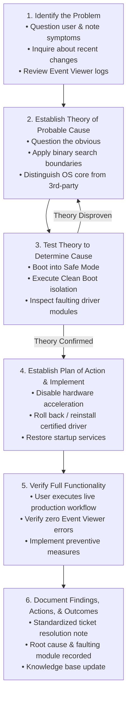
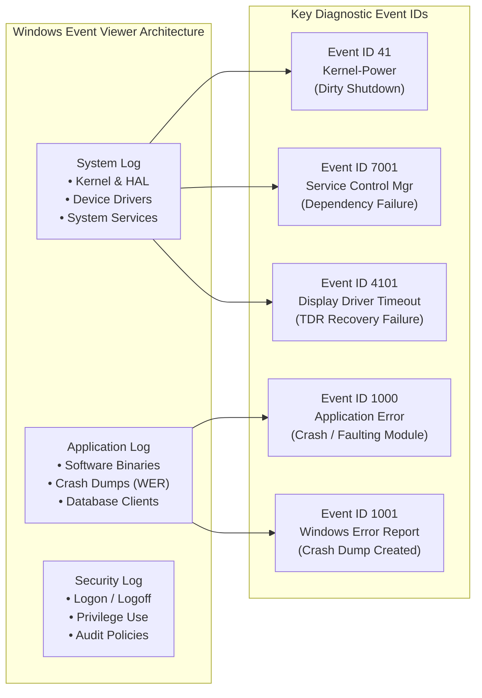
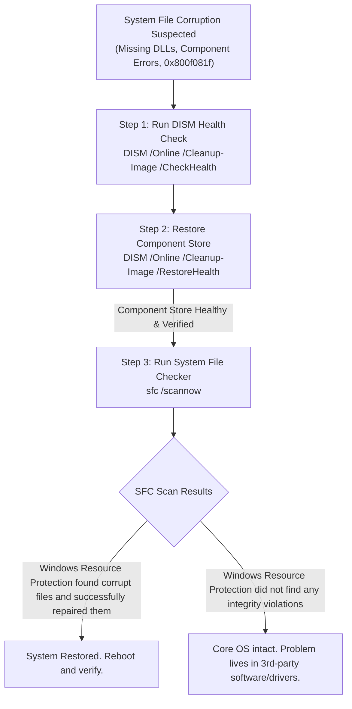

# Portland Desk Lab: OS Diagnostics, Event Log Triage, & Boot Recovery

> **The Situation:** Portland Regional Operations Center • Live service desk bullpen  
> **Your Role:** Tier 1 Support Specialist (Practical Trial under Desk Lead Jules Brooks)  
> **The Objective:** Troubleshoot live workstation freezes, OS crashes, and graphics driver conflicts using binary search, Safe Mode, and Windows Event Viewer logs.  
> **Estimated Time:** 40–50 minutes • Operating System Triage  


---

<details class="instructor-ref">
<summary>Instructor & Certification Reference (Click to Expand)</summary>

* **Aligned Certification:** CompTIA A+ Core 2 (220-1102)
* **Exam Domains:** Domain 1.0 (Operating Systems & Boot Architecture) & Domain 3.0 (Software Troubleshooting & Event Log Decomposition)
* **Core Competencies & Deliverables:** Windows Boot & Safe Mode Matrix • Event Viewer Crash Analysis Drill • Clean Boot Service Isolation Drill • Call Your Shot 5-Case Gate • Departmental Resolution Ticket

</details>


---

## 1. The Situation & Ground Truth

```callout-panel
title: "FIGURE 2.1: MOTHERBOARD MEMORY SLOT & BROKEN LATCH"
badge: "Motherboard Inspection"
caption: "Macro view: On the circuit board, a dual-digit red LED displays code C1. Directly adjacent, the DDR4 RAM slot has a broken white plastic retention latch tilted at 15 degrees, with the memory stick slightly unseated."
prompt: "Clean technical cutaway illustration of a computer motherboard RAM slot under bright, even inspection lighting. A dual-digit 7-segment red LED display reads C1. Beside it, the memory slot has its white plastic end-latch broken off and cocked at a 15-degree angle, with the gold contacts of the RAM module partially unseated. Sharp technical accuracy, no text, no words. 4:3 ratio."
```


### The Situation
It is 08:15 on a rain-swept August morning on the fourth floor of the Portland Regional Operations Center. You are Ethan Mercer, sitting beside Help Desk Lead Jules Brooks for your second-round practical working trial. Your portfolio holds your CompTIA A+ certificate and a signed recommendation from supervisor Ken out at the Gresham freight terminal. You are patched into the station fourteen training bridge on a dual-headset splitter. 

Two rows over, workstation fourteen displays a high-priority ticket flagged in glowing amber text:

$$\boxed{\textbf{INC-2026-0814: Maya Lin (Accounting) — Workstation Hard Freeze on Payroll Launch}}$$

Maya Lin has twenty-eight city supervisors waiting on biweekly payroll approval by noon. Every time she launches `PDX-Pay`, the mouse freezes, both monitors turn pitch black, and she is forced to crawl under her desk to yank the AC power cable. 

The temptation for every junior technician is the "nuclear option": reach for a bootable USB drive, re-image the drive, and hope the clean slate solves the issue. But as Jules makes clear before you touch the keyboard:

> *"A full OS wipe takes three hours, blows away departmental certificates and local database shortcuts, and leaves Maya stranded past her deadline. Worst of all, it tells you nothing about why the system failed. On this desk, troubleshooting is not intuition and it is not guessing. It is binary search. Every diagnostic test you run must eliminate half of the remaining failure domains."*


---

### The Ground Truth Rules of the Desk

1. **Binary Search Beats Random Exploration:** Never test random settings or poke through the Windows registry without an explicit hypothesis. Divide the system in half with each move:
   $$\text{Hardware vs. Software} \longrightarrow \text{Base OS vs. Third-Party} \longrightarrow \text{Driver vs. Background Service}$$
2. **Never Re-image on First Contact:** Re-imaging an operating system is an admission of diagnostic defeat. It destroys event logs, user preferences, and forensic evidence, and often reintroduces the exact same crash when automatic updates reinstall the offending driver.
3. **The Event Logs Are the Black Box Recorder:** Windows records every process crash, driver timeout, and kernel power disruption in `eventvwr.msc`. Read the logs before touching settings. Event IDs provide definitive timestamps and faulting module names that expose the exact root cause.
4. **Cryptographic Integrity is Inviolable:** BitLocker full-disk encryption binds volume master keys to motherboard Platform Configuration Registers (PCRs). When diagnostic boot configurations (such as Safe Mode or BCD edits) trigger a BitLocker recovery challenge, never bypass identity policy. Releasing the 48-digit numerical recovery key requires strict out-of-band employee verification.


---

## 2. Technical Reference & Triage Matrix

### The CompTIA 6-Step Troubleshooting Methodology for OS Failures

The CompTIA diagnostic framework transforms panic into disciplined engineering. When applied to workstation freezes, boot loops, and application crashes, each step must follow an exact procedural sequence:



| Step | Technical Execution & Help Desk Actions | Common Pitfall / Anti-Pattern |
| :--- | :--- | :--- |
| **1. Identify the Problem** | Interview the user without technical jargon. Ask: *When did it last work? Did Windows Update run overnight? Does the mouse move during the freeze?* Inspect Event Viewer System and Application logs. | Accepting vague reports like *"the computer is broken"* without capturing exact error codes or timestamps. |
| **2. Establish Theory** | Brainstorm probable causes based on causal mechanisms: hardware failure (RAM/PSU), core OS corruption, corrupted third-party driver, or application binary bug. | Blaming user error or jumping straight to registry editing without evidence. |
| **3. Test Theory** | Isolate variables using controlled execution states: boot into **Safe Mode with Networking** to eliminate third-party drivers; execute a **Clean Boot** to isolate startup services. | Changing multiple variables simultaneously (e.g., updating BIOS, replacing RAM, and reinstalling software at once). |
| **4. Plan of Action & Solution** | Formulate a minimal, reversible remediation plan: roll back corrupted device driver via Device Manager, disable application hardware acceleration, or run DISM/SFC. | Applying unverified registry hacks or third-party "cleaner" tools that destabilize the OS. |
| **5. Verify Functionality** | Have the end-user perform their actual production task (e.g., launch `PDX-Pay`, compute batch reports). Monitor Event Viewer for recurring Event IDs. | Declaring the ticket resolved because the Windows desktop loaded, without testing the user's specific application. |
| **6. Document Findings** | Record initial symptoms, diagnostic steps, faulting modules, driver versions, and preventive configurations in the service desk ticketing system. | Closing tickets with one-word summaries like *"fixed"* or *"rebooted"*, hiding recurring flaws from engineering. |


---

### Windows Event Viewer Architecture & Critical Event IDs

The Windows Event Log subsystem (`eventvwr.msc`) provides centralized, tamper-evident recording of operating system, service, and application telemetry:



| Event ID | Log Provider | Event Level | Technical Root Cause & Diagnostic Translation |
| :--- | :--- | :--- | :--- |
| **Event ID 41** | `Microsoft-Windows-Kernel-Power` | Critical | **Dirty Shutdown / Hard Power Cut.** The system rebooted without cleanly unmounting file systems. Indicates a physical power loss, a user holding down the power button, or a hardware thermal trip. BugcheckCode 0 indicates no blue screen dump was recorded before power dropped. |
| **Event ID 1000** | `Application Error` | Error | **Application Process Crash.** A user-space or kernel-mode component generated an unhandled exception. The event details explicitly report the `Faulting application name`, `Faulting module name` (e.g., `amdkmdag.sys`, `ntdll.dll`), and `Exception code` (e.g., `0xc0000005` Access Violation). |
| **Event ID 1001** | `Windows Error Reporting (WER)` | Information | **Crash Telemetry / Minidump Generation.** Generated immediately following an application crash or BSOD. Records bucket IDs and confirms whether a memory dump (`MEMORY.DMP` or minidump) was written to disk for WinDbg analysis. |
| **Event ID 4101** | `Display` | Warning / Error | **Timeout Detection & Recovery (TDR) Failure.** The GPU failed to respond to a scheduler preemption request within 2 seconds. The display driver (`nvlddmkm.sys`, `amdkmdag.sys`) crashed and attempted to reset. If TDR resets fail repeatedly, Windows hard-freezes the display pipeline. |
| **Event ID 7001** | `Service Control Manager` | Error | **Service Dependency Failure.** A required system service failed to start because one or more dependent services were disabled, crashed, or missing. Critical for diagnosing Print Spooler and RPC service failures. |


---

### Windows Boot Modes, Recovery Environments, & System File Repair

When an operating system fails to boot or hard-locks under user load, diagnostic startup modes strip away layers of abstraction to isolate faulty software.

#### Windows Boot Modes Comparison

| Boot Mode | Loaded Subsystems & Drivers | Network Stack | Primary Diagnostic Use Case |
| :--- | :--- | :--- | :--- |
| **Normal Boot** | Full kernel, HAL, all hardware drivers, third-party services, startup apps, shell. | Enabled | Standard production operations. |
| **Safe Mode (Minimal)** | Minimal kernel, basic VGA/VESA video driver, essential storage and keyboard drivers. No third-party drivers or services. | Disabled | Isolates whether crashes originate in third-party software vs. core OS files/hardware. |
| **Safe Mode with Networking** | Minimal kernel, basic display, storage drivers, **plus network interface drivers and basic TCP/IP services**. | Enabled | Allows remote desktop assistance, Active Directory domain connectivity, and driver downloads while in diagnostic state. |
| **Safe Mode with Command Prompt** | Minimal kernel, basic display, storage drivers. Shell boots directly into `cmd.exe` without `explorer.exe`. | Disabled | Used when the Windows Explorer graphical shell itself crashes continuously or fails to load. |
| **Windows Recovery Environment (WinRE)** | Dedicated WinPE boot partition with diagnostic tools (Startup Repair, Command Prompt, System Restore). | Optional | Used when the BCD is corrupted, BitLocker locks the system drive, or Windows cannot load the kernel (`ntoskrnl.exe`). |

#### System File Repair Tool Sequencing: DISM vs. SFC

A foundational technician rule: **Always repair the component store before repairing system files.**



1. **`DISM /Online /Cleanup-Image /RestoreHealth`**:
   - *Function:* Scans and repairs the Windows Component Store (`C:\Windows\WinSxS\`) using Windows Update servers or a mounted install WIM image as a clean reference source.
   - *Why Run First:* If the Component Store itself is corrupted, running `sfc /scannow` will fail because SFC relies on WinSxS to obtain clean replacement copies of damaged files.
2. **`sfc /scannow`**:
   - *Function:* Scans all protected operating system binaries (`System32`) and compares their cryptographic hashes against the clean copies in WinSxS. Replaces corrupted files on the fly.


---

### BitLocker Full-Disk Encryption & TPM Triage

BitLocker encrypts entire disk volumes using AES-XTS (128-bit or 256-bit). Key security rests upon the **Trusted Platform Module (TPM 2.0)**, a cryptographic microcontroller embedded on the motherboard.

#### Platform Configuration Registers (PCRs)
The TPM validates boot integrity using Platform Configuration Registers:
- **PCR 0–2:** UEFI BIOS code, motherboard firmware, CPU microcode.
- **PCR 7:** Secure Boot state and UEFI certificate authorities.
- **PCR 11:** BitLocker access control and BCD boot manager settings.

If a technician alters the boot sequence (e.g., enabling Safe Mode via BCD, booting from a USB drive, updating BIOS firmware), the PCR measurement changes. The TPM refuses to release the Volume Master Key (VMK), and Windows displays the **BitLocker Recovery Screen**.

```console
caption: Command-Line BitLocker Diagnostic Syntax
# Check BitLocker status and encryption state
manage-bde -status C:

# View configured key protectors and retrieve numerical password ID
manage-bde -protectors -get C:

# Temporarily suspend BitLocker protection for 1 reboot (Mandatory before BIOS/Firmware updates)
manage-bde -protectors -disable C: -rebootcount 1

# Resume BitLocker protection after maintenance
manage-bde -protectors -enable C:
```

> [!WARNING]
> **Out-of-Band Identity Verification Rule:** Never release a 48-digit BitLocker recovery key based solely on an incoming email, chat message, or unverified caller. Attackers use social engineering to obtain recovery keys and bypass full-disk encryption on lost or stolen laptops. Always verify the employee's identity via manager confirmation, HR badge records, or out-of-band telephone callback.


---

## 3. Quick Checks & Skill Reps

### Drill 1: Windows Event Log Decomposition

#### Scenario
Maya Lin's workstation (`PORT-WS-0142`) froze at 08:15. You pull the raw XML event records from the Windows Application and System logs:

```xml
<!-- Log Record A: Application Event Log -->
<Event xmlns="http://schemas.microsoft.com/win/2004/08/events/event">
  <System>
    <Provider Name="Application Error" />
    <EventID>1000</EventID>
    <Level>2</Level> <!-- Error -->
    <TimeCreated SystemTime="2026-08-14T08:15:22.4182910Z" />
    <Computer>PORT-WS-0142.portland.local</Computer>
  </System>
  <EventData>
    <Data Name="AppName">PDXPayClient.exe</Data>
    <Data Name="AppVersion">4.2.108.0</Data>
    <Data Name="FaultModuleName">amdkmdag.sys</Data>
    <Data Name="FaultModuleVersion">31.0.12024.2005</Data>
    <Data Name="ExceptionCode">0xc0000005</Data>
    <Data Name="FaultOffset">0x000000000018a4b0</Data>
  </EventData>
</Event>
```

```xml
<!-- Log Record B: System Event Log -->
<Event xmlns="http://schemas.microsoft.com/win/2004/08/events/event">
  <System>
    <Provider Name="Microsoft-Windows-Kernel-Power" />
    <EventID>41</EventID>
    <Level>1</Level> <!-- Critical -->
    <TimeCreated SystemTime="2026-08-14T08:22:10.1049210Z" />
    <Computer>PORT-WS-0142.portland.local</Computer>
  </System>
  <EventData>
    <Data Name="BugcheckCode">0</Data>
    <Data Name="BugcheckParameter1">0x0</Data>
    <Data Name="PowerButtonTimestamp">0</Data>
  </EventData>
</Event>
```

#### Diagnostic Decomposition Questions

1. Which component actually triggered the initial workstation freeze: the application executable, the graphics device driver, or the power supply?
2. What does `ExceptionCode 0xc0000005` signify in the Windows API?
3. Why does Event ID 41 show `BugcheckCode 0`, and what does its timestamp (08:22:10) reveal relative to Event ID 1000 (08:15:22)?

<details>
<summary>Solution & Technical Analysis</summary>

1. **Root Cause Component:** The crash was triggered by `amdkmdag.sys`, the AMD kernel-mode graphics device driver. While `PDXPayClient.exe` was the host process, the fault occurred inside the driver's execution space (`FaultModuleName: amdkmdag.sys`) during hardware acceleration rendering.
2. **Exception Code `0xc0000005`:** This is the standard Windows **Access Violation** status code. It indicates that a thread attempted to read or write to a memory virtual address for which it did not have appropriate architectural permissions (e.g., dereferencing a null pointer or accessing unmapped kernel space).
3. **Event ID 41 BugcheckCode 0 & Timeline:** 
   - At **08:15:22**, the display driver suffered an unrecoverable kernel deadlock, freezing the graphical output and locking input threads.
   - At **08:22:10** (seven minutes later), Maya crawled under the desk and pulled the power cord out of the wall.
   - `BugcheckCode 0` proves that Windows did **not** crash due to a Blue Screen / Bug Check; it was forcibly deprived of AC power while frozen. Event ID 41 was written when the workstation booted back up, logging the dirty shutdown that Maya initiated.
</details>


---

### Drill 2: Startup Service Isolation & Clean Boot Binary Search Matrix

When an operating system loads sixteen non-Microsoft vendor services at boot and suffers an intermittent hang, testing each service individually requires 16 reboots. Applying **binary search** ($O(\log_2 N)$) isolates the offending service in exactly 4 reboots.

#### The Binary Search Clean Boot Procedure

```text
Initial Pool: 16 Third-Party Services [S01, S02, S03, ..., S16]
Step 1: Disable Half A [S01–S08], Enable Half B [S09–S16]. Reboot.
        -> If system runs clean: Bug is in Half A [S01–S08].
Step 2: Enable [S01–S04], Disable [S05–S08]. Reboot.
        -> If system freezes: Bug is in [S01–S04].
Step 3: Enable [S01–S02], Disable [S03–S04]. Reboot.
        -> If system runs clean: Bug is in [S03–S04].
Step 4: Enable [S03], Disable [S04]. Reboot.
        -> If system freezes: Service S03 is the culprit.
```

#### Clean Boot Decision Matrix

| Step | State of Services | Test Result | Conclusion & Next Diagnostic Move |
| :---: | :--- | :--- | :--- |
| **Run 1** | Disable Services 1–8<br>Enable Services 9–16 | **PASS** (No freeze) | Eliminates Services 9–16. Culprit lives in Pool 1–8. |
| **Run 2** | Enable Services 1–4<br>Disable Services 5–8 | **FAIL** (Freeze reproduced) | Eliminates Services 5–8. Culprit lives in Pool 1–4. |
| **Run 3** | Enable Services 1–2<br>Disable Services 3–4 | **PASS** (No freeze) | Eliminates Services 1–2. Culprit lives in Pool 3–4. |
| **Run 4** | Enable Service 3<br>Disable Service 4 | **FAIL** (Freeze reproduced) | **Culprit Isolated:** Service 3 (`OEM-GpuAssist.exe`) conflicts with production workload. |


---


### 2.3 Interactive Diagnostic Console: Live Telemetry & Triage

Use the interactive console below to test commands, inspect telemetry, and verify your troubleshooting steps.

```lnk-terminal
title: "POWERSHELL: EVENT VIEWER & STARTUP SERVICE TRIAGE"
shell: "powershell"
prompt: "PS C:\Support> "
replay: true
objectives:
  - id: "obj-crash"
    label: "Query Application crash logs (Event ID 1000)"
    trigger: "Get-EventLog -LogName Application -InstanceId 1000"
  - id: "obj-services"
    label: "List third-party background services"
    trigger: "Get-Service | Where Status -eq Running"
  - id: "obj-disable"
    label: "Disable crashing audio/display helper service"
    trigger: "Stop-Service -Name NahimicService"
---
Get-EventLog -LogName Application -InstanceId 1000: |
  TimeGenerated       Source           EventID Message
  -------------       ------           ------- -------
  10/18 09:14:22 AM   Application Error   1000 Faulting application name: QuickBooks.exe, version: 23.0.4
                                               Faulting module name: NahimicOSD.dll, version: 2.1.8
                                               Exception code: 0xc0000005 (Access Violation)
                                               Fault offset: 0x00012a4f
                                               Faulting process id: 0x18a4

Get-Service | Where Status -eq Running: |
  Status   Name               DisplayName
  ------   ----               -----------
  Running  Appinfo            Application Information
  Running  AudioSrv           Windows Audio
  Running  Dhcp               DHCP Client
  Running  Dnscache           DNS Client
  Running  NahimicService     Nahimic Audio Overlay Helper (Third-Party OSD)
  Running  Spooler            Print Spooler
  Running  WinDefend          Microsoft Defender Antivirus Service

Stop-Service -Name NahimicService: |
  Service 'Nahimic Audio Overlay Helper' (NahimicService) stopped.
  Setting startup type to Disabled...
  [OK] Background injection hook removed. Payroll application launches cleanly.

```

---

### Quick Check 3: Call Your Shot: Predict Before You Look

> **The Rule of the Desk:** Before typing a command, changing an MSConfig checkbox, or giving advice to an end user, state your **Hypothesis**, **Primary Diagnostic Tool**, and **Planned Remediation**. Commit your answers mentally before expanding the solution.


---
<div class="scratchpad-container">
  <div class="scratchpad-header">
    <span class="scratchpad-title">Interactive Hypothesis Scratchpad</span>
    <span class="scratchpad-save-indicator" id="save-ind-02-cbyt">Saved in browser</span>
  </div>
  <div class="scratchpad-body">
    <textarea id="notes-02-cbyt" placeholder="Type your predicted failure layer, expected command output, and root cause hypothesis here before opening solutions..."></textarea>
  </div>
  <div class="scratchpad-footer">
    <span>Private notes saved locally in your browser. Not graded.</span>
    <button type="button" class="scratchpad-copy-btn" onclick="copyScratchpad('notes-02-cbyt')">Copy Notes</button>
  </div>
</div>


#### Case 1: Workstation BSOD Following Cumulative Windows Update
*Scenario:* A civil engineer's workstation blue-screens during boot with `DRIVER_IRQL_NOT_LESS_OR_EQUAL` (`0x000000D1`). The crash screen references `storvsc.sys`. The issue began immediately after Tuesday night's cumulative Windows update.
* **Your Action:** [ Safe Mode / DISM / Driver Rollback / System Restore ]
* **Diagnostic Tool & Path:**
* **Remediation Plan:**

<details>
<summary>Solution & Lead Tech Review</summary>

* **Action:** Boot into **Safe Mode**, then roll back or uninstall the conflicting storage controller driver update.
* **Diagnostic Tool:** Windows Recovery Environment (WinRE) $\rightarrow$ Startup Settings $\rightarrow$ **Safe Mode** $\rightarrow$ **Device Manager** (Storage Controllers).
* **Remediation Plan:** `storvsc.sys` is a storage virtualization / disk controller driver. Because the system cannot complete normal boot, boot into Safe Mode (which loads generic storage drivers). In Device Manager, right-click the storage controller and select **Roll Back Driver**. If unavailable, boot into WinRE and select **Uninstall Latest Quality Update**.
* **Jules' Critique:** *"Do not run `sfc /scannow` when a specific driver is named on a BSOD screen. System files are fine; the update pushed an incompatible driver. Get into Safe Mode, pull the driver back to the certified OEM build, and resume normal boot."*
</details>


---

#### Case 2: BitLocker Recovery Prompt After Motherboard Firmware Flash
*Scenario:* A Dell Precision workstation halts at the BitLocker Recovery screen requesting a 48-digit key following an automated Dell Command Update that flashed motherboard BIOS v1.14. The user has their laptop in the field.
* **Your Action:** [ Clear TPM / Supply Recovery Key / Re-image / Suspend BitLocker ]
* **Diagnostic Tool & Path:**
* **Remediation Plan:**

<details>
<summary>Solution & Lead Tech Review</summary>

* **Action:** Execute out-of-band identity verification, retrieve the 48-digit **BitLocker Recovery Key** from Active Directory, and input the key to unlock the drive.
* **Diagnostic Tool:** Active Directory Users & Computers (BitLocker Recovery Tab) or Microsoft Intune Admin Center.
* **Remediation Plan:** Flashing the BIOS altered PCR 0/2 measurements, causing the TPM to withhold the Volume Master Key. Have the user verify their employee ID and badge number over a voice call. Read the 48-digit key. Once in Windows, run `manage-bde -protectors -enable C:` to reseal the TPM against the new BIOS firmware hash.
* **Jules' Critique:** *"Never click 'Clear TPM' in the BIOS when BitLocker asks for a key! Clearing the TPM wipes the internal cryptographic hierarchy and turns a temporary unlock into a permanent catastrophe if the recovery key wasn't backed up in AD."*
</details>


---

#### Case 3: Print Spooler Recurring Crash with Event ID 7001
*Scenario:* At the Water Bureau service counter, printing halts across four customer windows. The Print Spooler service (`spoolsv.exe`) crashes every 90 seconds. Services console shows the service terminates automatically, and Event Viewer logs Event ID 7001.
* **Your Action:** [ Reinstall Windows / Clear Spooler Directory / Edit Registry / Run SFC ]
* **Diagnostic Tool & Path:**
* **Remediation Plan:**

<details>
<summary>Solution & Lead Tech Review</summary>

* **Action:** Stop `spoolsv.exe`, purge the corrupted print queue files in `C:\Windows\System32\spool\PRINTERS\`, and restart the service.
* **Diagnostic Tool:** PowerShell / Command Prompt (Admin) and Windows Services Console (`services.msc`).
* **Remediation Plan:** 
  ```console
  net stop spooler
  del /Q /F C:\Windows\System32\spool\PRINTERS\*.*
  net start spooler
  ```
  A corrupted print job (SHD/SPL files) causes the spooler daemon to crash whenever it attempts to parse the corrupted data stream on startup. Purging the queue directory eliminates the poison packet.
* **Jules' Critique:** *"Don't reinstall print drivers until you empty the spool folder. Ninety percent of spooler crash loops are just a corrupted two-megabyte PDF that a user tried to print on a label printer."*
</details>


---

#### Case 4: Severe CPU Throttling and System Freezes Under CAD Load
*Scenario:* A GIS analyst reports that ArcGIS crashes after ten minutes of 3D rendering. When the crash occurs, the mouse stutters violently. Task Manager reveals CPU utilization is pegged at 100%, but CPU core clock speed is locked at `0.79 GHz`.
* **Your Action:** [ Software Reinstall / Thermal Inspection / Power Plan Change / RAM Swap ]
* **Diagnostic Tool & Path:**
* **Remediation Plan:**

<details>
<summary>Solution & Lead Tech Review</summary>

* **Action:** Inspect physical hardware thermals, blow out clogged chassis/heatsink dust, and check CPU heatsink mounting.
* **Diagnostic Tool:** Task Manager (Performance tab) + Hardware Monitor / BIOS Thermal Telemetry.
* **Remediation Plan:** Modern CPUs employ **PROCHOT** (Processor Hot) thermal throttling. When CPU core temperatures exceed critical thresholds (95–100°C), the embedded controller locks the CPU multiplier to its lowest power state (800 MHz / 0.79 GHz) to prevent silicon destruction. This causes massive instruction stalls, freezing the OS. Clean heatsink fins and replace dried thermal paste.
* **Jules' Critique:** *"When Task Manager shows 0.79 GHz on a modern quad-core machine, don't waste time running malware scans or tweaking Windows power plans. The processor is screaming for cool air."*
</details>


---

#### Case 5: System File Corruption with DISM Error 0x800f081f
*Scenario:* Windows Update repeatedly fails with error code `0x800f081f` (Source files could not be found). The technician ran `sfc /scannow`, which returned: *"Windows Resource Protection found corrupt files but was unable to fix some of them."*
* **Your Action:** [ Re-run SFC / Run DISM RestoreHealth / Re-image / Replace SSD ]
* **Diagnostic Tool & Path:**
* **Remediation Plan:**

<details>
<summary>Solution & Lead Tech Review</summary>

* **Action:** Execute **DISM RestoreHealth** pointing to an external Windows ISO/WIM source, then re-execute `sfc /scannow`.
* **Diagnostic Tool:** Elevated Command Prompt (`cmd.exe`).
* **Remediation Plan:**
  ```console
  # Mount clean Windows 11 installation media to D:\
  DISM /Online /Cleanup-Image /RestoreHealth /Source:wim:D:\sources\install.wim:1 /LimitAccess
  # Re-run SFC against repaired component store
  sfc /scannow
  ```
  SFC failed because the local component store (`WinSxS`) was damaged. Running DISM with an external WIM source rebuilds WinSxS, allowing SFC to successfully repair `System32` binaries.
* **Jules' Critique:** *"Running SFC five times in a row will never fix a machine whose WinSxS cache is broken. Repair the source first with DISM, then let SFC do its job."*
</details>


---

## 4. Your Ticket Notes (What to Put in the Ticket)

<div class="scratchpad-container">
  <div class="scratchpad-header">
    <span class="scratchpad-title">Your Ticket Draft & Resolution Scratchpad</span>
    <span class="scratchpad-save-indicator" id="save-ind-02-ticket">Saved in browser</span>
  </div>
  <div class="scratchpad-body">
    <textarea id="notes-02-ticket" style="min-height: 140px;" placeholder="Draft your ticket notes, diagnosis, and resolution steps here before comparing with the reference standard below..."></textarea>
  </div>
  <div class="scratchpad-footer">
    <span>Private notes saved locally in your browser. Not graded.</span>
    <button type="button" class="scratchpad-copy-btn" onclick="copyScratchpad('notes-02-ticket')">Copy Notes</button>
  </div>
</div>

### Tier 1 Workstation Diagnostic Ticket Resolution & Root Cause Note

Below is the mandatory service desk documentation template required for all Tier 1 incidents involving system crashes, boot failures, and driver conflicts. This record serves as both operational documentation and engineering escalation records:

```text
================================================================================
TIER 1 RESOLUTION SUMMARY - PORTLAND REGIONAL SERVICE DESK
================================================================================
Ticket ID:        INC-2026-0814
Requester:        Maya Lin (Supervisor, Accounting Operations)
Affected Asset:   PORT-WS-0142 (Dell OptiPlex 7090 Micro / Service Tag: 8F2J9X3)
Technician:       Ethan Mercer (Tier 1 Support Trial)
Supervising Lead: Jules Brooks (Desk Lead)
Incident Date:    2026-08-14 08:15:00 PST
Resolution Date:  2026-08-14 09:12:35 PST
Impact Category:  Workstation Hardware / OS Display Subsystem Hang
Priority:         P1 - Critical / Payroll Processing Deadline at 12:00 PST
Status:           RESOLVED & VERIFIED

1. INITIAL SYMPTOM & USER REPORT:
   User reported workstation freezes solid within 3 seconds of launching PDX-Pay 
   accounting software client. Cursor locks, dual displays turn black, and system 
   fails to respond to keyboard input (Ctrl+Alt+Del, CapsLock LED non-responsive). 
   User had performed 4 ungraceful power-cord disconnects prior to calling desk.

2. BINARY SEARCH DIAGNOSTIC SEQUENCE:
   - Baseline Triage: Workstation powers on normally, boots to Windows 11 desktop, 
     and runs productivity apps (Outlook, Edge) without instability.
   - Hypothesis 1 (Hardware / Kernel Core vs. Third-Party Software):
     * Booted workstation into Safe Mode with Networking.
     * Required BitLocker recovery challenge due to BCD configuration change. 
       Verified user badge ID and cost center; entered 48-digit numerical key.
     * In Safe Mode, launched PDX-Pay client. Application launched cleanly and 
       connected to database server. Confirmed hardware and core OS binaries intact.
   - Hypothesis 2 (Third-Party Background Services vs. Driver Conflict):
     * Booted into Clean Boot state (all non-Microsoft services disabled via MSConfig; 
       all startup items disabled in Task Manager).
     * Application launched successfully without system hang.
   - Event Log Forensic Inspection:
     * Queried Application log: Located Event ID 1000 (Application Error) at 08:15:22.
       Faulting Application: PDXPayClient.exe | Faulting Module: amdkmdag.sys.
       Exception Code: 0xc0000005 (Access Violation).
     * Queried System log: Located 3 instances of Event ID 4101 (Display driver 
       stopped responding and has recovered).
     * Correlated with overnight automated driver update that installed generic OEM 
       AMD Radeon graphics driver package v31.0.12024.2005.

3. ROOT CAUSE IDENTIFICATION:
   Corrupted kernel-mode graphics device driver (amdkmdag.sys) encountered an 
   unhandled memory access violation (0xc0000005) when PDXPayClient invoked Direct3D 
   hardware acceleration for fiscal graph rendering, causing display driver TDR 
   timeout failure and full desktop deadlock.

4. REMEDIATION PERFORMED:
   - Configured PDXPayClient advanced configuration file to disable GPU hardware 
     acceleration (`HardwareAcceleration=0`), routing rendering through stable GDI+.
   - Opened Device Manager; rolled back AMD Radeon display adapter driver from 
     v31.0.12024.2005 to certified enterprise driver build v30.0.15021.1101.
   - Re-enabled required background services in MSConfig; restarted workstation.

5. VERIFICATION & PREVENTIVE MEASURES:
   - Supervised Maya Lin performing complete biweekly payroll batch calculation 
     (36 pages, 142 employee wage records). Calculation completed in 4.2 seconds 
     with zero display flickering or system latency.
   - Verified Event Viewer Application and System logs remain free of Event ID 
     1000, 4101, or 41 entries.
   - Escalated driver version conflict to Desktop Systems Engineering (TICKET-ENG-4412) 
     to blacklist generic driver update package across Accounting departmental OU.
================================================================================
```


---

## 5. What Good Looks Like (Shift Quality Checklist)

| Performance Criterion | Exemplary (Full Mastery) | Satisfactory | Needs Revision |
| :--- | :--- | :--- | :--- |
| **Diagnostic Methodology & Binary Search** | Systematically divides problem space (Hardware vs. Software $\rightarrow$ Safe Mode $\rightarrow$ Clean Boot $\rightarrow$ Event Logs). Never guesses or proposes destructive re-imaging. | Follows structured troubleshooting but occasionally skips intermediate tests or takes extra unnecessary steps. | Guesses randomly, edits registry without hypothesis, or jumps straight to OS re-installation. |
| **Event Log Analysis & Root Cause Accuracy** | Accurately identifies Event ID 1000 and 4101, correctly isolates the faulting module (`amdkmdag.sys`), and interprets Exception Code `0xc0000005`. | Identifies that a driver crashed in Event Viewer but confuses Application vs. System logs or misses the faulting module details. | Fails to inspect Event Viewer; misdiagnoses hardware failure or blames user error. |
| **Operating System & Security Execution** | Flawlessly executes Safe Mode with Networking, MSConfig clean boot, DISM/SFC sequencing, and adheres strictly to out-of-band BitLocker verification. | Understands boot tools and BitLocker concepts but hesitates on exact command syntax or tool sequencing. | Violates security policy by clearing TPM without key backup or fails to understand Safe Mode boundary testing. |
| **Ticket Documentation Quality** | Produces a comprehensive, professional enterprise resolution note with complete symptom analysis, root cause, remediation steps, and preventive escalation. | Documentation is accurate but lacks structured technical fields, faulting module names, or verification details. | Vague, single-sentence resolution notes (e.g., *"fixed display driver"*); fails to document root cause. |


---

*Workbench complete. Review companion datasets and test your knowledge against the live triage scenarios.*


---

## 6. Shift Resolution Epilogue

```callout-panel
title: "FIGURE 2.2: THE LIVE BOARD RESOLUTION"
badge: "Shift Epilogue"
caption: "Bullpen view: At 09:12 AM, workstation 14's dispatch ticket flips from amber to green. Outside the casement windows, rain sweeps across the Hawthorne Bridge as Jules Brooks signs the onboarding slip."
prompt: "Clean graphic novel panel of an IT help desk office bullpen in the Pacific Northwest. Rain streaks against large casement windows overlooking an industrial river bridge. A computer monitor displays a green resolved ticket badge. On the laminate desk, a blue visitor badge slip sits signed next to a ceramic coffee mug. Ligne Claire style, crisp technical lines, no text, no words. 16:9 ratio."
```

By 09:05 AM, the terminal logs had told the full story. The overnight maintenance update had installed generic AMD Radeon graphics driver package `v31.0.12024.2005`, clashing directly with `PDXPayClient.exe`'s Direct3D hardware acceleration engine.

Following the remediation plan, I opened the advanced client configuration file, disabled hardware acceleration to route chart rendering through the stable GDI+ CPU pipeline, and executed a clean driver rollback in Device Manager to enterprise build `v30.0.15021.1101`.

"Maya, please go ahead and launch the payroll database," I said over the headset. "Enter your credentials and run a test calculation on the batch summary report."

Across the remote desktop session, we watched the accounting matrices populate instantly. Thirty-six pages of wage distributions and one hundred forty-two employee records calculated in four seconds without dropping a single frame.

"It works," Maya exclaimed, her voice flooding with relief over the softphone line. "The calculation finished, and both of my screens stayed on. You just saved our entire payroll run for the week, Ethan."

"Thank you for your patience while we isolated the driver issue, Maya," I said. "I am updating ticket forty-two hundred with the driver rollback details right now so our desktop team can blacklist that update across your department."

I clicked disconnect on the softphone, slid the headset off, and completed the standardized resolution note. Jules stood behind my chair, reading through each section: the symptom description, the Safe Mode boundary test, the Event ID 1000 and 4101 analysis, and the preventive escalation to engineering.

"Your technical isolation was disciplined, Ethan," Jules said, setting her empty travel mug on the divider. "You didn't burn down the house with a re-image. You divided the problem in half with Safe Mode, let Event Viewer give you the exact driver module, and fixed the root cause without eighteen wasted reboots."

She paused, pulling a blue visitor badge exchange slip from her desk drawer and signing her initials across the authorization line.

"The job starts Monday morning at seven-thirty," she said. "Nineteen-fifty an hour to start. Bring your own coffee mug, and leave the flashcards in your backpack."

I thanked her, shook her hand, and walked out into the cool Portland rain. Across the river, the steel arches of the Hawthorne Bridge emerged from the morning fog, and for the first time in eighteen months, I felt like I was standing on solid ground.
