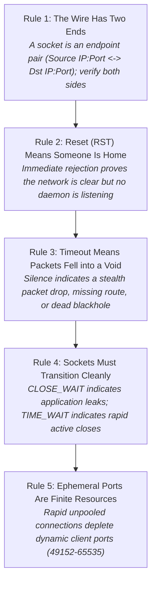
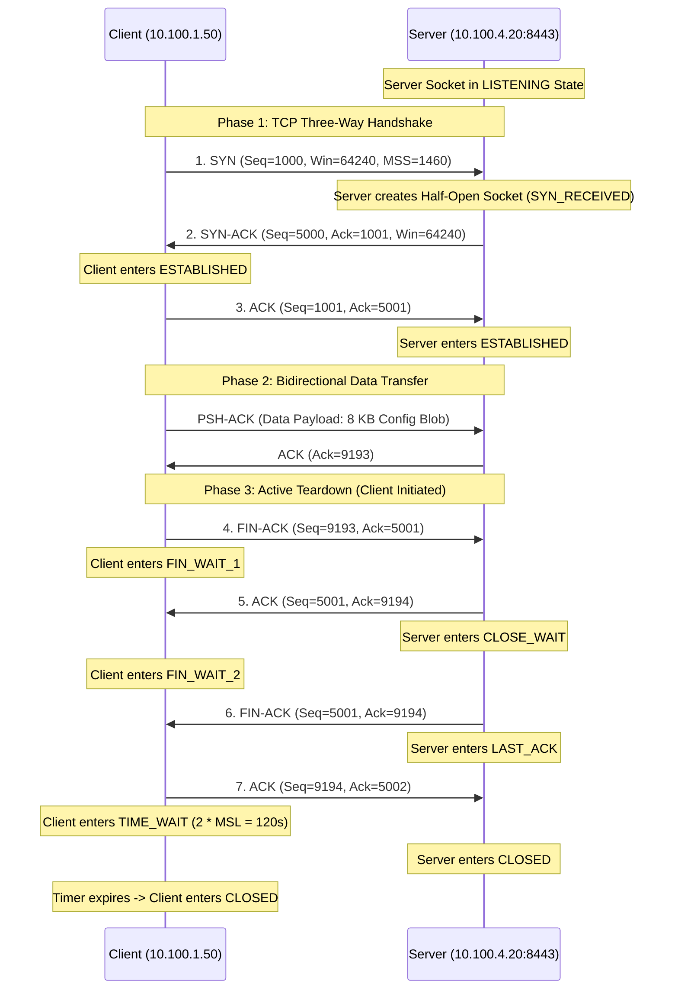
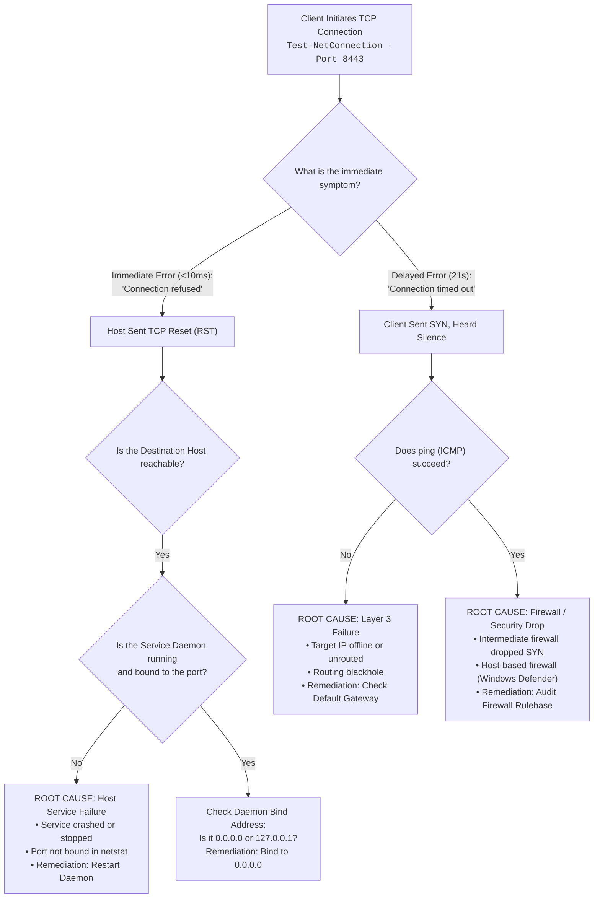

# Portland Desk Lab: TCP Sockets, Port States, & Handshake Diagnostics

> **The Situation:** Portland Operations Center Bullpen • Cold April rain, evening shift  
> **Your Role:** Level 1 Network Support Specialist (under Jules Brooks & Jared Vance)  
> **The Objective:** Diagnose network connection refusals (RST) versus silent timeouts (firewall drops) using TCP three-way handshake mechanics and netstat socket inspections.  
> **Estimated Time:** 45–50 minutes • Layer 4 Transport & Sockets  


---

<details class="instructor-ref">
<summary>Instructor & Certification Reference (Click to Expand)</summary>

* **Aligned Certification:** CompTIA Network+ (N10-008/009)
* **Exam Domains:** Domain 1.1 (OSI Transport Layer & TCP vs UDP) & Domain 5.4 (Network Tools: netstat, port scanners)
* **Core Competencies & Deliverables:** TCP Flag Reference & Socket State Flow • RST vs Drop Triage Matrix • Three-Way Handshake Wireshark Drill • Netstat Port & PID Inspection Drill • Call Your Shot 5-Case Gate • Socket Resolution & Escalation Note

</details>


---

## Worked Example: Jared's archive sweep

This lab starts with the same incident Ethan worked in the chapter, with the answer known. Read it as a demonstration, then use the sections below to practice each step. Section 6 gives you one new problem that works the same way.

**The incident.** Gresham terminals failed in two different ways, and Jared's nightly backup sweep died partway through four hundred devices.

1. Compare the two failures. Terminal four got `connection refused` instantly, which is a TCP reset: the packet reached the server and nothing was listening. Terminal seven timed out after a minute.
2. Ping `10.100.4.20` and run `Test-NetConnection` on port 8443. Routing works, and the port refuses.
3. Run `netstat -ano` on `PDX-ARCHIVE01`. Nothing is listening on 8443 because the backup agent crashed. Restart it and confirm `LISTENING` on PID 4112.
4. Now look at Jared's own workstation, which runs the sweep. Run `netstat -ano` there and count thousands of sockets in TIME_WAIT. Each device got a brand new connection, and each closed socket waited 120 seconds.
5. Recognize ephemeral port exhaustion on the client.
6. Fix the cause: pool sixteen persistent connections instead of one per device.
7. Shorten `TcpTimedWaitDelay` from 120 to 30 seconds as a safety margin, not as the fix.
8. Result: the sweep finished in under three minutes, after a night of missing backups that started with an alert Ethan scrolled past twice.

---

## 1. The Situation & Ground Truth

```callout-panel
title: "FIGURE 5.1: LAYER 4 TCP STATE MACHINE & TIME_WAIT EXHAUSTION"
badge: "Transport Layer"
caption: "Schematic diagram: TCP teardown lifecycle. After active closure (FIN/ACK exchange), the client socket parks in TIME_WAIT for 2MSL (120 seconds). Unthrottled multi-threaded retry loops consume all 16,384 ephemeral ports in the dynamic range (49152–65535)."
prompt: "Clean technical cutaway diagram of a network protocol state machine under bright inspection lighting. Flowchart lines illustrate TCP four-way handshake connection termination from FIN-WAIT to TIME-WAIT to CLOSED. A highlighted warning box depicts dynamic ephemeral port exhaustion. Crisp technical drawing style, Ligne Claire, no text, no letters. 16:9 ratio."
```


### The Situation
It is a wet April morning, and Ethan has been on the desk for eight months. Jared's configuration backup script aborted at quarter past three, and he blames a Chicago firewall change. Ken calls from the Gresham warehouse: terminal four gets "connection refused" instantly, and terminal seven spins for almost a minute before it times out.

This lab follows the chapter in two halves. First, the difference between a reset and a timeout shows that nothing on the path is dropping packets: the backup agent on `PDX-ARCHIVE01` has crashed and nothing is listening on port 8443. Second, Jared's own workstation is out of ephemeral ports, because his script opens a new connection for each of four hundred devices and leaves every socket in TIME_WAIT for 120 seconds.

### The Ground Truth Rules of Transport & Socket Diagnostics



1. **Rule 1: The Wire Has Two Ends.** A transport connection never exists in isolation; it is defined by a unique 4-tuple: `(Source IP, Source Port, Destination IP, Destination Port)`. Verifying that intermediate routers and firewalls permit a port is meaningless if the destination host has not bound a process to that port, or if the client operating system cannot allocate an outbound dynamic socket.
2. **Rule 2: TCP Reset (RST) Means Someone Is Home.** An immediate error stating `Connection refused` (generated within milliseconds) is definitive proof that intermediate cabling, switches, routers, and firewalls are operational. The packet crossed the entire network and reached the destination host's operating system kernel. The kernel sent back a packet with the RST flag asserted because no running service had registered a listening socket on that port.
3. **Rule 3: Silent Timeout Means Packets Fell into a Void.** A `Connection timed out` error indicates that the client transmitted its initial `SYN` packet and received zero response. The client operating system retransmitted the `SYN` packet at exponential intervals (typically after 3, 6, and 12 seconds) until its connection timer expired (typically 21 seconds). This silence is caused by a packet-filtering firewall dropping the packet, an access control list (ACL) filtering the traffic, or an unassigned/unrouted IP address.
4. **Rule 4: Sockets Must Transition Cleanly.** TCP is a stateful protocol with strict state transitions:
   - Sockets stranded in `CLOSE_WAIT` indicate an application defect: the remote peer closed the connection (`FIN`), but the local application failed to call `close()` on the socket handle.
   - Sockets stranded in `TIME_WAIT` represent normal protocol operation: the local endpoint initiated an active close and must wait $2 \times \text{MSL}$ (Maximum Segment Lifetime, default 120 seconds in Windows) to ensure the remote host received the final ACK.
5. **Rule 5: Ephemeral Ports Are Finite Resources.** When a client opens an outbound TCP connection, the operating system assigns a dynamic source port from the IANA ephemeral port range (`49152` to `65535`, comprising 16,384 ports). If an automated script or high-volume application opens and closes thousands of short-lived connections without socket reuse, all available ephemeral ports become trapped in `TIME_WAIT`, causing client-side ephemeral port exhaustion.


---

## 2. Technical Reference & Triage Matrix

### 2.1 The TCP Three-Way Handshake & Connection Teardown

Transmission Control Protocol (TCP) ensures reliable, ordered, and error-checked delivery of byte streams across IP networks. Before data transfer can commence, endpoints synchronize sequence numbers via the three-way handshake:




---

### 2.2 TCP Socket State Triage Matrix

| Socket State | Endpoint | Operational Meaning | Triage Focus & Common Failure Mode |
| :--- | :---: | :--- | :--- |
| **`LISTENING`** | Server | The server daemon has bound to an IP/port and is actively awaiting inbound client connections. | If missing from `netstat -ano`, the service is stopped, crashed, or bound exclusively to `127.0.0.1` instead of `0.0.0.0`. |
| **`SYN_SENT`** | Client | The client transmitted a SYN packet and is awaiting a SYN-ACK from the server. | If persistent, indicates a packet drop by a firewall or routing blackhole; connection will time out after 21 seconds. |
| **`SYN_RECEIVED`** | Server | The server received a SYN, allocated resources in its backlog queue, and replied with SYN-ACK. | If accumulating in large volumes, indicates a **SYN Flood Denial of Service** attack or dropped return ACKs. |
| **`ESTABLISHED`** | Both | The 3-way handshake completed successfully; active bidirectional payload transfer is enabled. | Normal state during active data exchange. Sockets remain established until teardown is initiated. |
| **`FIN_WAIT_1`** | Initiator | The local endpoint initiated an active close by sending a FIN segment. | Ephemeral state awaiting acknowledgment. |
| **`FIN_WAIT_2`** | Initiator | The local endpoint received the ACK for its FIN and is waiting for the remote peer's FIN segment. | If stuck, the remote peer received our close request but has not closed its end of the connection. |
| **`CLOSE_WAIT`** | Receiver | The local OS received a FIN from the remote peer and acknowledged it, but the local app has not closed. | **Application defect:** The program received a connection close notification from the remote peer but leaked the socket handle without calling `close()`. |
| **`LAST_ACK`** | Receiver | The local OS sent its own FIN segment and is waiting for the final ACK from the remote peer. | Ephemeral state during passive connection close. |
| **`TIME_WAIT`** | Initiator | The local endpoint completed teardown and is waiting $2 \times \text{MSL}$ (120s) to clear delayed packets. | Normal state for active closers. However, accumulating thousands in seconds indicates **client-side port exhaustion**. |
| **`CLOSED`** | Both | The connection has been completely released; the socket structure and port are deallocated. | Socket is closed and ready for memory deallocation. |


---

### 2.3 Diagnostic Decision Tree: Active Reset (RST) vs. Silent Drop / Timeout

When an application fails to connect to a target TCP port, the diagnostic symptoms immediately identify whether the root cause is situated in the intermediate network or on the endpoint host:




---

### 2.4 Ephemeral Port Exhaustion Mechanics

When a client initiates an outbound connection without explicitly binding to a local port, the operating system kernel assigns an **ephemeral port**:
- **Port Range:** On modern Windows and Linux operating systems, dynamic ports occupy `49152` through `65535` (RFC 6335), providing exactly **16,384 available ports**.
- **The $2 \times \text{MSL}$ Timer:** When a client application initiates an active close (`FIN`), the operating system parks the socket in `TIME_WAIT` for two Maximum Segment Lifetimes ($2 \times \text{MSL}$). On Windows, this timer defaults to **120 seconds** (configurable via registry).
- **The Exhaustion Formula:** If an automated process generates new connections at a rate faster than:
  $$\text{Max Sustainable Connection Rate} = \frac{\text{Total Ephemeral Ports}}{2 \times \text{MSL Timer}} = \frac{16,384}{120 \text{ s}} \approx 136.5 \text{ connections/second}$$
  the ephemeral port pool will completely deplete.
- **The Operational Error:** Applications throw socket exceptions stating:
  `System.Net.Sockets.SocketException: Only one usage of each socket address (protocol/network address/port) is normally permitted.`
- **Remediation Techniques:**
  1. *Connection Pooling (HTTP Keep-Alive):* Maintain persistent TCP sockets across multiple requests instead of creating and destroying sockets in loops.
  2. *Tune `TcpTimedWaitDelay`:* Lower the Windows `TIME_WAIT` duration from 120s to 30s (`HKLM\SYSTEM\CurrentControlSet\Services\Tcpip\Parameters\TcpTimedWaitDelay` = `30`).
  3. *Expand Dynamic Port Pool:* Configure Windows dynamic port allocation to start at port 1025:
     ```console
     netsh int ipv4 set dynamicport tcp start=1025 num=64511
     ```


---

### 2.5 Transport Layer Diagnostic Toolkit

```console
# 1. Inspect all active TCP connections, listening ports, and owning Process IDs (PIDs)
netstat -ano

# 2. Filter netstat output for a specific port (Windows)
netstat -ano | findstr 8443

# 3. Test transport layer connectivity to a remote port with detailed latency (PowerShell)
Test-NetConnection -ComputerName 10.100.4.20 -Port 8443

# 4. Query active TCP connections with PowerShell cmdlet (Windows 8 / Server 2012+)
Get-NetTCPConnection -LocalPort 8443

# 5. Measure number of active sockets grouped by state (PowerShell)
Get-NetTCPConnection | Group-Object State

# 6. Map a Process ID (PID) from netstat to an executable name and service
tasklist /svc /FI "PID eq 4112"
Get-Process -Id 4112
```


---


### 2.3 Interactive Diagnostic Console: Live Telemetry & Triage

Use the interactive console below to test commands, inspect telemetry, and verify your troubleshooting steps.

```lnk-terminal
title: "POWERSHELL: TCP SOCKET & LISTENING PORT DIAGNOSTICS"
shell: "powershell"
prompt: "PS C:\Support> "
replay: true
objectives:
  - id: "obj-netstat"
    label: "Inspect active listening TCP ports and PIDs"
    trigger: "netstat -ano | findstr 8080"
  - id: "obj-testport"
    label: "Test TCP handshake reachability on port 8080"
    trigger: "Test-NetConnection -Port 8080"
  - id: "obj-process"
    label: "Identify daemon process bound to socket"
    trigger: "Get-Process -Id 3412"
---
netstat -ano | findstr 8080: |
    Proto  Local Address          Foreign Address        State           PID
    TCP    0.0.0.0:8080           0.0.0.0:0              LISTENING       3412
    TCP    192.168.10.45:8080     192.168.10.112:51244   TIME_WAIT       0
  [OK] Port 8080 is actively LISTENING on PID 3412.

Test-NetConnection -Port 8080: |
  ComputerName     : localhost
  RemoteAddress    : 127.0.0.1
  RemotePort       : 8080
  InterfaceAlias   : Loopback Pseudo-Interface 1
  SourceAddress    : 127.0.0.1
  TcpTestSucceeded : True
  [OK] TCP 3-way handshake (SYN -> SYN-ACK -> ACK) verified.

Get-Process -Id 3412: |
  Handles  NPM(K)    PM(K)      WS(K)     CPU(s)     Id ProcessName
  -------  ------    -----      -----     ------     -- -----------
      412      18    42100      51200       2.14   3412 InventorySyncDaemon
  Status: Process active. Port open and receiving frames.

```

---

## 3. Quick Checks & Skill Reps

### Micro-Drill 1: TCP Handshake Flags & Packet Mechanics

**Objective:** Decode raw TCP packet header flags and sequence numbers to identify connection phases and failure modes.

#### Reference: TCP Control Flags Byte
The 6 standard TCP control flags operate as 1-bit binary flags within the TCP header:
$$\text{[URG | ACK | PSH | RST | SYN | FIN]}$$

| Packet Flag Pattern | Hex / Code | Handshake / Teardown Meaning | Diagnostic Significance |
| :---: | :---: | :--- | :--- |
| `[SYN]` | `0x002` | Handshake Step 1: Client requests connection | Client initiates session; carries initial sequence number (ISN). |
| `[SYN, ACK]` | `0x012` | Handshake Step 2: Server accepts connection | Server acknowledges client ISN and supplies server ISN. |
| `[ACK]` | `0x010` | Handshake Step 3: Client confirms connection | Final handshake step; transitions socket to `ESTABLISHED`. |
| `[PSH, ACK]` | `0x018` | Data payload transmission | Pushes application buffer immediately to the recipient process. |
| `[RST]` or `[RST, ACK]` | `0x004` / `0x014` | Connection abort / Port rejected | Host refused connection; port closed or connection aborted. |
| `[FIN, ACK]` | `0x011` | Orderly connection teardown | Endpoint has finished transmitting data; begins teardown. |

#### Practice Problems:
1. A Wireshark capture shows a client sending a packet with flags `[SYN]`, Seq=2500. The server responds with Seq=7000, Ack=2501, Flags `[SYN, ACK]`. What should the client's final ACK packet contain?
   - **Answer:** Seq=2501, Ack=7001, Flags `[ACK]`.
2. A client transmits `[SYN]` to destination port 23. In less than 1 ms, the host responds with `[RST, ACK]`, Seq=0, Ack=1. What does this prove?
   - **Answer:** Layer 1, 2, and 3 connectivity is operational. The target operating system received the frame, but Telnet (port 23) has no active listening service running.


---

### Micro-Drill 2: `netstat -ano` Socket Inspection & PID Mapping

**Scenario:** You log into production application server `PDX-APP01` following user complaints that the internal web application is unreachable. You run `netstat -ano` and capture the following raw output:

```console
C:\Windows\System32> netstat -ano

Active Connections

  Proto  Local Address          Foreign Address        State           PID
  TCP    0.0.0.0:135            0.0.0.0:0              LISTENING       944
  TCP    0.0.0.0:445            0.0.0.0:0              LISTENING       4
  TCP    127.0.0.1:5000         0.0.0.0:0              LISTENING       3280
  TCP    10.100.1.20:445        10.100.1.55:49812      ESTABLISHED     4
  TCP    10.100.1.20:8080       10.100.2.14:52110      CLOSE_WAIT      2196
  TCP    10.100.1.20:8080       10.100.2.15:52114      CLOSE_WAIT      2196
  TCP    10.100.1.20:8080       10.100.2.16:52118      CLOSE_WAIT      2196
  TCP    10.100.1.20:8080       10.100.2.17:52122      CLOSE_WAIT      2196
```

**Diagnostic Analysis Questions:**
1. **The Web Service on Port 5000:** The developers insist their API service is running on port 5000, but remote users on `10.100.2.0/24` cannot connect. Why?
   - *Analysis:* The socket is bound to `127.0.0.1:5000` (loopback only) instead of `0.0.0.0:5000` (all interfaces). The operating system will actively reject any packet arriving on physical interface `10.100.1.20`.
2. **The Port 8080 Sessions:** What is happening to the web application process (PID 2196)?
   - *Analysis:* Sockets are accumulating in `CLOSE_WAIT`. Remote clients initiated connection teardowns (`FIN`), but application process 2196 is failing to call `close()` to release the socket handles. This represents an application socket leak that will eventually exhaust server memory and file descriptors.


---

### Micro-Drill 3: "Call Your Shot: Predict Before You Look" (5-Case Prediction Gate)

Before running any network command, enforce the CBYT protocol:
1. **Layer & Subsystem:** What exact protocol, flag, or socket state governs this failure?
2. **Predicted Output:** What specific CLI output or error code will appear?
3. **Action & Remediation:** How do you verify and correct the root cause without guessing?


---

#### Case 3.1: The Unbound Port (Immediate Reset / Connection Refused)
**Scenario:** A junior administrator claims that the edge firewall is blocking traffic to port 8443 on `10.100.4.20`. When you run `Test-NetConnection -Port 8443`, the command fails immediately in under 2 milliseconds.

<details>
<summary>Prediction & Verification Gate (Click to Expand)</summary>

* **Layer & Subsystem:** Layer 4 / Transport Protocol (TCP Reset). The network path is clear; the destination host kernel rejected the connection because no process is bound to port 8443.
* **Predicted Output:**
  ```console
  PS C:\> Test-NetConnection -ComputerName 10.100.4.20 -Port 8443
  WARNING: TCP connect to (10.100.4.20 : 8443) failed
  TcpTestSucceeded : False
  # Wireshark trace: TCP [RST, ACK] returned in <2ms
  ```
* **Triage Action:**
  1. Do NOT open a firewall change ticket.
  2. Establish a remote management session to `10.100.4.20`.
  3. Execute `netstat -ano | findstr 8443` to confirm the listening port is absent.
  4. Inspect Windows Services (`Get-Service`) or Event Viewer logs to identify why the application service stopped.
  5. Restart the service and verify `netstat -ano` shows `0.0.0.0:8443 LISTENING`.
</details>


---

#### Case 3.2: The Stealth Firewall Drop (21-Second Socket Timeout)
**Scenario:** A warehouse terminal attempts to connect to `10.100.4.99:8443`. The console hangs with a blinking cursor for over twenty seconds before throwing an error. Ping to `10.100.4.99` fails with "Request timed out."

<details>
<summary>Prediction & Verification Gate (Click to Expand)</summary>

* **Layer & Subsystem:** Layer 3 / Routing or Layer 4 Firewall Silent Drop. The client sent `SYN` segments, but heard complete silence. The client retransmitted `SYN` packets until the 21-second connection timer expired.
* **Predicted Output:**
  ```console
  PS C:\> Test-NetConnection -ComputerName 10.100.4.99 -Port 8443
  # 21 seconds of silence...
  WARNING: TCP connect to (10.100.4.99 : 8443) failed
  PingSucceeded    : False
  TcpTestSucceeded : False
  ```
* **Triage Action:**
  1. Verify IP address validity in IPAM ledger: `10.100.4.99` is an unassigned/decommissioned address.
  2. Check the client application shortcut: update the destination configuration to the active server IP (`10.100.4.20`).
  3. Verify routing: execute `tracert -d 10.100.4.99` to identify the boundary router dropping the packet.
</details>


---

#### Case 3.3: Client-Side Ephemeral Port Exhaustion (`TIME_WAIT` Flood)
**Scenario:** An automated PowerShell backup script processes 400 network switches by establishing a new TCP connection for each device in a tight loop. After 10 minutes, the script crashes with `System.Net.Sockets.SocketException: Only one usage of each socket address is normally permitted`. The server reports 10% CPU and is running normally.

<details>
<summary>Prediction & Verification Gate (Click to Expand)</summary>

* **Layer & Subsystem:** Layer 4 / Operating System Transport Socket Pool. The client workstation exhausted its dynamic port range (`49152`–`65535`). Thousands of sockets are parked in `TIME_WAIT` for 120 seconds following active teardown.
* **Predicted Output:**
  ```console
  PS C:\> netstat -ano | findstr 8443 | measure-object -line
  Lines : 15248
  # All entries show client IP:49xxx -> server:8443 in TIME_WAIT with PID 0
  ```
* **Triage Action:**
  1. Refactor the script to use persistent connection pooling (`Keep-Alive`) rather than instantiating and tearing down raw sockets inside the loop.
  2. Reduce `TcpTimedWaitDelay` in Windows registry from 120 seconds to 30 seconds (`HKLM\SYSTEM\CurrentControlSet\Services\Tcpip\Parameters`).
  3. Expand ephemeral port range if high-churn testing is unavoidable.
</details>


---

#### Case 3.4: The Application Socket Leak (`CLOSE_WAIT` Accumulation)
**Scenario:** A production web service responds to initial health checks, but gradually degrades until new users receive connection errors. Running `netstat -ano` on the server reveals hundreds of connections pointing to port 8080 in the `CLOSE_WAIT` state under PID 2196.

<details>
<summary>Prediction & Verification Gate (Click to Expand)</summary>

* **Layer & Subsystem:** Layer 4 / Application Socket Handle Leak. Remote clients initiated teardown (`FIN`), but application process 2196 failed to call `close()` on the socket handle, stranding the connection in `CLOSE_WAIT`.
* **Predicted Output:**
  ```console
  PS C:\> netstat -ano | findstr 8080
  TCP  10.100.1.20:8080  10.100.2.14:52110  CLOSE_WAIT  2196
  TCP  10.100.1.20:8080  10.100.2.15:52114  CLOSE_WAIT  2196
  # Dozens of identical entries under the same PID
  ```
* **Triage Action:**
  1. Restart application process PID 2196 to immediately release the leaked socket descriptors.
  2. Collect application stack traces for development engineering to patch the unhandled connection close branch.
  3. Set a monitoring threshold on server socket states to alert when `CLOSE_WAIT` exceeds 50 sockets.
</details>


---

#### Case 3.5: Dual-Homed Server Listening on Loopback Only
**Scenario:** A newly deployed Linux internal utility server running a reporting daemon at port 9000 can be queried locally via `curl http://localhost:9000`, but all remote workstations on the same VLAN get `Connection refused`.

<details>
<summary>Prediction & Verification Gate (Click to Expand)</summary>

* **Layer & Subsystem:** Layer 4 / Daemon Socket Binding. The server daemon is bound to `127.0.0.1:9000` (loopback) rather than `0.0.0.0:9000` (INADDR_ANY). The operating system rejects remote packets arriving on physical interfaces with a TCP RST.
* **Predicted Output:**
  ```console
  $ ss -tulnp | grep 9000
  tcp  LISTEN  0  128  127.0.0.1:9000  0.0.0.0:*  users:(("reportd",pid=1420,fd=3))
  ```
* **Triage Action:**
  1. Inspect daemon configuration file (`/etc/reportd/reportd.conf`).
  2. Change `listen_address = 127.0.0.1` to `listen_address = 0.0.0.0`.
  3. Restart daemon: `systemctl restart reportd`.
  4. Verify socket binding shows `0.0.0.0:9000` or `*:9000`.
</details>


---

## 4. Your Ticket Notes

<div class="scratchpad-container">
  <div class="scratchpad-header">
    <span class="scratchpad-title">Your Ticket Draft & Resolution Scratchpad</span>
    <span class="scratchpad-save-indicator" id="save-ind-05-ticket">Saved in browser</span>
  </div>
  <div class="scratchpad-body">
    <textarea id="notes-05-ticket" style="min-height: 140px;" placeholder="Draft your ticket notes, diagnosis, and resolution steps here before comparing with the reference standard below..."></textarea>
  </div>
  <div class="scratchpad-footer">
    <span>Private notes saved locally in your browser. Not graded.</span>
    <button type="button" class="scratchpad-copy-btn" onclick="copyScratchpad('notes-05-ticket')">Copy Notes</button>
  </div>
</div>

### Part A: Standard Incident Resolution Note

```text
================================================================================
TIER 1 RESOLUTION SUMMARY - PORTLAND OPERATIONS SERVICE DESK
================================================================================
Ticket ID:        INC-2026-1024
Requester:        Ken Vance (Freight Supervisor, Gresham Logistics Annex)
Technician:       Ethan Mercer (Tier 1 Support Specialist)
Supervising Lead: Jules Brooks (Help Desk Lead)
Date / Time:      2026-10-24 09:30:15 PDT
Category:         Network / Transport Layer / Socket Error & Service Failure
Affected Host:    WS-GRESH-04 / WS-GRESH-07 / PDX-ARCHIVE01 (Port 8443)
Status:           RESOLVED

1. INCIDENT DESCRIPTION:
   At 08:20 PDT, Gresham warehouse freight clerks reported complete loss of 
   inventory manifest connectivity. Terminal 4 received immediate "Connection 
   refused" errors, while Terminal 7 experienced 21-second socket timeouts. 
   Simultaneously, overnight configuration backup scripts failed across server 
   PDX-ARCHIVE01 on port 8443. Network engineering suspected an unannounced 
   firewall policy update by Central IT.

2. ROOT CAUSE ANALYSIS:
   Two distinct failure mechanisms identified:
   a. Stale Desktop Shortcut (Timeout): Terminal 7 was misconfigured to connect 
      to decommissioned staging IP 10.100.4.99. SYN packets dropped into an 
      unrouted blackhole, producing a standard 21-second TCP connection timeout.
   b. Stopped Daemon Service (Reset): Terminal 4 and backup scripts connected 
      to legitimate IP 10.100.4.20 on port 8443. Traffic reached the server 
      cleanly (ping latency <2ms), but the destination kernel returned immediate 
      TCP Reset (RST) segments. Triage via 'netstat -ano' confirmed port 8443 
      was absent from the listening socket table. Event log review revealed 
      service 'PDX-BackupAgent' crashed at 03:14 PDT due to a file-lock conflict 
      during log rotation.

3. REMEDIATION PERFORMED:
   a. Cleared locked database log handle on PDX-ARCHIVE01 and executed 
      'Start-Service PDX-BackupAgent'. Confirmed socket entered LISTENING state 
      bound to 0.0.0.0:8443 under PID 4112.
   b. Verified 3-way handshake completion: executed Test-NetConnection from 
      Terminal 4 (TcpTestSucceeded: True, latency 1.8ms).
   c. Corrected desktop shortcut on Terminal 7 from 10.100.4.99 to 10.100.4.20.
   d. Validated freight clerks on both terminals successfully retrieved manifests.

4. PREVENTATIVE FOLLOW-UP:
   Configured automated recovery in Windows Services for 'PDX-BackupAgent' to 
   restart daemon on failure and alert desk if listening socket drops.
================================================================================
```


---

### Part B: Infrastructure Escalation Note

```text
================================================================================
NETWORK INFRASTRUCTURE PASSDOWN & HANDOVER NOTE
================================================================================
Escalation ID:    ESC-2026-0418
Originating Desk: Portland Regional Operations Help Desk
Technician:       Ethan Mercer (Tier 1 Specialist)
Escalated To:     Jared Vance (Network Operations Engineer)
Date / Time:      2026-10-24 11:45:00 PDT
Priority:         P2 - High (Client Transport Architecture & Script Refactor)
Subject:          Client-Side Ephemeral Port Exhaustion on Automated Backup Runs

1. DEFECT DESCRIPTION & RUNTIME IMPACT:
   During batch configuration archive runs across 400 network devices, the 
   PowerShell backup script failed with SocketException ("Only one usage of each 
   socket address is normally permitted"). The archive destination server 
   (PDX-ARCHIVE01:8443) remained healthy at 12% CPU with its listening socket 
   active. Triage isolated the bottleneck entirely to the client management station.

2. TECHNICAL ROOT CAUSE:
   The batch script instantiated and actively closed a separate TCP socket for 
   every sequential transaction without connection pooling. The Windows TCP stack 
   held every closed socket in TIME_WAIT for 2*MSL (120 seconds). 'netstat -ano' 
   revealed over 15,200 sockets stranded in TIME_WAIT from source range 49152-65535, 
   completely exhausting the client workstation's dynamic ephemeral port pool.

3. IMMEDIATE MITIGATION PERFORMED:
   a. Adjusted registry parameter 'TcpTimedWaitDelay' on management workstation 
      from 120s to 30s (HKLM\SYSTEM\CurrentControlSet\Services\Tcpip\Parameters) 
      to accelerate socket recycling during heavy administrative testing.
   b. Refactored script connection logic to utilize persistent HTTP Keep-Alive 
      with a connection pool of 16 concurrent reusable sockets.
   c. Re-executed batch run: all 400 devices completed in 2.8 minutes with zero 
      dropped sockets and zero port exhaustion errors.

4. RECOMMENDATIONS FOR INFRASTRUCTURE ENGINEERING:
   a. Standardize connection pooling across all internal administrative automation.
   b. Deploy registry GPO across management jump hosts to configure 
      TcpTimedWaitDelay = 30 and expand ephemeral pool via 'netsh int ipv4 set 
      dynamicport tcp start=1025 num=64511'.
================================================================================
```


---

## 5. What Good Looks Like / Shift Checklist

### Shift Checklist: End-of-Shift Transport & Socket Triage
- [ ] **Verify Both Ends First:** Before suspecting intermediate firewalls, verify that the destination IP is listening (`netstat -ano`) and the client has available outbound ports.
- [ ] **Interpret Error Velocity:**
  - Fast error (<10ms) `Connection refused` $\rightarrow$ Target host sent TCP RST; service is down or unbound.
  - Slow error (21s) `Connection timed out` $\rightarrow$ Silence; packet dropped by firewall or dead route.
- [ ] **Confirm Socket State:** Ensure daemons are bound to `0.0.0.0:<port>` (all interfaces) rather than `127.0.0.1:<port>` (loopback only) when remote access is required.
- [ ] **Monitor Socket Lifecycle:**
  - Sockets piling up in `CLOSE_WAIT` $\rightarrow$ Application handle leak; local process failed to close socket.
  - Sockets piling up in `TIME_WAIT` $\rightarrow$ Rapid active teardowns; implement connection pooling.
- [ ] **Audit Documentation Quality:** Ensure all ticket resolutions document exact timestamps, socket states, PIDs, root causes, and preventative controls.


---

### Scoring & Passing Standards

| Performance Criterion | Exemplary (Full Mastery) | Satisfactory (Competent) | Needs Revision (Deficient) |
| :--- | :--- | :--- | :--- |
| **TCP Handshake Mechanics** | Flawlessly explains the 3-way handshake (`SYN`, `SYN-ACK`, `ACK`), sequence number tracking, and teardown (`FIN`, `ACK`, `TIME_WAIT`). | Explains the 3 handshake steps accurately with minor hesitation on teardown timer mechanics. | Confuses TCP handshakes with UDP; unaware of sequence or acknowledgment numbers. |
| **RST vs. Timeout Differentiation** | Instantly distinguishes active host rejection (`RST` / `Connection refused`) from network drop (`Silence` / `Connection timed out`). Never blames firewalls for immediate resets. | Identifies resets and timeouts accurately, but occasionally checks firewall rules before verifying listening daemon. | Assumes all connection failures are firewall blocks; unable to explain why an immediate reset proves network reachability. |
| **Socket State Triage (`netstat`)** | Expertly parses `netstat -ano` and PowerShell cmdlets; identifies missing listeners, loopback bindings (`127.0.0.1`), `CLOSE_WAIT` leaks, and `TIME_WAIT` pileups; maps PIDs to processes. | Uses `netstat` to find listening ports and PIDs, but requires reference guidance to diagnose `CLOSE_WAIT` vs `TIME_WAIT`. | Relies solely on `ping`; unaware of socket states or how to inspect local listening ports. |
| **Ephemeral Port Exhaustion** | Articulates ephemeral port allocation (49152–65535), $2 \times \text{MSL}$ duration, and socket exhaustion math; implements connection pooling and registry tuning. | Understands client-side port depletion and `TIME_WAIT`, but struggles to calculate maximum sustainable connection rates. | Assumes port exhaustion only occurs on servers; unaware that clients allocate dynamic source ports. |
| **Documentation & Escalation Quality** | Submits audit-ready ticket notes and engineering escalation dossiers with precise socket metrics, PIDs, error velocity, and architectural remediations. | Ticket notes are accurate and complete, but omit preventative registry tuning or script refactoring recommendations. | Documentation is vague, omits technical evidence, lacks root-cause analysis, or recommends random reboots. |


---

*Workbench complete. Ensure all micro-drills, ticket notes, and checklists are reviewed against the evaluation rubric.*


---

---

## 6. Transfer Problem

This problem looks different from Jared's archive sweep, but it works the same way. Use the worked example and your notes.

A reporting server polls 2,000 sensors every minute and starts failing with connection errors after about an hour. The sensors are fine. What do you check on the reporting server, what number tells you the cause, and what is the real fix versus the safety margin?
