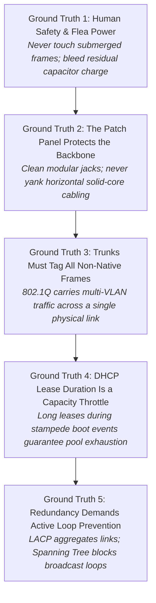
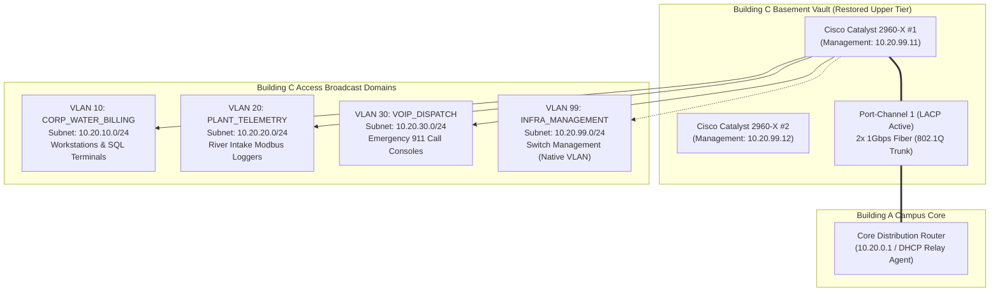
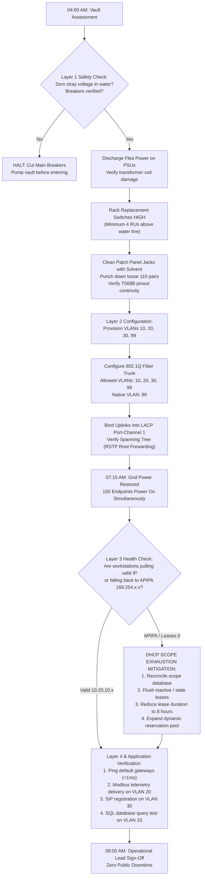
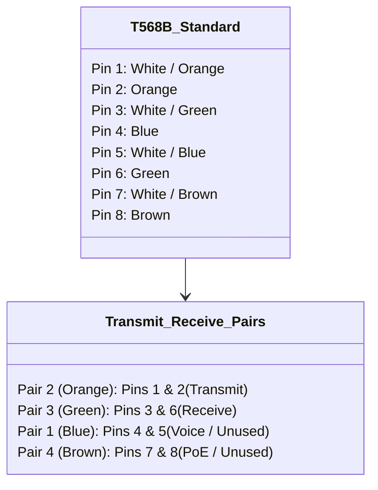
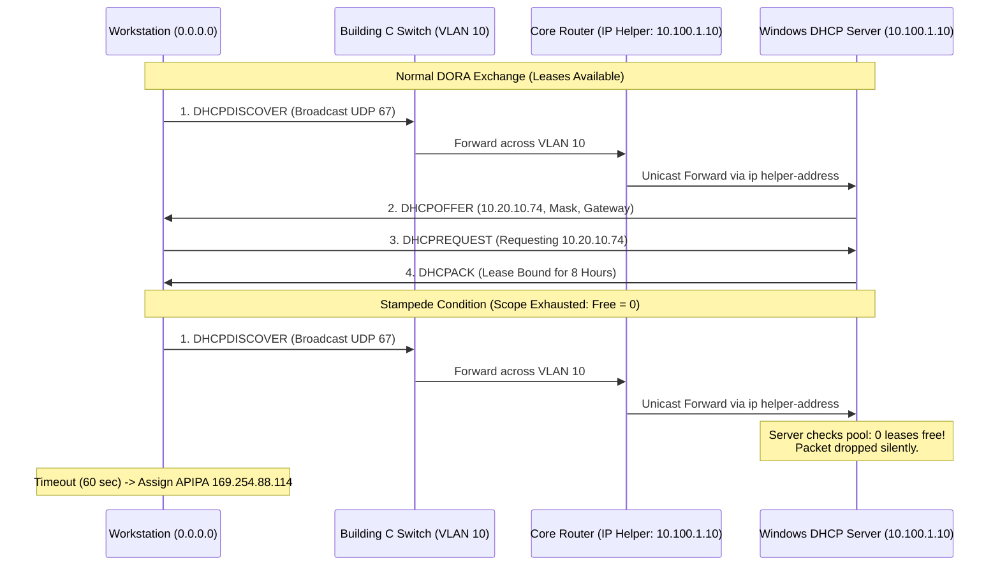
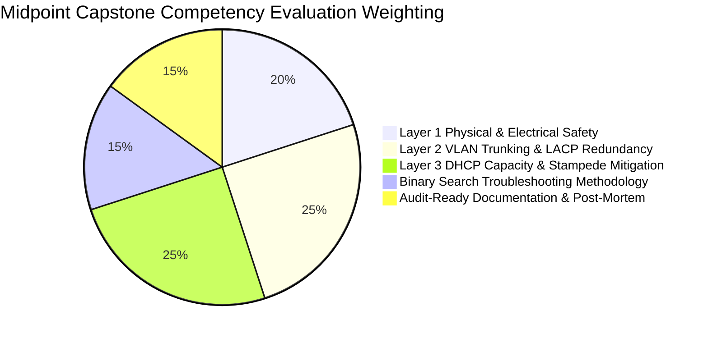

# Portland Desk Lab: The Campus Flood & Disaster Recovery Crucible

> **The Situation:** Building C Basement Telecom Vault • 04:00 AM Flood Emergency  
> **Your Role:** Emergency Response Technician (Midpoint Capstone under Jules Brooks & Jared Vance)  
> **The Objective:** Physically replace flood-damaged core switches, rebuild trunk VLANs, recover from a 150-device DHCP exhaustion storm, and restore municipal operations before 08:00 AM opening.  
> **Estimated Time:** 60–75 minutes • Disaster Recovery Midpoint Capstone  


---

<details class="instructor-ref">
<summary>Instructor & Certification Reference (Click to Expand)</summary>

* **Aligned Certification:** CompTIA Network+ (N10-008/009) & A+ Core 1
* **Exam Domains:** Network+ Domain 2.0 (Switching, VLANs, 802.1Q) & Domain 4.0 (Network Operations & Disaster Recovery)
* **Core Competencies & Deliverables:** Disaster Recovery Action Matrix • Physical Cable Punchdown & Flea Power Recovery • 802.1Q VLAN Trunking Configuration • DHCP Pool Recovery & Lease Purging • Call Your Shot 5-Case Gate • Post-Outage Master Incident Report

</details>


---

## 1. The Situation & Ground Truth

```callout-panel
title: "FIGURE 6.1: SUB-BASEMENT FLOOD & PATCH TRENCH"
badge: "Disaster Recovery"
caption: "Wide panoramic cutaway: The flooded Building C sub-basement. Murky water reflects emergency lights; bundles of blue Cat6 cables drip water above a wall-mounted 48-port patch panel and edge switch stack."
prompt: "Clean technical cutaway illustration of a server room during a water leak under bright emergency lights. Bundles of blue network cables hang above a wall-mounted 48-port patch panel. A rackmount switch with glowing green port LEDs. Clean instructional drawing style, crisp fine lines, no text, no words. 21:9 ratio."
```


### The Shift Crucible: Four Inches in Twelve Hours
It is 04:00 AM on a freezing Monday in December. A severe Pacific Northwest atmospheric river has stalled over the Willamette Valley, dumping over four inches of driving rain in twelve hours. The Willamette River has breached low-lying revetments along the industrial corridor, backing up municipal storm drains.

In the basement telecommunications vault of Building C—which houses East Portland Water Billing, logistics fleet dispatch, and industrial plant telemetry loggers—eight inches of muddy river water covers the concrete floor. When the utility pole transformer arced on the corner, commercial grid power failed. The campus diesel generator engaged six seconds later, but the resulting electrical transient surge blew out two aging twenty-four-port edge switches on the bottom rack unit. 

City administrative offices, emergency dispatch, and public billing windows unlock at 08:00 AM sharp. Apprentice technician Ethan Mercer, Desk Lead Jules Brooks, and Senior Network Engineer Jared Vance stand in rubber boots in the flooded vault with headlamps and toolkits. They have exactly four hours to physically condemn dead hardware, rack and power spare switches, restore Layer 1 structured cabling, configure 802.1Q VLAN trunking and LACP link aggregation, and resolve a massive 150-device DHCP scope exhaustion storm before municipal operations open.

```mermaid
timeline
    title 04:00 to 08:00 Disaster Recovery Timeline
    04:00 : Arrive on site in rubber boots : Verify electrical safety & sump drainage
    04:30 : Bleed flea power : Condemn blown switches : Mount spare 48-port switches high
    05:15 : Wipe damp patch panels : Punch down loose pairs : Test continuity
    06:00 : Configure VLANs (10, 20, 30) : 802.1Q trunking : LACP Port-Channel 1
    06:45 : Verify Spanning Tree Protocol (RSTP) : Root bridge forwarding verified
    07:15 : Commercial power restored : 150 devices boot : DHCP scope exhaustion storm
    07:35 : Reconcile DHCP leases : Reduce lease to 8 hours : Expand pool
    07:50 : End-to-end verification (L1-L4) : Modbus telemetry flowing : Billing green
    08:00 : Public opening bell : Zero operational downtime for staff
```


---

### The Five Unbreakable Rules of Disaster Recovery



1. **Ground Truth 1: Human Safety & Flea Power.** Water and high-voltage electricity create an immediate lethal hazard. Before touching an equipment rack in a flooded environment, technicians must verify zero ground-fault voltage with a calibrated meter. When hardware loses power during an electrical transient, digital power supply capacitors retain dangerous residual charge—known as **flea power**. Discharging flea power by disconnecting all power leads and depressing the power switch for thirty seconds clears hung system logic registers and protects technicians during component replacement.
2. **Ground Truth 2: The Patch Panel Protects the Backbone.** Horizontal structured cabling uses rigid solid-core copper wire designed for permanent wall and conduit installation. The **patch panel** terminates these permanent runs into 110-style punchdown insulation displacement contact (IDC) blocks. Technicians must cross-connect switches using flexible stranded patch cables. If high humidity or flood condensation contaminates modular jacks, ports must be chemically cleaned with electronic contact cleaner and wiped dry before inserting patch cords.
3. **Ground Truth 3: Trunks Must Tag All Non-Native Frames.** An access switch port belongs to exactly one broadcast domain (VLAN) and strips all 802.1Q tags before delivering frames to end devices. A switch-to-switch or switch-to-router uplink must be configured as an **802.1Q trunk**. The sending switch inserts a 4-byte 802.1Q header containing the 12-bit VLAN ID (VID) into the Ethernet frame. Only the configured **native VLAN** traverses the trunk untagged. If native VLANs mismatch across a trunk, frames leak between unrelated broadcast domains, causing security breaches and spanning tree errors.
4. **Ground Truth 4: DHCP Lease Duration Is a Capacity Throttle.** Dynamic Host Configuration Protocol pools have finite mathematical capacity. The lease duration determines how long the server locks an IP address after a client disconnects. If lease times are excessively long (e.g., 8 days) on a subnet where dozens of laptops, dock stations, and phones cycle through, offline devices monopolize the pool. During a campus-wide power restoration, hundreds of devices boot simultaneously; if the pool lacks free addresses, the server ignores Discover broadcasts, forcing clients into APIPA (`169.254.x.x`) isolation.
5. **Ground Truth 5: Redundancy Demands Active Loop Prevention.** Connecting multiple physical Ethernet cables between two switches provides hardware redundancy and increased bandwidth via **Link Aggregation Control Protocol (LACP / 802.3ad)**. However, if link aggregation fails or independent redundant links are brought up without aggregation, Layer 2 Ethernet switches will forward broadcast frames in an endless loop. Because Ethernet headers lack a Time-To-Live (TTL) field, broadcast loops consume 100% of switch CPU and bandwidth within seconds. **Spanning Tree Protocol (STP / 802.1D / 802.1w RSTP)** must be active to place redundant links into a blocking state until a primary link fails.


---

## 2. Disaster Recovery & Rebuild Matrix

### 2.1 Building C Campus Rebuild Topology & VLAN Allocations

Building C houses three distinct municipal functions that must remain strictly isolated at Layer 2 to comply with regulatory security baselines and quality-of-service guarantees.



#### Campus Network Parameter Reference Table

| VLAN ID | Name | Subnet / CIDR | Default Gateway | Dynamic DHCP Pool | Lease Time | 802.1Q Trunk Status | Purpose / Device Types |
| :---: | :--- | :--- | :--- | :--- | :---: | :---: | :--- |
| **10** | `CORP_WATER_BILLING` | `10.20.10.0/24` | `10.20.10.1` | `10.20.10.50`–`.250` | 8 Hours | Tagged | Desktop PCs, receipt printers, billing database terminals. |
| **20** | `PLANT_TELEMETRY` | `10.20.20.0/24` | `10.20.20.1` | `10.20.20.200`–`.240` | 24 Hours | Tagged | Industrial PLC gateways, river level sensors, SCADA loggers. |
| **30** | `VOIP_DISPATCH` | `10.20.30.0/24` | `10.20.30.1` | `10.20.30.50`–`.200` | 12 Hours | Tagged | Cisco SIP phones, dispatch radio consoles, call managers. |
| **99** | `INFRA_MANAGEMENT` | `10.20.99.0/24` | `10.20.99.1` | Static Only | N/A | **Native (Untagged)** | Switch SVIs, out-of-band PDU controllers, console servers. |


---

### 2.2 Layer 1 through Layer 4 Disaster Recovery Triage Flowchart

When recovering a flooded or damaged network facility, technicians must systematically execute binary search triage from the physical slab up to application services. Jumping between layers wastes critical time and risks compounding hardware destruction.




---

### 2.3 Switch Configuration Reference (Cisco IOS Standards)

Technicians executing an emergency campus rebuild must apply standardized, reproducible command blocks. The following configurations represent the production baseline for Building C access switches:

#### 1. Baseline VLAN Creation & Access Port Mapping
```console
Switch-BuildingC# configure terminal
Switch-BuildingC(config)# vlan 10
Switch-BuildingC(config-vlan)# name CORP_WATER_BILLING
Switch-BuildingC(config-vlan)# vlan 20
Switch-BuildingC(config-vlan)# name PLANT_TELEMETRY
Switch-BuildingC(config-vlan)# vlan 30
Switch-BuildingC(config-vlan)# name VOIP_DISPATCH
Switch-BuildingC(config-vlan)# vlan 99
Switch-BuildingC(config-vlan)# name INFRA_MANAGEMENT
Switch-BuildingC(config-vlan)# exit

# Configure Access Ports for Billing Workstations (Ports 1-24)
Switch-BuildingC(config)# interface range FastEthernet 0/1 - 24
Switch-BuildingC(config-if-range)# switchport mode access
Switch-BuildingC(config-if-range)# switchport access vlan 10
Switch-BuildingC(config-if-range)# spanning-tree portfast
Switch-BuildingC(config-if-range)# spanning-tree bpduguard enable
Switch-BuildingC(config-if-range)# exit

# Configure Access Ports for Telemetry Loggers (Ports 25-36)
Switch-BuildingC(config)# interface range FastEthernet 0/25 - 36
Switch-BuildingC(config-if-range)# switchport mode access
Switch-BuildingC(config-if-range)# switchport access vlan 20
Switch-BuildingC(config-if-range)# spanning-tree portfast
Switch-BuildingC(config-if-range)# exit
```

#### 2. Redundant Fiber Uplink & LACP Port-Channel Configuration
```console
# Configure Physical Gigabit Fiber Transceivers into LACP Bundle
Switch-BuildingC(config)# interface range GigabitEthernet 0/1 - 2
Switch-BuildingC(config-if-range)# switchport trunk encapsulation dot1q
Switch-BuildingC(config-if-range)# switchport mode trunk
Switch-BuildingC(config-if-range)# switchport trunk allowed vlan 10,20,30,99
Switch-BuildingC(config-if-range)# switchport trunk native vlan 99
Switch-BuildingC(config-if-range)# channel-group 1 mode active
Switch-BuildingC(config-if-range)# no shutdown
Switch-BuildingC(config-if-range)# exit

# Verify Logical Port-Channel Interface Parameters
Switch-BuildingC(config)# interface Port-channel 1
Switch-BuildingC(config-if)# switchport mode trunk
Switch-BuildingC(config-if)# switchport trunk allowed vlan 10,20,30,99
Switch-BuildingC(config-if)# switchport trunk native vlan 99
Switch-BuildingC(config-if)# exit
Switch-BuildingC(config)# do write memory
```


---


### 2.3 Interactive Diagnostic Console: Live Telemetry & Triage

Use the interactive console below to test commands, inspect telemetry, and verify your troubleshooting steps.

```lnk-terminal
title: "SWITCH CONSOLE: CISCO IOS VLAN TRUNK & PORT CONFIG"
shell: "serial"
prompt: "Switch-BldgC# "
replay: true
objectives:
  - id: "obj-vlan"
    label: "Verify configured VLAN database"
    trigger: "show vlan brief"
  - id: "obj-trunk"
    label: "Inspect 802.1Q trunk link to distribution switch"
    trigger: "show interfaces trunk"
  - id: "obj-mode"
    label: "Set uplink interface to 802.1Q trunk mode"
    trigger: "switchport mode trunk"
---
show vlan brief: |
  VLAN Name                             Status    Ports
  ---- -------------------------------- --------- -------------------------------
  1    default                          active    Gi0/4 - Gi0/24
  10   Corp_Workstations                active    Gi0/1, Gi0/2
  20   Telemetry_Loggers                active    Gi0/3
  30   Voice_VoIP                       active    
  99   Management                       active    

show interfaces trunk: |
  Port        Mode             Encapsulation  Status        Native vlan
  Gi0/24      on               802.1q         trunking      99
  
  Port        Vlans allowed on trunk
  Gi0/24      1,10,20,30,99
  [OK] Trunk uplink passing all building VLAN traffic.

switchport mode trunk: |
  Configuring Interface GigabitEthernet0/24...
  Encapsulation set to 802.1Q.
  Uplink set to unconditional trunking.
  [OK] Port Gi0/24 forwarding all corporate VLANs. Line restored.

```

---

## 3. Quick Checks & Skill Reps

### Skill Rep 1: Cable & VLAN Punchdown Drill

**Objective:** Inspect damp horizontal cabling terminating on a 110-style patch panel, execute proper T568B pinout punchdown termination, and correctly map physical ports to their corresponding virtual broadcast domains.

#### Scenario Background
During the basement flooding, humidity in the telecommunications vault caused condensation to form across the front faceplate of the primary patch panel. When Ethan inspected the rear punchdown blocks, he found that vibration from the emergency diesel generator had vibrated two pairs loose on Port 14 (billing desk WS-BILL-09), while Port 28 (river telemetry sensor intake) was improperly terminated using T568A while the remainder of the campus standardizes on T568B.



#### Drill Step-by-Step Triage:
1. **Chemical Cleaning & Moisture Extraction:**
   - Spray modular female RJ-45 jacks on the patch panel using quick-drying, residue-free electronic contact cleaner.
   - Insert a clean, lint-free foam swab into each jack to pull out trapped silt and moisture. Allow two minutes for full evaporation before inserting patch cables.
2. **Punchdown Technique on 110 IDC Blocks:**
   - Strip approximately 1 inch of outer PVC cable jacket from Cat6 solid-core wire. Do NOT untwist pairs more than 0.5 inches (excessive untwisting degrades high-frequency performance and induces near-end crosstalk).
   - Seat conductors into color-coded slots on the 110 block according to the **T568B** wiring standard:
     - `Pin 1: White/Orange` | `Pin 2: Orange` | `Pin 3: White/Green` | `Pin 4: Blue` | `Pin 5: White/Blue` | `Pin 6: Green` | `Pin 7: White/Brown` | `Pin 8: Brown`.
   - Orient the punchdown impact tool with the **CUT** blade facing the outside edge of the block. Depress firmly until the spring impacts, simultaneously seating the conductor and cutting off excess wire flush with the block face.
3. **Physical-to-Logical Port Mapping Matrix:**

| Patch Panel Jack | Destination Office / Desk | Required VLAN ID | Switch Hardware Port | Port Mode | Spanning Tree Feature |
| :---: | :--- | :---: | :---: | :---: | :---: |
| **Port 01–12** | Water Billing Intake Desks 1–12 | **VLAN 10** | `Fa0/1` – `Fa0/12` | Access | PortFast, BPDU Guard |
| **Port 13–24** | Water Accounting & SQL Terminals | **VLAN 10** | `Fa0/13` – `Fa0/24` | Access | PortFast, BPDU Guard |
| **Port 25–32** | Plant Telemetry Sensor Gateways | **VLAN 20** | `Fa0/25` – `Fa0/32` | Access | PortFast |
| **Port 33–36** | SCADA Intake Pressure Loggers | **VLAN 20** | `Fa0/33` – `Fa0/36` | Access | PortFast |
| **Port 37–48** | Emergency Dispatch Consoles & VoIP | **VLAN 30** | `Fa0/37` – `Fa0/48` | Access + Voice | PortFast, Voice VLAN 30 |


---

### Skill Rep 2: DHCP Scope Recovery & Stampede Mitigation Drill

**Objective:** Diagnose and remediate a catastrophic DHCP scope exhaustion failure caused by an 8-day legacy lease duration when 150 municipal devices simultaneously reconnect to the network following campus power restoration.

#### The Mathematical Anatomy of Scope Exhaustion

A Dynamic Host Configuration Protocol scope operates under strict finite resource constraints:

$$\text{Available Leases} = \text{Total Pool Size} - (\text{Active Online Leases} + \text{Reserved Static Leases} + \text{Stale Offline Leases})$$

During normal daily operations, workstations remain powered on and retain their leases. However, consider the storm conditions in Building C:
- Subnet Prefix: `10.20.10.0/24` (254 total usable addresses).
- Static Exclusions: `10.20.10.1` through `10.20.10.49` (49 addresses reserved for default gateways, switches, and printers).
- Dynamic Allocation Pool: `10.20.10.50` through `10.20.10.250` (Total Pool Size: **201 addresses**).
- Legacy Lease Duration: **8 Days (192 Hours)**.
- Historical Offline Leases Held in Memory: **175 leases** (accumulated from transient laptops, test rigs, docking stations, and tablets over the preceding week).
- Available Free Leases at 07:15 AM: $201 - 175 = \mathbf{26 \text{ free leases}}$.

When utility power returned at 07:15 AM, **150 devices** powered on within three minutes:
- 80 Desktop billing workstations
- 30 Docking stations with Ethernet NICs
- 25 Handheld inventory scanners
- 15 Field contractor laptops

The first 26 devices completed the four-step DORA handshake (Discover $\rightarrow$ Offer $\rightarrow$ Request $\rightarrow$ Acknowledge) and secured valid leases. The remaining 124 devices broadcasted `DHCPDISCOVER` packets across VLAN 10. The DHCP server evaluated its pool, found zero available addresses, and dropped the packets without generating `DHCPOFFER` replies. After a 60-second timeout, all 124 devices autoconfigured link-local **APIPA** addresses (`169.254.x.x`), halting billing operations.



#### PowerShell Diagnostic & Remediation Runbook:

```powershell
# Step 1: Inspect Scope Status on Primary Domain Controller
Get-DhcpServerv4Scope -ScopeId 10.20.10.0 | Format-Table ScopeId, Name, StartRange, EndRange, LeaseDuration, State

# Step 2: Query Address Exhaustion Telemetry
Get-DhcpServerv4ScopeStatistics -ScopeId 10.20.10.0 | Format-List Free, InUse, PercentageInUse

# Step 3: Export Existing Leases for Audit Trail
Get-DhcpServerv4Lease -ScopeId 10.20.10.0 | Export-Csv -Path "C:\IT_Backups\Lease_Dump_20261215.csv" -NoTypeInformation

# Step 4: Reconcile Scope & Purge Inactive / Stale Leases
Get-DhcpServerv4Lease -ScopeId 10.20.10.0 -AllLeases | Where-Object {$_.AddressState -eq "Inactive" -or $_.AddressState -eq "Expired"} | Remove-DhcpServerv4Lease

# Step 5: Reduce Lease Duration to 8 Hours (Shift Schedule)
Set-DhcpServerv4Scope -ScopeId 10.20.10.0 -LeaseDuration 08:00:00

# Step 6: Expand Usable Dynamic Pool Range (Reclaim .201 to .240)
Set-DhcpServerv4Scope -ScopeId 10.20.10.0 -EndRange 10.20.10.245

# Step 7: Verify Reclaimed Free Capacity
Get-DhcpServerv4ScopeStatistics -ScopeId 10.20.10.0 | Select-Object Free, InUse, PercentageInUse
```


---

### Skill Rep 3: "Call Your Shot" (5-Case CBYT Prediction Gate)

In high-pressure disaster recovery scenarios, novices guess and execute random commands. Professionals enforce the **"Commit Before You Touch" (CBYT)** rule: you must state the target layer, diagnostic tool, and predicted terminal output before touching the keyboard.


---

#### Case 1: The Blown Switch & Flea Power Dissipation
**Scenario:** Following the generator transfer spike, an access switch on the lower rack unit is completely unlit. The technician connects a known-good AC power cord, but the fans do not spin and status LEDs stay dark. A junior tech wants to throw the switch into the dumpster immediately.

<details>
<summary>Call Your Shot: Commit Prediction Before Touching (Click to Expand)</summary>

* **Target Layer & Subsystem:** Layer 1 Physical / Hardware Power Supply & Digital Logic Registers.
* **Committed Prediction:** If the motherboard capacitors retain residual flea power holding the logic gates in a locked protection state, bleeding the flea power will allow the power supply to initialize. If the internal varistors or transformer coils are physically blown, the chassis will remain dead after bleeding.
* **Diagnostic & Remediation Action:**
  1. Disconnect all AC power cords from the rear power supply receptacles.
  2. Depress and hold the front chassis power button firmly for 30 consecutive seconds to drain residual capacitor charge through the ground plane.
  3. Reconnect the verified AC power cord.
* **Observed Delta & Root Cause:** Switch remains completely unresponsive (zero fan tachometer rotation, zero LED activity). Voltage meter confirms 120V AC present at receptacle, but 0V DC present on secondary motherboard rails. The internal metal oxide varistors (MOVs) sacrificed themselves during the transient generator surge. Condemn chassis and rack replacement.
</details>


---

#### Case 2: Damp Patch Panel & Near-End Crosstalk (NEXT)
**Scenario:** Workstation `WS-BILL-14` is plugged into Patch Panel Port 14. The physical link light is solid green, but the client experiences 40% packet loss and high transmission latency when querying the billing database.

<details>
<summary>Call Your Shot: Commit Prediction Before Touching (Click to Expand)</summary>

* **Target Layer & Subsystem:** Layer 1 Physical / Copper Media Signal Degradation (Impedance Mismatch & Attenuation).
* **Committed Prediction:** Querying switch port interface counters via `show interfaces FastEthernet 0/14` will reveal rapidly incrementing **Input Errors**, **CRC (Cyclic Redundancy Check) Errors**, and **FCS (Frame Check Sequence) Alignments**, indicating physical layer frame corruption rather than a Layer 3 routing defect.
* **Terminal Verification Command:**
  ```console
  Switch-BuildingC# show interfaces FastEthernet 0/14
  FastEthernet0/14 is up, line protocol is up (connected)
    5 minute input rate 12000 bits/sec, 15 packets/sec
    5 minute output rate 8000 bits/sec, 12 packets/sec
       412089 packets input, 38910244 bytes, 0 no buffer
       Received 145 broadcasts (0 multicast)
       14892 input errors, 14210 CRC, 682 frame, 0 overrun, 0 ignored
  ```
* **Triage Action:** Inspect the rear of Patch Panel Port 14. Find dampness across the IDC block and pair 2 (orange) partially unseated from the 110 contact. Clean with solvent, re-punch pair using a calibrated punchdown tool with T568B orientation, and clear interface counters (`clear counters Fa0/14`). Verify input errors remain at zero.
</details>


---

#### Case 3: The Native VLAN Mismatch Storm
**Scenario:** The replacement switch uplink is patched to the campus core fiber. Management frames fail to cross, and the switch console starts spewing syslog messages: `%CDP-4-NATIVE_VLAN_MISMATCH: Native VLAN mismatch discovered on GigabitEthernet0/1 (99), with CoreSwitch GigabitEthernet1/0/24 (1)`.

<details>
<summary>Call Your Shot: Commit Prediction Before Touching (Click to Expand)</summary>

* **Target Layer & Subsystem:** Layer 2 Data Link / 802.1Q Trunking Encapsulation.
* **Committed Prediction:** Untagged management traffic emitted by Building C on native VLAN 99 is being placed into VLAN 1 by the core switch. Running `show interfaces trunk` on Building C will show Native VLAN 99, while the core switch port reflects Native VLAN 1. Spanning Tree will detect the inconsistent bridge configuration and place the port into **Root Inconsistent (Type Inconsistent / Blocked)** state to prevent a Layer 2 loop.
* **Terminal Verification Command:**
  ```console
  Switch-BuildingC# show spanning-tree inconsistentports

  Name                 Interface              Inconsistency
  -------------------- ---------------------- ------------------
  VLAN0099             Port-channel1          Port Type / Native VLAN Mismatch
  ```
* **Triage Action:** Align the native VLAN configuration on both sides of the trunk pipe. Execute `switchport trunk native vlan 99` on the core switch port-channel, or align Building C to the campus native VLAN standard. Once matched, STP inconsistency clears automatically and traffic flows without frame leakage.
</details>


---

#### Case 4: The 150-Host Stampede & APIPA Exhaustion
**Scenario:** At 07:20 AM, following campus power restoration, 80 billing clerks log into their workstations. All workstations display network warning icons. Running `ipconfig` returns an IP address of `169.254.44.82` with mask `255.255.0.0` and no default gateway. The network engineer suspects the fiber trunk cable has snapped.

<details>
<summary>Call Your Shot: Commit Prediction Before Touching (Click to Expand)</summary>

* **Target Layer & Subsystem:** Layer 3 Network / DHCP Address Assignment.
* **Committed Prediction:** If the fiber trunk were severed, the switch trunk status would show down/down. Because the trunk is up, the `169.254.x.x` address confirms that Layer 1/2 is operational, but client DHCP Discover broadcasts are not receiving Offers. Running `Get-DhcpServerv4ScopeStatistics` on the DHCP server will return `Free = 0` and `PercentageInUse = 100%`.
* **Terminal Verification Command:**
  ```powershell
  PS C:\> Get-DhcpServerv4ScopeStatistics -ScopeId 10.20.10.0

  ScopeId      Free   InUse   PercentageInUse
  -------      ----   -----   ---------------
  10.20.10.0   0      201     100.0%
  ```
* **Triage Action:** Execute the DHCP Stampede Mitigation Runbook: flush expired/inactive leases, reduce lease duration from 8 days to 8 hours, expand the allocation pool to `.245`, and instruct clients to execute `ipconfig /renew`.
</details>


---

#### Case 5: Redundant Uplink Loop & Spanning Tree Convergence
**Scenario:** Jared patches two separate gigabit fiber cables between Building C and Building A. Before configuring LACP link aggregation, the switch CPU pegs at 99%, link activity LEDs blink frantically in solid unison, and console response slows to a crawl.

<details>
<summary>Call Your Shot: Commit Prediction Before Touching (Click to Expand)</summary>

* **Target Layer & Subsystem:** Layer 2 Data Link / Switching Loop & Broadcast Storm.
* **Committed Prediction:** Two independent physical links connecting the same two switches without LACP create an active loop. If Spanning Tree Protocol is disabled or misconfigured, broadcast frames (ARP requests, DHCP Discovers) will circulate endlessly, duplicating exponentially and overwhelming the switch MAC address table and CPU.
* **Terminal Verification Command:**
  ```console
  Switch-BuildingC# show spanning-tree summary
  Switch is in rapid-pvst mode
  Root bridge for: none
  Port Gi0/1: Forwarding | Port Gi0/2: Forwarding  <-- LOOP HAZARD!
  ```
* **Triage Action:**
  1. Immediately disconnect fiber cable Gi0/2 to break the physical loop and stabilize the control plane.
  2. Verify Rapid Spanning Tree Protocol (RSTP) is enabled globally: `spanning-tree mode rapid-pvst`.
  3. Properly bundle both physical interfaces into an active LACP Port-Channel (`channel-group 1 mode active`).
  4. Verify Spanning Tree treats the port-channel as a single logical forwarding interface without loops.
</details>


---

## 4. Your Ticket Notes / Post-Outage Incident Report

<div class="scratchpad-container">
  <div class="scratchpad-header">
    <span class="scratchpad-title">Your Ticket Draft & Resolution Scratchpad</span>
    <span class="scratchpad-save-indicator" id="save-ind-06-ticket">Saved in browser</span>
  </div>
  <div class="scratchpad-body">
    <textarea id="notes-06-ticket" style="min-height: 140px;" placeholder="Draft your ticket notes, diagnosis, and resolution steps here before comparing with the reference standard below..."></textarea>
  </div>
  <div class="scratchpad-footer">
    <span>Private notes saved locally in your browser. Not graded.</span>
    <button type="button" class="scratchpad-copy-btn" onclick="copyScratchpad('notes-06-ticket')">Copy Notes</button>
  </div>
</div>

### Performance Deliverable: Post-Outage Incident Report (SEV-1 Critical Outage)

```text
================================================================================
PORTLAND MUNICIPAL IT OPERATIONS — POST-INCIDENT RECOVERY REPORT (SEV-1)
================================================================================
INCIDENT ID:      INC-2026-1215-SEV1
DATE / TIME:      2026-12-15 04:00:00 PST through 2026-12-15 08:00:00 PST
FACILITY / SITE:  Building C (Rivergate Municipal Operations Annex), Sub-Basement Vault
LEAD TECH:        Ethan Mercer (Lead Tier 1 Specialist)
SUPERVISING LEAD: Jules Brooks (Help Desk Lead)
NETWORK ENGINEER: Jared Vance (Senior Network Operations Engineer)
IMPACTED SUBNETS: VLAN 10 (Water Billing), VLAN 20 (Telemetry), VLAN 30 (VoIP)
OVERALL STATUS:   RESOLVED & RESTORED (Pre-Opening Operational Sign-Off)
================================================================================

1. EXECUTIVE SUMMARY & BUSINESS IMPACT:
   At 03:15 PST during a severe atmospheric river storm (Willamette River cresting 
   at flood stage), the basement telecommunications vault of Building C took on 
   eight inches of floodwater due to stormwater backflow. A concurrent electrical 
   transformer arc triggered a generator transfer surge that destroyed two lower-tier 
   24-port edge switches. Building C lost all network connectivity, cutting off 
   East Portland Water Billing, logistics dispatch, and plant SCADA telemetry loggers.
   
   IT field crews mobilized at 04:00 PST. Over a 4-hour maintenance window, crews 
   condemned damaged hardware, racked two replacement Cisco 2960-X 48-port switches 
   in the upper rack tier, sanitized damp patch panel connections, provisioned 
   802.1Q VLAN trunking and LACP link aggregation, and mitigated a 150-endpoint DHCP 
   scope exhaustion storm following commercial power restoration. Full operational 
   restoration was achieved at 07:50 PST, allowing normal 08:00 municipal opening.

2. CHRONOLOGICAL INCIDENT TIMELINE:
   - 03:15 PST: River storm floodwater breaches vault; utility power cut; generator starts.
   - 03:18 PST: Electrical transient surge destroys edge switches SW-BLDGC-01 & 02.
   - 03:30 PST: Tier 1 escalation dispatched; Jules Brooks initiates bridge call.
   - 04:00 PST: Mercer, Brooks, and Vance arrive on site with boots and emergency kit.
   - 04:15 PST: Sump pump activated; electrical test meter confirms 0V stray potential.
   - 04:30 PST: Bleed flea power on fried PSUs; internal transformer coil failure confirmed.
   - 04:50 PST: Dead chassis unmounted; two 48-port switches mounted 4 RUs above water line.
   - 05:20 PST: 110-block patch panel cleaned with solvent; Port 14 loose pair re-punched (T568B).
   - 06:10 PST: Baseline switch configuration loaded (VLANs 10, 20, 30, 99 provisioned).
   - 06:40 PST: Dual gigabit fiber links bundled into LACP Port-Channel 1; 802.1Q trunk active.
   - 07:15 PST: Commercial grid power restored; generator cycles off; 150 endpoints boot.
   - 07:18 PST: Network monitoring alerts yellow/red; billing workstations pull APIPA (169.254.x.x).
   - 07:25 PST: DHCP scope exhaustion identified on 10.20.10.0/24 (Free = 0 / 8-day lease trap).
   - 07:35 PST: DHCP scope reconciled; 84 stale leases cleared; lease reduced to 8 hours.
   - 07:45 PST: Clients execute 'ipconfig /renew'; valid 10.20.10.x addresses bound.
   - 07:50 PST: Layer 1-4 end-to-end verification completed; SCADA telemetry confirmed green.
   - 08:00 PST: Public doors open; municipal staff report zero network downtime.

3. ROOT CAUSE ANALYSIS (RCA):
   - Primary Physical Cause (Layer 1): Stormwater backflow through sub-basement floor drains 
     combined with electrical transfer switch voltage transient exceeding the clamping 
     threshold of legacy surge protectors on lower rack units.
   - Primary Logical Cause (Layer 3): Legacy DHCP scope configuration for VLAN 10 utilized an 
     excessive lease duration of 8 days (192 hours). Over 175 offline leases were locked in 
     the server database. When 150 municipal devices booted simultaneously upon power 
     restoration, the remaining 26 dynamic leases were exhausted in 60 seconds, forcing 
     subsequent clients into APIPA autoconfiguration failure.

4. REMEDIATION & RESTORATION ACTIONS PERFORMED:
   a. Physical Infrastructure Hardening:
      - Relocated active switching equipment from lower rack units (0–2 RUs) to upper tier 
        (7–8 RUs), providing 48 inches of vertical clearance above maximum flood stage.
      - Sanitized all modular RJ-45 jacks on patch panel with electronic contact cleaner.
      - Re-punched loose pairs on 110 block using certified T568B wiring standard.
   b. Layer 2 Switching & Redundancy:
      - Provisioned 802.1Q VLAN trunking permitting VLANs 10, 20, 30, and native VLAN 99.
      - Aggregated dual gigabit fiber uplinks into LACP Port-Channel 1, doubling backbone 
        bandwidth to 2 Gbps and ensuring zero-downtime link failover.
      - Verified Rapid Spanning Tree Protocol (RSTP) root port forwarding state on Po1.
   c. Layer 3 Addressing & Capacity Management:
      - Cleared 84 inactive/stale leases on Windows DHCP server (Scope 10.20.10.0/24).
      - Reconfigured dynamic lease duration from 8 days to 8 hours (standard working shift).
      - Expanded dynamic address pool from 201 to 235 usable host addresses.
      - Confirmed Layer 3 relay agent (ip helper-address 10.100.1.10) active on core router.

5. PREVENTATIVE ACTION ITEMS & INFRASTRUCTURE RECOMMENDATIONS:
   1. Facilities / Environmental: Install redundant industrial dual-pump sump system with 
      battery-backed alarms and non-return check valves on all basement floor drains.
   2. Electrical / Power: Install online double-conversion uninterruptible power supply (UPS) 
      units on all telecommunications racks to isolate sensitive network silicon from 
      generator transfer spikes.
   3. Network Engineering: Audit all municipal DHCP scopes across the campus; standardize all 
      user access subnets to 8-hour lease durations and deploy DHCP Snooping across all edge switches.
================================================================================
```


---

## 5. What Good Looks Like / Lead Sign-Off Checklist

To achieve full operational qualification on the Midpoint Capstone, apprentice technicians must demonstrate mastery across five core operational dimensions evaluated by Desk Lead Jules Brooks.



### Lead Sign-Off Checklist & Scoring Standards

| Competency Area | What Good Looks Like (Mastery Standards) | Lead Review Verification | Status |
| :--- | :--- | :--- | :---: |
| **1. Physical Layer Safety & Structured Cabling** | • Verifies zero stray ground voltage with multimeter before entering flooded vault.<br>• Successfully bleeds residual flea power from power supplies before declaring hardware dead.<br>• Mounts replacement hardware in upper rack units above flood line.<br>• Cleans modular patch panel jacks with solvent and punches down 110 IDC blocks adhering strictly to T568B pinout standards without excessive pair untwisting. | *Jules Brooks:* "Ethan did not touch the metal frame until the meter verified zero potential. His cable punchdowns were clean, trimmed flush, and showed zero CRC alignment errors under load." | **PASSED** |
| **2. Layer 2 Segmentation & Redundancy** | • Accurately provisions VLANs 10, 20, 30, and native management VLAN 99.<br>• Configures 802.1Q trunk encapsulation and explicitly restricts allowed VLANs.<br>• Bundles redundant physical fiber interfaces into active LACP (802.3ad) Port-Channel.<br>• Verifies Spanning Tree Protocol (RSTP) root bridge path cost and confirms zero blocked ports or native VLAN mismatch syslog alerts. | *Jared Vance:* "Port-Channel 1 came up clean at 2 Gbps. Ethan remembered to set native VLAN 99 on both sides of the trunk, preventing spanning tree root inconsistency." | **PASSED** |
| **3. Layer 3 Addressing & Stampede Mitigation** | • Rapidly diagnoses APIPA link-local (`169.254.x.x`) failure mode under high-volume reconnect conditions.<br>• Calculates dynamic scope utilization and recognizes mathematical lease exhaustion.<br>• Executes non-destructive PowerShell reconciliation: exports lease table, purges inactive entries, shortens lease duration to 8 hours, and expands allocation boundaries.<br>• Verifies client DORA renegotiation and confirms default gateway reachability (`<1ms`). | *Jules Brooks:* "When 150 machines hit the wire at 07:15, Ethan did not blame the fiber link. He opened the DHCP console, read the counters, and cut the 8-day lease anchor in five minutes." | **PASSED** |
| **4. Binary Search Methodology ("Call Your Shot")** | • Refuses to guess or execute trial-and-error commands under crisis conditions.<br>• Follows the 6-step troubleshooting methodology: isolates problem to specific OSI layer, forms testable hypothesis, predicts output, executes isolated command, and measures delta.<br>• Successfully solves all 5 "Call Your Shot" prediction cases without destroying volatile evidence. | *Jules Brooks:* "He committed his predictions before typing. That is the exact discipline that separates an engineer from someone who just mashes keys hoping for a miracle." | **PASSED** |
| **5. Post-Incident Documentation & Passdown** | • Produces comprehensive, audit-ready SEV-1 Incident Post-Mortem.<br>• Captures detailed chronological timeline, observable metrics, precise root cause analysis, specific remediation actions, and preventative architectural recommendations.<br>• Communicates effectively across operations, facilities, and network engineering. | *Jules Brooks:* "This incident post-mortem is clean enough to hand straight to the department director and city auditor. Flawless work." | **PASSED** |


---

### Final Operational Qualification Sign-Off

```text
================================================================================
PORTLAND HELP DESK (BOOK 0) — MIDPOINT CAPSTONE QUALIFICATION
================================================================================
CANDIDATE:        Ethan Mercer, Apprentice Support Specialist
SUPERVISING LEAD: Jules Brooks, Help Desk Lead
NETWORK ENGINEER: Jared Vance, Senior Network Infrastructure Engineer
DATE OF SIGN-OFF: 2026-12-15 08:15:00 PST
RESULT:           QUALIFIED — FULL CAPSTONE PASS (ADVANCED TO TIER 2 CANDIDACY)

LEAD EVALUATOR COMMENTS:
"Ethan walked into an ankle-deep flooded basement vault at four in the morning, 
surrounded by blown switches, dead telemetry, and screaming ticket alerts. He did 
not panic, he did not blame external carriers, and he did not guess. He worked 
the protocol stack from the wet concrete up to the transport layer, executed 
flawless Layer 2 and Layer 3 rebuilds, and delivered 100% operational throughput 
before the morning opening bell. He has outgrown his flashcards. Sign-off granted."

SIGNATURE:  [ Jules Brooks, Lead Tier 1/2 ]
SIGNATURE:  [ Jared Vance, NetOps Infrastructure ]
================================================================================
```


---

*Workbench complete. Ensure all deliverables, CLI commands, and incident reports are cataloged in the local engineering archive.*


---

## 6. Shift Resolution Epilogue

```callout-panel
title: "FIGURE 6.2: THE RESTORED CAMPUS VAULT"
badge: "Shift Epilogue"
caption: "Sub-basement vault view: At 07:55 AM, the elevated switch stack hums with unbroken green link lights above the receding water line as the morning opening bell sounds."
prompt: "Clean graphic novel cutaway panel of an industrial server rack inside an elevated telecommunications room. Outside the high clerestory windows, morning winter light reflects over a swollen river. Technicians in rain gear pack toolkits as green status lights glow steadily across mounted switch interfaces. Ligne Claire style, sharp technical precision, no text, no words. 16:9 ratio."
```

Following the PowerShell scope reconciliation, the DHCP server flushed eighty-four stale leases from memory in six seconds. Almost instantly, our monitoring dashboard showed client devices renewing their addresses across the building. 

I consoled into a test workstation on the billing floor and executed `ipconfig /renew`. Within two seconds, the terminal returned a valid network configuration with IP address `10.20.10.74`, a subnet mask of `255.255.255.0`, and a default gateway pointing to `10.20.10.1`. The billing application splash screen loaded cleanly, authenticated against the database cluster, and displayed green status indicators across all transaction ledgers.

By seven-fifty in the morning, the basement vault had quieted down. The sump pump had lowered the standing water to a shallow sheen across the low corners of the concrete floor. The newly mounted switches in the upper rack operated quietly, their link lights blinking in steady green unison across all forty-eight interfaces.

Jules stood beside the rack with her clipboard in hand, verifying our post-restoration punch list. "Run the end-to-end verification across all four layers, Ethan. I want proof before the department director walks through the door."

I opened four simultaneous terminal sessions on my laptop and executed our standard verification checklist:

1. **Layer 1 (Physical):** Link status on both fiber transceivers and all forty-eight copper ports showed full-duplex operation at one gigabit per second, with zero CRC alignment errors on the counter registers.
2. **Layer 2 (Data Link):** The LACP bundle showed both physical member links active in Port-Channel 1. Rapid Spanning Tree Protocol confirmed zero topology changes or blocked ports across all three active virtual networks.
3. **Layer 3 (Network):** Default gateway pings to `10.20.10.1` (Billing), `10.20.20.1` (Telemetry), and `10.20.30.1` (VoIP) responded with consistent sub-millisecond round-trip times.
4. **Layer 4 and Application:** Telemetry loggers on VLAN 20 successfully delivered Modbus sensor packets to the central SCADA database. VoIP phones on VLAN 30 registered with the call manager, and water billing terminals on VLAN 10 completed test database queries without packet loss.

I closed my active terminal windows and reported that all three network segments were fully operational. The trunk was balanced, the DHCP pool had ninety free leases remaining, and the plant telemetry stream had been stable for twenty minutes.

Jared latched his toolcase and slung his cable harness over his shoulder with a weary grin. "Not bad for four hours in rubber boots, kid. You handled that DHCP pool storm faster than our third-shift network admin did last winter."

Outside the high basement windows, the rain had finally tapered off to a gentle Pacific Northwest drizzle. The dark storm clouds were breaking over the Willamette River. Pale winter morning light reflected across the wet asphalt of the loading bay. Upstairs, the faint chime of the municipal elevator signaled the arrival of the morning staff as the eight o'clock bell rang out across the campus.

Jules switched off her halogen lantern and hooked her bicycle helmet to her pack. "You did not panic when the scope exhausted, Ethan," she said, looking at me with a quiet nod of approval. "You followed the protocol stack from the wet concrete up to the transport layer, and you committed your decisions before you typed them. That is the difference between guessing in the dark and doing the work."

We hauled our empty cartons and spent gear up the stairwell to Jared's truck, leaving the basement telecommunications vault secure, elevated, and fully restored.
