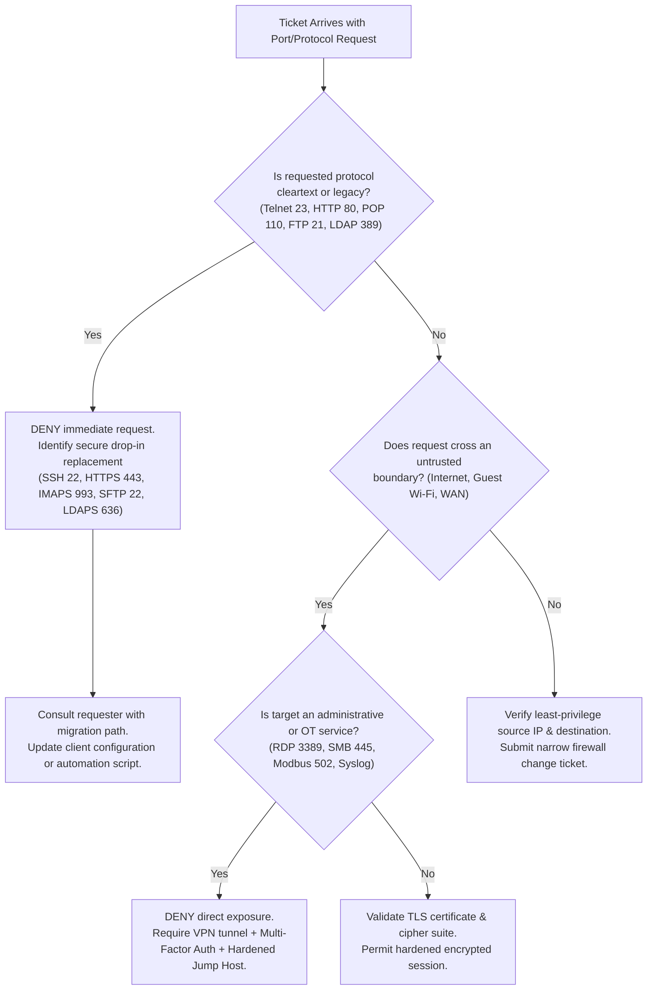

# Portland Desk Lab: Level 1 Protocol Triage & Diagnostic Analysis

> **The Situation:** Level 1 Service Desk Terminal • Operational Queue  
> **Your Role:** Tier 1 Service Desk Specialist (under Desk Lead Jules Brooks)  
> **The Objective:** Identify and replace unencrypted, cleartext legacy protocols (Telnet, HTTP, POP3, SMTP) with modern TLS encrypted standards across email, administration, and plant telemetry.  
> **Estimated Time:** 40–50 minutes • Network Security & Protocol Hardening  


---

<details class="instructor-ref">
<summary>Instructor & Certification Reference (Click to Expand)</summary>

* **Aligned Certification:** CompTIA Security+ (SY0-701)
* **Exam Domains:** Domain 1.0 (Threats & Protocol Vulnerabilities) & Domain 3.0 (Security Architecture: Secure Transit Protocols)
* **Core Competencies & Deliverables:** Cleartext vs Encrypted Protocol Matrix • Packet Capture Credential Extraction Drill • Mail Client Port & STARTTLS Drill • Call Your Shot 5-Case Gate • Standard Resolution & Security Escalation Note

</details>


---

## Worked Example: The open-port queue

This lab starts with the same incident Ethan worked in the chapter, with the answer known. Read it as a demonstration, then use the sections below to practice each step. Section 6 gives you one new problem that works the same way.

**The incident.** A scan showed RDP, LDAP, FTP, Telnet, and SNMP `public` in use, and Sam, a contractor on the road, asked for 3389 to the internet.

1. For each request, name the port and ask what it exposes in clear text.
2. Show the risk with a capture. Jared's Telnet password scrolled past.
3. Swap each protocol for its secure twin: VPN plus a jump host for RDP, LDAPS on 636, SFTP, SSH, and SNMPv3.
4. Where a device cannot run the secure twin, isolate it on a management VLAN behind a jump host.
5. Result: a narrow firewall rule, six old switches patched around instead of fixed, and a Saturday outage when the jump host rebooted.

---

## 1. The Situation & Ground Truth

```callout-panel
title: "FIGURE 7.1: NETWORK PERIMETER & PORT SCAN VECTOR"
badge: "Perimeter Architecture"
caption: "Schematic layout: The corporate perimeter firewall. Cleartext Telnet (Port 23) and unencrypted HTTP (Port 80) bypass encrypted tunnels, exposing credentials on the wire."
prompt: "Clean technical schematic of a corporate network perimeter under bright, even lighting. Flowchart lines connect external internet router to internal firewall and server racks with port numbers highlighted in green and red. Crisp technical line art, no text, no words. 16:9 ratio."
```


### The Situation
It is a Tuesday in August, and Ethan has been on the Portland desk for a year. The queue is full of people carrying habits from somewhere else. Jared's switch script still speaks Telnet. Sam, a contractor traveling for a client, wants RDP on 3389 opened to the internet. Dale Okafor, a facilities vendor engineer, wants FTP on 21 for an appliance. Legal's tool binds to cleartext LDAP on 389. Leah Moreno at the Willamette River plant wants telemetry across the perimeter, and HR's benefits portal still loads over HTTP.

This lab follows those requests. For each one, name the port, name what crosses the wire in clear text, and offer the secure twin.

### The Ground Truth Rules of the Desk
1. **Ports are Doors, Protocols are Languages:** Opening a port allows traffic to reach a listening daemon. If that protocol speaks cleartext, any intermediary on the path (an attacker on guest Wi-Fi, a compromised switch span port, an ISP tap) can harvest passwords, session tokens, and business data without triggering alarms.
2. **Never Open Management Ports to the Public Internet:** Raw management ports—RDP (3389), Telnet (23), SMB (445), SSH (22)—must never be reachable from the external WAN. Remote administrative access requires an encrypted tunnel (**VPN**) terminating at an internal concentrator, followed by access restricted to a hardened **Jump Host**.
3. **Availability Never Excuses Cleartext in Transit:** When an appliance or remote facility (such as Leah Moreno's telemetry loggers in Portland plant operations) cannot establish a secure session natively, we do not downgrade the enterprise perimeter to cleartext. We encapsulate, proxy, or isolate on a dedicated staging network.
4. **Client Submission $\neq$ Server Relay:** Mail clients must never send mail on port 25. Port 25 is unauthenticated server-to-server relay. End-user mail submission must use **Submission (Port 587 with STARTTLS)** or **SMTPS (Port 465 with implicit TLS)**.


---

## 2. Technical Reference & Triage Matrix

### The SY0-701 Cleartext vs. Encrypted Protocol Matrix

| Functional Role | Insecure / Cleartext | Secure / Encrypted | Transport & Mechanism | Port Hardening Rule & Exam Objective |
| :--- | :--- | :--- | :--- | :--- |
| **Remote Shell / CLI Admin** | **Telnet** (TCP 23) | **SSH** (TCP 22) | Asymmetric key exchange + Symmetric stream encryption | **Block TCP 23.** All administrative terminal sessions must use SSH with public-key authentication; disable password authentication where possible. |
| **Web Traffic** | **HTTP** (TCP 80) | **HTTPS** (TCP 443) | Transport Layer Security (TLS 1.3 / X.509 PKI) | **Redirect TCP 80 to 443.** Enforce HSTS (HTTP Strict Transport Security). Never transmit credentials or form data over port 80. |
| **Mail Inbound (Download)** | **POP3** (TCP 110) | **POP3S** (TCP 995) | Implicit TLS wrapper | **Block TCP 110.** POP3 downloads and removes mail locally. If POP3 is mandated, wrap entirely in TLS on port 995. |
| **Mail Inbound (Server-Sync)** | **IMAP** (TCP 143) | **IMAPS** (TCP 993) | Implicit TLS wrapper | **Block TCP 143.** IMAP maintains server-side sync. Modern endpoints must connect to IMAPS on 993 to protect session cookies and authentication tokens. |
| **Mail Outbound (Client Send)** | **SMTP** (TCP 25) | **Submission** (TCP 587) / **SMTPS** (TCP 465) | Explicit TLS (**STARTTLS**) on 587; Implicit TLS on 465 | **Block outbound TCP 25 on client subnets.** Port 25 is restricted to MTA-to-MTA relays. Clients authenticate on 587 or 465. |
| **File Transfer** | **FTP** (TCP 20, 21) | **SFTP** (TCP 22) *or* **FTPS** (TCP 989, 990) | SFTP: SSH subsystem.<br>FTPS: TLS-wrapped FTP control/data | **Block TCP 20/21.** Do not confuse SFTP (runs over SSH port 22) with FTPS (classic FTP wrapped in TLS on 989/990). |
| **Directory Services** | **LDAP** (TCP 389) | **LDAPS** (TCP 636) | TLS wrapper over LDAP | **Block TCP 389 across perimeter & wireless.** Directory binds expose Active Directory credentials in cleartext; migrate all queries to LDAPS (636). |
| **Device Monitoring** | **SNMPv1 / v2c** (UDP 161, 162) | **SNMPv3** (UDP 161, 162) | Cryptographic Auth (SHA-256) + Privacy/Encryption (AES) | **Retire community strings (`public`/`private`).** SNMPv3 `authPriv` encrypts polling payloads and traps, stopping device reconnaissance. |
| **Centralized Logging** | **Syslog** (UDP 514) | **Syslog over TLS** (TCP 6514) | TLS over reliable TCP connection | **Replace UDP 514 on untrusted links.** Classic syslog can be spoofed and read in transit. TCP 6514 ensures log integrity and confidentiality. |
| **Time Synchronization** | — | **NTP** (UDP 123) | UDP datagrams with optional symmetric key auth | **Enforce internal NTP.** Clock drift $> 5$ minutes causes immediate Kerberos authentication failure across Active Directory. |
| **Remote Desktop** | — | **RDP** (TCP 3389) | TLS / Network Level Authentication (NLA) | **Never expose 3389 to internet.** RDP is a prime ransomware attack vector. Place strictly behind VPN concentrator and jump host. |
| **Industrial / Plant Telemetry** | **Modbus/TCP** (TCP 502) / **DNP3** (TCP 20000) | **IPsec Encapsulated Tunnel** | IPsec ESP (Encapsulating Security Payload) Tunnel Mode | **Isolate OT subnets.** Industrial control protocols have no native encryption. Route across WAN only within an encrypted IPsec tunnel. |


---

### Tier 1 Triage Decision Guide

When reviewing a ticket or firewall change request, execute this 4-step decision tree before taking action:




---

## 3. Quick Checks & Skill Reps

### Drill 1: The Cleartext Telnet Trap (Packet Capture Analysis)

#### The Scenario
Jared Vance from Network Operations filed ticket **`INC-2026-1041`**. His legacy configuration script failed against switch `10.0.4.15` in Building C because port 23 was refused. He claims: *"I've used this script for ten years. Telnet is fine—it's inside our building on the wired management VLAN. Just open 23 for ten minutes so I can fix the trunk VLAN."*

Before replying, you pull an actual packet capture ([`artifacts/jared-telnet-capture.pcap`](../artifacts/jared-telnet-capture.pcap)) taken from a span port on that management segment during Jared's previous run. The table below shows frames 101 to 137 of it, filtered to port 23. You can read the table here, or open the file in Wireshark:

```console
caption: Wireshark / tcpdump Stream Reassembly · Filter: tcp.port == 23

No.   Time        Source          Destination     Proto  Info
-----------------------------------------------------------------------------------------
101   08:44:12    192.168.10.45   10.0.4.15       TCP    51240 > 23 [SYN] Seq=0 Win=64240
102   08:44:12    10.0.4.15       192.168.10.45   TCP    23 > 51240 [SYN, ACK] Seq=0
103   08:44:12    192.168.10.45   10.0.4.15       TCP    51240 > 23 [ACK] Seq=1
104   08:44:13    10.0.4.15       192.168.10.45   TELNET User Access Verification
105   08:44:13    10.0.4.15       192.168.10.45   TELNET Password: 
106   08:44:14    192.168.10.45   10.0.4.15       TELNET Data: C
107   08:44:14    192.168.10.45   10.0.4.15       TELNET Data: 1
108   08:44:14    192.168.10.45   10.0.4.15       TELNET Data: s
109   08:44:14    192.168.10.45   10.0.4.15       TELNET Data: c
110   08:44:14    192.168.10.45   10.0.4.15       TELNET Data: o
111   08:44:14    192.168.10.45   10.0.4.15       TELNET Data: _
112   08:44:14    192.168.10.45   10.0.4.15       TELNET Data: S
113   08:44:14    192.168.10.45   10.0.4.15       TELNET Data: w
114   08:44:14    192.168.10.45   10.0.4.15       TELNET Data: !
115   08:44:14    192.168.10.45   10.0.4.15       TELNET Data: t
116   08:44:14    192.168.10.45   10.0.4.15       TELNET Data: c
117   08:44:14    192.168.10.45   10.0.4.15       TELNET Data: h
118   08:44:14    192.168.10.45   10.0.4.15       TELNET Data: _
119   08:44:14    192.168.10.45   10.0.4.15       TELNET Data: 2
120   08:44:14    192.168.10.45   10.0.4.15       TELNET Data: 0
121   08:44:14    192.168.10.45   10.0.4.15       TELNET Data: 2
122   08:44:14    192.168.10.45   10.0.4.15       TELNET Data: 6
123   08:44:14    192.168.10.45   10.0.4.15       TELNET Data: \r\n
124   08:44:15    10.0.4.15       192.168.10.45   TELNET Switch-Closet-C> enable
125   08:44:15    10.0.4.15       192.168.10.45   TELNET Password: 
126   08:44:16    192.168.10.45   10.0.4.15       TELNET Data: E
127   08:44:16    192.168.10.45   10.0.4.15       TELNET Data: n
128   08:44:16    192.168.10.45   10.0.4.15       TELNET Data: a
129   08:44:16    192.168.10.45   10.0.4.15       TELNET Data: b
130   08:44:16    192.168.10.45   10.0.4.15       TELNET Data: l
131   08:44:16    192.168.10.45   10.0.4.15       TELNET Data: e
132   08:44:16    192.168.10.45   10.0.4.15       TELNET Data: !
133   08:44:16    192.168.10.45   10.0.4.15       TELNET Data: 2
134   08:44:16    192.168.10.45   10.0.4.15       TELNET Data: 4
135   08:44:16    192.168.10.45   10.0.4.15       TELNET Data: 7
136   08:44:16    192.168.10.45   10.0.4.15       TELNET Data: \r\n
137   08:44:17    10.0.4.15       192.168.10.45   TELNET Switch-Closet-C#
```

<video controls width="100%" src="assets/video/wireshark-find-the-conversation.mp4">Video: Wireshark, find one conversation (2:08)</video>

> **New to Wireshark?** Watch the two-minute primer first: [Wireshark: find one conversation](../assets/video/wireshark-find-the-conversation.mp4). It uses the same capture file but a different conversation, so it won't give away your answers. If you'd rather read the steps:
>
> 1. **File → Open** the capture. The **Protocol** column tells you what kind of traffic each packet is.
> 2. Type a filter in the bar and press **Enter**. `dns` shows name lookups. `udp.port == 514` shows log messages. Hidden packets aren't deleted, and **Clear** brings them back.
> 3. Hide traffic you don't need, for example `not arp and not icmp`.
> 4. Right-click a packet, then **Follow** and pick the stream type, to read a whole conversation as text.
> 5. No screen to click on? `tshark -r artifacts/jared-telnet-capture.pcap -Y "udp.port == 514"` runs the same filter.

#### Your Analysis Task
1. What was the exact login password entered in lines 106–122?
2. What was the privileged enable password entered in lines 126–135?
3. Why does Telnet transmit individual keystrokes in separate single-byte packets?
4. What is the immediate remediation for the script and the switch?

<details>
<summary>Solution & Lead Tech Review</summary>

**Jules' Analysis:**
1. **Login Password:** `C1sco_Sw!tch_2026`
2. **Enable Password:** `Enable!247`
3. **Transmission Mechanism:** Telnet operates in character-at-a-time mode (RFC 854), echoing every keystroke back from the server in separate TCP segments. In cleartext, this means anyone running `tcpdump` or Wireshark on the segment does not even need to crack a hash—the credentials stream across their console in real time.
4. **Remediation:**
   - **Immediately rotate** both the console password and the privileged `enable secret` on all switches sharing this management template.
   - Reconfigure switch daemon: `crypto key generate rsa modulus 4096` and `transport input ssh` on line vty 0 15 (disabling Telnet entirely).
   - Rewrite Jared's Python script to use `paramiko` or `netmiko` targeting **TCP Port 22** with public-key authentication (`id_ed25519`).
</details>


---

### Drill 2: Mail Client Configuration Triage (Maya Lin)

#### The Scenario
Maya Lin from Accounting logged ticket **`INC-2026-1042`**. When she works from her desk dock, email syncs. When she works from home or tethered to her phone, Outlook errors out with:
`Receiving reported error (0x8004210A): The operation timed out waiting for a response from the receiving (POP) server.`
Her Outbox has 4 unsent vendor payment approvals.

You examine the client workstation diagnostic dump ([`artifacts/ipconfig_all.txt`](../artifacts/ipconfig_all.txt)) and run a live port query from her machine:

```console
caption: PowerShell Diagnostic on PORT-WS-1042
PS C:\Users\mlin> Test-NetConnection -ComputerName mail.harrowmere.local -Port 110
WARNING: TCP connect to (192.168.10.50 : 110) failed
TcpTestSucceeded : False

PS C:\Users\mlin> Test-NetConnection -ComputerName mail.harrowmere.local -Port 25
WARNING: TCP connect to (192.168.10.50 : 25) failed
TcpTestSucceeded : False

PS C:\Users\mlin> Test-NetConnection -ComputerName mail.harrowmere.local -Port 993
ComputerName     : mail.harrowmere.local
RemoteAddress    : 192.168.10.50
RemotePort       : 993
TcpTestSucceeded : True

PS C:\Users\mlin> Test-NetConnection -ComputerName mail.harrowmere.local -Port 587
ComputerName     : mail.harrowmere.local
RemoteAddress    : 192.168.10.50
RemotePort       : 587
TcpTestSucceeded : True
```

#### Your Analysis Task
1. Why did connection to Port 25 fail when Maya left the corporate office?
2. Why is cleartext POP3 (Port 110) a security hazard on coffee shop Wi-Fi?
3. Specify the exact modern, encrypted server settings you will configure in Maya's Outlook profile.

<details>
<summary>Solution & Lead Tech Review</summary>

**Jules' Analysis:**
1. **Port 25 Failure:** Standard residential ISPs and mobile carriers block outbound TCP Port 25 by default to prevent compromised endpoints from acting as spam zombie relays. Port 25 is meant exclusively for MTA-to-MTA routing.
2. **Port 110 Hazard:** POP3 on port 110 transmits the `USER` and `PASS` commands in cleartext ASCII. On an unencrypted coffee shop or hotel Wi-Fi network, any nearby machine running a packet monitor can harvest Maya's corporate domain credentials.
3. **Correct Configuration:**
   - **Incoming Mail Server:** `mail.harrowmere.local`
     - **Protocol:** **IMAPS** (maintains server mailbox state across phone, laptop, and web)
     - **Port:** **`993`**
     - **Encryption Method:** **SSL/TLS (Implicit)**
   - **Outgoing Mail Server (SMTP):** `mail.harrowmere.local`
     - **Protocol:** **Authenticated SMTP Submission**
     - **Port:** **`587`**
     - **Encryption Method:** **STARTTLS (Explicit TLS)**
     - **Authentication:** Require authentication using incoming mail credentials.
</details>


---


### 2.3 Interactive Diagnostic Console: Live Telemetry & Triage

Use the interactive console below to test commands, inspect telemetry, and verify your troubleshooting steps.

```lnk-terminal
title: "CONSOLE: PERIMETER PORT SCAN & BANNER INSPECTION"
shell: "cmd"
prompt: "C:\Security> "
replay: true
objectives:
  - id: "obj-nmap"
    label: "Scan open service ports on warehouse server"
    trigger: "nmap -sS -p 21,22,23,80,443 192.168.10.50"
  - id: "obj-banner"
    label: "Test cleartext Telnet banner response"
    trigger: "telnet 192.168.10.50 23"
  - id: "obj-ssh"
    label: "Verify encrypted SSH connectivity on Port 22"
    trigger: "ssh admin@192.168.10.50"
---
nmap -sS -p 21,22,23,80,443 192.168.10.50: |
  Starting Nmap scan on 192.168.10.50...
  PORT     STATE SERVICE
  21/tcp   OPEN  ftp (CLEAR TEXT)
  22/tcp   OPEN  ssh (OpenSSH 8.9p1)
  23/tcp   OPEN  telnet (CRITICAL: CLEARTEXT AUTH)
  80/tcp   OPEN  http
  443/tcp  OPEN  https
  Warning: Port 23 is transmitting passwords in unencrypted ASCII frames.

telnet 192.168.10.50 23: |
  Connecting to 192.168.10.50...
  Connected to Toledo Scale Controller.
  Escape character is '^]'.
  WARNING: Cleartext session active. Passwords visible to any packet capture on switch.
  Action: Migrate to SSH (Port 22) immediately.

ssh admin@192.168.10.50: |
  admin@192.168.10.50's password: 
  Linux scale-controller-04 5.15.0-generic #42-Ubuntu SMP
  Encrypted session established with AES-256-GCM cipher.
  [OK] Port 23 disabled. Secure management active.

```

---

### Quick Check 3: Call Your Shot: Predict Before You Look

> **The Rule of the Desk:** Before clicking "Approve" on a firewall ticket or giving advice to a department lead, you must write down your decision, the required ports, and the architectural defense. Commit your answer in your mind before clicking to expand.
<div class="scratchpad-container">
  <div class="scratchpad-header">
    <span class="scratchpad-title">Interactive Hypothesis Scratchpad</span>
    <span class="scratchpad-save-indicator" id="save-ind-07-cbyt">Saved in browser</span>
  </div>
  <div class="scratchpad-body">
    <textarea id="notes-07-cbyt" placeholder="Type your predicted failure layer, expected command output, and root cause hypothesis here before opening solutions..."></textarea>
  </div>
  <div class="scratchpad-footer">
    <span>Private notes saved locally in your browser. Not graded.</span>
    <button type="button" class="scratchpad-copy-btn" onclick="copyScratchpad('notes-07-cbyt')">Copy Notes</button>
  </div>
</div>


#### Ticket 1: Dale Okafor (Facilities HVAC Vendor) — `INC-2026-1043`
*Request:* "Open FTP (Port 21) inbound through the perimeter firewall to internal server `192.168.10.85` so our diagnostic laptop can push building HVAC controller firmware."

* **Your Action:** [ Allow / Deny / Redirect ]
* **Target Protocol & Port:**
* **Security Rationale:**

<details>
<summary>Solution & Lead Tech Review</summary>

* **Action:** **DENY** direct FTP request; **REDIRECT** to FTPS / SFTP via Jump Host.
* **Target Protocol & Port:** **FTPS** (TCP 990 control / 989 data) or **SFTP** (TCP 22).
* **Rationale:** FTP sends credentials and firmware snapshots in cleartext. Furthermore, FTP active mode requires the server to establish an inbound data connection on port 20, creating stateful firewall traversal failures. Vendor appliance supports FTPS; route through an authenticated jump host in the DMZ.
</details>


---

#### Ticket 2: Sam Kelly (External Finance Contractor) — `INC-2026-1044`
*Request:* "Traveling in Seattle. Open RDP (TCP 3389) on our external gateway IP directly to `192.168.10.14` for 72 hours so I can complete quarterly audit spreadsheets from my hotel room."

* **Your Action:** [ Allow / Deny / Redirect ]
* **Target Protocol & Port:**
* **Security Rationale:**

<details>
<summary>Solution & Lead Tech Review</summary>

* **Action:** **DENY** public firewall exception.
* **Target Protocol & Port:** **VPN Concentrator** (SSL/TLS 443 or IPsec IKE/ESP) $\rightarrow$ Internal RDP (TCP 3389) to **Jump Host**.
* **Rationale:** Internet-exposed RDP is the #1 vector for initial access by ransomware syndicates. Our cyber insurance questionnaire explicitly prohibits public 3389 listeners. Sam must connect via corporate VPN with MFA, then RDP to a hardened jump host.
</details>


---

#### Ticket 3: Lena Cho (Legal Dept Onboarding) — `INC-2026-1045`
*Request:* "Connecting from Guest Wi-Fi in the lobby. Password reset portal reports `LDAP error 81 (Cannot contact directory server)`. Connecting to dock gives `Kerberos clock skew error`."

* **Your Action:** [ Diagnostic & Configuration Changes ]
* **Target Protocol & Port:**
* **Security Rationale:**

<details>
<summary>Solution & Lead Tech Review</summary>

* **Action:** Reconfigure client to **LDAPS (TCP 636)**; resynchronize clock via **NTP (UDP 123)**.
* **Target Protocol & Port:** LDAPS (TCP 636) + NTP (UDP 123).
* **Rationale:** Cleartext LDAP (389) is blocked from Guest Wi-Fi to prevent credential eavesdropping across guest networks. For Kerberos, Active Directory enforces a maximum timestamp variance of 5 minutes (RFC 4120 replay defense). Her clock was 14 minutes slow. Running `w32tm /resync` against the internal NTP server resolved the Kerberos ticket rejection.
</details>


---

#### Ticket 4: Dee Washington (Network Operations) — `INC-2026-1046`
*Request:* "Access switches in Building B were provisioned with SNMP community string `public` on UDP 161. Monitoring needs graphs by tomorrow."

* **Your Action:** [ Configuration Hardening ]
* **Target Protocol & Port:**
* **Security Rationale:**

<details>
<summary>Solution & Lead Tech Review</summary>

* **Action:** **DENY** use of `public` string; upgrade to **SNMPv3**.
* **Target Protocol & Port:** **SNMPv3** on UDP 161 (polling) / UDP 162 (traps).
* **Rationale:** SNMPv1 and v2c transmit community strings in cleartext. Anyone with a packet capture tool learns switch interfaces, routing tables, and device models. SNMPv3 `authPriv` provides message integrity, authentication (SHA-256), and encryption (AES-128).
</details>


---

#### Ticket 5: Leah Moreno (Portland Plant Operations) — `INC-2026-1049`
*Request:* "East Treatment Line telemetry gateway in Building 4 failed to stream pump and valve sensor metrics to central plant console. Field technician wants to route Modbus/TCP (port 502) and DNP3 (port 20000) directly over the inter-site WAN."

* **Your Action:** [ Operational Technology Architecture Decision ]
* **Target Protocol & Port:**
* **Security Rationale:**

<details>
<summary>Solution & Lead Tech Review</summary>

* **Action:** **DENY** unencrypted Modbus/DNP3 over WAN; **ESCALATE** to NetOps for **IPsec ESP Tunnel** termination.
* **Target Protocol & Port:** Encapsulate Modbus (502) and DNP3 (20000) inside an **IPsec VPN Tunnel (UDP 500 / 4500, IP Protocol 50 ESP)**.
* **Rationale:** Leah Moreno is managing physical plant infrastructure. Industrial protocols (Modbus, DNP3) have no built-in encryption or authentication; sending raw port 502 across an untrusted WAN allows malicious actors to issue unauthorized valve open/close commands or falsify sensor telemetry. The traffic must be strictly isolated on an industrial OT VLAN and encrypted across the link via IPsec tunnel.
</details>


---

## 4. Your Ticket Notes (What to Put in the Ticket)

<div class="scratchpad-container">
  <div class="scratchpad-header">
    <span class="scratchpad-title">Your Ticket Draft & Resolution Scratchpad</span>
    <span class="scratchpad-save-indicator" id="save-ind-07-ticket">Saved in browser</span>
  </div>
  <div class="scratchpad-body">
    <textarea id="notes-07-ticket" style="min-height: 140px;" placeholder="Draft your ticket notes, diagnosis, and resolution steps here before comparing with the reference standard below..."></textarea>
  </div>
  <div class="scratchpad-footer">
    <span>Private notes saved locally in your browser. Not graded.</span>
    <button type="button" class="scratchpad-copy-btn" onclick="copyScratchpad('notes-07-ticket')">Copy Notes</button>
  </div>
</div>

### Tier 1 Ticket Resolution and Security Escalation Note

In enterprise support environments, your ticket documentation is a legal and security record. Below are the two mandatory templates you must master:

#### Part A: Standard Ticket Resolution Note (Example: Maya Lin / INC-2026-1042)

```text
================================================================================
TIER 1 RESOLUTION SUMMARY - PORTLAND SERVICE DESK
================================================================================
Ticket ID:        INC-2026-1042
Requester:        Maya Lin (Accounting)
Technician:       Ethan Mercer (Tier 1 Support)
Supervising Lead: Jules Brooks
Date/Time:        2026-10-20 09:35:10 PST
Category:         Email & Collaboration / Client Configuration
Status:           RESOLVED

1. ISSUE SUMMARY:
   User reported Outlook client synchronization timeouts (Error 0x8004210A) when 
   connecting from external networks (home Wi-Fi, cellular hotspot). Outgoing mail 
   remained stranded in Outbox.

2. ROOT CAUSE ANALYSIS:
   Inspection of Outlook account profile revealed legacy cleartext configuration:
   - Inbound: POP3 over TCP 110 (Unencrypted). Transmitted mailbox credentials in 
     cleartext across untrusted networks.
   - Outbound: SMTP over TCP 25 (Unauthenticated/Unencrypted). Dropped by remote 
     residential ISPs enforcing anti-spam port 25 filtering.

3. REMEDIATION PERFORMED:
   Remote session to PORT-WS-1042. Reconfigured email transport to modern TLS standards:
   - Inbound Server:  mail.harrowmere.local | Protocol: IMAPS | Port: 993 (SSL/TLS)
   - Outbound Server: mail.harrowmere.local | Protocol: Submission | Port: 587 (STARTTLS)
   - Authentication:  Enforced same credentials as incoming server (SASL PLAIN over TLS).
   - Validation: Sent test verification email; confirmed inbound sync and Outbox flush.

4. USER GUIDANCE:
   Advised user that mail is now synchronized server-side and protected by encryption 
   in transit across public Wi-Fi networks. No further action required.
================================================================================
```

#### Part B: Security Incident Escalation Note (Example: Leah Moreno / INC-2026-1049)

```text
================================================================================
SECURITY ESCALATION & ARCHITECTURAL REVIEW NOTE
================================================================================
Ticket ID:        INC-2026-1049
Requester:        Leah Moreno (Portland Plant Operations Lead)
Technician:       Ethan Mercer (Tier 1 Support)
Escalated To:     Tier 2 Network Security & SOC Incident Desk
Priority:         P2 - High / Operational Facility Impact
Date/Time:        2026-10-20 15:25:12 PST
Classification:   OT/SCADA Perimeter Traversal Exception Request

1. SITUATION DESCRIPTION:
   Portland Plant Operations reported telemetry gateway connection failures 
   monitoring East Treatment Line pump/valve controllers in Building 4. A field 
   contractor requested an emergency firewall rule opening raw Modbus/TCP (Port 502) 
   and DNP3 (Port 20000) over the inter-site WAN to the central monitoring console.

2. SECURITY RISK ASSESSMENT:
   - Cleartext Transmission: Modbus/TCP and DNP3 contain zero native encryption or 
     cryptographic authentication mechanisms.
   - Attack Surface: Exposing port 502/20000 across inter-site WAN links allows any 
     adversary on the path to inject malicious controller commands, alter setpoints, 
     or spoof water level telemetry, posing an environmental and physical safety hazard.
   - Policy Violation: Violates SecOps Standard OT-SEC-04 (Mandatory Isolation of 
     Operational Technology Networks).

3. INTERIM MITIGATION & RECOMMENDED ESCALATION PATH:
   - Request for raw firewall port opening has been DENIED by Tier 1 Desk.
   - Coordinated with Leah Moreno to confirm local plant safety systems remain on 
     isolated local fail-safe controllers.
   - Escalating to Tier 2 Network Engineering to establish an encrypted IPsec ESP 
     tunnel (AES-256-GCM) between the Building 4 plant gateway and the central datacenter.
   - Telemetry polling will be restricted to authorized collector IP 192.168.10.85 
     inside a dedicated OT VLAN segment.
================================================================================
```


---

## 5. What Good Looks Like (Shift Quality Checklist)

| Performance Criterion | Exemplary (Full Points) | Satisfactory | Needs Revision |
| :--- | :--- | :--- | :--- |
| **Protocol Identification & Port Precision** | Accurately identifies exact port numbers and transport protocols (TCP vs. UDP). Flawlessly distinguishes between SFTP (22) and FTPS (989/990). | Identifies port numbers correctly but occasionally confuses transport layer (TCP vs. UDP) or SFTP/FTPS nuances. | Incorrect port numbers or confuses cleartext protocols with encrypted counterparts. |
| **Security Rationale & Threat Context** | Explains the underlying vulnerability (packet sniffing, lack of authentication, cleartext credential harvesting, ransomware vector) using CompTIA SY0-701 terminology. | Mentions that the protocol is "insecure" but lacks specific technical explanation of the mechanism. | Fails to articulate why a cleartext protocol represents a threat to enterprise operations. |
| **Architectural Decision-Making** | Enforces perimeter boundaries, defense-in-depth, VPN jump hosts, and network segmentation (e.g., isolating OT telemetry). | Proposes secure protocols but overlooks architecture (e.g., suggests SSH directly to the internet without a jump host). | Approves insecure firewall exceptions for convenience or user pressure. |
| **Documentation & Escalation Quality** | Delivers clear, professional, concise ticket notes using standard enterprise formatting, root-cause analysis, and actionable escalation data. | Notes are accurate but lack standardized structure or technical depth. | Ticket notes are vague, missing root causes, or omit critical remediation steps. |


---

*Workbench complete. Proceed to test your knowledge against the interactive questions in `review.yaml` and review companion datasets in [`artifacts/`](../artifacts/).*


---

---

## 6. Transfer Problem

This problem looks different from the open-port queue, but it works the same way. Use the worked example and your notes.

A new badge-printer vendor asks you to open TCP 23 and UDP 161 with community `public` so their support can reach the printer. Name what each port is, what crosses the wire in clear text, and the secure alternative you would offer for each.
