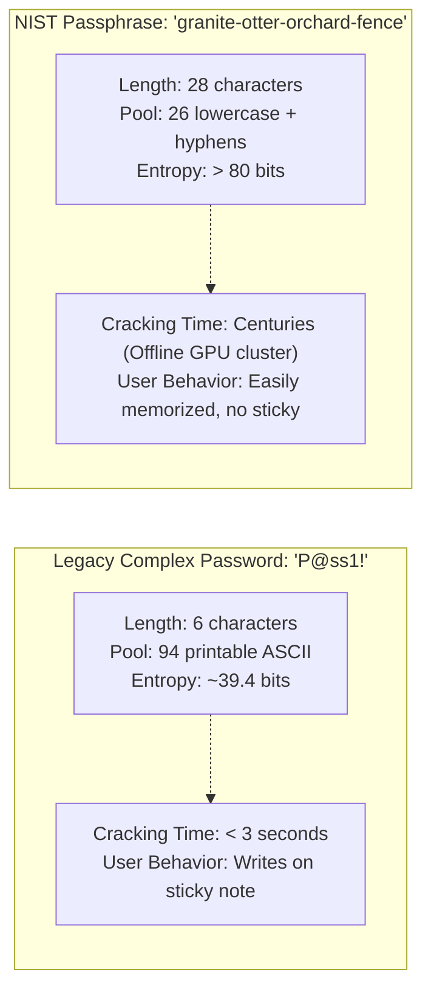
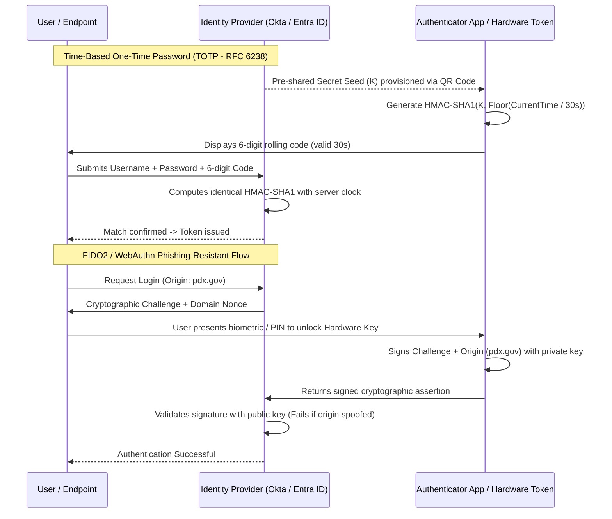
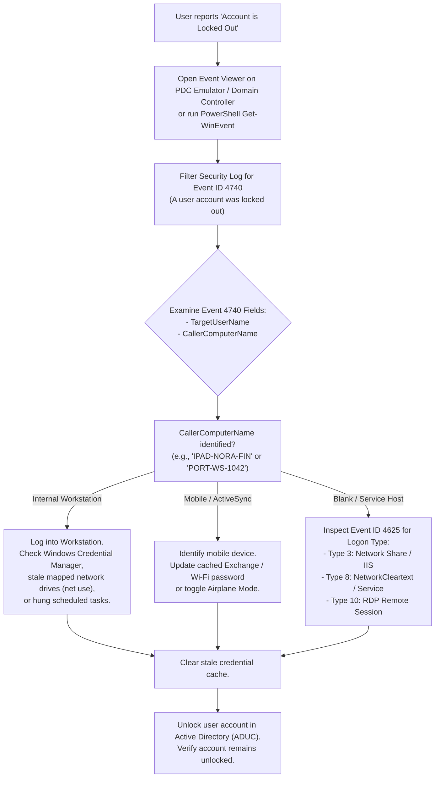

# Portland Desk Lab: Identity, Authentication Factors, & Password Policy Triage

> **The Situation:** Level 1 Service Desk Terminal • Identity & Access Queue  
> **Your Role:** Tier 1 Service Desk Specialist (under Desk Lead Jules Brooks)  
> **The Objective:** Triage authentication failures, Active Directory lockouts (Event ID 4740), caller computer detection, and transition users from vulnerable SMS OTP to phishing-resistant MFA.  
> **Estimated Time:** 40–50 minutes • Identity, Credential & Access Management  


---

<details class="instructor-ref">
<summary>Instructor & Certification Reference (Click to Expand)</summary>

* **Aligned Certification:** CompTIA Security+ (SY0-701)
* **Exam Domains:** Domain 4.0 (Security Operations: Identity & Access Management 4.2) & NIST SP 800-63B Passphrase Standards
* **Core Competencies & Deliverables:** Authentication Factors Matrix • Active Directory Event 4740 Analysis Drill • Passphrase vs Complexity Heuristics • Call Your Shot 5-Case Gate • Account Lockout & MFA Resolution Note

</details>


---

## 1. The Situation & Ground Truth

```callout-panel
title: "FIGURE 8.1: AUTHENTICATION FACTORS & ACCOUNT LOCKOUT"
badge: "Identity & Access"
caption: "Macro technical view: A corporate smartphone on a clean desk displaying rapid push notifications alongside an Active Directory security event log on a monitor."
prompt: "Clean technical illustration of a smartphone on an office desk next to a computer monitor under bright office lighting. The monitor displays security event logs with red warning highlights. Clean instructional manual style, crisp lines, no text, no words. 4:3 ratio."
```


### The Situation
It is 08:15 on a gusty Wednesday morning in East Portland. Low gray clouds drag across the Willamette, and the service desk floor smells of damp rain jackets and burnt roast coffee. Two cubes over sits Jules Brooks, desk lead for nine years, bike helmet clipped to her monitor arm, scanning the incoming identity dispatch queue.

On the whiteboard beside her desk, the sticky note from the networking rotation (*which decision?*) has been swapped for a fresh yellow square:

$$\boxed{\textbf{Which factor?}}$$

Ethan’s desk drawer still holds his port flashcards, but this morning's tickets are not about firewalls or packet headers. They are about humans, identity stores, and passwords:
* **Nora in Finance** is locked out after her quarterly password rotation failed. She tried `Spring2024!`, `Summer2024!`, and `Fall2024!`. Active Directory rejected all of them, policy requires sixteen characters, and she is threatening to write her new password on a bright green Post-it note stuck to her bezel.
* **Ken in Sales** wiped his phone over the weekend, lost access to his CRM, and insists he already has multifactor authentication because he types a **Password** and a **PIN** into his laptop. He calls it "two things" and wants a quick bypass.
* **Dev in Engineering** ran a test script with hardcoded credentials that failed forty times in two minutes, triggering an enterprise account lockout storm that halted his deployment stand-up.

Jules spins her mug and looks across the divider:
> *"Memorizing that MFA stands for Multifactor Authentication will get you through a multiple-choice question on an exam. It will not save you when an executive screams that typing a password and a PIN is two things, or when a user's account re-locks every fifteen minutes while they swear they haven't touched their keyboard. On this desk, identity is not a buzzword—it is the cryptographic boundary of the entire enterprise."*

### The Ground Truth Rules of the Desk
1. **Two Nouns Do Not Equal Two Factors:** Multifactor authentication requires **two or more distinct categories** of credentials: *Something you know* (knowledge), *Something you have* (possession), *Something you are* (inherence/biometrics), or *Somewhere you are* (location/context). A password plus a PIN is simply two things you know ($1 + 1 = 1$). It is single-factor authentication with extra typing.
2. **Length Beats Complexity (Entropy Wins):** Requiring users to rotate complex 8-character passwords every 90 days breeds predictable patterns (`Winter2026!`) and physical sticky notes. Modern enterprise defense (NIST SP 800-63B) prioritizes **length and entropy**: a 16-character four-word passphrase (`correct-horse-battery-staple`) resists brute-force and dictionary attacks far better than an 8-character symbol salad.
3. **Possession Strength Follows a Hierarchy:** Not all possession factors are created equal. SMS OTP and voice codes are vulnerable to SIM swapping, SS7 cellular routing intercepts, and adversary-in-the-middle (AiTM) phishing reverse proxies. Authenticator apps (TOTP/HOTP) provide stronger possession, while FIDO2/WebAuthn hardware security keys provide cryptographic phishing resistance.
4. **Never Clear a Lockout Without Identifying the Caller:** Clicking "Unlock Account" in Active Directory Users and Computers (ADUC) treats the symptom, not the cause. If a user's phone, forgotten tablet, or background batch script is still hammering the domain controller with cached stale credentials, the account will re-lock within minutes. You must inspect **Event ID 4740** in the Security Event Log, extract the **Caller Computer Name**, and terminate the offending session before unlocking.


---

## 2. Technical Reference & Triage Matrix

### The SY0-701 Authentication Factors Matrix

| Factor Category | Plain-English Definition | Valid Implementations | Invalid / False Claims (Trap Scenarios) | Threat & Compromise Vector |
| :--- | :--- | :--- | :--- | :--- |
| **Something You Know** *(Knowledge)* | Information that the claimant must remember and reproduce. | • Alphanumeric Passwords<br>• Multi-word Passphrases<br>• Numeric PINs<br>• Pre-shared Keys (PSK) | • Password + PIN (Both knowledge)<br>• Password + Mother's maiden name (Both knowledge) | Credential stuffing, dictionary attacks, brute-force attacks, keylogging, shoulder surfing, social engineering. |
| **Something You Have** *(Possession)* | A physical or cryptographic token in the claimant's physical custody. | • Hardware Tokens (RSA SecurID)<br>• FIDO2 / WebAuthn Security Keys<br>• Authenticator App (TOTP / HOTP)<br>• PIV / CAC Smart Cards<br>• SMS / Voice OTP *(Legacy/Weak)* | • Emailing a code to the same workstation desktop (Not separate possession channel) | SIM swapping, SS7 cellular interception, physical token theft, AiTM reverse-proxy phishing (Evilginx). |
| **Something You Are** *(Inherence)* | Biological or physiological characteristics unique to the claimant. | • Fingerprint scanners<br>• Facial recognition (Windows Hello)<br>• Iris / Retina scans<br>• Voiceprint analysis | • Behavioral patterns alone without biometric sensor attestation | False Acceptance Rate (FAR), False Rejection Rate (FRR), presentation attacks / spoofing (high-res photos, 3D molds). |
| **Somewhere You Are** *(Location)* | Physical or spatial context of the claimant during the authentication attempt. | • Geolocation via GPS<br>• Corporate IP Geofencing<br>• BSSID / Wi-Fi trilateration | • Client-reported timezone or browser language header | IP proxying, commercial VPN spoofing, GPS mock locations, cellular tower spoofing. |
| **Something You Do** *(Action / Behavior)* | Dynamic behavioral patterns unique to human neuromuscular habits. | • Keystroke dynamics (rhythm/dwell time)<br>• Mouse gesture tracking<br>• Gait analysis | • Static signature image uploads | High variance due to injury, stress, or peripheral changes; typically used as secondary adaptive telemetry. |


---

### Password Complexity vs. Password Length & Entropy

Enterprise password security is governed by **cryptographic entropy**—the measure of unpredictability in bits.

$$\text{Entropy } (H) = L \times \log_2(N)$$

*Where $L$ is password length in characters, and $N$ is the size of the character pool.*



#### Comparison: Legacy Complexity vs. NIST SP 800-63B Passphrase Standard

| Standard Dimension | Legacy Enterprise Policy (Pre-2020) | Modern NIST SP 800-63B Policy | Security & Desk Impact |
| :--- | :--- | :--- | :--- |
| **Minimum Length** | 8 characters | **15–16+ characters** (Minimum 8, Passphrases strongly encouraged) | Exponential increase in search space ($94^8 \approx 6 \times 10^{15}$ vs $26^{16} \approx 4.3 \times 10^{22}$). |
| **Composition Rules** | Mandatory 3 of 4: Upper, Lower, Digit, Symbol | **Eliminated.** No arbitrary symbol mandates. | Eliminates predictable substitutions (`E` $\rightarrow$ `3`, `a` $\rightarrow$ `@`, ending in `!`). |
| **Mandatory Rotation** | Forced 60–90 day expiration | **Removed.** Rotate only upon suspected breach or credential leak. | Stops the "Seasons and Years" pattern (`Spring2026!` $\rightarrow$ `Summer2026!`). |
| **Breach Filtering** | Basic dictionary check against `password` or username | **Mandatory check against breached password lists** (e.g., HaveIBeenPwned). | Prevents users from choosing passwords exposed in prior corporate breaches. |
| **Hint Questions** | "Mother's maiden name", "First car" | **Prohibited.** | Knowledge-based authentication (KBA) answers are easily scraped from social media. |


---

### Multi-Factor Authentication (MFA) Protocols & Mechanisms



#### Detailed Protocol Specifications

1. **TOTP (Time-based One-Time Password - RFC 6238):**
   - Combines a pre-shared secret key ($K$) with the current Unix timestamp divided by a 30-second time step ($T_0 = 30$).
   - Vulnerability: Prone to real-time relay attacks (AiTM phishing reverse proxies) where the attacker relays the 6-digit code to the legitimate IdP within the 30-second window.
2. **HOTP (HMAC-based One-Time Password - RFC 4226):**
   - Counter-based one-time password incremented upon each button press.
   - Vulnerability: Counters can de-synchronize if the user presses the button repeatedly without completing authentication (look-ahead window exhaustion).
3. **Push Notifications & MFA Fatigue Mitigation:**
   - Simple Approve/Deny push notifications are subject to **MFA Fatigue Attacks** (Prompt Bombing), where an adversary triggers dozens of push requests at 02:00 until the victim taps "Approve" out of frustration.
   - **Remediation: Number Matching.** The IdP displays a 2-digit number on the login screen; the user must manually enter that exact number inside the authenticator app to authorize the push.
4. **FIDO2 / WebAuthn (Passkeys & Security Keys):**
   - Employs public-key cryptography bound to the browser's origin URL (domain).
   - Immune to credential phishing and AiTM proxies: even if the user is tricked into visiting `pdx-gov.phish.com`, the hardware key signs the prompt for `pdx-gov.phish.com`, which the real `pdx.gov` server immediately rejects.


---

### Active Directory Account Lockout & Event Log Triage

In an Active Directory domain environment, Windows logs every logon attempt and account state change in the **Security Event Log**. When an account repeatedly locks out, the service desk must correlate **Event ID 4625** (Logon Failure) and **Event ID 4740** (Account Lockout).



#### Windows Security Event ID Reference

| Event ID | Event Name | Critical XML / Log Fields | Triage Significance |
| :--- | :--- | :--- | :--- |
| **4624** | Successful Logon | `TargetUserName`<br>`LogonType`<br>`IpAddress` | Confirms normal system access. Logon Type 2 = Console, Type 3 = Network share, Type 10 = Remote Desktop (RDP). |
| **4625** | Failed Logon Attempt | `TargetUserName`<br>`Status`<br>`SubStatus`<br>`WorkstationName` | Indicates failed authentication. Look at `SubStatus`: `0xC000006A` = User name valid, password incorrect; `0xC0000064` = User name does not exist; `0xC0000234` = Account is locked out. |
| **4740** | User Account Locked Out | `TargetUserName`<br>`CallerComputerName`<br>`SubjectUserName` | Fires at the exact moment the bad logon threshold is exceeded. **`CallerComputerName` reveals the device sending bad credentials.** |
| **4720** | User Account Created | `TargetUserName`<br>`SubjectUserName` | Audit trail for new account provisioning. |
| **4738** | User Account Modified | `TargetUserName`<br>`PasswordLastSet` | Indicates password rotation or account attribute updates. |


---

## 3. Quick Checks & Skill Reps

### Drill 1: Multi-Factor Authentication (MFA) Factor Classification Matrix

#### The Scenario
During morning ticket triage, you review six incoming requests and security policy queries. Several end users and departmental leads claim they already have MFA or want exceptions.

Evaluate each scenario in the matrix below. Determine whether the configuration represents true multifactor authentication ($MFA \ge 2 \text{ distinct factor types}$) or a false single-factor claim.

| Ticket / Scenario | Proposed Authentication Combination | Factor Categories Claimed | True MFA? (Yes / No) | Security & Exam Analysis |
| :--- | :--- | :--- | :--- | :--- |
| **Case 1** | Nora types her domain password, then enters a 6-digit PIN on her local Windows Hello screen. | Password + PIN | **No** *(Single-Factor)* | Both are **Something You Know** (Knowledge + Knowledge). Two instances of the same factor category do not satisfy MFA requirements. |
| **Case 2** | Ken enters his domain password, then approves a push notification on his enrolled smartphone authenticator app with number matching. | Password + Authenticator Push | **Yes** *(Multifactor)* | Combines **Something You Know** (Password) with **Something You Have** (Cryptographic smartphone possession token). |
| **Case 3** | Rita logs into the HR portal using her corporate laptop's built-in fingerprint scanner, followed by Windows Hello facial recognition. | Fingerprint + Facial Recognition | **No** *(Single-Factor)* | Both are **Something You Are** (Inherence + Inherence). Combining two biometric modalities is multi-modal biometrics, but still constitutes a single factor category. |
| **Case 4** | Dev connects to the enterprise VPN using a password, then receives an SMS containing a 6-digit one-time code to his cellular phone. | Password + SMS OTP | **Yes** *(Multifactor - Weak)* | Technically satisfies **Something You Know** + **Something You Have**, but SMS OTP is deprecated/discouraged due to SIM swapping and SS7 interception. |
| **Case 5** | Jordan logs into the cloud admin portal by inserting a FIDO2 YubiKey, entering the hardware PIN to unlock the token, and touching the capacitive sensor. | FIDO2 Security Key + Hardware PIN + Touch | **Yes** *(Multifactor)* | Combines **Something You Have** (Physical FIDO2 USB token) with **Something You Know** (Hardware token PIN unlocking the private key). Touch proves user presence (liveness). |
| **Case 6** | Dana attempts to access the building facilities portal using a password, but access is restricted to workstations physically connected to the Portland Plant Operations internal subnet. | Password + IP Geofencing / Subnet Location | **Yes** *(Multifactor with Context)* | Combines **Something You Know** (Password) with **Somewhere You Are** (Location / Network boundary context). |

#### Your Analysis Task
1. Why is Case 1 (Password + PIN) the single most common false MFA claim encountered on enterprise service desks?
2. In Case 3, why does combining fingerprint and facial recognition fail the definition of multifactor authentication, and in what specific high-security environments might multi-modal biometrics still be deployed?
3. What makes Case 5 (FIDO2) cryptographically superior to Case 4 (SMS OTP) when defending against adversary-in-the-middle (AiTM) phishing proxies like Evilginx?

<details>
<summary>Solution & Lead Tech Review</summary>

**Jules' Analysis:**
1. **The Password + PIN Trap:** Users and uncertified managers mistakenly confuse the quantity of credential prompts with the number of authentication factors. Because a PIN feels like an ATM card code, users believe it represents hardware possession. In reality, unless the PIN unlocks a physical TPM or smart card chip, typing two alphanumeric secrets into software is purely knowledge-based.
2. **Multi-Modal Biometrics:** Both modalities reside in the *Something You Are* bucket. While multi-modal biometrics significantly lowers the False Acceptance Rate (FAR) in high-security biometric checkpoints (e.g., facial recognition combined with fingerprint attestation in defense SCIFs), it remains single-factor authentication under CompTIA and NIST standards unless paired with a token (possession) or passphrase (knowledge).
3. **FIDO2 Phishing Resistance:** SMS OTP can be harvested in real time: an attacker spins up a spoofed phishing page that prompts the victim for their username, password, and SMS code, and the attacker's server automatically replays that code to the legitimate service. FIDO2 / WebAuthn creates a cryptographic key pair bound to the exact Fully Qualified Domain Name (FQDN) in the browser address bar. The browser passes the origin domain to the security key; if the domain is `pdx-portal.phishing-domain.com` instead of `pdx.gov`, the cryptographic signature is invalid for the real portal, stopping the attack instantly.
</details>


---

### Drill 2: Active Directory Event Viewer Lockout Analysis

#### The Scenario
Nora Higgins in Finance logged ticket **`INC-2026-1142`**. At 08:30 she updated her domain password in the self-service portal from `Summer2024!` to a newly compliant 16-character passphrase. At 08:34, her account locked out. 

You unlocked her account in Active Directory Users and Computers (ADUC). At 08:39, she called back furious: her account locked out again while she was on the phone, and she had not even touched her keyboard.

Instead of clicking "Unlock" a second time, you launch PowerShell on your management console and query the Security Event Log on the Primary Domain Controller (`dc01.portland-ops.local`) using [`artifacts/event_4740_dump.txt`](../artifacts/event_4740_dump.txt):

```console
caption: PowerShell Active Directory Security Event Query on DC01
PS C:\Users\emercer> Get-WinEvent -FilterHashtable @{LogName='Security'; Id=4740} -MaxEvents 1 | Format-List -Property *

Message              : A user account was locked out.

                       Subject:
                           Security ID:        S-1-5-18
                           Account Name:       DC01$
                           Account Domain:     PORTLAND-OPS
                           Logon ID:           0x3E7

                       Account That Was Locked Out:
                           Security ID:        S-1-5-21-3928174412-1082938471-2948192837-1402
                           Account Name:       nhiggins

                       Additional Information:
                           Caller Computer Name:   IPAD-NORA-FIN

Id                   : 4740
TimeCreated          : 10/21/2026 8:34:18 AM
MachineName          : dc01.portland-ops.local
TaskDisplayName      : User Account Management
Properties           : {nhiggins, PORTLAND-OPS, IPAD-NORA-FIN, S-1-5-21-3928174412-1082938471-2948192837-1402...}
```

Next, you inspect the preceding **Event ID 4625** records from [`artifacts/security_events.json`](../artifacts/security_events.json) generated just prior to the lockout:

```console
caption: Windows Event Log 4625 Breakdown on DC01
Event ID:     4625
Time Created: 10/21/2026 8:34:18.109240Z
Computer:     dc01.portland-ops.local
Description:  An account failed to log on.

Account For Which Logon Failed:
    Account Name:        nhiggins
    Account Domain:      PORTLAND-OPS

Failure Information:
    Failure Reason:      The user account has been automatically locked because too many invalid logon attempts were made.
    Status:              0xC000006D
    Sub Status:          0xC0000234

Network Information:
    Workstation Name:    IPAD-NORA-FIN
    Source Network Address: 192.168.20.114
    Source Port:         49888

Detailed Authentication Information:
    Logon Type:          3 (Network)
    Authentication Package: MICROSOFT_AUTHENTICATION_PACKAGE_V1_0
```

#### Your Analysis Task
1. What is the root cause of Nora's recurring account lockout?
2. What does `Sub Status: 0xC0000234` in Event 4625 indicate, and how does it differ from `Sub Status: 0xC000006A`?
3. What does `Logon Type: 3` tell you about the mechanism the device was using to authenticate against the domain?
4. What exact sequence of operational steps must you execute to permanently resolve Nora's issue before unlocking her account?

<details>
<summary>Solution & Lead Tech Review</summary>

**Jules' Analysis:**
1. **Root Cause:** Nora has a secondary mobile device—her corporate iPad (`IPAD-NORA-FIN` at IP `192.168.20.114`)—sitting in her briefcase or on her desk dock. When Nora changed her domain password at 08:30 on her desktop, the iPad continued attempting background mail/calendar synchronizations (ActiveSync / Exchange) every few minutes using her old cached password. After three failed attempts, the domain lockout threshold of 3 invalid attempts was triggered.
2. **Sub Status Decodes:**
   - `0xC000006A`: *Bad Password*. The user account exists, but the caller provided an incorrect password.
   - `0xC0000234`: *Account Locked*. The attempt failed specifically because the account's lockout threshold had already been reached and the account is currently disabled by lockout policy.
3. **Logon Type 3:** Indicates a **Network Logon** (connecting across the network to a shared resource, IIS service, or ActiveSync endpoint), as opposed to Logon Type 2 (interactive console keyboard login) or Logon Type 10 (Remote Desktop Protocol).
4. **Permanent Remediation Sequence:**
   1. Contact Nora and instruct her to take out `IPAD-NORA-FIN` and immediately toggle **Airplane Mode ON** (or disconnect it from Wi-Fi) to suppress automated background authentication attempts.
   2. Navigate to `Settings` $\rightarrow$ `Mail` / `Accounts` on the iPad and update the stored corporate password with her new 16-character passphrase.
   3. Check Windows Credential Manager on her primary desktop (`PORT-WS-FIN02`) to ensure no stale network drive mappings (`net use * /delete`) or old Outlook credential profiles exist.
   4. Once all devices have updated credentials, navigate to Active Directory Users and Computers (ADUC), locate `nhiggins`, check the box for **"Unlock account"**, and click Apply.
   5. Toggle Airplane Mode OFF on the iPad and verify successful ActiveSync synchronization.
</details>


---


### 2.3 Interactive Diagnostic Console: Live Telemetry & Triage

Use the interactive console below to test commands, inspect telemetry, and verify your troubleshooting steps.

```lnk-terminal
title: "POWERSHELL: ACTIVE DIRECTORY ACCOUNT LOCKOUT TRIAGE"
shell: "powershell"
prompt: "PS C:\Support> "
replay: true
objectives:
  - id: "obj-lockout"
    label: "Find account lockout events (Event ID 4740)"
    trigger: "Get-WinEvent -FilterHashtable @{LogName='Security';Id=4740}"
  - id: "obj-unlock"
    label: "Unlock Nora's domain account"
    trigger: "Unlock-ADAccount -Identity nora.finance"
  - id: "obj-caller"
    label: "Identify caller computer causing stale password lockouts"
    trigger: "Get-ADUser -Identity nora.finance -Properties *"
---
Get-WinEvent -FilterHashtable @{LogName='Security';Id=4740}: |
  TimeCreated          Id RecordId ProcessId Message
  -----------          -- -------- --------- -------
  10/18 03:17:42 AM  4740   149204       620 A user account was locked out.
                                              Target Account Name: nora.finance
                                              Caller Computer Name: WKS-NORA-PHONE (Stale Exchange ActiveSync creds)

Unlock-ADAccount -Identity nora.finance: |
  Unlocking Active Directory account 'nora.finance' on Domain Controller DC01...
  Account unlocked successfully.
  [OK] Account status: ACTIVE (Password expired flag: FALSE).

Get-ADUser -Identity nora.finance -Properties *: |
  DistinguishedName : CN=Nora Vance,OU=Finance,DC=corp,DC=local
  Enabled           : True
  LockedOut         : False
  badPwdCount       : 0
  LastBadPasswordAttempt : 10/18 03:17:41 AM
  Root Cause: Nora's company iPhone was sending old password over Wi-Fi after password change.

```

---

### Quick Check 3: Call Your Shot: Predict Before You Look

> **The Rule of the Desk:** Before clicking "Approve", resetting a credential, or editing a directory object, you must commit your decision, identify the exact factor or policy, and justify the security rationale. Commit your answer in your mind before clicking to expand.
<div class="scratchpad-container">
  <div class="scratchpad-header">
    <span class="scratchpad-title">Interactive Hypothesis Scratchpad</span>
    <span class="scratchpad-save-indicator" id="save-ind-08-cbyt">Saved in browser</span>
  </div>
  <div class="scratchpad-body">
    <textarea id="notes-08-cbyt" placeholder="Type your predicted failure layer, expected command output, and root cause hypothesis here before opening solutions..."></textarea>
  </div>
  <div class="scratchpad-footer">
    <span>Private notes saved locally in your browser. Not graded.</span>
    <button type="button" class="scratchpad-copy-btn" onclick="copyScratchpad('notes-08-cbyt')">Copy Notes</button>
  </div>
</div>


#### Ticket 1: Ken Vance (Sales Representative) — `INC-2026-1141`
*Request:* "Got a new phone over the weekend. I don't want to install the company authenticator app again because it takes up storage. Just set my account to SMS verification, or turn off MFA and let me use my laptop PIN plus password."

* **Your Action:** [ Approve / Deny / Redirect ]
* **Target Authentication Control & Policy:**
* **Security Rationale:**

<details>
<summary>Solution & Lead Tech Review</summary>

* **Action:** **DENY** MFA bypass and SMS preference; **REDIRECT** to standard enterprise Authenticator App enrollment with Push + Number Matching.
* **Target Control & Policy:** Mandatory Multi-Factor Authentication Policy (Standard SEC-IAM-02).
* **Rationale:** Ken’s proposal of Password + PIN represents two knowledge factors (single-factor). SMS OTP is deprecated for primary corporate access due to severe vulnerabilities to SIM swapping attacks and SS7 cellular interception. Ken must install the approved authenticator app or be issued a temporary physical hardware token (FIDO2 / TOTP key) if personal phone storage is an issue.
</details>


---

#### Ticket 2: Nora Higgins (Finance Clerk) — `INC-2026-1142`
*Request:* "Password reset portal says my new password `Winter2026!` violates complexity and history policy. I've used Seasons and Years for ten years. Give me an exemption or lower the required length to 8 characters so I don't have to write it down."

* **Your Action:** [ Approve Exemption / Deny / Coach on Passphrase ]
* **Target Authentication Control & Policy:**
* **Security Rationale:**

<details>
<summary>Solution & Lead Tech Review</summary>

* **Action:** **DENY** policy exemption; **COACH** user to adopt a 4-word memorized passphrase.
* **Target Control & Policy:** Password Policy & Entropy Standard (NIST SP 800-63B).
* **Rationale:** Predictable rotational patterns like `SeasonYYYY!` are trivial to crack using mask attacks and automated dictionary permutation tools (Hashcat). Lowering minimum length to 8 characters drastically decreases cryptographic entropy. Walk Nora through selecting four unrelated common dictionary words separated by hyphens (e.g., `copper-blanket-maple-stride`), which exceeds the 16-character requirement, delivers $> 75$ bits of entropy, and eliminates the urge to use physical sticky notes.
</details>


---

#### Ticket 3: Dev Patel (Software Engineering) — `INC-2026-1143`
*Request:* "My account `dpatel` is locked out again. I was testing a legacy database backup script that had an expired password hardcoded in the connection string. Unlock my account right now so I can commit my pull request."

* **Your Action:** [ Unlock Immediately / Hold Unlock Until Remediated ]
* **Target Authentication Control & Policy:**
* **Security Rationale:**

<details>
<summary>Solution & Lead Tech Review</summary>

* **Action:** **HOLD UNLOCK**; require Dev to kill the executing script process and update the credential source first.
* **Target Control & Policy:** Privileged Identity Management & Account Lockout Threshold.
* **Rationale:** Unlocking an account while a background loop or scheduled cron job is still executing with stale credentials will exhaust the bad logon attempts threshold within seconds, re-locking the account immediately. Dev must terminate the script process or service on `ENG-SRV-DEV02`. Furthermore, hardcoding cleartext personal credentials into scripts violates security policy; migrate the script to use a dedicated Service Principal or vaulted Service Account.
</details>


---

#### Ticket 4: Rita Alvarez (Marketing Lead) — `INC-2026-1144`
*Request:* "Traveling to international conference in Geneva for ten days. I am afraid of losing my smartphone or having no international roaming cellular signal. Can I disable MFA while abroad, or what is the approved option?"

* **Your Action:** [ Disable MFA / Provide Roaming Bypass / Issue Hardware Token ]
* **Target Authentication Control & Policy:**
* **Security Rationale:**

<details>
<summary>Solution & Lead Tech Review</summary>

* **Action:** **DENY** MFA disabling; **ISSUE** a pre-configured physical FIDO2 hardware security key (or loaner TOTP hard token) and generate emergency offline backup codes.
* **Target Control & Policy:** Remote Travel & Possession-Based Authentication Standard.
* **Rationale:** Disabling MFA while an employee travels internationally across untrusted hotel and conference Wi-Fi networks drastically heightens the risk of account takeover. Authenticator apps running TOTP generate codes mathematically using the local device clock without needing cellular data or roaming. As a redundancy, issue a physical FIDO2 USB-C key and store one-time offline backup recovery codes in the corporate password vault.
</details>


---

#### Ticket 5: Jordan Chen (IT Operations) — `INC-2026-1145`
*Request:* "Offboarding contractor Sam Kelly. Badge collected, laptop returned. Contractor was member of shared administrator account `admin_billing`. We don't want to change the password because three other contractors use it."

* **Your Action:** [ Close Ticket / Escalate & Rotate Shared Secret / Migrate to RBAC ]
* **Target Authentication Control & Policy:**
* **Security Rationale:**

<details>
<summary>Solution & Lead Tech Review</summary>

* **Action:** **DENY** leaving shared secret unrotated; **ESCALATE** for immediate password rotation, vaulting, and account separation.
* **Target Control & Policy:** Account Deprovisioning & Non-Repudiation (Accounting / AAA Standard).
* **Rationale:** Shared administrative accounts completely destroy the principle of **non-repudiation** and auditability: when five people share `admin_billing`, the security operations center cannot prove who made a configuration change or exported customer records. Leaving the shared password unrotated after a contractor departs allows unauthorized external access. Immediately rotate the password in an enterprise Privileged Access Management (PAM) vault and assign individualized Role-Based Access Control (RBAC) accounts to the remaining team members.
</details>


---

## 4. Your Ticket Notes (What to Put in the Ticket)

<div class="scratchpad-container">
  <div class="scratchpad-header">
    <span class="scratchpad-title">Your Ticket Draft & Resolution Scratchpad</span>
    <span class="scratchpad-save-indicator" id="save-ind-08-ticket">Saved in browser</span>
  </div>
  <div class="scratchpad-body">
    <textarea id="notes-08-ticket" style="min-height: 140px;" placeholder="Draft your ticket notes, diagnosis, and resolution steps here before comparing with the reference standard below..."></textarea>
  </div>
  <div class="scratchpad-footer">
    <span>Private notes saved locally in your browser. Not graded.</span>
    <button type="button" class="scratchpad-copy-btn" onclick="copyScratchpad('notes-08-ticket')">Copy Notes</button>
  </div>
</div>

### Tier 1 Account Lockout & MFA Enrollment Resolution Note

In enterprise identity operations, your ticket notes are legal and security audit records. Below are the two mandatory templates you must master:

#### Part A: Standard Account Lockout & Credential Triage Note (Example: Nora Higgins / INC-2026-1142)

```text
================================================================================
TIER 1 RESOLUTION SUMMARY - PORTLAND SERVICE DESK
================================================================================
Ticket ID:        INC-2026-1142
Requester:        Nora Higgins (Finance Department)
Technician:       Ethan Mercer (Tier 1 Support)
Supervising Lead: Jules Brooks
Date/Time:        2026-10-21 08:52:14 PST
Category:         Identity & Access Management / Account Lockout
Status:           RESOLVED

1. ISSUE SUMMARY:
   User reported repeated Active Directory domain account lockouts immediately 
   following quarterly password rotation. Unlocking via ADUC resulted in secondary 
   lockout within five minutes without active user input.

2. ROOT CAUSE ANALYSIS & EVENT LOG TRIAGE:
   - Queried Primary Domain Controller (dc01.portland-ops.local) Security Log.
   - Identified Event ID 4740 (Account Lockout) for target user 'nhiggins'.
   - Extracted Caller Computer Name: 'IPAD-NORA-FIN' (IP: 192.168.20.114).
   - Correlated with Event ID 4625 (Logon Failure, SubStatus 0xC000006A - Bad Password, 
     Logon Type 3 - Network).
   - Root Cause: Corporate iPad running ActiveSync background mail synchronization 
     held stale cached credentials following desktop password reset.

3. REMEDIATION PERFORMED:
   - Contacted user; engaged Airplane Mode on IPAD-NORA-FIN to halt authentication storm.
   - Updated cached corporate Exchange password in iPad Account Settings to current passphrase.
   - Audited user desktop (PORT-WS-FIN02) Credential Manager; purged orphaned network drive tokens.
   - Coached user on NIST SP 800-63B passphrase policy (16+ characters, 4-word semantic passphrase); 
     discouraged seasonal rotation patterns ('Spring2026!').
   - Cleared lockout flag in Active Directory Users and Computers (ADUC).
   - Reconnected iPad to Wi-Fi; verified successful mail flow and zero Event 4625 failures.

4. SECURITY AUDIT & USER GUIDANCE:
   Advised user that account lockouts are automated defenses against credential-guessing 
   attacks. Reminded user to enroll pending enterprise password manager vault to eliminate 
   manual credential synchronizations. Ticket closed.
================================================================================
```

#### Part B: Phishing-Resistant MFA Enrollment & Security Escalation Note (Example: Ken Vance / INC-2026-1141)

```text
================================================================================
SECURITY ENROLLMENT & HARDENING NOTE - PORTLAND SERVICE DESK
================================================================================
Ticket ID:        INC-2026-1141
Requester:        Ken Vance (Sales Representative)
Technician:       Ethan Mercer (Tier 1 Support)
Supervising Lead: Jules Brooks
Date/Time:        2026-10-21 10:15:30 PST
Category:         Multi-Factor Authentication / Device Provisioning
Status:           RESOLVED

1. SITUATION DESCRIPTION:
   User requested access restoration following mobile device replacement. User 
   requested an exemption to use a static laptop PIN + Password as MFA, or fallback 
   to unencrypted SMS OTP verification.

2. POLICY & ARCHITECTURAL EVALUATION:
   - Factor Analysis: Password + PIN constitutes two Knowledge factors (Single-Factor 
     Authentication with redundant entry). Denied per Policy SEC-IAM-02.
   - SMS OTP Assessment: Denied for primary corporate access due to SIM swap risk, 
     SS7 cellular vulnerabilities, and susceptibility to AiTM phishing reverse proxies.
   - Approved Architecture: Smartphone Authenticator App (TOTP / Push with Number Matching) 
     or FIDO2 WebAuthn hardware token.

3. REMEDIATION & ENROLLMENT COMPLETED:
   - Verified user identity via out-of-band video call and employee ID badge validation.
   - Directed user through secure installation of enterprise authenticator app on new endpoint.
   - Supervised QR-code binding over encrypted session; verified TOTP 30-second token generation.
   - Enforced Push Notification with Number Matching to mitigate MFA Fatigue (prompt bombing).
   - Generated 10 single-use emergency backup recovery codes; confirmed user stored codes 
     inside corporate password vault, not in plain text.
   - Validated test authentication against CRM portal: successfully prompted, matched 2-digit 
     challenge, and granted session token.

4. USER HYGIENE INSTRUCTION:
   Instructed user on MFA fatigue protocols: if an unsolicited push prompt appears, user must 
   tap 'Deny' immediately and contact the service desk to report potential credential stuffing.
================================================================================
```


---

## 5. What Good Looks Like (Shift Quality Checklist)

| Performance Criterion | Exemplary (Full Points) | Satisfactory | Needs Revision |
| :--- | :--- | :--- | :--- |
| **Factor Classification Precision** | Flawlessly categorizes credentials into Knowledge, Possession, Inherence, Location, and Action. Explicitly recognizes false MFA claims (Password + PIN, Multi-modal biometrics). | Accurately identifies primary factor types but struggles to explain why Password + PIN fails to satisfy MFA requirements. | Confuses basic authentication factor categories; misidentifies single-factor combinations as MFA. |
| **Event Log Triage & Root Cause Analysis** | Correctly parses Windows Security Event IDs 4625 and 4740. Identifies `CallerComputerName`, differentiates Logon Types, and isolates stale cached credentials prior to unlocking. | Identifies Event ID 4740 as a lockout event, but unlocks the account before locating and neutralizing the calling device. | Unable to interpret Event Viewer fields; repeatedly unlocks accounts without investigating root causes. |
| **Password Policy & Entropy Engineering** | Champions modern NIST SP 800-63B standards (length, passphrases, breach filtering) over deprecated complexity and forced periodic rotations. Articulates entropy benefits. | Understands that longer passwords are stronger, but defaults to recommending arbitrary symbol requirements or 90-day rotations. | Approves insecure password policy exceptions or recommends weak, predictable patterns. |
| **Documentation & Escalation Quality** | Generates flawless, professional Tier 1 resolution notes detailing root causes, exact event IDs, remediation sequences, and user defense hygiene. | Notes are technically accurate but lack standardized structure, omitted event codes, or minimal root cause explanation. | Resolution notes are vague, incomplete, or omit critical security remediation steps. |


---

*Workbench complete. Proceed to test your knowledge against the interactive questions in `review.yaml` and review companion datasets in [`artifacts/`](../artifacts/).*

---

## 6. Shift Resolution Epilogue

```callout-panel
title: "FIGURE 8.2: IDENTITY BOUNDARIES & OFFBOARDING ENFORCEMENT"
badge: "Shift Epilogue"
caption: "Operations floor: At 05:35 PM, the identity queue clears. Ken's phone displays a verified authenticator token, Dev's script runs cleanly against the vault, and offboarding revokes the last orphaned credentials."
prompt: "Clean graphic novel cutaway panel of an IT support technician desk at late afternoon. Warm desk lamp light mixes with rainy window reflection. On the desk, an authenticator app shows a glowing security key verification symbol next to an Active Directory management console showing green status ticks. Ligne Claire style, sharp technical ink linework, no text, no words. 16:9 ratio."
```

With Dev's caller computer identified and silenced in Event Viewer, we cleared the lockout in Active Directory and watched the bad password counter stay at zero. Dev updated his test script to pull credentials directly from the secrets vault, and his stand-up deployment cleared cleanly.

Across the aisle, Ken was back at his desk, staring at his phone. "Sign in with company worked," he called over. "It bounced me through the push prompt, matched the two digits, and let me straight into the CRM. No SMS codes, no password plus PIN."

"Told you," I said. "Two distinct factor types. Identification is claiming who you are; authentication is proving it."

## Offboarding leftovers and the admin sticky

Afternoon started with HR pinging offboarding for a contractor who had left Friday. Badge returned. Laptop wiped. Access had not followed.

Jordan from IT ops shared a screen. The contractor still had a license on the design tool, a shared mailbox membership, and — Jules made a noise — a line in a wiki with a shared admin account password last rotated "sometime before the rebrand."

"That is not a password," Jules said. "That is a campfire story."

We treated it as a deprovisioning failure. Disable the cloud login. Pull group memberships. Kill the API token someone had minted "temporarily" in March. For the shared admin: move the secret into vaulting, rotate it, and stop pretending six people can share one identity and still have accounting that means anything.

"Provisioning was fine on day one," Jordan said. "We created the account, put them in the contractor role, shipped the laptop. Day last is where we get sloppy."

I opened a follow-up ticket to map the contractor role in [[rbac|RBAC]] so the next person inherited a bundle we could revoke in one motion — not a scavenger hunt across five admin consoles. Jules, still in the thread: "[[least_privilege|Least privilege]] on the way in. Same muscle on the way out."

## Privileged shortcuts and break-glass myths

Network dropped into the same thread. Jared — still proud of last week's SSH rewrite — wanted a standing domain admin for "closet emergencies."

"I have a Pi at home that is basically god mode," he said. "At work I still type a normal user password and wait. If the IdP hiccups, how do we get in?"

"Checkout, not a lifestyle," Jules said. "I've got a vendor call in ten. Walk him through PAM and then get off the thread."

We walked the desk-level [[pam|PAM]] story without turning it into a product pitch: vault the break-glass path, do not laminate it. Break-glass exists for when MFA and IdP paths are actually down — sealed, monitored, painful on purpose. Day to day, Jared requests just-in-time elevation for the change window, does the work, loses the rights when the window closes. Authorization for admin actions should not be a permanent personality trait on his account. Privileged access is a checkout.

Jared sighed. "Fine. I will stop naming shared accounts after the street food cart." He did not get the standing admin. He opened a change ticket for the next window instead.

## SSO ticket: the app that wants its own password

Late afternoon. Vendor portal for facilities. Title: *need password for EnergyDash*. Description: *IT please create a login.*

I called. Dana — same truck as the FTP week — was between buildings.

"The portal has a Sign in with company button," Dana said. "Also a Register. Register asked me for a new password. I made one. Now Finance says that is wrong."

"[[sso|SSO]]," I said. "We do not want a snowflake password in EnergyDash if we can help it. Our IdP already authenticated you this morning. The portal should trust a federation assertion, not a new local account."

"They said SAML on the implementation call," Dana offered. "Or OAuth. They used both words like synonyms."

Jules, still on her vendor call, muted long enough to say, "Desk translation, Ethan," and unmuted again.

"Federation means their app trusts our IdP. [[saml|SAML]] is the enterprise assertion pattern you will see on the wiki checklist. [[oauth|OAuth]] shows up when an app wants a token to call an API without eating your password — related paperwork, different shape. For this ticket, click Sign in with company, refuse Register, and if Register is the only path, we escalate — local passwords in vendor tools become reuse magnets and offboarding blind spots."

Dana tapped something. "Sign in with company worked. It bounced me through the usual MFA push. I denied the first one because I forgot I had started it. Then I approved the second."

"Good," I said. "Keep the local register button unemployed."

## Passwordless rumor and the end of the shift

Last ping was not a fire. It was a rumor. Someone in Slack asked when we would go passwordless so they could throw their password manager into the river.

Jules typed one line between vendor questions: *security keys and device-bound passkeys are on the roadmap; throwing secrets into the river is not a migration plan.*

I added the desk version for the person who would still call: passwordless replaces the knowledge factor with possession and biometrics wired through the IdP — it does not mean no proof. Until then, unique passwords in the manager, MFA that is actually multifactor, and no PIN cosplay.

At 5:35 the queue was down to noise. Nora's vault was still pending. Ken was enrolled. The contractor was deprovisioned. EnergyDash was on SSO. Jared did not have standing god mode.

Jules clipped her bike lights on. "Tomorrow someone will call password-plus-PIN multifactor again."

"I already have the line," I said.

She almost smiled. I locked the drawer. The cards in it were still about ports. Today's tickets had been about proof — who you claim to be, how you show it, and what we revoke when the story ends. I went out into the rain to catch the MAX.
