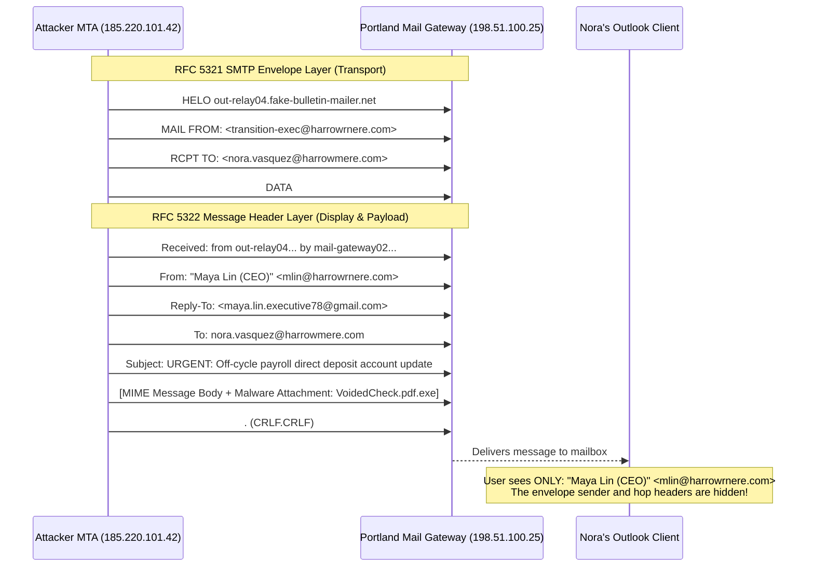
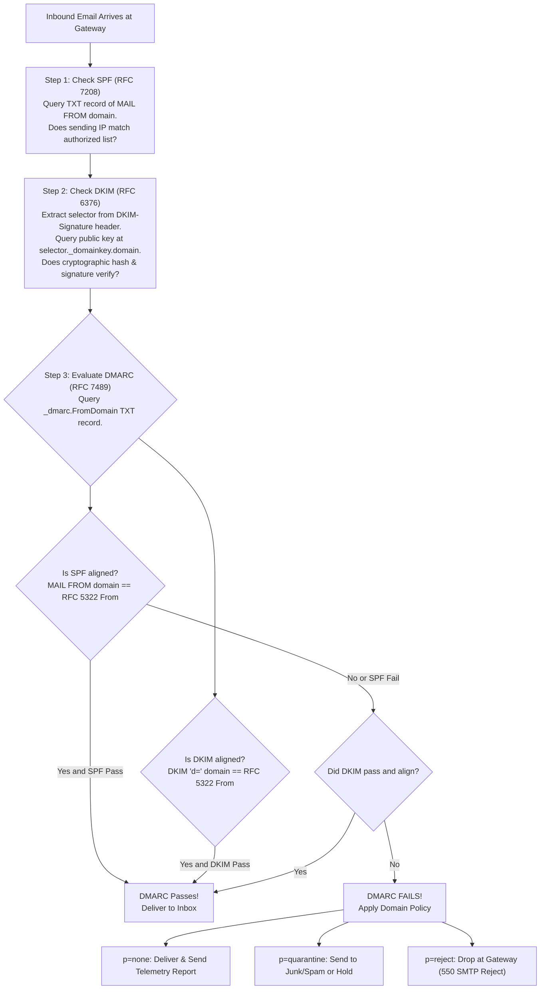
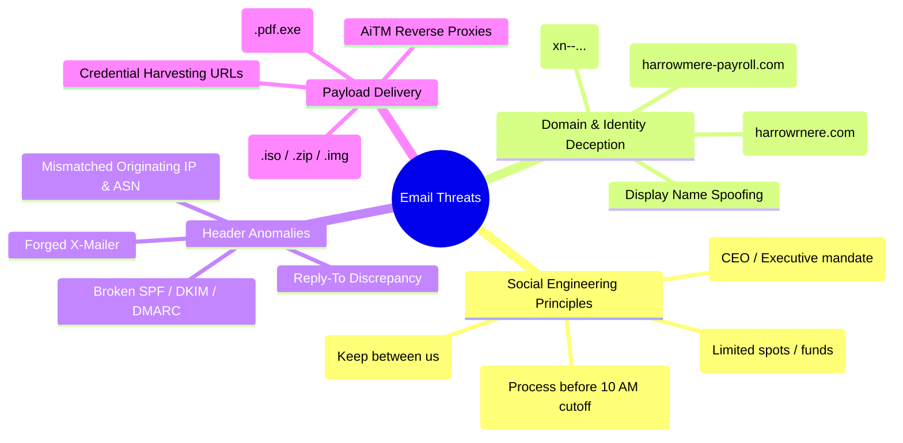

# Portland Desk Lab: Email Header Decomposition & Phishing Triage

> **The Situation:** Level 1 Service Desk Terminal • Mail Defense Queue  
> **Your Role:** Tier 1 Service Desk Specialist (under Desk Lead Jules Brooks)  
> **The Objective:** Dissect RFC 5322 raw email MIME headers, verify SPF, DKIM, and DMARC cryptographic alignment, and identify typosquatted domains in executive wire fraud attempts.  
> **Estimated Time:** 40–50 minutes • Email Security & Phishing Analysis  


---

<details class="instructor-ref">
<summary>Instructor & Certification Reference (Click to Expand)</summary>

* **Aligned Certification:** CompTIA Security+ (SY0-701)
* **Exam Domains:** Domain 1.0 (Social Engineering & BEC) & Domain 2.0 (Cryptographic Email Verification: SPF, DKIM, DMARC)
* **Core Competencies & Deliverables:** MIME Header Anatomy & Authentication Triad • Raw Email Hop Inspection Drill • Domain Squatting & Typosquatting Recognition • Call Your Shot 5-Case Gate • Formal Phishing Incident Escalation Note

</details>


---

## 1. The Situation & Ground Truth

```callout-panel
title: "FIGURE 9.1: EMAIL MIME ARCHITECTURE & SPF CHECK"
badge: "Email Authentication"
caption: "Schematic diagram: Email envelope sender (MAIL FROM) versus message header (From:). Demonstrates how SPF verifies sending IP while DKIM cryptographically signs body hashes."
prompt: "Clean technical cutaway diagram of an email message header structure under bright lighting. Arrows connect sender IP address to DNS TXT record for SPF validation. Clean instructional manual style, crisp fine lines, no text, no words. 4:3 ratio."
```


### The Situation
It is 08:10 on a rain-lashed Wednesday morning on the east side of Portland. Low, charcoal-colored clouds hang heavy over the Hawthorne Bridge, and the service desk smells of damp wool coats, ozone from the server room exhaust, and dark roast coffee. Two cubes over sits Jules Brooks, desk lead for nine years, bike helmet clipped to her monitor arm, calmly triaging the morning ticket flood.

On the corner of her primary display, the sticky note from yesterday's authentication shift (*which factor?*) has been stripped away. In its place sits a fresh neon-yellow square:

$$\boxed{\textbf{Who benefits if I hurry?}}$$

Ethan’s desk drawer still holds his port flashcards and Active Directory lockout guides, but this morning the red indicator light on the help desk dispatch console is blinking rapidly. Ticket **`INC-2026-1051`** has arrived from Nora Vasquez in Finance, marked with **Priority: High**:

> **Ticket Subject:** URGENT — Direct Deposit Update for Maya Lin (CEO)  
> **Requester:** Nora Vasquez (Payroll & Accounting)  
> **Description:** *"I received an urgent email from Maya Lin asking to change her direct deposit banking routing information for tomorrow morning's payroll run before the 10:00 AM bank cutoff. Maya says she's in an executive retreat offsite in Hood River with no phone service, so she can't take voice calls and told me to update it immediately from the attached voided check. The email has our logo and says 'Confidential'. I was about to type it into ADP, but something felt fast. Can IT verify Maya's message is safe?"*

Jules spins slowly in her chair, holding her ceramic mug. She gestures toward Ethan's terminal:

> *"Memorizing that SPF is a DNS TXT record and DKIM uses RSA keys will earn you points on a multiple-choice exam, Ethan. It will not save you when an executive screams, when payroll is thirty seconds away from wiring eighty thousand dollars to a mule bank in Eastern Europe, or when a user waves a printed email insisting 'the logo is real.' On this desk, email headers are not trivia—they are the cryptographic and forensic crime scene of who touched the packet."*

### The Ground Truth Rules of the Desk

1. **Display Names Lie; The Envelope and DNS Tell the Truth:** An email client's friendly `From:` display name (e.g., `"Maya Lin (CEO)"`) can be forged in any SMTP client with zero technical effort. Never make a security, access, or financial decision based on the visual header shown in an email client. Always inspect the RFC 5321 envelope sender (`Return-Path` / `MAIL FROM`), the `Received:` hops, and the cryptographic authentication headers (`Authentication-Results:`).
2. **Urgency and Secrecy Are Attack Signatures, Not Executive Priorities:** Phishing attacks succeed by weaponizing cognitive biases—specifically **urgency** ("before the 10:00 AM banking cutoff"), **authority** ("Maya Lin, CEO"), and **secrecy** ("keep this strictly confidential until tomorrow"). Whenever an email demands that normal verification procedures be bypassed because the sender "cannot take calls," treat the message as hostile until proven otherwise.
3. **Visual Fidelity Has Zero Cryptographic Value:** High-resolution corporate logos, legal confidentiality footers, and crisp executive headshots can be copied from public websites in seconds. Visual polish is trivial to fabricate; only public-key cryptographic signatures (**DKIM**) and domain alignment (**DMARC**) prove that a message genuinely originated from the declared organization.
4. **Out-of-Band (OOB) Verification is Mandatory for Financial Directives:** Never confirm wire instructions, vendor banking changes, or payroll updates using the communication channel that delivered the request. If an email requests a funds transfer or account modification, verify the directive using a pre-established, trusted telephone number from the corporate directory or through an in-person meeting—never via phone numbers, reply email addresses, or links contained within the suspect email.
5. **Preserve and Report; Never Forward Raw Phishing Bait:** Forwarding a raw phishing email across internal distribution lists ("Hey team, is this real?") duplicates the attack payload, exposes colleagues to accidental clicks, and strips original SMTP transport headers. Train users to click the **Report Phish** button, or save the message as an RFC 822 `.eml` artifact so Tier 1 and SOC analysts can examine intact MIME headers safely in an isolated text viewer.


---

## 2. Technical Reference & Triage Matrix

### RFC 5322 Email MIME Architecture: Envelope vs. Header

To analyze email forgery, you must distinguish between the **SMTP Envelope** (RFC 5321) and the **MIME Message Header** (RFC 5322).



* **RFC 5321 Envelope (`MAIL FROM` / `Return-Path`):** Used by mail transfer agents (MTAs) for routing and non-delivery reports (bounces). This is the identity evaluated by basic **SPF**.
* **RFC 5322 Message Header (`From:`):** The human-readable header parsed and displayed by client software (Outlook, Apple Mail, Gmail). This is what the recipient reads on screen.
* **The Vulnerability:** Without DMARC alignment, an attacker can specify a disposable domain in `MAIL FROM` to pass SPF, while placing an executive's spoofed address in the RFC 5322 `From:` header.


---

### The Email Authentication Triad: SPF, DKIM, and DMARC

Modern email defense relies on three complementary standards working in unison to validate sender identity and prevent spoofing.



#### 1. SPF (Sender Policy Framework — RFC 7208)
* **What it does:** Publishes an authorized list of IP addresses, CIDR subnets, and hostnames permitted to send mail on behalf of a specific domain in a DNS TXT record.
* **Standard DNS TXT Record:**
  ```text
  harrowmere.com.  IN  TXT  "v=spf1 ip4:198.51.100.0/24 include:_spf.google.com -all"
  ```
* **Mechanism & Qualifiers:**
  * `+all` (Pass): Anyone can send (dangerous; insecure).
  * `?all` (Neutral): No definitive policy stated.
  * `~all` (SoftFail): Unauthorized IPs should be accepted but flagged as suspicious.
  * `-all` (Fail / HardFail): Unauthorized IPs must be rejected outright.
  * `include:<domain>`: Authorizes another domain's SPF record (e.g., Google Workspace, Microsoft 365, SendGrid).
* **Limitation:** SPF validates only the RFC 5321 `MAIL FROM` envelope address. It does **not** evaluate the RFC 5322 `From:` address displayed to the human user, and it breaks upon automated email forwarding.

#### 2. DKIM (DomainKeys Identified Mail — RFC 6376)
* **What it does:** Provides asymmetric cryptographic authentication and tamper-evident integrity for email headers and message body.
* **Mechanism:**
  1. The sending mail server calculates a cryptographic hash (SHA-256) of specified headers (`h=From:To:Subject:Date`) and the message body (`bh=`).
  2. The server encrypts this hash using its **private key** and attaches it to the email header as `DKIM-Signature:`.
  3. The receiving MTA extracts the domain (`d=`) and selector (`s=`) from the header, queries DNS for `<selector>._domainkey.<domain>`, retrieves the sender's **public key**, and verifies the signature.
* **Example DKIM Header:**
  ```text
  DKIM-Signature: v=1; a=rsa-sha256; c=relaxed/relaxed; d=harrowmere.com;
    s=selector1; t=1697897414;
    bh=9zE8x+W9kY5K1G0fC+6v3u2H1q0=;
    h=From:To:Subject:Date:Message-ID;
    b=X9eF3k...[RSA-2048-SIGNATURE]...
  ```
* **Limitation:** DKIM proves that the message was not modified in transit and that the signing domain owns the cryptographic key. However, DKIM does **not** require the signing domain (`d=attacker.com`) to match the visible `From:` address (`From: ceo@harrowmere.com`).

#### 3. DMARC (Domain-based Message Authentication, Reporting, and Conformance — RFC 7489)
* **What it does:** Binds SPF and DKIM to the RFC 5322 `From:` header via **Identifier Alignment**, instructs receiving gateways how to handle authentication failures, and generates diagnostic XML reports (`rua`/`ruf`).
* **The Alignment Rule:**
  $$\text{DMARC Pass} = (\text{SPF Pass} \land \text{SPF Alignment}) \lor (\text{DKIM Pass} \land \text{DKIM Alignment})$$
  * **SPF Alignment:** The domain in the RFC 5321 `MAIL FROM` envelope must match the domain in the visible RFC 5322 `From:` header.
  * **DKIM Alignment:** The domain in the `d=` tag of a valid DKIM signature must match the domain in the visible RFC 5322 `From:` header.
* **Standard DNS TXT Record:**
  ```text
  _dmarc.harrowmere.com.  IN  TXT  "v=DMARC1; p=reject; sp=reject; pct=100; rua=mailto:dmarc-rua@harrowmere.com; aspf=r; adkim=r"
  ```
* **Policy Parameters (`p=`):**
  * `p=none`: Monitor mode. Delivers mail normally; collects telemetry reports.
  * `p=quarantine`: Delivers failed mail to recipient's Junk/Spam folder or quarantine queue.
  * `p=reject`: Instructs receiving gateways to drop failed mail at SMTP handshake (`550 5.7.1 Message rejected`).


---

### Comparison: The Email Authentication Triad

| Feature | SPF (RFC 7208) | DKIM (RFC 6376) | DMARC (RFC 7489) |
| :--- | :--- | :--- | :--- |
| **Primary Goal** | IP address authorization for senders | Cryptographic message integrity & origin proof | Policy enforcement & identifier alignment |
| **DNS Record Type** | TXT record at domain apex (`example.com`) | TXT record at selector (`<s1>._domainkey.example.com`) | TXT record at `_dmarc.<domain>` |
| **Header Examined** | RFC 5321 `MAIL FROM` / Return-Path | `DKIM-Signature:` and signed headers | RFC 5322 `From:` (aligned with SPF / DKIM) |
| **Cryptographic Basis** | None (IP allowlisting) | Asymmetric cryptography (RSA / Ed25519) | Relies on underlying DKIM cryptographic signatures |
| **Forwarding Resilient** | No (breaks when forwarded through relays) | Yes (signature survives intermediate hops) | Yes (if DKIM signature remains valid and aligned) |
| **Enforcement Actions** | Neutral, SoftFail, HardFail | Pass or Fail | `p=none`, `p=quarantine`, `p=reject` |
| **Core Vulnerability** | Ignores visible `From:` header | Signing domain can differ from `From:` | High deployment complexity; strict alignment misconfig |


---

### Red Flags of Spear Phishing & Business Email Compromise (BEC)

CompTIA Security+ SY0-701 categorizes social engineering attacks by transmission vector, target specificity, and cognitive influence principles:



1. **Domain Squatting & Typosquatting:**
   * **Character Substitution:** Replacing letters with visually similar numbers or symbols (e.g., `harrowrnere.com` substituting the letters `rn` for `m`, or `micros0ft.com`).
   * **Combosquatting:** Appending legitimate brand names with operational terms (e.g., `harrowmere-payroll.com`, `login-microsoft-verify.com`).
   * **TLD Swapping:** Switching domain extensions (e.g., registering `.com`, `.net`, or `.co` when the organization operates on `.com`).
   * **Transposition:** Inverting adjacent letters (e.g., `harrowmeer.com`).
2. **Punycode & IDN Homograph Attacks:**
   * Attackers exploit the Internationalized Domain Name (IDN) standard by registering domains using Cyrillic, Greek, or Latin lookalike characters.
   * A browser or mail client translates Unicode into ASCII via the **Punycode** standard (prefixed with `xn--`). For example, the Cyrillic small letter "о" (U+043E) looks identical to Latin "o" (U+006F), but resolves to `xn--harrwmere-32h.com`.
3. **Reply-To Discrepancy:**
   * The visible `From:` address displays a legitimate internal executive (`mlin@harrowmere.com`), but the hidden `Reply-To:` header points to an external, attacker-controlled inbox (`maya.lin.executive78@gmail.com`). When the victim clicks "Reply," their client quietly addresses the attacker.
4. **Malicious Attachments & Container Smuggling:**
   * **Double Extensions:** Exploiting default Windows file explorer settings that hide known extensions (e.g., `VoidedCheck.pdf.exe`).
   * **Container Archives:** Delivering `.iso`, `.vhd`, `.zip`, or `.img` files to evade email gateway static inspection and bypass Windows Mark of the Web (MOTW) security controls.


---

## 3. Quick Checks & Skill Reps

### Drill 1: Raw MIME Header Trace

#### The Incident Artifact
Nora Vasquez in Finance forwarded the suspicious email headers from ticket **`INC-2026-1051`** ([`artifacts/eml_samples/sample_spoofed_ceo_payroll.eml`](../artifacts/eml_samples/sample_spoofed_ceo_payroll.eml)):

```email
Delivered-To: nora.vasquez@harrowmere.com
Received: from mail-gateway02.harrowmere.com (mail-gateway02.harrowmere.com [198.51.100.25])
	by imap-internal.harrowmere.com (Postfix) with ESMTPS id 4Y7kL901zZz982b
	for <nora.vasquez@harrowmere.com>; Wed, 21 Oct 2026 08:12:14 -0700
Received: from out-relay04.fake-bulletin-mailer.net (out-relay04.fake-bulletin-mailer.net [185.220.101.42])
	by mail-gateway02.harrowmere.com (CipherMail) with ESMTP id 8F21A3011C
	for <nora.vasquez@harrowmere.com>; Wed, 21 Oct 2026 08:12:12 -0700
Authentication-Results: mail-gateway02.harrowmere.com;
	dkim=fail reason="signature missing or invalid" header.i=@harrowrnere.com;
	spf=softfail (mail-gateway02.harrowmere.com: domain of transition-exec@harrowrnere.com does not designate 185.220.101.42 as permitted sender) smtp.mailfrom=transition-exec@harrowrnere.com;
	dmarc=fail (p=quarantine dis=quarantine) header.from=harrowrnere.com
Received-SPF: softfail (mail-gateway02.harrowmere.com: domain of transition-exec@harrowrnere.com does not designate 185.220.101.42 as permitted sender) client-ip=185.220.101.42;
From: "Maya Lin (CEO)" <mlin@harrowrnere.com>
Reply-To: "Maya Lin (Personal Mobile)" <maya.lin.executive78@gmail.com>
To: nora.vasquez@harrowmere.com
Subject: URGENT: Off-cycle payroll direct deposit account update - Confidential
Date: Wed, 21 Oct 2026 08:11:45 -0700
Message-ID: <20261021081145.42918.transition-exec@harrowrnere.com>
X-Mailer: WebMail / PHP-Mailer v6.8.0
Attachment: MayaLin_VoidedCheck_RoutingUpdate.pdf.exe
```

#### Diagnostic Questions
1. What is the chronological sequence of MTAs that processed this email? Which server was the untrusted external originator?
2. What IP address sent the email to the Portland perimeter gateway, and why did SPF return `softfail`?
3. What domain is declared in the RFC 5322 `From:` header, and how does it deceive the recipient?
4. What happens if Nora clicks "Reply" in her mail client?
5. What is the security risk of the attached file `MayaLin_VoidedCheck_RoutingUpdate.pdf.exe`?

<details>
<summary>Drill 1 Forensic Findings & Lead Review</summary>

* **Hop Analysis (Read Bottom to Top):**
  1. **Hop 1 (Origin):** Server `out-relay04.fake-bulletin-mailer.net` at IP `185.220.101.42` connected to Harrowmere's perimeter mail gateway (`mail-gateway02.harrowmere.com`) at 08:12:12. This is the untrusted external entry point.
  2. **Hop 2 (Internal Relay):** `mail-gateway02.harrowmere.com` (`198.51.100.25`) relayed the message internally to `imap-internal.harrowmere.com` at 08:12:14.
* **SPF Failure:**
  The RFC 5321 envelope sender was `transition-exec@harrowrnere.com`. The gateway queried DNS for the SPF record of `harrowrnere.com`. That SPF record did not authorize IP `185.220.101.42`, resulting in `spf=softfail`.
* **Domain Squatting / Typosquatting:**
  The `From:` address is `<mlin@harrowrnere.com>`. Notice the two letters **`rn`** standing in for the letter **`m`** in `harrowmere`. The attacker kept the same **`.com`** top-level domain, so the swap only shows if you read the name letter by letter.
* **Reply-To Hijack:**
  The `Reply-To:` header is set to `maya.lin.executive78@gmail.com`. Even if Nora did not notice the typosquatted address, any reply sent from her client would route directly to an attacker-controlled Gmail account.
* **Malicious Executable Dropper:**
  The attachment uses a **double extension** (`.pdf.exe`). On Windows systems with default explorer settings ("Hide extensions for known file types"), the `.exe` extension is hidden, displaying only `MayaLin_VoidedCheck_RoutingUpdate.pdf` with a PDF document icon. Opening this file executes binary shellcode (trojan/stealer) rather than displaying a document.
</details>


---

### Drill 2: Domain Squatting & Typosquatting Recognition

Examine the suspect domain names below and classify the deceptive technique employed against Harrowmere's legitimate domain (`harrowmere.com`):

| # | Suspect Candidate Domain | Deceptive Technique | Forensic Detection Method |
| :--- | :--- | :--- | :--- |
| **1** | `harrowrnere.com` | **Character Substitution (Typosquatting)** | Letters `rn` stand in for `m`; same `.com` TLD, so only a letter-by-letter read catches it. |
| **2** | `xn--harrwmere-32h.com` (`harrоwmere.com`) | **IDN Homograph / Punycode Attack** | Cyrillic small letter `о` (U+043E) substituted for Latin `o` (U+006F). Browser resolves Punycode `xn--`. |
| **3** | `harrowmere-payroll.com` | **Combosquatting (Keyword Insertion)** | Appending legitimate brand name with trusted departmental keyword (`-payroll`). |
| **4** | `harrowmere.co` | **TLD Swapping / Omission** | Dropping the trailing letter of a commercial TLD (`.com` $\rightarrow$ `.co`). |
| **5** | `harrowmeer.com` | **Transposition** | Inverting adjacent characters (`er` $\rightarrow$ `re`), taking advantage of fast human reading habits. |
| **6** | `harrowmere.com.attacker-auth.net` | **Subdomain Prepending** | Creating a third-level subdomain containing the target entity's full domain name on an attacker-owned root. |

#### Micro-Drill Challenge
Evaluate the following four URLs received in user tickets. Identify which are malicious and specify the indicator:
1. `https://login.microsoftonline.com/common/oauth2/authorize`
2. `https://login-micros0ft-secure.ru/auth/login.php?user=maya.lin@harrowmere.com`
3. `https://harrowmere.com.identity-verify.org/portal/reset`
4. `https://adp.workday.harrowmere.com/payroll/`

<details>
<summary>Solution & Lead Technique Breakdown</summary>

1. **Legitimate:** Official Microsoft 365 OAuth 2.0 authorization endpoint under apex domain `microsoftonline.com`.
2. **Malicious (Credential Harvesting Phish):** Typosquatting (numeral `0` for letter `o`), brand impersonation, and untrusted foreign country-code top-level domain (`.ru`).
3. **Malicious (Subdomain Prepending):** The root domain is `identity-verify.org`. The string `harrowmere.com` is merely a deceptive subdomain designed to fool users who read left-to-right without identifying the effective top-level domain (eTLD+1).
4. **Legitimate:** An internal subdomain (`adp.workday`) residing securely under Harrowmere's genuine organizational domain `harrowmere.com`.
</details>


---


### 2.3 Interactive Diagnostic Console: Live Telemetry & Triage

Use the interactive console below to test commands, inspect telemetry, and verify your troubleshooting steps.

```lnk-terminal
title: "CONSOLE: RAW MIME EMAIL HEADER & SPF/DKIM INSPECTION"
shell: "cmd"
prompt: "C:\Incident> "
replay: true
objectives:
  - id: "obj-headers"
    label: "Extract Received-SPF authentication result"
    trigger: "findstr /i "Received-SPF Authentication-Results" invoice.eml"
  - id: "obj-origin"
    label: "Extract originating sender IP from hop chain"
    trigger: "findstr /i "Received: from" invoice.eml"
  - id: "obj-quarantine"
    label: "Execute mail gateway rule to quarantine lookalike sender"
    trigger: "quarantine-sender --domain harrowrnere.com"
---
findstr /i "Received-SPF Authentication-Results" invoice.eml: |
  Received-SPF: Fail (protection.outlook.com: domain of harrowrnere.com does not designate 198.51.100.77 as permitted sender)
  Authentication-Results: spf=fail (sender IP is 198.51.100.77); dkim=none; dmarc=fail action=none header.from=harrowrnere.com
  [ALERT] SPF/DMARC hard failure. Sender domain is typosquatted (letters rn substituted for letter m).

findstr /i "Received: from" invoice.eml: |
  Received: from mail-relay.suspicious-host.net (198.51.100.77)
  Received: from client-smtp-relay (192.0.2.14)
  Originating IP: 198.51.100.77 (Bucharest, Romania)
  Target: nora.finance@harrowmere.com
  Subject: URGENT: Wire Transfer Routing Change

quarantine-sender --domain harrowrnere.com: |
  Rule created: Block and quarantine all incoming mail from '@harrowrnere.com'.
  Mailbox purge executed: 1 malicious phishing message moved to Junk/Quarantine.
  [OK] Phishing threat contained before wire transfer executed.

```

---

### Quick Check 3: Call Your Shot: Predict Before You Look

> **The Rule of the Desk:** Before clicking any button, moving a ticket, or responding to a department lead, write down your decision, the cryptographic indicator, and your operational rationale. Commit your answer before expanding the analysis.
<div class="scratchpad-container">
  <div class="scratchpad-header">
    <span class="scratchpad-title">Interactive Hypothesis Scratchpad</span>
    <span class="scratchpad-save-indicator" id="save-ind-09-cbyt">Saved in browser</span>
  </div>
  <div class="scratchpad-body">
    <textarea id="notes-09-cbyt" placeholder="Type your predicted failure layer, expected command output, and root cause hypothesis here before opening solutions..."></textarea>
  </div>
  <div class="scratchpad-footer">
    <span>Private notes saved locally in your browser. Not graded.</span>
    <button type="button" class="scratchpad-copy-btn" onclick="copyScratchpad('notes-09-cbyt')">Copy Notes</button>
  </div>
</div>


#### Case 1: Nora Vasquez (Finance) — `INC-2026-1051`
* **Incoming Message:** "Urgent direct deposit bank update for CEO Maya Lin before 10:00 AM payroll cutoff."
* **Header Metadata:** `From: "Maya Lin" <mlin@harrowrnere.com>`, `Return-Path: <transition-exec@harrowrnere.com>`, `Reply-To: <maya.lin.executive78@gmail.com>`. Attachment: `MayaLin_VoidedCheck_RoutingUpdate.pdf.exe`.
* **Your Triage Action:** [ Allow / Quarantine / Drop / Escalate ]
* **Authentication Status:** SPF, DKIM, DMARC?
* **Security Rationale:**

<details>
<summary>Solution & Lead Tech Review</summary>

* **Action:** **DROP & ESCALATE IMMEDIATELY** to Tier 2 Security / SOC.
* **Authentication Status:** SPF SoftFail, DKIM Fail (unaligned), DMARC Fail (`p=quarantine`).
* **Rationale:** Classic **Business Email Compromise (BEC)** / **Whaling** attack employing an executive impersonation pretext, typosquatted domain (`harrowrnere.com`), Reply-To discrepancy, and a malicious Win32 PE binary payload disguised as a PDF document. Instruct Nora via phone/in-person to make no payroll changes. Submit attachment hash to EDR blocklist.
</details>


---

#### Case 2: Sam Kelly (Contractor) — `INC-2026-1052`
* **Incoming Message:** "Statement of Work (SOW) revision attached. Please review deliverables before tonight's change window."
* **Header Metadata:** `From: "Sam Kelly (External)" <skelly@consulting-partner.com>`. `Received-SPF: pass`. `DKIM-Signature: pass (d=consulting-partner.com)`. Attachment: `SOW_Deliverables_Signed.iso.zip`.
* **Your Triage Action:** [ Allow / Quarantine / Sandbox Detonation ]
* **Authentication Status:** SPF, DKIM, DMARC?
* **Security Rationale:**

<details>
<summary>Solution & Lead Tech Review</summary>

* **Action:** **QUARANTINE & DETONATE IN SECURE SANDBOX**.
* **Authentication Status:** SPF Pass, DKIM Pass, DMARC Pass.
* **Rationale:** A passing authentication triad only confirms that the email originated from the legitimate server of `consulting-partner.com`—it does **not** guarantee the message is benign. The partner's email account may be compromised (Account Takeover / BEC). The attachment exhibits a nested archive container pattern (`.iso.zip`). Adversaries distribute `.iso` images to bypass Windows Mark of the Web (MOTW) smart-screen filters. Isolate file in a malware analysis sandbox prior to release.
</details>


---

#### Case 3: Ken in Sales — `INC-2026-1053`
* **Incoming Message:** SMS text message to corporate mobile phone: *"IT Alert: Your Portland Ops cloud storage mailbox has reached 98% capacity. Re-validate credentials immediately at https://bit.ly/pdx-storage-quota to avoid account deactivation."*
* **Your Triage Action:** [ Ignore / Delete / User Security Guidance / Carrier Report ]
* **Threat Classification:**
* **Security Rationale:**

<details>
<summary>Solution & Lead Tech Review</summary>

* **Action:** **FILE SMISHING INCIDENT TICKET & BLOCK DESTINATION URL**.
* **Threat Classification:** **Smishing (SMS Phishing)** with URL shortening and artificial urgency / scarcity.
* **Rationale:** IT service desks do not notify users of storage quotas via third-party commercial SMS links using URL shorteners (`bit.ly`). Expanding the URL reveals a credential-harvesting reverse-proxy page designed to steal username, password, and session cookies. Block the expanded destination domain at the enterprise web proxy and firewall. Remind Ken to never click links in unexpected text messages.
</details>


---

#### Case 4: Dana Okafor (Facilities) — `INC-2026-1054`
* **Incoming Message:** "Vendor HVAC Maintenance Invoice #8841 Past Due. Remit payment to our updated Citibank clearing account."
* **Header Metadata:** `From: "Accounts Receivable" <ar@apex-hvac-services.com>`. `Reply-To: <apex-billing-desk@outlook.com>`. `Authentication-Results: dkim=pass d=apex-hvac-services.com; spf=pass; dmarc=pass`.
* **Your Triage Action:** [ Approve Payment / Reject / Mandatory Out-of-Band Verification ]
* **Authentication Status:** SPF, DKIM, DMARC?
* **Security Rationale:**

<details>
<summary>Solution & Lead Tech Review</summary>

* **Action:** **HOLD PAYMENT & ENFORCE OUT-OF-BAND (OOB) VERIFICATION**.
* **Authentication Status:** SPF Pass, DKIM Pass, DMARC Pass, BUT glaring `Reply-To` discrepancy.
* **Rationale:** This is an **Invoice Fraud / BEC Vendor Compromise** scenario. Even though the sender domain authenticated cleanly (suggesting the vendor's primary email system or compromised mailbox sent the message), the `Reply-To` header shifts communications to an unmonitored consumer webmail account (`@outlook.com`). Dana must place an out-of-band telephone call to the vendor's verified Accounts Receivable controller using the known phone number from the original contract—never using numbers listed on the new invoice.
</details>


---

#### Case 5: Dev in Engineering — `INC-2026-1055`
* **Incoming Message:** Dev reports his phone has buzzed 18 times in 20 minutes with Duo/Okta Push notifications prompting "Approve login from Moscow, Russia?" Dev has pressed "Deny" repeatedly, but his phone won't stop vibrating.
* **Your Triage Action:** [ Tell him to keep pressing Deny / Clear Lockout / Immediate Session Revocation & Credential Reset ]
* **Threat Classification:**
* **Security Rationale:**

<details>
<summary>Solution & Lead Tech Review</summary>

* **Action:** **IMMEDIATELY REVOKE ALL ACTIVE SESSIONS & FORCE PASSWORD ROTATION**.
* **Threat Classification:** **MFA Fatigue Attack (Prompt Bombing)** resulting from compromised primary credentials.
* **Rationale:** An attacker already possesses Dev's username and password (harvested via a prior phishing attack or credential stuffing) and is flooding his authenticator app with push requests in hopes that he will tap "Approve" out of frustration or distraction. Telling the user to "keep pressing Deny" is unacceptable—one accidental tap compromises the corporate network. Terminate all active OAuth refresh tokens, change his Active Directory password immediately, and transition Dev to FIDO2 WebAuthn phishing-resistant hardware keys or number-matching MFA.
</details>


---

## 4. Your Ticket Notes (What to Put in the Ticket)

<div class="scratchpad-container">
  <div class="scratchpad-header">
    <span class="scratchpad-title">Your Ticket Draft & Resolution Scratchpad</span>
    <span class="scratchpad-save-indicator" id="save-ind-09-ticket">Saved in browser</span>
  </div>
  <div class="scratchpad-body">
    <textarea id="notes-09-ticket" style="min-height: 140px;" placeholder="Draft your ticket notes, diagnosis, and resolution steps here before comparing with the reference standard below..."></textarea>
  </div>
  <div class="scratchpad-footer">
    <span>Private notes saved locally in your browser. Not graded.</span>
    <button type="button" class="scratchpad-copy-btn" onclick="copyScratchpad('notes-09-ticket')">Copy Notes</button>
  </div>
</div>

### Tier 1 Phishing Incident Triage & Security Escalation Note

In an enterprise service desk, your incident notes serve as legal documentation and the operational foundation for Tier 2 SOC investigations. Below are the two mandatory deliverables for ticket **`INC-2026-1051`**.

#### Part A: Tier 1 Ticket Triage & Resolution Note

```text
================================================================================
TIER 1 INCIDENT RESOLUTION NOTE - PORTLAND SERVICE DESK
================================================================================
Ticket ID:        INC-2026-1051
Date / Time:      2026-10-21 08:35:22 PST
Technician:       Ethan Mercer (Tier 1 Support)
Supervising Lead: Jules Brooks (Service Desk Lead)
Requester:        Nora Vasquez (Payroll & Accounting - Ext. 4412)
Category:         Security Incident / Email Phishing & Spoofing
Severity:         P2 - High (Attempted Executive Payroll Fraud)
Status:           RESOLVED / ESCALATED TO SOC

1. INCIDENT DESCRIPTION:
   User received an unsolicited email purportedly from CEO Maya Lin requesting 
   an emergency off-cycle direct deposit routing change prior to the 10:00 AM 
   banking cutoff. Message urged confidentiality and claimed executive was 
   traveling offsite with no voice telephone reception.

2. FORENSIC HEADER & ARTIFACT TRIAGE:
   - Header From:          "Maya Lin (CEO)" <mlin@harrowrnere.com>
   - Envelope Sender:      transition-exec@harrowrnere.com
   - Originating IP / ASN: 185.220.101.42 (AS44194 - Bulletproof VPS Hosting)
   - Reply-To Discrepancy: maya.lin.executive78@gmail.com
   - Authentication:       SPF: SoftFail | DKIM: Fail (Unsigned) | DMARC: Fail
   - Attachment:           MayaLin_VoidedCheck_RoutingUpdate.pdf.exe
                           (SHA-256: e3b0c44298fc1c149afbf4c8996fb92427ae41e4649b934ca495991b7852b855)

3. CONTAINMENT & REMEDIATION ACTIONS:
   - Extracted RFC 5322 .eml artifact and isolated in secure repository.
   - Purged malicious email from Nora Vasquez's mailbox via Exchange PowerShell.
   - Verified that user DID NOT execute attachment or enter bank data into ADP.
   - Performed out-of-band voice contact with executive assistant to confirm 
     genuine CEO Maya Lin did not author message.
   - Blocked originating IP (185.220.101.42) and domain (harrowrnere.com) at 
     perimeter mail gateway.

4. USER GUIDANCE & CLOSING:
   - Commended user for recognizing urgency pressure and pausing before execution.
   - Reinforced desk policy: all executive payroll updates require out-of-band 
     in-person or telephone verification.
================================================================================
```

#### Part B: SOC Security Incident Escalation & Threat Advisory

```text
================================================================================
SECURITY ESCALATION & THREAT INTEL ADVISORY - TIER 2 SOC DESK
================================================================================
Incident Tracking: SEC-PHISH-2026-1021
Related Ticket:    INC-2026-1051
Reporter:          Ethan Mercer (Tier 1 Support)
Lead Endorsement:  Jules Brooks (Desk Lead)
Target Unit:       Harrowmere Equipment Group (harrowmere.com)
Threat Actor TTP:  MITRE ATT&CK T1566.001 (Spearphishing Attachment), 
                   T1566.002 (Spearphishing Link), T1656 (Impersonation)
Threat Level:      HIGH - Active Targeted Whaling / BEC Campaign

1. EXECUTIVE SUMMARY:
   A targeted Business Email Compromise (BEC) and spear-phishing campaign was 
   intercepted targeting Finance personnel. The threat actor impersonated CEO 
   Maya Lin utilizing a lookalike typosquatted domain (harrowrnere.com) to request 
   unauthorized payroll routing modifications and deliver a double-extension 
   malware dropper (Win32 PE executable).

2. INDICATORS OF COMPROMISE (IOCs):
   - Malicious Domains:    harrowrnere.com (Typosquat - letters rn for letter m)
                           login-micros0ft-secure.ru (Credential harvesting)
   - Originating IPs:      185.220.101.42 (Mailer relay - AS44194)
                           194.26.29.114 (Web hosting - AS209588)
   - Discrepant Accounts:  maya.lin.executive78@gmail.com
                           transition-exec@harrowrnere.com
   - Malicious Hash:       SHA-256: e3b0c44298fc1c149afbf4c8996fb92427ae41e4649b934ca495991b7852b855
                           Filename: MayaLin_VoidedCheck_RoutingUpdate.pdf.exe

3. RECOMMENDED ENTERPRISE MITIGATIONS:
   1. Gateway Rule: Add 'harrowrnere.com' and regex pattern 'port*1*ops' to 
      inbound mail transport blocklist.
   2. DNS Sinkhole: Add domain and subdomains to corporate DNS RPZ sinkhole.
   3. EDR Threat Hunt: Query Microsoft Defender / CrowdStrike telemetry across all 
      workstations for SHA-256 file hash and process spawning of '.pdf.exe'.
   4. Domain Triage: Notify legal and file ICANN UDRP dispute / registrar takedown 
      for typosquatted domain 'harrowrnere.com'.
   5. DMARC Review: Accelerate enterprise migration of 'harrowmere.com' DMARC 
      policy from 'p=quarantine' to 'p=reject' across all outbound relays.
================================================================================
```


---

## 5. What Good Looks Like (Shift Quality Checklist)

| Performance Criterion | Exemplary (Full Points) | Satisfactory | Needs Revision |
| :--- | :--- | :--- | :--- |
| **Email Header Decomposition & Hop Analysis** | Accurately traces multi-hop `Received:` headers chronologically from origin to destination; identifies untrusted external MTAs, client IPs, and differentiates RFC 5321 envelope senders from RFC 5322 display headers. | Identifies originating IP and basic headers, but confuses hop sequence or overlooks envelope vs. header distinction. | Cannot trace `Received:` hops; evaluates email legitimacy based solely on visible `From:` display name or logo. |
| **Authentication Triad (SPF/DKIM/DMARC) Mastery** | Flawlessly evaluates SPF DNS syntax, DKIM cryptographic key exchange, and DMARC identifier alignment rules (`none`, `quarantine`, `reject`); explains why SPF alone fails to stop display-name spoofing. | Understands purpose of SPF, DKIM, and DMARC, but struggles to calculate alignment or explain qualifier impacts (`~all` vs. `-all`). | Confuses SPF with DKIM; fails to articulate why passing SPF with an unaligned domain permits phishing bypass. |
| **Domain Squatting & Social Engineering Vector Identification** | Rapidly spots typosquatting, character substitution (e.g., `1` for `l`), combosquatting, Punycode/IDN homographs, and weaponized influence principles (urgency, authority, secrecy). | Identifies obvious typosquatting but misses advanced homoglyphs, Punycode indicators, or subtle Reply-To discrepancies. | Fails to detect typosquatted domains; falls victim to visual branding and superficial email formatting. |
| **Incident Documentation, IOC Extraction & SOC Escalation Quality** | Delivers structured, professional ticket notes and escalation advisories complete with extracted IOCs (IPs, domains, hashes), MITRE ATT&CK mapping, and actionable containment steps. | Notes are accurate but lack standardized enterprise formatting, omission of critical IOCs (hashes/ASNs), or unclear remediation steps. | Ticket documentation is vague, lacks forensic evidence, or recommends unsafe actions (e.g., forwarding raw malware). |


---

*Workbench complete. Test your mastery against the interactive assessment scenarios in `review.yaml` and inspect companion header artifacts in [`artifacts/`](../artifacts/).*

---

## 6. Shift Resolution Epilogue

```callout-panel
title: "FIGURE 9.2: MAIL GATEWAY QUARANTINE & GATEWAY TELEMETRY"
badge: "Shift Epilogue"
caption: "Operations center: At 05:40 PM, the rain clears over the Willamette River. On the security monitor, the perimeter mail gateway displays zero accepted connections from the typosquatted domain as AP confirms the payment wire was frozen."
prompt: "Clean graphic novel cutaway panel of an IT support technician desk at twilight. Outside the window, city lights reflect on rain-slicked asphalt. On the monitor, a secure email gateway console displays green accepted logs and bold red quarantined lines. Clean ligne claire style, sharp technical ink linework, no text, no words. 16:9 ratio."
```

With the malicious header trace verified and the originating IP and typosquatted domain blocked at the perimeter gateway, AP confirmed that the fraudulent wire update had been cancelled. Maya Lin's real executive assistant confirmed the legitimate payroll routing was untouched, and Sam's double-extension zip dropper was safely purged from the mail spool.

Across the floor, the human layer kept moving.

## Doors, shoulders, and the recycling bin

Facilities walked a visitor past the badge reader. The visitor smiled, held a coffee tray for three, and waited for someone to beep in. Two people held the door because manners. One of them was me for half a second.

Jules did not raise her voice. She still stopped the line.

"Tailgating," she said to me, not as a lecture to the lobby. "Ask them to sign in. Be polite. Be annoying on purpose."

The visitor signed in. The coffee still got delivered.

At the standing desk near the printer, I caught a contractor reading over Lila's shoulder while she typed a temporary password into a shared screen. I angled my body and said, "Shoulder surfing works in offices too. Screens have sides." Lila turned the laptop. The contractor found somewhere else to be.

Later Jordan from ops dumped a box of old printouts next to the open recycling — org chart with cellphone scribbles, a page with a VPN URL and a handwritten password scratched out but still readable under the scribble, a badge access list from a retired closet.

Jules looked in the box. "Shredder for anything that still has a secret, even a dead one. Dumpster diving is that bin."

Jordan took the box back. He left a sticky on the shredder that said *if you can still read it, it still counts.*

## Quid pro quo and the watering hole rumor

A caller offered me a "free security scan gift card" if I confirmed our external mail gateway brand and the name of our sandbox vendor. Helpful tone. Soft sell. He even offered to "credit the help desk team" in a write-up.

"[[quid_pro_quo|Quid pro quo]]," I said after I hung up and typed the note. "Gift for a detail. We do not trade architecture for coupons. If he needs a vendor list, he can go through procurement like a person."

Slack, meanwhile, was circulating a blog post from a niche local-devops forum everyone here actually reads. Commenters claimed a browser extension "everyone on the floor already installed" fixed a fake outage. The site looked familiar because it was familiar — until Security flagged the admin account takeover from last night.

"[[watering_hole|Watering hole]]," Jules said. "Poison the place the herd already drinks. That is why 'I only click things from our forum' is not a strategy." She posted the official advisory and killed the extension rumor before it became policy by screenshot.

Someone replied with a chain-letter PDF about "FBI mandatory password reset tonight or criminal liability." No ticket. No SOC banner. Just panic fuel.

"Hoax," I wrote in the channel. "If it mattered, it would arrive on the reporting path we already trust — not a viral PDF."

Jules pinned one more line: coordinated scare-posts and fake consensus threads are how light influence campaigns show up at desk scale. We are still a hallway where social engineering rumors try to become policy.

## Quarantine, gateway, and the path that counts

End of day we sat with a SOC analyst on a short bridge call. Not because I was becoming an investigator. Because the desk is where the humans land.

"Mail gateway caught a sibling of Maya's message after her report," the analyst said. "We dropped the campaign into quarantine, detonated the zip in the sandbox, and tuned the rule. User-reported beat the first filter by twelve minutes. Filters are late sometimes. People who hover are early."

I updated the wiki blurb the desk actually reads: hover the link, check the real host, never read codes to callers, never approve surprise MFA, never change wire instructions from a thread, badge your own door, shred the bin, and when something feels like borrowed manners, use the report button. That is the reporting path.

At 5:40 I closed notes: Maya reported, Sam did not open the zip, Avery's wire frozen, Nora hung up on the pretext, Ken ignored the text, Dev denied the pushes, the lobby stopped a tailgate, Jordan shredded, the gift-card caller got nothing.

Jules clipped her bike lights on. "Tomorrow someone will call a spoofed CFO probably real because the logo is crisp."

I said I already had the line. I locked the drawer and went out into the rain.
