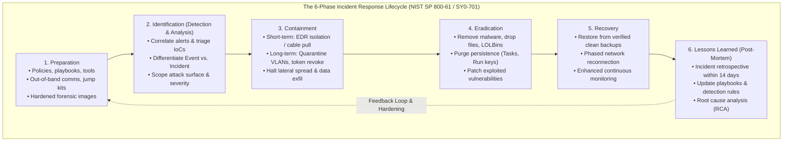
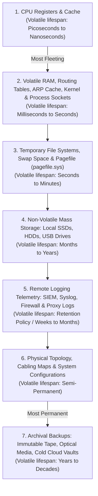
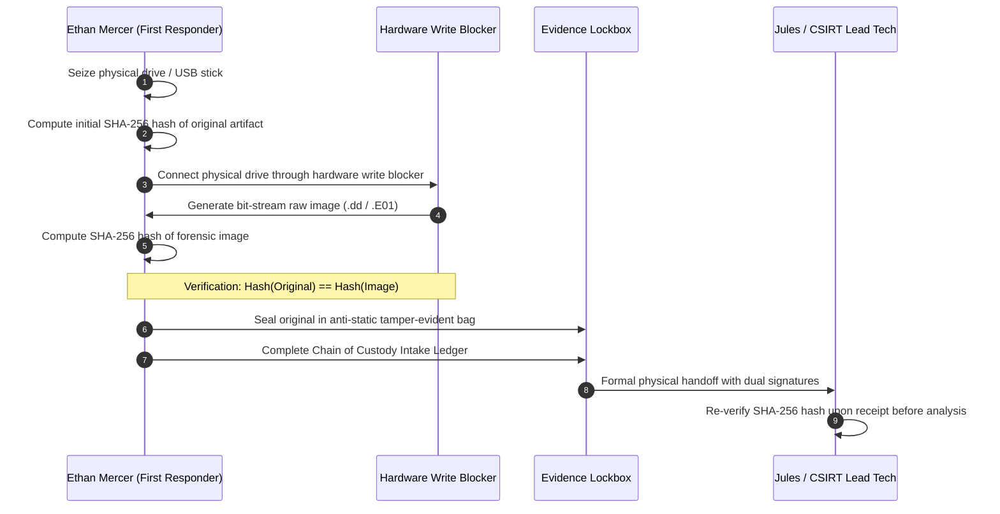

# Portland Desk Lab: The Incident Escalation & SOC Handoff Crucible

> **The Situation:** Portland Operations Center Service Desk • Tier 1 CSIRT Incident Station  
> **Your Role:** Tier 1 Support Specialist / Junior CSIRT Responder (Final Capstone under Jules Brooks)  
> **The Objective:** Correlate a multi-stage enterprise intrusion spanning finance phishing, USB dropper execution, lateral pivot, and industrial OT egress into a definitive CSIRT handoff dossier.  
> **Estimated Time:** 60–75 minutes • Book 0 Final Capstone (Handoff to the SOC)  


---

<details class="instructor-ref">
<summary>Instructor & Certification Reference (Click to Expand)</summary>

* **Aligned Certification:** CompTIA Security+ (SY0-701) Capstone & Incident Response
* **Exam Domains:** Domain 4.0 (Incident Response Lifecycle 4.1, Order of Volatility, Chain of Custody & CSIRT Escalation)
* **Core Competencies & Deliverables:** Incident Lifecycle & Volatility Hierarchy Matrix • Live Memory Acquisition & Chain of Custody Drill • Multi-Stage Attack Correlation Drill • Call Your Shot 5-Case Gate • Definitive CSIRT Incident Handoff Dossier

</details>


---

## Worked Example: The quiet mailbox intrusion

This lab starts with the same incident Ethan worked in the chapter, with the answer known. Read it as a demonstration, then use the sections below to practice each step. Section 6 gives you one new problem that works the same way.

**The incident.** Quiet mailbox rules, a USB in the warehouse, and lateral movement toward the plant gateway.

1. Recognize the pattern as an incident and declare it, which moves you from tickets into the IR lifecycle.
2. Capture volatile evidence in order: memory first, then network state, then disk.
3. Contain: isolate the compromised workstation and the plant gateway.
4. Keep chain of custody on every artifact.
5. Eradicate and recover with the owners of each system.
6. Run the after-action review and write down what you would do differently.
7. Result: contained, with a lost second memory capture, a plant on manual override, and a missing plant playbook.

---

## 1. The Situation & Ground Truth

```callout-panel
title: "FIGURE 12.1: LIVE FORENSIC MEMORY CAPTURE & ORDER OF VOLATILITY"
badge: "Incident Response"
caption: "Forensic bench diagram: An isolated, live running laptop on an ESD mat streaming volatile system RAM to an external forensic SSD (RFC 3227) while a standalone hardware write-blocker sits staged for Step 2 dead-disk storage imaging."
prompt: "Clean technical cutaway illustration of a computer forensic examination bench under bright laboratory lighting. A running laptop sits on an ESD mat connected via high-speed USB-C to a rugged external forensic SSD actively capturing live volatile memory. Staged on the ESD mat beside the laptop sits a standalone hardware write-blocker bridge with disconnected SATA/NVMe adapter cables and anti-static evidence bags ready for secondary persistent disk acquisition. Sharp technical linework, no text, no words. 16:9 ratio."
```


### The Situation
It is a Wednesday in late June. Ethan has been on the desk for twenty-two months. At 08:30, Maya brings in a laptop that turns out to be quarantined adware. At 11:15, Nora Higgins in finance sends a quiet ticket: her wire confirmations are missing from Sent Items, and there is an Outlook rule she does not remember creating. In the early afternoon, Jared relays a call from Todd Miller in Inside Sales, who found an unbranded USB stick labeled *Client Deck Final* on the shipping office floor and plugged it into `TODD-SALES-14`. Then Nora's credentials authenticate to the staging jump host `SRV-STAGE-01`, which bridges into the Willamette River plant network.

This lab follows the chapter from the moment Jules declares an incident: order of volatility, memory capture, hashes, containment, chain of custody, and the handoff to Nia Alvarez.

### The Ground Truth Rules of the Desk

1. **First Touch Is Not Freelance Forensics:**  
   The help desk technician is almost always the first human being to touch an active security incident. Your responsibility as a first responder is to secure the scene, halt active compromise, preserve evidence in its pristine state, and escalate according to the incident response plan. You do not install unvetted freeware tools, you do not rummage through compromised mailboxes for souvenirs, and you never attempt live reverse engineering on an enterprise domain workstation.

2. **The Order of Volatility Is Written in Electrons:**  
   Digital evidence is ephemeral. Once electrical power is removed from a motherboard, every register, cache line, CPU state, routing table, and megabyte of volatile random-access memory (RAM) dissolves instantly. Pulling the power cord may stop a network attacker, but it annihilates the decrypted in-memory malware payload, active encryption keys, injected DLLs, and open network sockets. Follow the RFC 3227 order of volatility strictly: capture volatile state before non-volatile storage.

3. **Need-to-Know Protects the Investigation:**  
   When an intrusion is uncovered, operational silence is mandatory. Never post details about an active breach in general Slack channels, never email company-wide distribution lists, and never notify suspects or unvetted colleagues. If an adversary has compromised email or possesses administrative persistence, broadcasting your investigation tips them off, prompting them to deploy anti-forensic wipers, destroy logs, or accelerate data exfiltration.

4. **Containment Is Not Eradication:**  
   Containment means stopping the bleeding—severing network pathways, isolating endpoints, disabling malicious inbox forwarding rules, and revoking compromised tokens so the attacker cannot pivot or exfiltrate data. Eradication means eliminating the root cause—purging scheduled tasks, removing backdoors, and patching vulnerabilities. You cannot eradicate what you have not yet fully contained and understood. Reimaging a box before identifying its persistence mechanisms simply invites the attacker to re-infect the environment thirty minutes later.

5. **The Dossier Is the Evidence:**  
   In enterprise incident response and legal proceedings, unrecorded actions do not exist. Every file touched, every cable disconnected, every hash calculated, and every custody transfer executed must be recorded with an immutable timestamp, technician identity, and cryptographic checksum. The handoff dossier you deliver to the Computer Security Incident Response Team (CSIRT) dictates whether the enterprise recovers cleanly or suffers a catastrophic blind spot.


---

## 2. Technical Reference & Triage Matrix

### The 6-Phase Incident Response Lifecycle

CompTIA Security+ SY0-701 aligns with established incident response frameworks (NIST SP 800-61 Rev. 2 and ISO/IEC 27035). Technicians must recognize that incident response is not a chaotic reaction; it is a structured, cyclical operational lifecycle.



#### Detailed Breakdown of the Six Phases

| Phase | Core Objective | Key Help Desk & First Responder Actions | Common Pitfalls & Anti-Patterns |
| :--- | :--- | :--- | :--- |
| **1. Preparation** | Establish defenses, playbooks, communication channels, and forensic readiness before an incident occurs. | Maintain pre-configured write blockers, forensic imaging drives, EDR deployment scripts, contact trees, and out-of-band communication paths (signal/cellular). | Attempting to download triage tools over the internet on a compromised host during an active incident. |
| **2. Identification** | Detect anomalous activity, correlate telemetry, validate whether an event constitutes a security incident, and determine scope. | Inspect event logs (Event IDs 4624, 4625, 4698, 7045), analyze email MIME headers, calculate SHA-256 hashes, verify IoCs against threat intel, assign severity (P1–P4). | Dismissing low-noise alerts; declaring every false positive an incident; failing to check whether a quarantined file had already executed. |
| **3. Containment** | Prevent the adversary from expanding their foothold, moving laterally, or exfiltrating data while preserving evidence. | Isolate host via EDR network containment; physically disconnect Ethernet and disable Wi-Fi/Bluetooth; disable malicious cloud forwarding rules; revoke active refresh tokens. | Immediately rebooting or wiping the machine, destroying volatile memory and active network socket connections. |
| **4. Eradication** | Identify all artifacts, persistence mechanisms, and compromised credentials, removing them thoroughly. | Remove malicious scheduled tasks, registry run keys, dropped DLLs, and unauthorized administrative accounts; rotate all enterprise service and user passwords. | Killing a visible process while leaving its persistence scheduled task or service intact. |
| **5. Recovery** | Return compromised systems to production securely, ensuring no residual compromise remains. | Restore databases from clean immutable offline backups; reimage endpoints using verified baseline images; validate operational telemetry; test systems in isolated staging. | Reconnecting systems to the production subnet without patching the initial vulnerability or rotating credentials. |
| **6. Lessons Learned** | Conduct a post-incident retrospective to analyze root causes, response efficacy, and update policies. | Participate in CSIRT debrief within 14 days; document total mean time to detect (MTTD) and mean time to respond (MTTR); update help desk triage playbooks. | Skipping the retrospective to "get back to tickets"; blaming individual users rather than remediating systemic control failures. |


---

### The Order of Volatility (RFC 3227 & CompTIA SY0-701)

When collecting digital evidence from an infected endpoint, forensic data must be captured in strict order of volatility—from the most fleeting to the most permanent. Powering down or rebooting a machine invalidates every tier above physical disk storage.



#### Volatility Hierarchy & Collection Guide

| Volatility Rank | Storage Mechanism | What Is Lost If System Is Powered Off / Rebooted | Typical Collection Method / Tool |
| :---: | :--- | :--- | :--- |
| **1** | **CPU Registers & Processor Cache (L1/L2/L3)** | Thread execution states, active instruction pointers, register contents, decrypted processor variables. | Specialized hardware debuggers / kernel crash dumps (rarely captured at Tier 1; preserved during memory dumping). |
| **2** | **System RAM & Volatile Kernel State** | Unencrypted memory, injected DLLs, running process trees, plaintext passwords, open TCP/UDP sockets, ARP cache, routing table. | Live memory acquisition tools: `WinPmem`, `DumpIt`, `FTK Imager Lite`, `LiME` (Linux). Live CLI: `netstat -ano`, `arp -a`, `ip route`. |
| **3** | **Temporary File Systems & Swap / Pagefile** | Virtual memory caches, active page swaps (`pagefile.sys`, `swapfile.sys`), temporary extraction directories (`%TEMP%`). | Live image capture of paging file; memory acquisition tools that extract swap alongside physical RAM. |
| **4** | **Non-Volatile Mass Storage (SSDs / HDDs / Flash)** | Executable binaries, log files on disk, registry hives (`SAM`, `SYSTEM`, `SOFTWARE`), Master File Table (MFT), event viewer `.evtx` files. | Physical bit-stream disk acquisition via hardware write blocker; software tools: `dd`, `dc3dd`, FTK Imager (`.E01` raw format). |
| **5** | **Remote Logging & Telemetry Systems** | Centralized audit records, SIEM events, firewall flow logs, EDR process history, cloud identity sign-in telemetry. | Centralized SIEM query exports (Splunk, Elastic, Sentinel); authenticated API exports with verified server-side hashes. |
| **6** | **Physical Topology & Network Documentation** | Hardware MAC addresses, physical switch port mappings, patch panel drops, VLAN trunk configurations. | Physical photographs of physical equipment, port audit sheets, configuration backups of managed switches. |
| **7** | **Archival Backups & Cold Media** | Historic system states, baseline snapshots, offline recovery volumes. | Catalog verification, read-only snapshot mounting, cryptographic verification against master backup manifests. |

> [!CAUTION]
> **Never Pull the Plug as Default Action:** Modern operating systems hold critical forensic artifacts—including unencrypted BitLocker keys, injected shellcode, and C2 network sockets—exclusively in RAM. Yanking the power cable destroys all Level 1 and Level 2 evidence. Perform live volatile acquisition or engage EDR network isolation before touching the power switch.


---

### Chain of Custody & Evidence Integrity

Digital evidence is only admissible in administrative actions, regulatory inquiries, or court proceedings if its integrity can be mathematically proven and its possession accounted for every second after seizure.



#### The Cryptographic Hashing Protocol
Before digital media is examined or cloned, a cryptographic message digest must be calculated using a collision-resistant algorithm (SHA-256).

```powershell
# Calculate SHA-256 digest of seized physical or virtual forensic image
Get-FileHash -Path "C:\Forensics\Evidence\TODD-SALES-14-disk.raw" -Algorithm SHA256 | Format-List
```

1. **Pre-Acquisition Hash:** Calculate the hash of the source media (or bit-stream read stream).
2. **Post-Acquisition Hash:** Calculate the hash of the resulting forensic image file.
3. **Verification:** If the two hashes match character for character, the image is a forensically sound bit-for-bit twin. Any alteration of a single bit flips approximately 50% of the output hash digest (the *avalanche effect*).

#### Mandatory Chain of Custody Ledger Fields
Every entry in a formal chain of custody log must contain:
* **Item Tracking Number:** Unique alphanumeric identifier (e.g., `EVD-2026-0624-01`).
* **Item Description:** Exact make, model, capacity, serial number, and physical condition.
* **Source / Seizure Location:** Workstation hostname, physical desk location, port, or user profile.
* **Date & Time of Seizure:** Precise timestamp including local timezone (PST/PDT) and UTC offset.
* **Seizing Official:** Full name, title, and badge/employee number of first responder.
* **Custody Transfers:** Date, time, releasing party signature, receiving party signature, and specific purpose of transfer.
* **Storage Location:** Secure evidence locker ID, safe combination holder, or chain-of-custody room rack.
* **Tamper-Evident Seal ID:** Barcode or serial number of the tamper-evident security tape.


---

### Containment Decision Matrix: Isolation vs. Live Capture vs. Power Pull

First responders must make split-second containment decisions. The wrong choice either spreads malware to neighboring subnets or wipes critical memory evidence.

| Scenario / Threat Pattern | Containment Action | Technical Mechanism | Why This Choice? (Exam & Desk Justification) |
| :--- | :--- | :--- | :--- |
| **Active C2 Beaconing or Worm Spread** (e.g., Nora's endpoint, Todd's share scanning) | **EDR Network Isolation or Physical Cable Disconnect** | Issue EDR network quarantine command; physically disconnect RJ-45 Ethernet; disable 802.11 Wi-Fi. Keep PC powered ON. | **Preserves RAM and process tree.** EDR retains a secure out-of-band management tunnel to collect live memory and process dumps while blocking all internal and external communication. |
| **Active Ransomware Encryption in Progress** (e.g., mass `.locked` file renames) | **Immediate Physical Power Sever (Pull the Plug)** | Yank AC power cable directly from desktop power supply; immediately strip laptop battery. | **Data preservation emergency.** Ransomware encrypts at gigabytes per second. Live memory capture takes 10–15 minutes, during which critical databases and network shares are permanently lost. Stopping encryption takes absolute precedence over memory forensics. |
| **Suspected Rootkit or Kernel Evasion** (e.g., unsigned kernel driver hooking disk I/O) | **Hypervisor Snapshot / Live Memory Dump under Isolation** | Suspend VM or take live hypervisor snapshot; for bare-metal, isolate network and run hardware-based/live memory capture tool. | **Userland tools cannot be trusted.** If the kernel is compromised, userland executables (`tasklist`, `netstat`) return falsified data. Hypervisor-level or raw memory capture bypasses kernel hooks. |
| **Unauthorized Cloud Mailbox Rule / Stolen Session Token** | **Revoke Active Tokens & Purge Mailbox Forwarding** | Execute `Revoke-AzureADUserAllRefreshToken`; delete malicious inbox rule via Exchange PowerShell; force password reset. | **Host isolation does not fix cloud exfiltration.** If the attacker possesses an OAuth token or session cookie, pulling the user's laptop cable accomplishes nothing. Remediation must occur at the identity provider (IdP) layer. |
| **Routine Adware / False Positive Alert** | **Local File Quarantine & Ticket Observation** | Move file to AV/EDR quarantine vault; observe host process behavior. | **Avoid unnecessary disruption.** Overreacting to routine adware by pulling cables or wiping machines disrupts legitimate business operations without justification. |


---

## 3. Quick Checks & Skill Reps

### Quick Check 1: Order of Volatility Sorting

> **The Rule of the Desk:** If you reboot before you capture, you are throwing the weapon into the Willamette River. Rank the evidence before you touch the machine.

#### The Challenge
During the triage of Nora's workstation (`FIN-NORA-02`), Todd's laptop (`TODD-SALES-14`), and the plant gateway (`GW-PLANT-04`), Ethan collects eight distinct evidence artifacts.

Sort the following eight items in strict order of volatility according to RFC 3227 and CompTIA Security+ SY0-701 guidelines, ranking them from **1 (Most Volatile / Dies First)** to **8 (Least Volatile / Most Permanent)**:

* **Item A:** Local SSD storage volume containing `%SystemRoot%\System32\winevt\Logs\Security.evtx`
* **Item B:** Physical network patch cabling map and rack elevation diagram for the Willamette plant
* **Item C:** CPU L3 cache and execution registers on `FIN-NORA-02`
* **Item D:** Volatile main memory (16GB DDR4 RAM) containing the injected `powershell.exe` process and unencrypted C2 decryption key
* **Item E:** Magnetic backup tapes stored in the climate-controlled Gresham vault taken 7 days ago
* **Item F:** Active TCP network sockets and local ARP cache mapping `192.168.10.45` to default gateway `10.100.4.1`
* **Item G:** Virtual memory paging file (`C:\pagefile.sys`) and temporary swap directory (`C:\Windows\Temp`)
* **Item H:** Centralized SIEM firewall flow logs and proxy authentication logs stored on the corporate syslog server

```text
Your Ranking Order:
1 (Most Volatile) : [ ? ]
2                 : [ ? ]
3                 : [ ? ]
4                 : [ ? ]
5                 : [ ? ]
6                 : [ ? ]
7                 : [ ? ]
8 (Least Volatile): [ ? ]
```

**Follow-Up Forensic Questions:**
1. If Ethan executes `Restart-Computer -Force` on Nora's workstation to "clear the sluggishness," which of the items above are permanently lost?
2. Why is Item F (TCP network sockets and ARP cache) ranked higher in volatility than Item G (swap / pagefile)?

<details>
<summary>Solution & Lead Tech Review</summary>

**Correct Volatility Sequence:**

1. **Rank 1 — Item C: CPU L3 cache and execution registers** (Dies within nanoseconds/picoseconds without continuous electrical charge).
2. **Rank 2 — Item F: Active TCP network sockets and local ARP cache** (Volatile kernel memory structures; lost instantly upon socket closure or reboot).
3. **Rank 3 — Item D: Volatile main memory (16GB DDR4 RAM)** (Volatile physical memory; holds running code, injected DLLs, and plaintext credentials; wiped upon power loss).
4. **Rank 4 — Item G: Virtual memory paging file (`pagefile.sys`) and temporary swap space** (Written to disk, but dynamic and partially overwritten as memory pages cycle; cleared or marked stale on shutdown).
5. **Rank 5 — Item A: Local SSD storage volume (`Security.evtx` and disk files)** (Non-volatile solid-state mass storage; persists across reboots and power outages).
6. **Rank 6 — Item H: Centralized SIEM firewall flow logs and proxy server records** (Remote server-side logging; protected from local endpoint deletion, subject to log retention policies).
7. **Rank 7 — Item B: Physical network patch cabling map and rack elevation diagram** (Physical configuration documentation; changes only when physical infrastructure is altered).
8. **Rank 8 — Item E: Magnetic backup tapes in climate-controlled vault** (Archival offline storage; retainable for decades).

*(Note: Items F and D both reside within volatile system memory, but active kernel socket states and CPU execution contexts fluctuate even faster than general RAM allocations).*

**Jules' Analysis of Follow-Up Questions:**
1. **Consequences of Rebooting:** Executing `Restart-Computer` immediately destroys **Item C (Registers/Cache)**, **Item F (Sockets/ARP)**, and **Item D (RAM)**. The unencrypted C2 communication keys, the injected PowerShell payload, and the active process connection to `185.22.112.14:443` vanish permanently. Furthermore, `pagefile.sys` (Item G) will have its active pointers reset and temporary files overwritten during the shutdown/boot cycle.
2. **Why Sockets Precede Swap:** Active TCP sockets and ARP cache tables are live kernel state structures. A network reset, interface flap, or connection termination from the remote server clears the socket state in milliseconds. The swap file (`pagefile.sys`) sits on physical disk media; while dynamic, remnants of swapped memory can persist on disk sectors even across reboots until overwritten by new memory demands.
</details>


---

### Quick Check 2: Evidence Integrity & Hash Verification

> **The Rule of the Desk:** A forensic image without a matching hash is just a copy of a story you can't prove in court. Verify the math before you touch the drive.

#### Scenario Walkthrough
Ethan connects Todd's confiscated 32GB USB flash drive (`CLIENT DECK`) to the dedicated forensic workstation (`PORT-IR-WK01`). The forensic station is equipped with a hardware write blocker (Tableau T8u USB 3.0 Forensic Bridge) that physically prevents write requests (`SCSI WRITE`, `USB Bulk-Only Write`) from reaching the storage controller.

Ethan executes a bit-stream raw disk acquisition to create an exact forensic disk image:

```powershell
# Step 1: Compute baseline SHA-256 hash of original physical media via write blocker
# Media ID: PhysicalDrive2 (Vendor: SanDisk Ultra 32GB, S/N: 4C530001220914112102)
PS C:\Forensics> Get-FileHash -Path "\\.\PhysicalDrive2" -Algorithm SHA256

Algorithm       Hash                                                               Path
---------       ----                                                               ----
SHA256          A4F2C9901B34E57D890AA71B994E10F823CD456188902A3CDEF1192837462B10   \\.\PhysicalDrive2

# Step 2: Acquire bit-stream raw image to forensic storage
PS C:\Forensics> dc3dd.exe if=\\.\PhysicalDrive2 of=D:\Images\EVD-2026-0624-USB.raw hash=sha256 log=D:\Images\acquisition.log
dc3dd 7.2.646 started at 2026-06-24 15:10:04 -0700
31268536320 bytes (31 GB) copied (100%), 124.2 s, 240 MB/s
input hash (sha256): a4f2c9901b34e57d890aa71b994e10f823cd456188902a3cdef1192837462b10
output hash (sha256): a4f2c9901b34e57d890aa71b994e10f823cd456188902a3cdef1192837462b10

# Step 3: Ethan mounts the raw image as a read-only loopback device to extract the dropper
PS C:\Forensics> Get-FileHash -Path "D:\MountedEvidence\SOW_final.pdf.exe" -Algorithm SHA256

Algorithm       Hash                                                               Path
---------       ----                                                               ----
SHA256          9F2C8D1E3A4B5C6D7E8F0A1B2C3D4E5F6A7B8C9D0E1F2A3B4C5D6E7F8A9BC41A   D:\MountedEvidence\SOW_final.pdf.exe
```

#### Diagnostic Evaluation Questions
1. Compare the `input hash` and `output hash` in Step 2. What does this mathematical comparison prove regarding evidence integrity?
2. Suppose a junior technician took Todd's USB drive, plugged it directly into a standard Windows 11 laptop *without* a write blocker, and browsed the drive using Windows File Explorer before running the hash. Would the SHA-256 hash still match `A4F2C99...`? Why or why not?
3. Review the following snippet from a chain of custody ledger. Identify the fatal procedural error that would compromise evidence admissibility:

```text
ITEM: EVD-2026-0624-USB
SEIZED: 2026-06-24 14:40 PDT by Ethan Mercer (Tier 1 Support)
CUSTODY LOG:
- 14:40 PDT: Seized from Todd Miller's desk (TODD-SALES-14) by Ethan Mercer. Placed in backpack.
- 15:05 PDT: Ethan Mercer arrived at Operations Center; placed USB on desk beside coffee.
- 15:10 PDT: Connected to PORT-IR-WK01 for bit-stream acquisition.
- 15:30 PDT: Transferred to Jules Brooks (CSIRT Lead). Signature: J. Brooks.
```

<details>
<summary>Solution & Lead Tech Review</summary>

**Jules' Analysis:**

1. **Proof of Integrity:**  
   The bit-for-bit equality of the input hash (`\\.\PhysicalDrive2`) and output hash (`EVD-2026-0624-USB.raw`) mathematically proves that the forensic disk image is an exact, uncorrupted, 100% identical replica of the original physical media. Every sector, file slack, unallocated cluster, and partition table bit was duplicated without alteration. Forensic analysis can now proceed exclusively on clones of this image while the original media remains sealed in evidence storage.

2. **The Impact of Plugging Without a Write Blocker:**  
   **No, the hash would not match.** The moment a modern operating system (Windows, macOS, or Linux) mounts a mass storage device without a hardware or kernel write blocker, the OS automatically performs write operations:
   - Windows Explorer writes hidden volume information (`System Volume Information`, `IndexerVolumeGuid`, `WPSettings.dat`).
   - The OS updates file access timestamps ($32$ attributes) and may generate thumbnail caches (`thumbs.db`).
   - Antivirus software may automatically rename, lock, or quarantine files on the volume.
   Because cryptographic hashing exhibits the avalanche effect, altering a single timestamp byte changes the resulting SHA-256 hash completely, rendering it impossible to prove that evidence was not planted or tampered with.

3. **Fatal Chain of Custody Errors Identified:**
   - *"Placed in backpack"*: Evidence was placed in an unsecured personal bag rather than a certified anti-static, tamper-evident evidence pouch sealed with tamper-indicating tape and signed across the seam.
   - *"Placed USB on desk beside coffee"*: Evidence was left unattended in an open, unmonitored area. This represents a complete break in physical custody. Anyone on the desk floor had physical access to the device.
   - *Missing Releasing Signature*: Ethan Mercer failed to sign the transfer block at 15:30 PDT; a valid chain of custody requires dual signatures (releasing party and receiving party) at every handoff.
</details>


---


### 2.3 Interactive Diagnostic Console: Live Telemetry & Triage

Use the interactive console below to test commands, inspect telemetry, and verify your troubleshooting steps.

```lnk-terminal
title: "POWERSHELL: FORENSIC INTEGRITY & SHA-256 HASH VERIFICATION"
shell: "powershell"
prompt: "PS C:\CSIRT> "
replay: true
objectives:
  - id: "obj-hash"
    label: "Calculate SHA-256 hash of extracted evidence image"
    trigger: "Get-FileHash -Algorithm SHA256 .\evidence_disk0.dd"
  - id: "obj-verify"
    label: "Verify forensic image hash matches chain of custody"
    trigger: "(Get-FileHash .\evidence_disk0.dd).Hash -eq $custodyHash"
---
Get-FileHash -Algorithm SHA256 .\evidence_disk0.dd: |
  Algorithm       Hash                                                             Path
  ---------       ----                                                             ----
  SHA256          A3F8B4C92E1045D87E6B9C1045F2A83C4D5E6F7A8B9C0D1E2F3A4B5C6D7E8F9A .\evidence_disk0.dd
  [OK] Bit-for-bit forensic image acquired through hardware write-blocker.

(Get-FileHash .\evidence_disk0.dd).Hash -eq $custodyHash: |
  True
  [VERIFIED] Cryptographic hash matches original intake record exactly (0 differences).
  Chain of Custody verified: Evidence integrity intact.
  Formal handoff dossier packaged for Senior CSIRT Lead Nia Alvarez and Jules Brooks.
  [OK] Incident handoff complete.

```

---

### Quick Check 3: Call Your Shot: Predict Before You Look

> **Practice cases.** Unless a case names the chapter's incident, these are invented practice cases. They use the chapter's ideas on new machines and new people, and they are not events from the story.

> **The Rule of the Desk:** Do not touch the console until you have committed your decision in your mind. Name the threat, select the containment action, and articulate your technical justification.


---
<div class="scratchpad-container">
  <div class="scratchpad-header">
    <span class="scratchpad-title">Interactive Hypothesis Scratchpad</span>
    <span class="scratchpad-save-indicator" id="save-ind-12-cbyt">Saved in browser</span>
  </div>
  <div class="scratchpad-body">
    <textarea id="notes-12-cbyt" placeholder="Type your predicted failure layer, expected command output, and root cause hypothesis here before opening solutions..."></textarea>
  </div>
  <div class="scratchpad-footer">
    <span>Private notes saved locally in your browser. Not graded.</span>
    <button type="button" class="scratchpad-copy-btn" onclick="copyScratchpad('notes-12-cbyt')">Copy Notes</button>
  </div>
</div>


#### Case 1: Nora Higgins (Finance Specialist) — `INC-2026-1201`
*Telemetry & Symptoms:* Nora's account underwent an MFA reset at 02:13 a.m. from an external German hosting provider IP (`198.51.100.77`). An Exchange inbox rule (`InvoiceProcess`) is silently forwarding all finance emails to an external drop address. Meanwhile, host telemetry on `FIN-NORA-02` indicates an injected PowerShell process establishing recurring HTTPS connections to `185.22.112.14:443` every 300 seconds and attempting to access `lsass.exe`. Nora says she has payroll to disburse in 45 minutes and asks if she can just change her password and keep working on her laptop.

* **Your Action:**  
  [ A. Reset Password & Allow User to Finish Payroll / B. Isolate Host via EDR, Revoke Cloud Refresh Tokens, Purge Rule, Issue Clean Loaner / C. Pull Laptop Power Cable Immediately & Delete Mailbox ]
* **Threat Classification & IR Phase:**
* **Technical Justification:**

<details>
<summary>Solution & Lead Tech Review</summary>

* **Action:** **B. Isolate Host via EDR, Revoke Cloud Refresh Tokens, Purge Malicious Rule, and Issue Clean Hardened Loaner.**
* **Threat Classification & IR Phase:** **Account Hijacking / C2 Beaconing / Credential Dumping**; Lifecycle Phase: **Containment & Identification**.
* **Jules' Critique:**  
  "A simple password reset is completely useless here. Why? Because the attacker has two separate hooks into our environment:
  1. *Cloud Layer:* An active Azure AD refresh token and an Exchange inbox forwarding rule. Even if Nora changes her password, existing session tokens remain valid until explicitly revoked via `Revoke-AzureADUserAllRefreshToken`, and the inbox rule will continue forwarding payroll spreadsheets to Germany.
  2. *Endpoint Layer:* Workstation `FIN-NORA-02` is infected with an in-memory C2 beacon targeting `lsass.exe`. If you let her keep typing on that machine, the attacker harvests every new credential she enters.
  Isolate the laptop via EDR (retaining memory for the CSIRT), revoke all cloud sessions, delete the forwarding rule, and hand Nora an uncompromised loaner laptop so payroll can proceed safely."
</details>


---

#### Case 2: Todd Miller (Sales & Warehouse) — `INC-2026-1202`
*Telemetry & Symptoms:* Todd plugged in an unbranded USB drive. Antivirus quarantined `SOW_final.pdf.exe` on drive `E:\`. Todd unplugged the stick and wants his ticket closed. However, EDR process history indicates that before quarantine, the dropper spawned `powershell.exe -w hidden`, which executed `net view /all`, probed writable shares on `\\WH-PACK-02\share$`, and created a persistent scheduled task named `CacheCleanup` configured to execute at system startup.

* **Your Action:**  
  [ A. Close Ticket with Warning / B. Delete Scheduled Task & Reconnect / C. Isolate Host Immediately, Confiscate USB Drive, Audit Target Network Shares ]
* **Threat Classification & IR Phase:**
* **Technical Justification:**

<details>
<summary>Solution & Lead Tech Review</summary>

* **Action:** **C. Isolate Host Immediately, Confiscate Physical USB Drive for Chain of Custody, and Audit Target Network Shares.**
* **Threat Classification & IR Phase:** **Trojan Dropper / Worm-like Lateral Movement / Persistence**; Lifecycle Phase: **Containment & Identification**.
* **Jules' Critique:**  
  "Todd thinks because the USB is sitting on his mousepad and AV popped a green box, the problem is gone. The green box is a lie. The dropper had four seconds of life before AV intervened, and in those four seconds it spawned a detached PowerShell worker, established machine persistence via `CacheCleanup`, and reached across the warehouse subnet.  
  Sever Todd's network connection immediately. Place the USB in a tamper-evident evidence pouch. Then immediately notify Storage Engineering to inspect `\\WH-PACK-02\share$` for newly dropped payload files. Never let a user convince you an infection is dead just because they pulled the plastic."
</details>


---

#### Case 3: Leah Moreno (Willamette Plant) — `INC-2026-1203`
*Telemetry & Symptoms:* Leah reports that plant telemetry gateway `GW-PLANT-04` is attempting outbound TLS sessions to external IP `185.22.112.14:8443`. Traffic originates from an internal staging jump box (`SRV-STAGE-01`) located in the cross-connected operations subnet. The Willamette plant's programmable logic controllers (PLCs) are operating normally, but Leah is concerned the gateway could be used to bridge into the SCADA network.

* **Your Action:**  
  [ A. Reimage SCADA Gateway Immediately / B. Emergency Isolation of Staging Jump Box, Block Outbound Port 8443 at OT Edge, Engage Industrial CSIRT / C. Ignore Alert as Routine Telemetry Sync ]
* **Threat Classification & IR Phase:**
* **Technical Justification:**

<details>
<summary>Solution & Lead Tech Review</summary>

* **Action:** **B. Emergency Isolation of Staging Jump Box, Block Outbound Port 8443 at OT Firewall Boundary, and Engage Industrial CSIRT.**
* **Threat Classification & IR Phase:** **Pivoting / Unauthorized Network Egress / Critical Infrastructure Threat**; Lifecycle Phase: **Containment & Escalation**.
* **Jules' Critique:**  
  "This is where help desk responsibilities end and emergency CSIRT protocols begin. Gateway `GW-PLANT-04` sits on the boundary between corporate IT and plant process control. The external destination IP (`185.22.112.14`) is the exact same C2 address communicating with Nora's infected PC in Finance.  
  The attacker is attempting to pivot from corporate IT through staging jump box `SRV-STAGE-01` into the plant network. Sever the staging box's network links instantly. Implement an immediate egress drop rule on the OT perimeter firewall for port 8443 and IP `185.22.112.14`. Do NOT reboot the gateway or PLCs—call the Industrial Incident Commander immediately."
</details>


---

#### Case 4: Maya's "Possessed" Laptop vs. Nora's Stolen Mailbox — `INC-2026-1204`
*Telemetry & Symptoms:* Maya from Marketing sprints to the desk shouting that her laptop is "possessed by demons"—her browser is flashing coupon ads, the fan is whining, and she demands an immediate hard drive wipe before her executive meeting. Meanwhile, Nora's ticket sits in the queue marked "Low Priority: Sent folder empty."

* **Your Action:**  
  [ A. Wipe Maya's Laptop First (Loudest User) / B. Treat Maya as an Event (Adware Quarantine) & Escalate Nora as a Security Incident / C. Reimage Both Workstations Simultaneously ]
* **Threat Classification & IR Phase:**
* **Technical Justification:**

<details>
<summary>Solution & Lead Tech Review</summary>

* **Action:** **B. Treat Maya as an Event (Verify Adware Quarantine) & Escalate Nora as a Severe Security Incident.**
* **Threat Classification & IR Phase:** **Event vs. Incident Triage / Prioritization**; Lifecycle Phase: **Identification & Triage**.
* **Jules' Critique:**  
  "This is the core test of a real technician: *the volume of the user does not equal the severity of the threat.*  
  Maya has adware (`couponbar.dll`). The AV log showed quarantine completed at 07:41, no network beaconing, and no lateral spread. Maya’s issue is an **Event**—scary to an untrained human, but contained. Wiping her machine would have wasted two hours of desk time and destroyed her meeting.  
  Nora was quiet and polite, but her ticket represented an active **Security Incident**—an unauthorized foreign logon, automated exfiltration of financial wire transfers, and in-memory credential harvesting. Criteria must always beat adrenaline."
</details>


---

#### Case 5: Staging Server Kernel Driver Anomaly — `INC-2026-1205`
*Telemetry & Symptoms:* On staging host `SRV-STAGE-01`, host EDR alerts on an unsigned kernel driver hooking disk input/output routines. The system administrator attempts to run `dir` and `tasklist` via PowerShell, which report that all files and services are clean and normal. The admin asks if they can run a third-party rootkit cleaner downloaded from a tech blog.

* **Your Action:**  
  [ A. Run the Third-Party Rootkit Cleaner as Administrator / B. Trust `tasklist` and Close Ticket / C. Freeze Virtual Machine / Capture Live Memory via Hypervisor, Disconnect Network, Schedule Bare-Metal Rebuild ]
* **Threat Classification & IR Phase:**
* **Technical Justification:**

<details>
<summary>Solution & Lead Tech Review</summary>

* **Action:** **C. Freeze Virtual Machine / Capture Live Memory via Hypervisor, Disconnect Network, and Prepare for Bare-Metal Rebuild.**
* **Threat Classification & IR Phase:** **Rootkit / Kernel-Level Hooking**; Lifecycle Phase: **Containment & Eradication**.
* **Jules' Critique:**  
  "When a rootkit hooks Ring 0 (kernel space), the operating system loses the ability to tell the truth. When the admin types `dir` or `tasklist`, the query passes through the compromised kernel driver, which intercepts the system call and strips the malicious files from the output before the user sees it.  
  Never run unvetted 'cleaner tools'—they cannot be trusted and frequently introduce secondary backdoors. Capture memory from outside the OS (via hypervisor snapshot) so forensics can analyze the hooked driver, isolate the host from the network, and plan a complete reimage from trusted, known-good installation media."
</details>


---

## 4. Your Ticket Notes / Formal Security Escalation Dossier

<div class="scratchpad-container">
  <div class="scratchpad-header">
    <span class="scratchpad-title">Your Ticket Draft & Resolution Scratchpad</span>
    <span class="scratchpad-save-indicator" id="save-ind-12-ticket">Saved in browser</span>
  </div>
  <div class="scratchpad-body">
    <textarea id="notes-12-ticket" style="min-height: 140px;" placeholder="Draft your ticket notes, diagnosis, and resolution steps here before comparing with the reference standard below..."></textarea>
  </div>
  <div class="scratchpad-footer">
    <span>Private notes saved locally in your browser. Not graded.</span>
    <button type="button" class="scratchpad-copy-btn" onclick="copyScratchpad('notes-12-ticket')">Copy Notes</button>
  </div>
</div>

Below is the definitive, audit-grade Incident Escalation Dossier assembled by Ethan and reviewed by Desk Lead Jules Brooks for formal handoff to the Portland Operations Center CSIRT and Incident Commander.

```text
================================================================================
PORTLAND OPERATIONS CENTER — FORMAL CSIRT INCIDENT ESCALATION DOSSIER
================================================================================
INCIDENT TRACKING ID:  INC-2026-1022-CRUCIBLE
INCIDENT SEVERITY:     P1 — CRITICAL (ACTIVE MULTI-STAGE INTRUSION & OT EXPOSURE)
INITIAL CLASSIFICATION: Malicious Phishing / C2 Beaconing / Lateral Pivot / SCADA Exposure
DATE & TIME INITIATED: 2026-06-24 14:15:00 PDT (21:15:00 UTC)
FIRST RESPONDER:       Ethan Mercer (Tier 1 Support Specialist, Portland Desk)
INCIDENT LEAD / QA:    Jules Brooks (Service Desk Lead & First Response Coordinator)
TARGET ESCALATION:     Enterprise CSIRT / SOC Tier 2 Operations / Industrial IR Bridge
================================================================================

1. EXECUTIVE SUMMARY & ATTACK PATH CORRELATION
--------------------------------------------------------------------------------
Between 08:30 and 14:15 PDT on 2026-06-24, Tier 1 triage correlated four 
superficially disparate help-desk events into an ongoing, coordinated, multi-stage
enterprise intrusion campaign:

Attack Path Chronology:
[Initial Access]        Workstation FIN-NORA-02 compromised via credential phishing.
                        MFA reset executed from 198.51.100.77 (Frankfurt, Germany) at 02:13 PDT.
                        Malicious Exchange rule 'InvoiceProcess' exfiltrates financial data.
                                |
[Host C2 & Dumping]     Workstation FIN-NORA-02 establishes 300-second HTTPS beaconing 
                        to 185.22.112.14:443. Memory injection targets lsass.exe.
                                |
[Physical Vector]       Workstation TODD-SALES-14 infected via unbranded USB ('CLIENT DECK').
                        Dropper SOW_final.pdf.exe initiates lateral SMB share enumeration
                        and establishes persistence task 'CacheCleanup' (SYSTEM).
                                |
[Internal Pivot]        Adversary leverages harvested credentials to access cross-zone staging 
                        jump box SRV-STAGE-01 spanning corporate IT and industrial OT subnets.
                                |
[Critical OT Egress]    Plant telemetry gateway GW-PLANT-04 at Willamette River Water 
                        Treatment Facility displays unauthorized egress to 185.22.112.14:8443.

2. AFFECTED ASSETS & IDENTITY SCOPE
--------------------------------------------------------------------------------
Workstations:
- Hostname: FIN-NORA-02 | IP: 192.168.20.14 | User: Nora Higgins (Finance Specialist)
  Status: EDR ISOLATED (Power ON) | MAC: 00:1A:2B:3C:4D:5E | OS: Windows 11 Enterprise
- Hostname: TODD-SALES-14 | IP: 192.168.10.45 | User: Todd Miller (Inside Sales Lead)
  Status: PHYSICALLY DISCONNECTED (Power ON) | MAC: 00:1A:2B:5F:6A:7B | OS: Windows 11

Servers & Gateways:
- Hostname: SRV-STAGE-01 | IP: 10.100.50.10 / 172.16.4.10 (Dual-Homed Jump Box)
  Status: NETWORK PORTS DISABLED (Switch SW-CORE-02, Gi1/0/22 & Gi1/0/23 shut)
- Hostname: GW-PLANT-04 | IP: 172.16.4.1 (SCADA Edge Gateway, Willamette Facility)
  Status: EGRESS BLOCKED AT OT FIREWALL | Operating under Industrial IR Protocol

Compromised Identities:
- UPN: nhiggins@harrowmere.com (Finance Specialist — Full Mailbox & Cloud Access)
- UPN: tmiller@harrowmere.com (Inside Sales Lead — Domain User)
- Target Exfiltration Mailbox: exfil@pay-secure-audit.com

3. COMPREHENSIVE INDICATORS OF COMPROMISE (IoCs)
--------------------------------------------------------------------------------
[Cryptographic File Hashes — SHA-256]
• 9f2c8d1e3a4b5c6d7e8f0a1b2c3d4e5f6a7b8c9d0e1f2a3b4c5d6e7f8a9bc41a
  Filename: SOW_final.pdf.exe | Type: PE32+ Executable | Role: Initial USB Dropper
• e3b0c44298fc1c149afbf4c8996fb92427ae41e4649b934ca495991b7852b855
  Filename: update.ps1 | Type: PowerShell Script | Role: Internal SMB Replicator
• d41d8cd98f00b204e9800998ecf8427e00000000000000000000000000000000
  Filename: telemetry_sync.bin | Type: Encrypted Payload | Role: Gateway Staging Drop

[Network Infrastructure & C2 Channels]
• IP Address: 185.22.112.14 (External Hosting Provider — C2 Primary Controller)
  - Port 443 TCP: HTTPS C2 beaconing channel from FIN-NORA-02 (Interval: 300s ± 15s)
  - Port 8443 TCP: TLS egress channel attempted from GW-PLANT-04
  - Port 8080 TCP: Secondary payload staging port identified in PowerShell cradle
• IP Address: 198.51.100.77 (Frankfurt, Germany — Anonymizing Proxy)
  - Source IP for unauthorized Azure AD interactive logons and MFA manipulation
• Domain: pay-secure-audit.com (Lookalike Domain / Created 2026-06-19)
  - Recipient for unauthorized Exchange inbox forwarding rule

[Host Persistence & Behavioral Indicators]
• Scheduled Task Name: 'CacheCleanup' (Event ID 4698 on TODD-SALES-14)
  Action: powershell.exe -nop -w hidden -File C:\ProgramData\update.ps1
  Trigger: At system startup | Principal: NT AUTHORITY\SYSTEM
• Exchange Inbox Rule: 'InvoiceProcess'
  Condition: Subj/Body contains ['wire','invoice','payroll','confidential']
  Actions: ForwardTo 'exfil@pay-secure-audit.com'; MarkAsRead; MoveTo 'RSS Feeds'
• Memory Injection Indicator: EDR Alert 2026-1022-991
  Source PID: 6412 (powershell.exe) -> Target PID: 748 (lsass.exe) [PROCESS_VM_READ]

4. CONTAINMENT & EVIDENCE PRESERVATION ACTIONS EXECUTED
--------------------------------------------------------------------------------
Timestamp (PST) | Action Executed & Technical Details
----------------|---------------------------------------------------------------
14:18:12        | EDR Host Isolation engaged on FIN-NORA-02. Machine retained powered 
                | ON in locked state. Out-of-band management channel preserved.
14:20:05        | Cloud Identity Containment: Executed Revoke-AzureADUserAllRefreshToken
                | for nhiggins@harrowmere.com. Forced administrative password reset.
14:22:30        | Purged malicious forwarding rule 'InvoiceProcess' via Exchange 
                | Online PowerShell (Remove-InboxRule -Mailbox nhiggins -Identity ...).
14:25:10        | Physical Network Isolation of TODD-SALES-14: Disconnected RJ-45 
                | Ethernet cable. Disengaged physical Wi-Fi hardware toggle.
14:28:45        | Physical Media Seizure: Seized 32GB USB flash drive from Todd Miller.
                | Packaged in Anti-Static Evidence Pouch #EVD-2026-0624-01 with 
                | tamper-evident seal #SEAL-90412.
14:32:00        | Industrial OT Boundary Containment: Network Operations disabled 
                | switch ports Gi1/0/22 & Gi1/0/23 on SW-CORE-02, severing staging 
                | server SRV-STAGE-01. Edge firewall drop rule applied for 185.22.112.14.
14:40:00        | Live volatile RAM acquisition initiated on FIN-NORA-02 via WinPmem
                | over secure EDR collection tunnel. Image: FIN-NORA-02-RAM.raw.
15:15:00        | Bit-stream forensic acquisition of USB completed via Tableau write
                | blocker on PORT-IR-WK01. Image: EVD-2026-0624-USB.raw. Hash verified.

5. EVIDENCE LOG & CHAIN OF CUSTODY MASTER RECORD
--------------------------------------------------------------------------------
Item Number:      EVD-2026-0624-01
Item Description: SanDisk Ultra 32GB USB 3.0 Flash Drive (Black casing, blue sharpie)
Serial Number:    4C530001220914112102
Seized From:      Todd Miller desk (Inside Sales, TODD-SALES-14)
Seized Date/Time: 2026-06-24 14:28:45 PDT
Seizing Tech:     Ethan Mercer (Badge #IT-8842)
SHA-256 Digest:   a4f2c9901b34e57d890aa71b994e10f823cd456188902a3cdef1192837462b10
Storage Location: Central Operations Evidence Safe #2 (Locker B, Combination Held by J. Brooks)

Chain of Custody Transfer History:
- 14:28 PDT: Seized by Ethan Mercer; sealed in Bag #EVD-2026-0624-01.
- 15:05 PDT: Transferred to PORT-IR-WK01 by Ethan Mercer for write-blocked imaging.
- 15:35 PDT: Transferred to Jules Brooks (CSIRT Lead). 
  Releasing Signature: Ethan Mercer, Tier 1 Support
  Receiving Signature: Jules Brooks, Desk Lead & CSIRT Coordinator

Item Number:      EVD-2026-0624-02
Item Description: Volatile Memory Dump (FIN-NORA-02-RAM.raw) — 16GB Physical DDR4
Source Hostname:  FIN-NORA-02 (Finance Specialist Workstation)
Acquired Date:    2026-06-24 14:48:10 PDT via WinPmem (Remote EDR Live Capture)
SHA-256 Digest:   5e884898da28047151d0e56f8dc6292773603d0d6aabbdd62a11ef721d1542d8
Storage Location: Secure IR SAN Share: \\IR-SECURE-VAULT\Case-2026-1022\Memory\

6. RECOMMENDED CSIRT & ENGINEERING NEXT STEPS
--------------------------------------------------------------------------------
1. Active Directory & Kerberos Remediation:
   - Perform dual-reset of enterprise Kerberos Ticket Granting Service account (KRBTGT)
     password across all domain controllers to invalidate potential Golden Tickets.
   - Force global password rotation and MFA re-registration for all Finance personnel.
2. Threat Hunting across Enterprise SIEM:
   - Query 30-day firewall flow records for all internal connections to 185.22.112.14
     and 198.51.100.77.
   - Query Windows Event Log Event ID 4698 across all domain endpoints to detect any
     secondary deployments of task 'CacheCleanup' or variants.
3. Network Share Sanitization:
   - Audit target share \\WH-PACK-02\share$ for existence of update.ps1 or staging DLLs.
   - Restrict SMB share write permissions across warehouse subnets.
4. Industrial SCADA Integrity Audit:
   - Coordinate with Leah Moreno to inspect firmware checksums on GW-PLANT-04.
   - Maintain physical network isolation between corporate IT and plant OT until full
     code audit of staging server SRV-STAGE-01 is complete.
================================================================================
DOSSIER STATUS: SIGNED & TRANSFERRED TO CSIRT INCIDENT COMMANDER (2026-06-24 15:45 PDT)
================================================================================
```


---

## 5. What Good Looks Like (Shift Quality Checklist)

### Lead Tech Sign-Off Checklist
Before Ethan closes the red folder and hands the physical binder to Jules, he verifies every item against the Portland Desk Shift Quality Standard:

* [x] **Event vs. Incident Delineated:** Maya's noisy adware was properly tagged as an isolated *Event* (resolved without disruption), while Nora's quiet mailbox anomaly was identified as an active *Security Incident*.
* [x] **Order of Volatility Honored:** Volatile memory (RAM) and network socket states were captured live before any system reboots, shutdowns, or disk imaging occurred.
* [x] **Strict Containment Before Analysis:** Infected endpoints (`FIN-NORA-02`, `TODD-SALES-14`) were isolated from the network via EDR and physical cable disengagement before forensic triage commenced.
* [x] **Operational Silence Maintained:** Need-to-know principles were strictly enforced; no notifications were posted to public Slack channels or email distribution lists that could alert the adversary.
* [x] **Cryptographic Hash Verification:** Every physical and virtual artifact possesses an immutable pre-acquisition and post-acquisition SHA-256 checksum proving 100% mathematical integrity.
* [x] **Continuous Chain of Custody:** The physical evidence log accounts for every minute of possession from the moment Todd's USB drive was picked up to the dual-signature transfer to Jules.
* [x] **Actionable CSIRT Handoff:** The escalation dossier provides specific, testable IoCs (hashes, IP addresses, ports, task names) allowing Tier 2 analysts to hunt across enterprise telemetry immediately.


---

### Shift Scoring & Passing Standards

| Performance Criterion | Exemplary (Full Lead Sign-Off) | Satisfactory (Minor Guidance Needed) | Needs Revision (Redo Ticket) |
| :--- | :--- | :--- | :--- |
| **Multi-Stage Incident Correlation & Lifecycle** | Instantly connects seemingly disconnected events across finance, warehouse, and plant OT into a single intrusion path; accurately maps all actions to the 6-phase IR lifecycle. | Identifies individual security incidents, but struggles to see the correlation between Nora's C2 beacon and the plant gateway anomaly without lead prompt. | Treats each ticket in complete isolation; suggests wiping or reimaging hosts without investigating root cause or persistence. |
| **Order of Volatility & Evidence Preservation** | Flawlessly prioritizes live RAM and volatile network sockets ahead of static disk storage; articulates exact data lost upon power termination. | Follows the volatility hierarchy when referenced from notes, but hesitates on whether to pull cables vs. execute live memory captures. | Reboots or powers down infected machines before capturing memory; destroys in-memory decryption keys and process handles. |
| **Evidence Integrity & Chain of Custody** | Employs hardware write blockers correctly; calculates SHA-256 pre/post hashes; maintains meticulous custody logs with zero unmonitored time gaps or missing signatures. | Calculates file hashes, but forgets to verify the destination image against the source media; records custody with minor timestamp ambiguities. | Connects evidence directly to write-enabled machines; fails to calculate hashes; leaves physical evidence unattended on open desks. |
| **Containment Precision & Need-to-Know** | Selects the exact containment tool (EDR isolation, token revocation, firewall drop) matching the threat; enforces strict operational secrecy across all user interactions. | Contains the threat successfully, but causes unnecessary business downtime by disconnecting unaffected infrastructure; shares minor details with unvetted staff. | Fails to isolate infected endpoints while investigating; alerts general company Slack channels, compromising investigative integrity. |
| **CSIRT Escalation Dossier Quality** | Delivers an audit-grade, professional technical dossier complete with executive summary, IoCs, attack path timeline, and prioritized remediation actions. | Writes clear ticket notes with accurate technical data, but lacks formal structure, executive summary, or standardized IoC formatting. | Submits vague, unstructured notes ("laptop was acting weird, ran AV, escalated to SOC"); omits hashes, IPs, and timestamps. |


---

---

---

## 6. Transfer Problem

This problem looks different from the quiet mailbox intrusion, but it works the same way. Use the worked example and your notes.

A manager's account sends an unusual forwarding rule to an outside address, and an hour later the same account signs in from two countries. Walk the incident lifecycle for this case, name what you capture first, and name one containment call that could cost you evidence.
