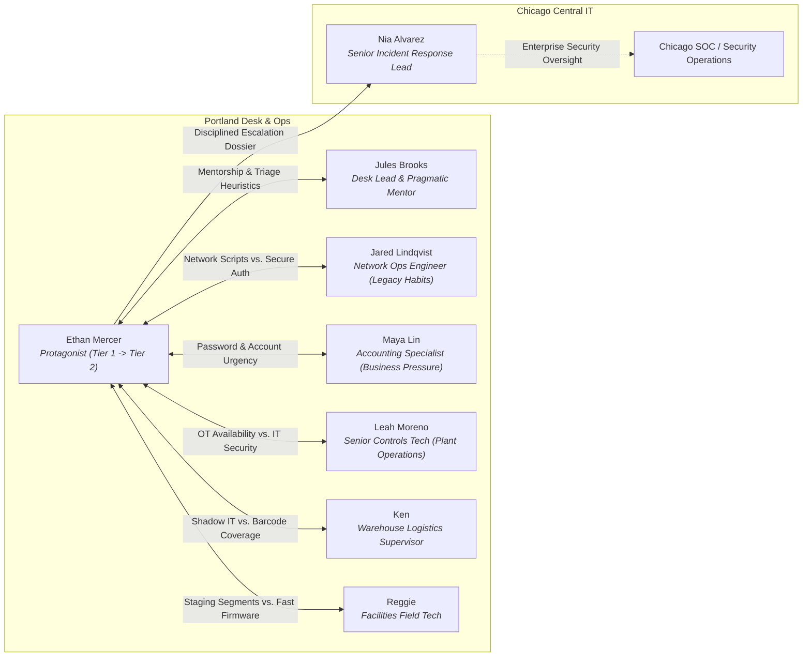

# Portland Help Desk Author Bible & Episode Architecture Cards
*Book 0: Zero-to-One — A Narrative Architecture Primer for Foundational IT & Cybersecurity Operations*

---

## 1. Executive Summary & Series Overview

### 1.1 Premise and Mandate
The Portland Help Desk Prequel (*Book 0: Zero-to-One*) is a thirteen-episode narrative learning track (Ep 00 to 12) that bridges foundational IT support and practical cybersecurity operations. This series chronicles the professional formation of Ethan Mercer as he evolves from a twenty-year-old warehouse worker, two years out of high school and trapped in rote certification memorization, into a battle-tested Tier 2 Help Desk Lead at Harrowmere Equipment Group's Portland Regional Operations Center.

Where standard certification prep materials treat IT concepts as isolated flashcard definitions, *Book 0* demonstrates how technical protocols, access controls, physical infrastructure, and incident response lifecycles interact within messy, high-pressure human organizations. Every episode operates under the tradition of Eliyahu M. Goldratt’s *The Goal*: technology is never an end in itself, but rather a mechanism for maintaining operational throughput in the face of competing business incentives, organizational friction, and technical debt.

### 1.2 Pedagogical Model: Narrative as Cognitive Anchor
In the Learning Narrative Kit (LNK) framework, the narrative is not decorative fiction draped over a syllabus; it is the primary cognitive scaffolding. Learners do not retain port numbers, protocol handshakes, or security frameworks through passive recall. They retain them through the operational decisions to which those concepts are tethered. 

When a character chooses between opening port 23 versus port 22, the learning objective is not simply the integers `23` and `22`. The learning objective is the consequence: cleartext administrative credentials traversing a shared network span versus encrypted SSH sessions with cryptographic key authentication. By embedding every CompTIA A+, Network+, and Security+ concept within an authentic workplace dilemma where someone has a train to catch, an accounting run to finish, or a wastewater pump to keep running, the technical concept becomes an indelible operational memory.

### 1.3 Continuity with NADF (Book 1)
*Book 0* is the first part of Ethan's story. The Network Analyst Development Framework (NADF, *Book 1*) continues it. Both books are set inside **Harrowmere Equipment Group**, a mid-sized manufacturer and distributor of industrial equipment headquartered in Chicago. In Book 0, Ethan works for **Harrowmere Northwest Distribution & Services** ("Harrowmere Northwest"), the wholly owned subsidiary that runs the Portland area: the Gresham distribution warehouse, the Willamette River plant, the Rivergate parts & service center, and the Portland Regional Operations Center (PROC), the subsidiary's regional IT help desk that serves all of them. The subsidiary shares the parent's directory, email, and `harrowmere.com` domain. Central IT and Security Operations are parent-company shared services run from Chicago; Security Operations monitors every subsidiary and keeps a Portland pod one floor above PROC. In NADF, Ethan works for the parent. Ethan never relocates; he stays in the Portland area from Book 0 through NADF. The characters, environments, and tensions below are where it starts:
- **Leah Moreno** appears as the Senior Plant Systems Specialist at Harrowmere Northwest's Willamette River plant, establishing the high-friction boundary between corporate enterprise IT and operational technology (OT/ICS). Between the books she moves up to the parent company as Enterprise Applications Lead, a few months ahead of Ethan.
- The **Chicago Central IT and Security Operations Center (SOC)**, shared services of the parent company, exists as an intimidating, distant corporate presence whose top-down policies frequently clash with regional operational realities.
- **Nia Alvarez**, Senior Incident Response Lead at Chicago HQ, makes her pivotal first appearance in Episode 12, where Ethan’s meticulous Tier 1/2 escalation dossier catches her attention and earns him a seat at the enterprise security table. She is promoted to Security Operations Manager right after Ep 12. Her first staffing call is to Jules, asking for a name for the Portland seat. Nia continues into NADF in that role.
- Legacy architectural quirks—such as unsegmented field networks, unmanaged warehouse switches, and fragmented identity directories—provide the exact historical vulnerabilities that adversaries exploit in subsequent storylines.

**Continuity with NADF.** Ethan Mercer, Jules Brooks, Nia Alvarez, and Leah Moreno are the same people in both stories. Names were reconciled on 2026-10-21: Ethan was "Ethan Brooks" here and is now Ethan Mercer, as in NADF; the desk lead was "Jules Mercer" and is now Jules Brooks; NADF's developer Marcus Vance became Marcus Whitlock so he no longer clashes with Jared Lindqvist here.

**Still to reconcile (the integration pass):**
1. ~~**Ethan's age and timeline.**~~ Resolved 2026-10-21: see §3.1 and `PORTLAND_TIMELINE.md` §4. He is 20 at Ep 00, 23 by Ep 12, and 23 turning 24 when NADF starts.
2. ~~**Employer and place.**~~ Resolved 2026-10-29 (Charles): subsidiary model. Book 0's employer is Harrowmere Northwest Distribution & Services, a wholly owned subsidiary of Harrowmere Equipment Group. The Gresham dock and PROC belong to the subsidiary; Chicago (parent HQ) runs Central IT and Security Operations as shared services. NADF is set at the parent.
3. ~~**Nia's title.**~~ Resolved 2026-10-29: Senior Incident Response Lead through Ep 12, promoted to Security Operations Manager right after it.
4. ~~**Leah's role.**~~ Resolved 2026-10-29: Senior Controls Tech at the subsidiary's Willamette plant in Book 0; she moves up to the parent's Enterprise Applications team between the books, to own the warehouse, plant, and finance sync.
5. ~~**Dana.**~~ Resolved 2026-10-26: the name Dana is reserved for the NADF mentor Dana Shah. The Ep 07 and 08 vendor engineer is Dale Okafor, the Ep 09 AP specialist is Marisol, and the Ep 10 facilities lead is Rina Rostova.
6. ~~**The validator.**~~ Resolved 2026-10-21: the ban on "Harrowmere" is lifted. "Priya" is still banned in Book 0 narrative.
7. ~~**Leah's age.**~~ Resolved 2026-10-29: 35 in Book 0 (Ep 07 to 12); she turns 36 in July of Year 4, so she is 36 when NADF opens.
8. ~~**Ep 00's day job.**~~ Resolved 2026-10-21: it is the same job. Ep 00 and Ep 01 both put Ethan on the dock at Harrowmere's Gresham distribution warehouse.

---

## 2. The Story Arc: Three Acts

Acts are story structure, defined in `PORTLAND_TIMELINE.md` section 0. Phases (the story-to-lab handoff models) are in `PEDAGOGICAL_AGENCY_ARCHITECTURE.md`.

### Act I: Getting In (Ep 00 to 02, A+)
Ethan goes from a graveyard dock job and a failed exam to a seat on the help desk. He learns that paper certs open doors but do not fix machines, and that guessing has costs other people pay.

### Act II: The Wire (Ep 03 to 06, Network+)
On the desk, Ethan learns addressing, name resolution, transport, and switching under real deadlines. The act ends with the flood, where he earns Jules's trust for night work.

### Act III: Identity, Threats, and Escalation (Ep 07 to 12, Security+)
Ethan moves from fixing things to protecting them. He misses the October Tier 2 round because of the Ep 08 tone complaint and is promoted in January, between Ep 09 and Ep 10. The act ends with an incident he contains at a real cost, and with Ethan applying for an analyst role on the parent company's security operations in Portland, after Nia asks Jules for a name and Jules gives her his. The offer opens Book 1. He never relocates; the new job is one floor up.


---

## 3. Cast & Character Bible



### 3.1 Primary Characters

#### Ethan Mercer — Protagonist & POV
- **Role:** Graveyard dock worker (Ep 00 to 01), IT rotation (off-page), Tier 1 Support Technician (Ep 02 to 09), promoted to Tier 2 in January of Year 4 after missing the October round (Ep 10 to 12), then, on Jules's referral, applies for an analyst role on the parent company's security operations at the end of Ep 12. The offer opens Book 1 in August. In NADF he is a partial outsider: new to the parent company and to security work, but in the same building and known to many of the people.
- **Age:** 20 at Episode 0; 21 at Episodes 1–2; 23 by Episode 12; 23 turning 24 when NADF begins.
- **Background:** Raised in East Portland / Gresham. His father, now retired, was a precision machinist at a metal fabrication shop who taught him how to respect physical tools. Ethan skipped the four-year university track due to financial constraints. He spent up to two years in a restaurant job, then about fourteen months on Harrowmere's graveyard dock in Gresham, studying by day. After the Line 4 fix, Ken's internal referral moved him into a six-month day-shift IT rotation at a slight pay cut, and then onto Jules's help desk. The certs are spaced out: A+ after about ten months of study, Network+ about thirteen months into IT, Security+ about twenty-six months into IT (after Book 0 ends). Full table: `PORTLAND_TIMELINE.md` §4.
- **Psychological Profile:** Highly observant, earnest, and intrinsically motivated, but initially burdened by severe imposter syndrome. In the early episodes, he treats technical standards as moral dogma and clings to flashcard taxonomies like a security blanket. When faced with ambiguous failures, his instinct is to freeze or over-engineer theoretical solutions. Over Book 0 (about three years, about 22 months of it on the desk), he develops emotional resilience, learning that troubleshooting is an iterative discipline of hypothesis testing, root-cause isolation, and empathetic communication.
- **Standing struggles (adopted 2026-10-26).** These two drive every wrong turn Ethan takes. Do not invent a new flaw for each chapter.
  1. **He acts before he has the whole picture when someone is waiting on him.** The breaker (Ep 01), the re-image offer (Ep 02), the wrong Gresham port (Ep 07), and the early isolation (Ep 12).
  2. **He works alone when he should ask, and he gets curt when he is sure he is right.** Scrolling past the alert instead of raising it (Ep 05), texting Jared instead of calling on-call (Ep 07), and the written no to Todd's manager (Ep 08).
- **Narrative Voice:** First-person past tense. Analytical, reflective, grounded, and intensely aware of physical textures—smells of damp rain jackets, hum of server racks, clicking of mechanical clipboards. He does not speak in stylized action-movie tropes; he narrates like an authentic junior engineer reflecting on how he learned to do the work.

#### Jules Brooks — Desk Lead & Mentor
- **Role:** Portland Help Desk Lead (9-year veteran).
- **Age:** 34.
- **Visuals & Habits:** Daily bicycle commuter regardless of Pacific Northwest weather (rides a beat-up steel Kona Rove with fenders and waterproof panniers). Wears wool sweaters, rolled-up flannel sleeves, and durable canvas trousers. A yellow cycling rain jacket dries over the back of her chair; her bike helmet hangs perpetually from her secondary monitor arm. Keeps a ceramic mug of dark coffee on the corner partition of her cubicle.
- **Signature Artifact:** A single faded yellow sticky note stuck to the lower bezel of her primary monitor: *Which decision?*
- **Mentorship Philosophy:** Jules is not an academic lecturer, nor is she a fortune-cookie mystic who speaks only in cryptic aphorisms. Ninety percent of her dialogue consists of ordinary, functional enterprise communication (*"Did you check the switch port status?", "Who else is reporting this?", "I’m on the bridge with Chicago in ten minutes"*). She allows Ethan to struggle enough to encounter the boundary of his knowledge, stepping in only when he is about to cause catastrophic damage or lock himself into an unhelpful rabbit hole. When she does offer an architectural insight, Ethan explicitly registers it because it re-anchors his mental model.
- **Flaws & Blind Spots:** Jules is cynical about corporate initiatives originating from Chicago Central IT. Her fierce loyalty to regional autonomy sometimes leads her to delay corporate compliance rollouts, preferring local operational stability over enterprise uniformity. That is what makes her referral of Ethan to Chicago's security operations cost her something.

#### Leah Moreno — Senior Controls Tech / Plant Systems Specialist
- **Role:** Senior Controls & SCADA Technician, Harrowmere Northwest's Willamette River Plant (Portland Operations). Moves up to the parent's Enterprise Applications team between Book 0 and NADF.
- **Age:** 35 in Book 0; 36 when NADF opens.
- **Visuals & Habits:** Carries a scratched aluminum clipboard stuffed with piping and instrumentation diagrams (P&IDs). Wears a high-visibility ANSI Class 2 vest, steel-toed boots, and safety glasses with side shields. Carries an armored Panasonic Toughbook running specialized PLC ladder logic software.
- **Why Leah matters:** Leah brings the plant-floor side of the story into the help desk. She represents the critical, unforgiving reality of Operational Technology (OT) and Industrial Control Systems (ICS). Her plant processes hundreds of thousands of gallons of liquid daily; an unexpected valve trip or network latency spike does not result in a 404 error—it results in physical effluent overflow, environmental fines, or blown pump seals.
- **Relationship with Ethan:** Initially hostile toward "carpet-land IT" technicians who push Windows security patches that reboot telemetry servers mid-cycle. She first tests Ethan in Episode 07. When Ethan demonstrates that he respects her physical operational constraints and devises an encrypted site-to-site VPN solution that protects her sensors without touching the pumps, Leah becomes his staunchest operational ally. She teaches Ethan how to read physical industrial failure modes.

#### Jared Lindqvist — Network Operations Engineer
- **Role:** Senior Network Infrastructure Engineer (Portland Operations).
- **Age:** 42.
- **Background & Personality:** Racked switches and pulled copper in Hillsboro data centers during the dot-com boom. Deeply knowledgeable about physical Layer 1/2/3 networking, but fiercely attached to the muscle memory of the early 2000s. Relies on a massive library of unversioned Bash and Perl scripts that execute unencrypted Telnet commands and query devices using the default `public` SNMP community string.
- **Dynamic:** Jared is not incompetent; he is time-starved. Every security requirement handed down by corporate feels like friction designed to make his maintenance windows longer. Ethan’s challenge with Jared is never technical superiority—it is convincing Jared that modernizing his scripts with SSH keys and SNMPv3 actually protects Jared from 2:00 AM emergency triage calls.

#### Maya Lin — Senior Accounting Specialist
- **Role:** Lead Accounts Payable & Financial Reconciliation Specialist.
- **Age:** 29.
- **Personality & Work Style:** Sharp, high-energy, constantly balancing tight corporate accounting deadlines with Byzantine internal software. Maya is the archetype of the highly productive enterprise user whose job performance depends on speed. She is not careless, but if an IT security policy adds three minutes to her invoice reconciliation workflow, she will find a workaround.
- **Dynamic:** Maya tests the boundaries of security policies in almost every act. In Act I, she insists on legacy POP3 mail profiles because that is how she learned to archive receipts in college. In Act II, she panics over adware popups when an audit review is thirty minutes away. In Act III, her mailbox becomes the primary battleground for a Business Email Compromise attack. Through Maya, Ethan learns that user empathy is a critical technical skill.

### 3.2 Supporting Cast
- **Rosa Ibarra (Night Maintenance Tech, Gresham):** Forty-four, headlamp over a beanie. Covers Hank's routes in Ep 01. Knows motors, fuses, and meters, and says plainly what she does not know about computers. A recurring knowledgeable peer (framework principle 3a), not a mentor.
- **Ken (Warehouse Logistics Supervisor):** Fifty-year-old shipping veteran. Manages the high-bay distribution annex. If his forklift operators cannot scan pallets because steel racking blocks Wi-Fi signals, Ken buys an off-the-shelf consumer router from an electronics store and plugs it into the nearest wall jack. He views IT as an obstacle to shipping pallets on time.
- **Lena Chen (Tier 2 Systems Administrator, Portland ROC):** Owns the VPN gateway and the Hillsboro DHCP failover. Ethan escalates to her in Ep 04.
- **Marisol (Accounts Payable, works with Maya):** Nine years in AP and knows every vendor's real domain. She verifies the Ep 09 wire request by phone and pays for the save with an afternoon of callbacks.
- **Dale Okafor (Facilities Vendor Engineer):** The appliance engineer from Ep 07 who calls from his truck, and again in Ep 08.
- **Rina Rostova (Facilities Lead):** Her team folder is encrypted in Ep 10.
- **Reggie (Facilities Field Technician):** Practical, always on the move with a heavy tool belt. Manages building management systems (BMS), badge readers, HVAC controllers, and network printers. Pragmatic to a fault; frequently attempts to push unauthenticated firmware updates across user subnets to beat his transit schedule.
- **Dee (Network Monitoring Specialist):** Sits in the network bullpen. Obsessed with clean Grafana dashboards and switch interface telemetry. Prefers default SNMP templates because they "just graph without a fight," serving as Jared’s junior co-conspirator.
- **Bettina Szabo (Legal & Compliance Junior Associate):** Detail-oriented, newly hired attorney who struggles through corporate onboarding. Her encounters with Active Directory domain joins, Kerberos ticket expiration, and document classification policies highlight the operational friction of enterprise compliance.
- **Marco (Cabling & Closet Technician):** Junior field contractor responsible for physical patch panels, structured cabling, and telecommunications closets. Frequently creates unintentional Layer 2 switching loops and cleartext syslog diversions out of convenience.

### 3.3 The Chicago Presence
- **Nia Alvarez (Senior Incident Response Lead, Chicago HQ):** Highly respected, rigorous security investigator at the parent company's headquarters. Promoted to Security Operations Manager right after Ep 12. Nia deals with hundreds of careless, poorly documented escalation tickets from regional sites every week. She has zero patience for hand-waving, speculation, or missing timestamps. When Ethan submits a pristine, mathematically rigorous incident packet in Episode 12, Nia recognizes a rare analytical talent operating at the regional level.
- **Chicago Central IT / SOC:** The parent company's shared services, and the faceless corporate entity that dictates enterprise group policies, mandatory software agents, and quarterly compliance mandates. Chicago represents the systemic tension between centralized governance and local regional survival.


### 3.4 Cast Registry (one surname per character)
`tools/check_dates.py` reads this table. Labs, artifacts, and scripts may use only the surname listed here. A character with no surname has "none".

| First name | Surname | Role |
|---|---|---|
| Ethan | Mercer | Protagonist, dock then Tier 1 desk |
| Jules | Brooks | Help desk lead |
| Jared | Lindqvist | Network operations engineer |
| Ken | Vance | Gresham dock supervisor |
| Maya | Lin | Regional accounting supervisor |
| Nora | Higgins | Finance specialist |
| Todd | Miller | Inside sales |
| Dev | Patel | Software engineering |
| Rita | Sorensen | Marketing lead |
| Sam | Kelly | Finance contractor |
| Leah | Moreno | Willamette River plant operations lead |
| Lena | Chen | Tier 2 systems administrator |
| Bettina | Szabo | Legal and compliance associate |
| Marisol | none | Accounts payable |
| Avery | Holloway | Chief financial officer |
| Dale | Okafor | Facilities vendor engineer |
| Rina | Rostova | Facilities lead |
| Reggie | Castillo | Facilities field technician |
| Dee | Washington | Network monitoring specialist |
| Marco | Reyes | Cabling and closet technician |
| Nia | Alvarez | Chicago incident response lead |
| Rosa | Ibarra | Gresham night maintenance tech |
| Jordan | Reed | IT operations |
| Greg | Adams | Accounts payable specialist |
| Frank | Mercer | Ethan's father |
| Carlos | Gomez | Warehouse shipping (ticket artifact) |
| Rachel | Adams | Executive office (ticket artifact) |
| David | Kim | Marketing (ticket artifact) |
| Sarah | Jenkins | Lobby reception (ticket artifact) |
| Tom | Bradley | Procurement (ticket artifact) |

---

## 4. The Causal Beat Matrix (Ep 00 to 12)

| Ep | Title | Goal | Cost | Carries forward |
|---|---|---|---|---|
| 00 | The Four Rubber Bands | Pass the A+ Core 1 retake tomorrow morning after failing the first attempt six weeks earlier with a 592. | He passes the retake with a 690, fifteen points over the line. The first attempt cost him $246 and six weeks of extra graveyard shifts. The paper does not get him off the dock. | The cert is the first line Ken will point to in the referral. The four bands stay in his pocket for years. |
| 01 | The Paper Cert | Line 4's scale terminal dies. Seattle and Boise trailers roll at 5:00 AM. Fixing it is not Ethan's job; he stages freight. | Seattle leaves 51 minutes late and the late report carries Ken's name. Ken remembers it. Bloody knuckles and a broken latch. | Ken writes the internal referral anyway: the first line says Ethan cost him a trailer, the second says he is worth training. Rosa becomes a recurring peer. |
| 02 | The Live Board | Pass Jules's supervised practical and join the desk. | Maya's trust is dented by the re-image suggestion. The fix lands in the lab, not in the story. | He joins the desk the next Monday at about $24 an hour. |
| 03 | The Default Gateway Doesn't Care | Restore a freight system that keeps dropping off the network. | Ken holds dock door six for forty minutes and two trailers load late. Eleven more undocumented static devices turn up. | Static addressing sprawl becomes a standing problem on the warehouse network. |
| 04 | The Name Is Not the Number | Get Maya's VPN session reaching internal payroll before the payroll deadline. | The escalation lands on Jared, who resents it and answers in one-word replies for two weeks. | The DNS design debt goes on Jared's list. |
| 05 | The Wire Has Two Ends | Find why a management station's connections keep failing. | The Tuesday backups for three shares never ran; Jared re-runs the sweep and stays until nine. Ethan had scrolled past the first failure twice. | Connection pooling becomes a change request with Jared's name on it. |
| 06 | The Portland Flood | Restore the network for 150 endpoints before the doors unlock. | Twelve shipping label printers stay down until ten, and the pooling change slips two weeks. | Midpoint capstone. Ethan has earned Jules's trust for night work. |
| 07 | The Port That Is Open | Handle a pile of requests that all want ports opened. | Six old switches get a jump-host patch instead of a fix, and Jared stops answering Ethan quickly. | Leah enters as the plant voice. Jared's scripts remain a risk. |
| 08 | Prove Who You Are | Clear a lockout queue before standup. | Todd's manager complains about Ethan's tone; the complaint and Jules's reply go into his promotion file. | Ethan misses the October Tier 2 round. He is promoted in January, after Ep 09. |
| 09 | Don't Click That | Stop a spoofed CFO wire-change request before the afternoon batch. | AP holds the wire batch three hours; two real vendor payments go out a day late and the controller complains. | The phishing campaign is a scout for what comes in Ep 12. |
| 10 | Something on the Box | Contain a bundled installer before it spreads. | Ethan trusts a valid but revoked code signature for two minutes; Ken's laptop is reimaged and he loses two years of local notes. | Ken's loop from Ep 01 closes: he calls Ethan directly. |
| 11 | The Air Is Shared | Keep the barcode scanners on the right network. | Ken's dock scans by hand at two doors until noon while scanners are re-enrolled. | The baseline from this work helps flag the Ep 12 intrusion. |
| 12 | When the Ticket Escalates | Turn four quiet tickets into one correct incident escalation. | The plant loses a shift to manual override while the gateway is isolated. In the after-action review, one of Ethan's containment calls is second-guessed: he isolated a host before a second memory capture was done. | Ethan applies for the security operations analyst opening in Portland. The offer opens Book 1. |

---

## 5. Style, Voice, and Pedagogical Constraints

### 5.1 Enforcing the Narrative Voice (`schema/VOICE.md`)
The narrative must sound like an authentic human being reflecting on real work. It must strictly avoid the synthetic rhythms and artificial tics common to generated fiction.

#### 1. Restore Full Determiners and Articles
Generated prose frequently drops articles to create a false sense of dramatic urgency (*"Switch in closet hung. Ethan took cable."*). This is unacceptable. English relies on determiners.
- **Incorrect:** *Closet switch in Building C dropped packets. Rain hit window.*
- **Correct:** *A switch in a wiring closet in Building C was dropping packets. The rain hit the east-side windows.*

#### 2. Eliminate Verbless Fragment Runs
A single fragment can serve as deliberate emphasis. Three consecutive verbless fragments constitute an artificial tic.
- **Incorrect:** *Jules two cubes over. Desk lead. Helmet on the monitor arm, rain pants drying.*
- **Correct:** *Jules worked two cubes over and held the desk lead title. Her bike helmet hung off her monitor arm, and her rain pants were drying over the back of her chair.*

#### 3. Sentence Length Distribution & Cadence
Prose must maintain natural rhythmic variety. The target mean sentence length is **16 to 20 words**, with a wide standard deviation. Writers must balance short, decisive observations with compound, multi-clause explanations that mirror complex technical thinking.
- Short sentences are reserved for physical realizations or operational pivots.
- Longer, complex sentences carry technical explanations and systemic tradeoffs.

#### 4. Eliminate Section-Final Aphorisms & Cross-Stitch Maxims
Real operational shifts do not resolve into neat philosophical epigrams suitable for embroidery. 
- **Forbidden Patterns:** *"Numbers are inventory. Decisions are the job."* / *"Reporting is not snitching; reporting is how the filter gets a second brain."* / *"X is not Y."*
- **The Operational Reality:** Let scenes end flat. Let them end on an unresolved ticket note, someone walking to the microwave, an irritated user accepting a compromise, or an engineer locking their desk drawer to catch the bus.

#### 5. Deformulate the Mentor (Jules Brooks)
Jules is a working desk lead, not a zen master. 
- Over ninety percent of Jules’ speech must be functional, messy, and operational (*"Did you verify Layer 1?", "Check the switch uptime before you reboot it", "I have an operations review with Chicago at eleven"*).
- She speaks epigrammatic truths only when Ethan explicitly stops to register them in his notes (*"That was the line I wrote down"*).
- Jules can be tired, distracted, mildly annoyed, or occasionally mistaken about a non-critical detail.

### 5.2 The Goldratt Workplace Realism Mandate
Every episode must reflect the principles of industrial throughput and organizational dynamics:
1. **The Core Dilemma is Throughput:** Technical security always creates organizational friction. When security impedes throughput, humans route around it. The protagonist’s job is not to punish users, but to align security controls with operational throughput.
2. **Every Pivot Must Charge an Operational Cost:** In real IT, problems are never resolved with magical perfection. A successful resolution always costs something:
   - Engineering goodwill (Jared grumbling about rewriting ten years of scripts).
   - Time and backlog accumulation (spending three hours analyzing an AV log means five printer tickets sit unresolved).
   - Hardware compromise (buying an expensive managed switch or codifying an isolated legacy proxy).
   - End-user inconvenience (Maya having to complete two-factor prompts during a frantic quarterly close).

---

## 6. Episode Cards (Ep 00 to 12, rewritten 2026-10-26 to match the shipped episodes)

These cards describe the episodes as shipped in `docs/portland-desk/narrative/`. The shipped episodes are canon. The costs, carry-forwards, and fold-ins below were written into the chapters on 2026-10-26. Ages and months come from `PORTLAND_TIMELINE.md`.

### Card 00: The Four Rubber Bands

- **Placement:** Act I, Phase 1. Year 1, late July. About 7 months on the graveyard dock. Ethan is 20.
- **Setting and cast:** East Portland duplex kitchen on his night off; Beaverton testing center the next morning. Ethan, his father (Frank), Hank in memory.
- **Goal:** Pass the A+ Core 1 retake tomorrow morning after failing the first attempt six weeks earlier with a 592.
- **Complication:** Three hundred flashcards treated as equal; he fails another practice drill and $41.16 is all he has left.
- **Pivot:** His father reframes the cards as a parts catalog. Ethan sorts them into four bands (red trivia, green building blocks, yellow identity, blue triage method).
- **Cost:** He passes the retake with a 690, fifteen points over the line. The first attempt cost him $246 and six weeks of extra graveyard shifts. The paper does not get him off the dock.
- **Carries forward:** The cert is the first line Ken will point to in the referral. The four bands stay in his pocket for years.
- **Knowledge load:** A+ Core 1 foundations: volatile versus non-volatile storage, CPU, RAM, motherboard, POST, MAC versus IP, troubleshooting order.

### Card 01: The Paper Cert

- **Placement:** Act I, Phase 1. Year 2, February. About 14 months on the graveyard dock. Ethan is 21.
- **Setting and cast:** Harrowmere Gresham cross-dock, 2:24 AM, Sorting Line 4. Ken Vance (dock supervisor), Rosa Ibarra (night maintenance tech covering for Hank).
- **Goal:** Line 4's scale terminal dies. Seattle and Boise trailers roll at 5:00 AM. Fixing it is not Ethan's job; he stages freight.
- **Complication:** He power-cycles the cabinet during a batch write and dumps forty carton weights. He guesses RAM and snaps a memory latch.
- **Pivot:** Rosa corrects his meter setting and reads the sagging 5 V rail like a motor fault. Ethan finds the chafed ribbon cable, then the bent serial pin. The baud-rate mismatch he caused is his to solve in the lab.
- **Cost:** Seattle leaves 51 minutes late and the late report carries Ken's name. Ken remembers it. Bloody knuckles and a broken latch.
- **Carries forward:** Ken writes the internal referral anyway: the first line says Ethan cost him a trailer, the second says he is worth training. Rosa becomes a recurring peer.
- **Knowledge load:** A+ Core 1 hardware: POST codes, multimeter, continuity test, RS-232, baud rate, DIP switches.

### Card 02: The Live Board

- **Placement:** Act I, Phase 1. Year 2, late August. End of the six-month IT rotation. Ethan is 21.
- **Setting and cast:** Portland ROC, fourth floor. Jules Brooks (desk lead), Maya Lin (accounts payable).
- **Goal:** Pass Jules's supervised practical and join the desk.
- **Complication:** Maya's payroll app freezes before a deadline. Ethan blurts out a re-image, which would wipe three weeks of unsynced spreadsheets.
- **Pivot:** He apologizes, isolates what changed, and works a clean boot and Event Viewer toward the faulting module.
- **Cost:** Maya's trust is dented by the re-image suggestion. The fix lands in the lab, not in the story.
- **Carries forward:** He joins the desk the next Monday at about $24 an hour.
- **Knowledge load:** A+ Core 2: troubleshooting methodology, Safe Mode, clean boot, Event Viewer, device drivers, BitLocker recovery key.

### Card 03: The Default Gateway Doesn't Care

- **Placement:** Act II, Phase 2. Year 2, October. 2 months on the desk. Ethan is 22.
- **Setting and cast:** Portland ROC during a storm outage. Jules, Jared Lindqvist (network), Ken calling from Gresham, Reggie (facilities).
- **Goal:** Restore a freight system that keeps dropping off the network.
- **Complication:** Two machines claim the same static address; one halts freight, the other sits on an unknown warehouse port.
- **Pivot:** Ethan reads subnet masks, gateways, and ARP to find the rogue host and lock down the DHCP pool.
- **Cost:** Ken holds dock door six for forty minutes and two trailers load late. Eleven more undocumented static devices turn up.
- **Carries forward:** Static addressing sprawl becomes a standing problem on the warehouse network.
- **Knowledge load:** Network+: APIPA, DHCP DORA, broadcast domains, subnet masks, default gateway, ARP cache.

### Card 04: The Name Is Not the Number

- **Placement:** Act II, Phase 2. Year 3, March. 7 months on the desk. Ethan is 22.
- **Setting and cast:** Portland ROC. Jules, Jared, Maya.
- **Goal:** Get Maya's VPN session reaching internal payroll before the payroll deadline.
- **Complication:** Stale hosts-file entries and a split-horizon DNS setup send her lookups the wrong way; the tunnel is up but packets fly blind.
- **Pivot:** Ethan flushes the cache, removes obsolete entries, and traces the DNS leak to adapter metrics.
- **Cost:** The escalation lands on Jared, who resents it and answers in one-word replies for two weeks.
- **Carries forward:** The DNS design debt goes on Jared's list.
- **Knowledge load:** Network+: split-horizon DNS, DNS leak, hosts file, recursive resolver, TTL, CNAME.

### Card 05: The Wire Has Two Ends

- **Placement:** Act II, Phase 2. Year 3, April. 8 months on the desk. Ethan is 22.
- **Setting and cast:** Portland ROC. Jules, Jared, Ken, Reggie.
- **Goal:** Find why a management station's connections keep failing.
- **Complication:** Nothing listens on the expected port, and the station is drowning in TIME_WAIT sockets.
- **Pivot:** Ethan reads socket states and finds ephemeral port exhaustion on their own management station.
- **Cost:** The Tuesday backups for three shares never ran; Jared re-runs the sweep and stays until nine. Ethan had scrolled past the first failure twice.
- **Carries forward:** Connection pooling becomes a change request with Jared's name on it.
- **Knowledge load:** Network+: TCP handshake, socket states, listening ports, RST, ephemeral ports and exhaustion.

### Card 06: The Portland Flood

- **Placement:** Act II, Phase 2. Year 3, late May. 9 months on the desk. Ethan is 22.
- **Setting and cast:** Flooded sub-basement at 3:00 AM. Jules, Jared.
- **Goal:** Restore the network for 150 endpoints before the doors unlock.
- **Complication:** Flooded closets, a broadcast loop, and DHCP scope exhaustion.
- **Pivot:** Trunking across fiber, spanning tree, and DHCP reconciliation under a deadline.
- **Cost:** Twelve shipping label printers stay down until ten, and the pooling change slips two weeks.
- **Carries forward:** Midpoint capstone. Ethan has earned Jules's trust for night work.
- **Knowledge load:** Network+: 802.1Q trunking, DHCP scope exhaustion, patch panels, flea power, STP, LACP.

### Card 07: The Port That Is Open

- **Placement:** Act III, Phase 3. Year 3, August. 1 year on the desk. Ethan is 22.
- **Setting and cast:** Portland ROC and a call from the plant. Jules, Jared, Dale Okafor, Leah Moreno, Maya, Sam.
- **Goal:** Handle a pile of requests that all want ports opened.
- **Complication:** Jared wants Telnet for an old script; others want cleartext mail and FTP.
- **Pivot:** Ethan proves the cleartext risk from a capture and steers each request to a secure protocol.
- **Cost:** Six old switches get a jump-host patch instead of a fix, and Jared stops answering Ethan quickly.
- **Carries forward:** Leah enters as the plant voice. Jared's scripts remain a risk.
- **Knowledge load:** Security+: secure versus insecure protocols and ports (Telnet, SSH, FTP, SFTP, FTPS, SMTP, IMAP, POP3, TLS, STARTTLS).

### Card 08: Prove Who You Are

- **Placement:** Act III, Phase 3. Year 3, October. 14 months on the desk. Ethan is 23.
- **Setting and cast:** Portland ROC on a lockout morning. Jules, Todd, Nora, Dev.
- **Goal:** Clear a lockout queue before standup.
- **Complication:** A runaway script locks Dev out, Todd insists password plus PIN is MFA, and Nora keeps choosing seasonal passwords.
- **Pivot:** Ethan triages each by factor type and lockout cause.
- **Cost:** Todd's manager complains about Ethan's tone; the complaint and Jules's reply go into his promotion file.
- **Carries forward:** Ethan misses the October Tier 2 round because of the complaint. He reapplies in December and is promoted in January.
- **Knowledge load:** Security+: authentication factors, MFA, TOTP, MFA fatigue, lockout, biometrics, identity providers.
- **Fold-in (written into the chapter 2026-10-26):** Fold in physical security: the lockout morning includes a tailgating report at the badge door, so Ethan sees that physical access is also an authentication factor. 

### Card 09: Don't Click That

- **Placement:** Act III, Phase 3. Year 3, December. 16 months on the desk. Still Tier 1; the Tier 2 posting reopens this month. Ethan is 23.
- **Setting and cast:** Portland ROC. Jules, Marisol (AP), Maya, Nora, Sam, Todd, and Avery Holloway (CFO, impersonated).
- **Goal:** Stop a spoofed CFO wire-change request before the afternoon batch.
- **Complication:** A $48,000 wire request, an archive attachment, and MFA fatigue pushes on Dev's phone, all at once.
- **Pivot:** Ethan pulls headers, checks SPF, DKIM, and DMARC, and gets a quarantine hash to the mail gateway, and Marisol verifies by phone.
- **Cost:** AP holds the wire batch three hours; two real vendor payments go out a day late and the controller complains.
- **Carries forward:** The phishing campaign is a scout for what comes in Ep 12.
- **Knowledge load:** Security+: phishing types, BEC, typosquatting, credential harvesting, MFA fatigue.
- **Fold-in (written into the chapter 2026-10-26):** Fold in PKI: DKIM signatures lead to one short scene where Ethan checks a certificate chain on the spoofed site and learns why a padlock icon is not trust. 

### Card 10: Something on the Box

- **Placement:** Act III, Phase 3. Year 4, February. 18 months on the desk. Ethan is 23.
- **Setting and cast:** Portland ROC and a Gresham laptop. Jules, Maya, Ken by phone.
- **Goal:** Contain a bundled installer before it spreads.
- **Complication:** A PDF tool came with adware and a dropper; Ken's logistics laptop shows the same signs.
- **Pivot:** Ethan isolates, quarantines, and separates signature hits from heuristics.
- **Cost:** Ethan trusts a valid but revoked code signature for two minutes; Ken's laptop is reimaged and he loses two years of local notes.
- **Carries forward:** Ken's loop from Ep 01 closes: he calls Ethan directly.
- **Knowledge load:** Security+: malware types, droppers, payloads, AV versus EDR, signatures versus heuristics, IoCs.
- **Fold-in (written into the chapter 2026-10-26):** Fold in PKI: a code-signing certificate on the dropper turns out to be valid but stolen, so Ethan learns that a valid signature is not the same as a trusted publisher. 

### Card 11: The Air Is Shared

- **Placement:** Act III, Phase 4. Year 4, April. 20 months on the desk. Ethan is 23.
- **Setting and cast:** Portland ROC, conference room 3B, lobby, warehouse. Jules, Maya, Todd.
- **Goal:** Keep the barcode scanners on the right network.
- **Complication:** A rogue travel router on the data VLAN, an evil twin in the lobby, and deauth floods.
- **Pivot:** Ethan uses a Wi-Fi analyzer and 802.1X to separate rogue from real.
- **Cost:** Ken's dock scans by hand at two doors until noon while scanners are re-enrolled.
- **Carries forward:** The baseline from this work helps flag the Ep 12 intrusion.
- **Knowledge load:** Security+: rogue AP, evil twin, deauthentication, 802.1X, RADIUS, WPA-Enterprise, PSK, captive portal.
- **Fold-in (written into the chapter 2026-10-26):** Fold in physical security: the evil twin hardware is found in the lobby, which leads to a short walk-through of badge areas, locks, and cameras with Reggie. 

### Card 12: When the Ticket Escalates

- **Placement:** Act III, Phase 4. Year 4, late June. 22 months on the desk. Ethan is 23.
- **Setting and cast:** Portland ROC and the Willamette River plant. Jules, Jared, Maya, Nora, Sam, Todd, Leah, Nia Alvarez (Chicago CSIRT, by bridge).
- **Goal:** Turn four quiet tickets into one correct incident escalation.
- **Complication:** A C2 beacon, lateral share enumeration, and plant gateway egress line up. Pulling plugs destroys evidence; leaving hosts up drains plant telemetry.
- **Pivot:** Ethan isolates hosts, captures memory in order of volatility, hashes evidence, keeps chain of custody, and briefs Nia.
- **Cost:** The plant loses a shift to manual override while the gateway is isolated. In the after-action review, one of Ethan's containment calls is second-guessed: he isolated a host before a second memory capture was done.
- **Carries forward:** The parent's security operations opens a Portland analyst seat, one floor up. Nia, newly promoted, asks Jules for a name; Jules gives her Ethan's and tells him the application still has to stand on its own. He writes about the lost memory capture in it. Book 0 ends with the application submitted. **The offer opens NADF Book 1** (August, Year 4), which makes it easy for Ethan to narrate the move from the new role. Ethan stays in Portland.
- **Knowledge load:** Security+: incident versus event, order of volatility, chain of custody, isolation, IoCs, CSIRT.
- **Fold-in (written into the chapter 2026-10-26):** Fold in the IR lifecycle: the after-action review walks the six phases (preparation, identification, containment, eradication, recovery, lessons learned), and the second-guessed call is discussed as a containment-phase tradeoff. 

---

## 7. Production & Authoring Guidelines for Contributing Writers

### 7.1 The Golden Rules of the Portland Desk Cadence
Every chapter submitted to the Portland Help Desk track must satisfy the following five non-negotiable rules:

1. **Strict Narrative Perspective:**
   All narrative must be written in the **first-person, past tense** ("I arrived", "I checked the cable", "Jules told me"). The narrator is always Ethan Mercer looking back on his operational formation.

2. **The Cover Test:**
   Strip every markdown glossary mark (`[[term_id|surface text]]`). Read the prose aloud. If the narrative sounds like an artificial glossary parade or an awkward recitation of textbook definitions, the scene must be rewritten. The story must explain the real-world relationships between systems even if all tooltips are disabled.

3. **Placement of Marked Terms:**
   Per `schema/README.md`, technical terms must **never** be placed in passive setup exposition. They must appear at the **complication** (where the technical concept makes the obvious action impossible) or at the **pivot** (where the character uses the concept to make a difficult, costly decision).

4. **Natural Cadence and Syntax:**
   - Maintain an average sentence length of **16 to 20 words**.
   - Prohibit verbless fragment runs (maximum of one deliberate fragment per section).
   - Restore all dropped determiners (*the*, *a*, *an*).
   - Prohibit section-final aphorisms, rhyming slogans, and the *"X is not Y"* rhetorical formula.

5. **Operational Accounting (The Goldratt Check):**
   Before submitting an episode, answer two questions in writing, using only what is in the narrative file. First: *What did this cost Ethan personally,* in time, money, opportunity, or standing, with nothing refunded in this chapter or the next? Second: *What did it cost the business or another person?* If the first answer is empty, the draft fails, whatever the second answer or the lab says. See the cost and canon rules in `docs/craft/learning-narrative-framework.md`.

### 7.2 Validation & Quality Pipeline
Before committing any new unit to the repository, contributors must execute the automated validation suite:

```bash
# 1. Run the voice checker to verify cadence and flag synthetic tells
python tools/voice_check.py docs/portland-desk/narrative/<NN-episode>.md

# 2. Run the unit validator to ensure schema and glossary integrity
python tools/validate_unit.py examples/<unit_id>

# 3. Render the output and verify browser presentation
python tools/render_unit.py examples/<unit_id>
```

A passing test with warnings is not a pass. Resolve all dropped articles, rhythm flags, and terminology mismatches before pushing to main. Keep the story grounded, keep the technical facts accurate, and honor the work of the people who keep the systems running.
