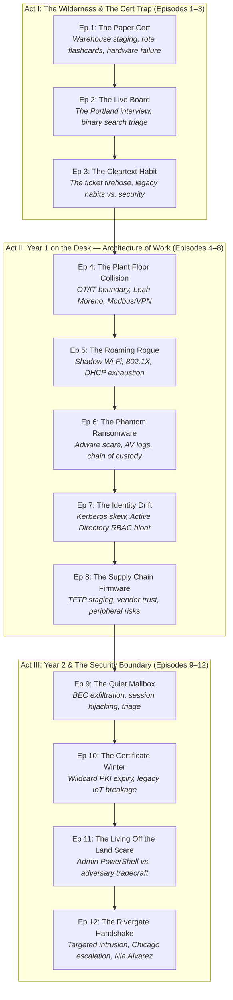
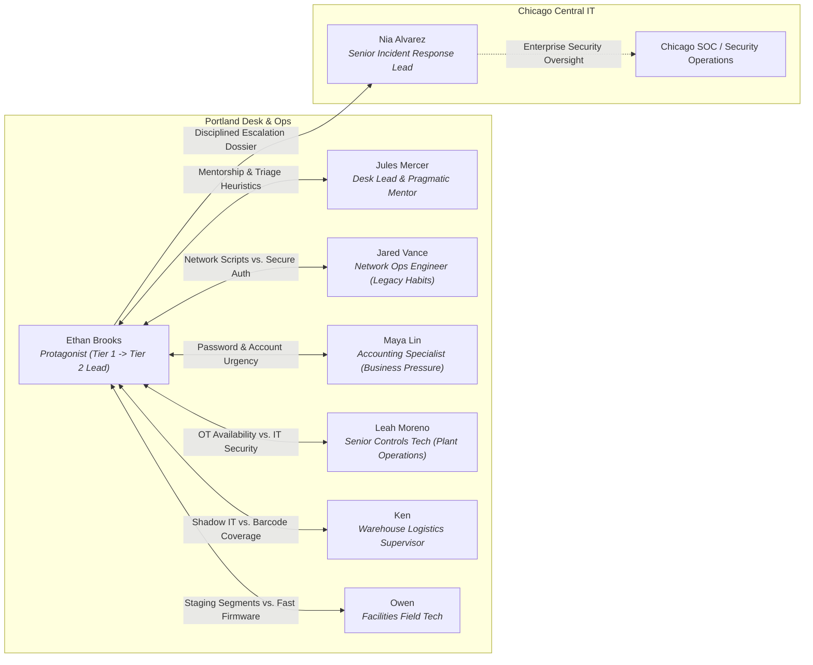

# Portland Help Desk Author Bible & Episode Architecture Cards
*Book 0: Zero-to-One — A Narrative Architecture Primer for Foundational IT & Cybersecurity Operations*

---

## 1. Executive Summary & Series Overview

### 1.1 Premise and Mandate
The Portland Help Desk Prequel (*Book 0: Zero-to-One*) is a twelve-episode narrative learning track that bridges foundational IT support and practical cybersecurity operations. Situated chronologically before the events of the National Agro-Distribution Federation (NADF) enterprise security saga (*Book 1*), this series chronicles the professional formation of Ethan Brooks as he evolves from an eighteen-year-old high school graduate trapped in rote certification memorization into a battle-tested Tier 2 Help Desk Lead at the Portland Regional Operations Center.

Where standard certification prep materials treat IT concepts as isolated flashcard definitions, *Book 0* demonstrates how technical protocols, access controls, physical infrastructure, and incident response lifecycles interact within messy, high-pressure human organizations. Every episode operates under the tradition of Eliyahu M. Goldratt’s *The Goal*: technology is never an end in itself, but rather a mechanism for maintaining operational throughput in the face of competing business incentives, organizational friction, and technical debt.

### 1.2 Pedagogical Model: Narrative as Cognitive Anchor
In the Learning Narrative Kit (LNK) framework, the narrative is not decorative fiction draped over a syllabus; it is the primary cognitive scaffolding. Learners do not retain port numbers, protocol handshakes, or security frameworks through passive recall. They retain them through the operational decisions to which those concepts are tethered. 

When a character chooses between opening port 23 versus port 22, the learning objective is not simply the integers `23` and `22`. The learning objective is the consequence: cleartext administrative credentials traversing a shared network span versus encrypted SSH sessions with cryptographic key authentication. By embedding every CompTIA A+, Network+, and Security+ concept within an authentic workplace dilemma where someone has a train to catch, an accounting run to finish, or a wastewater pump to keep running, the technical concept becomes an indelible operational memory.

### 1.3 Continuity with the NADF Universe (Book 1)
*Book 0* establishes the regional operational roots that underpin the broader enterprise architecture of *Book 1*. The Portland site serves as a vital logistics, distribution, and processing hub. Key characters, technical environments, and operational tensions introduced here directly establish the stakes for Book 1:
- **Leah Moreno** appears as the Senior Plant Systems Specialist at the Willamette River treatment and processing plant, establishing the high-friction boundary between corporate enterprise IT and operational technology (OT/ICS).
- The **Chicago Central IT and Security Operations Center (SOC)** exists as an intimidating, distant corporate presence whose top-down policies frequently clash with regional operational realities.
- **Nia Alvarez**, Senior Incident Response Lead at Chicago HQ, makes her pivotal first appearance in Episode 12, where Ethan’s meticulous Tier 1/2 escalation dossier catches her attention and earns him a seat at the enterprise security table.
- Legacy architectural quirks—such as unsegmented field networks, unmanaged warehouse switches, and fragmented identity directories—provide the exact historical vulnerabilities that adversaries exploit in subsequent storylines.

---

## 2. The Story Snowflake: The 3-Act Arc



### Act I: The Wilderness & The Cert Trap (Episodes 1–3 | Months 1–4)
- **Thematic Core:** The transition from artificial, multiple-choice theoretical knowledge to empirical, real-world troubleshooting.
- **Narrative Movement:** Ethan graduates high school and takes a graveyard-shift logistics staging job at an industrial warehouse out in Gresham. He spends his days memorizing hundreds of digital flashcards for CompTIA A+, Network+, and Security+, convinced that passing the exams will make him an engineer. The reality check comes swiftly: a dead motherboard on a barcode-sorting line does not present four multiple-choice options. When Ethan is hired onto the Portland Regional Help Desk by Jules Mercer, he expects clean network diagrams. Instead, he is thrown into an overwhelming ticket firehose where legacy habits thrive because "it worked yesterday," and where the first lesson of IT support is learning that troubleshooting is not guessing—it is binary search across physical and logical layers.

### Act II: Year 1 on the Desk — The Architecture of Work (Episodes 4–8 | Months 5–14)
- **Thematic Core:** Socio-technical systems, organizational friction, and the boundary between operational availability and enterprise security.
- **Narrative Movement:** Ethan finds his footing as a Tier 1 technician, but quickly discovers that the hardest problems do not occur inside operating systems; they occur at the boundaries between human departments. When Leah Moreno demands an open firewall rule to silence plant overflow alarms, Ethan learns that operational technology (OT) prioritizes physical safety and uptime over data confidentiality. When warehouse workers deploy consumer Wi-Fi routers to meet shipping quotas, Ethan learns that shadow IT is always an unfulfilled business requirement. Over the course of his first year, guided by Jules Mercer’s pragmatic mentorship, Ethan learns how to handle false-positive ransomware panics, untangle Active Directory privilege drift, and enforce secure staging protocols without alienating the business.

### Act III: Year 2 & The Security Boundary — The Chicago Threshold (Episodes 9–12 | Months 15–24)
- **Thematic Core:** Professional maturity, distinguishing noise from adversary tradecraft, and crossing from regional support to enterprise defense.
- **Narrative Movement:** Promoted to Tier 2 Lead, Ethan is no longer merely reacting to broken hardware or forgotten passwords; he is tracking subtle behavioral anomalies across the network. When a quiet forwarding rule in accounting signals a sophisticated Business Email Compromise (BEC), Ethan learns the discipline of silent containment and chain of custody. A catastrophic corporate PKI renewal breaks critical operational equipment, proving that cryptographic maintenance requires operational planning. When a targeted adversary attempts to pivot from an administrative endpoint into Leah Moreno’s plant control network, Ethan synthesizes every lesson from his two years on the desk to build a comprehensive incident response dossier. His escalation catches the eye of Nia Alvarez at Chicago Central IT, securing Portland’s defense and launching Ethan into the enterprise cybersecurity arena.

---

## 3. Cast & Character Bible



### 3.1 Primary Characters

#### Ethan Brooks — Protagonist & POV
- **Role:** Tier 1 Support Technician (Episodes 1–7), promoted to Tier 2 Help Desk Lead (Episodes 8–12).
- **Age:** 19 at Episode 1; 21 by Episode 12.
- **Background:** Raised in East Portland / Gresham. His father was a precision machinist at a metal fabrication shop who taught him how to respect physical tools. Ethan skipped the four-year university track due to financial constraints, working warehouse logistics while studying late into the night for his CompTIA trifecta (A+, Network+, Security+).
- **Psychological Profile:** Highly observant, earnest, and intrinsically motivated, but initially burdened by severe imposter syndrome. In the early episodes, he treats technical standards as moral dogma and clings to flashcard taxonomies like a security blanket. When faced with ambiguous failures, his instinct is to freeze or over-engineer theoretical solutions. Over 24 months, he develops emotional resilience, learning that troubleshooting is an iterative discipline of hypothesis testing, root-cause isolation, and empathetic communication.
- **Narrative Voice:** First-person past tense. Analytical, reflective, grounded, and intensely aware of physical textures—smells of damp rain jackets, hum of server racks, clicking of mechanical clipboards. He does not speak in stylized action-movie tropes; he narrates like an authentic junior engineer reflecting on how he learned to do the work.

#### Jules Mercer — Desk Lead & Mentor
- **Role:** Portland Help Desk Lead (9-year veteran).
- **Age:** 34.
- **Visuals & Habits:** Daily bicycle commuter regardless of Pacific Northwest weather (rides a beat-up steel Kona Rove with fenders and waterproof panniers). Wears wool sweaters, rolled-up flannel sleeves, and durable canvas trousers. A yellow cycling rain jacket dries over the back of her chair; her bike helmet hangs perpetually from her secondary monitor arm. Keeps a ceramic mug of dark coffee on the corner partition of her cubicle.
- **Signature Artifact:** A single faded yellow sticky note stuck to the lower bezel of her primary monitor: *Which decision?*
- **Mentorship Philosophy:** Jules is not an academic lecturer, nor is she a fortune-cookie mystic who speaks only in cryptic aphorisms. Ninety percent of her dialogue consists of ordinary, functional enterprise communication (*"Did you check the switch port status?", "Who else is reporting this?", "I’m on the bridge with Chicago in ten minutes"*). She allows Ethan to struggle enough to encounter the boundary of his knowledge, stepping in only when he is about to cause catastrophic damage or lock himself into an unhelpful rabbit hole. When she does offer an architectural insight, Ethan explicitly registers it because it re-anchors his mental model.
- **Flaws & Blind Spots:** Jules is cynical about corporate initiatives originating from Chicago Central IT. Her fierce loyalty to regional autonomy sometimes leads her to delay corporate compliance rollouts, preferring local operational stability over enterprise uniformity.

#### Leah Moreno — Senior Controls Tech / Plant Systems Specialist
- **Role:** Senior Controls & SCADA Technician, Willamette River Treatment & Processing Facility (Portland Operations).
- **Age:** 38.
- **Visuals & Habits:** Carries a scratched aluminum clipboard stuffed with piping and instrumentation diagrams (P&IDs). Wears a high-visibility ANSI Class 2 vest, steel-toed boots, and safety glasses with side shields. Carries an armored Panasonic Toughbook running specialized PLC ladder logic software.
- **Canon Bridge to Book 1:** Leah is the foundational bridge between *Book 0* and *Book 1*. She represents the critical, unforgiving reality of Operational Technology (OT) and Industrial Control Systems (ICS). Her plant processes hundreds of thousands of gallons of liquid daily; an unexpected valve trip or network latency spike does not result in a 404 error—it results in physical effluent overflow, environmental fines, or blown pump seals.
- **Relationship with Ethan:** Initially hostile toward "carpet-land IT" technicians who push Windows security patches that reboot telemetry servers mid-cycle. She tests Ethan mercilessly in Episode 4. When Ethan demonstrates that he respects her physical operational constraints and devises an encrypted site-to-site VPN solution that protects her sensors without touching the pumps, Leah becomes his staunchest operational ally. She teaches Ethan how to read physical industrial failure modes.

#### Jared Vance — Network Operations Engineer
- **Role:** Senior Network Infrastructure Engineer (Portland Operations).
- **Age:** 42.
- **Background & Personality:** Racked switches and pulled copper in Hillsboro data centers during the dot-com boom. Deeply knowledgeable about physical Layer 1/2/3 networking, but fiercely attached to the muscle memory of the early 2000s. Relies on a massive library of unversioned Bash and Perl scripts that execute unencrypted Telnet commands and query devices using the default `public` SNMP community string.
- **Dynamic:** Jared is not incompetent; he is time-starved. Every security requirement handed down by corporate feels like friction designed to make his maintenance windows longer. Ethan’s challenge with Jared is never technical superiority—it is convincing Jared that modernizing his scripts with SSH keys and SNMPv3 actually protects Jared from 2:00 AM emergency triage calls.

#### Maya Lin — Senior Accounting Specialist
- **Role:** Lead Accounts Payable & Financial Reconciliation Specialist.
- **Age:** 29.
- **Personality & Work Style:** Sharp, high-energy, constantly balancing tight corporate accounting deadlines with Byzantine internal software. Maya is the archetype of the highly productive enterprise user whose job performance depends on speed. She is not careless, but if an IT security policy adds three minutes to her invoice reconciliation workflow, she will find a workaround.
- **Dynamic:** Maya tests the boundaries of security policies in almost every act. In Act I, she insists on legacy POP3 mail profiles because that is how she learned to archive receipts in college. In Act II, she panics over adware popups when an audit review is thirty minutes away. In Act III, her mailbox becomes the primary battleground for a Business Email Compromise attack. Through Maya, Ethan learns that user empathy is a critical technical skill.

### 3.2 Supporting Cast
- **Ken (Warehouse Logistics Supervisor):** Fifty-year-old shipping veteran. Manages the high-bay distribution annex. If his forklift operators cannot scan pallets because steel racking blocks Wi-Fi signals, Ken buys an off-the-shelf consumer router from an electronics store and plugs it into the nearest wall jack. He views IT as an obstacle to shipping pallets on time.
- **Owen (Facilities Field Technician):** Practical, always on the move with a heavy tool belt. Manages building management systems (BMS), badge readers, HVAC controllers, and network printers. Pragmatic to a fault; frequently attempts to push unauthenticated firmware updates across user subnets to beat his transit schedule.
- **Dee (Network Monitoring Specialist):** Sits in the network bullpen. Obsessed with clean Grafana dashboards and switch interface telemetry. Prefers default SNMP templates because they "just graph without a fight," serving as Jared’s junior co-conspirator.
- **Lena Cho (Legal & Compliance Junior Associate):** Detail-oriented, newly hired attorney who struggles through corporate onboarding. Her encounters with Active Directory domain joins, Kerberos ticket expiration, and document classification policies highlight the operational friction of enterprise compliance.
- **Marco (Cabling & Closet Technician):** Junior field contractor responsible for physical patch panels, structured cabling, and telecommunications closets. Frequently creates unintentional Layer 2 switching loops and cleartext syslog diversions out of convenience.

### 3.3 The Chicago Presence
- **Nia Alvarez (Senior Incident Response Lead, Chicago HQ):** Highly respected, rigorous security investigator at corporate headquarters. Nia deals with hundreds of careless, poorly documented escalation tickets from regional sites every week. She has zero patience for hand-waving, speculation, or missing timestamps. When Ethan submits a pristine, mathematically rigorous incident packet in Episode 12, Nia recognizes a rare analytical talent operating at the regional level.
- **Chicago Central IT / SOC:** The faceless corporate entity that dictates enterprise group policies, mandatory software agents, and quarterly compliance mandates. Chicago represents the systemic tension between centralized governance and local regional survival.

---

## 4. The Causal Beat Matrix (Episodes 1–12)

To prevent the narrative from devolving into episodic "vocabulary parades" where random concepts are checked off a syllabus, every episode’s resolution directly generates the friction, technical debt, or discovery that triggers the subsequent episode.

| Ep # | Title | Prior State & Trigger (Why Ep N Happens) | Core Friction / Workplace Collision | Charged Pivot & Operational Cost | Successor Hook (Direct Link to Ep N+1) |
|:---:|:---|:---|:---|:---|:---|
| **1** | **The Paper Cert** | Ethan passes CompTIA exams via flashcards; works warehouse graveyard shift. | Warehouse sorting line motherboard dies; textbook memorization fails against physical Layer 1 rust, bent pins, and baud rate mismatches. | Ethan abandons theoretical perfection; learns dirty hands-on hardware triage, earning Jules' interview. | Ethan brings his empirical mindset to the Portland Desk interview. |
| **2** | **The Live Board** | Ethan arrives for the Portland Help Desk interview expecting a technical quiz. | Jules bypasses trivia; hands him a live phone ticket and a hung machine, testing binary search methodology. | Ethan passes the interview by demonstrating disciplined troubleshooting, but realizes his speed is dangerously slow. | Ethan is hired and thrown immediately into the high-volume Tier 1 morning queue. |
| **3** | **The Cleartext Habit** | Ethan starts at Portland Desk; inherits hundreds of backlog tickets and legacy practices. | Jared uses Telnet scripts; Maya uses cleartext POP3; unencrypted protocols dominate corporate traffic. | Ethan enforces SSH and encrypted mail, but forcing password rotations and script rewrites costs engineering goodwill. | Shutting down unencrypted management ports breaks legacy industrial telemetry in Leah Moreno's treatment plant. |
| **4** | **The Plant Floor Collision** | Hardening corporate ports broke telemetry streams from the Willamette wastewater plant. | Leah Moreno demands emergency firewall punch for Modbus/DNP3; OT availability collides with IT confidentiality. | Ethan builds an encrypted site-to-site IPsec VPN tunnel; plant telemetry is restored, but the tunnel creates field latency. | Field technicians complain of Wi-Fi dead zones when trying to monitor pump sensors via the new VPN gateway. |
| **5** | **The Roaming Rogue** | Warehouse workers experience dead zones after the plant gateway realignment. | Ken installs an unmanaged Best Buy wireless router; rogue DHCP server exhausts the corporate subnet pool. | Ethan hunts down the rogue AP using signal triangulation; evicts the device, leaving warehouse workers frustrated by slow manual logging. | To appease warehouse staff, IT deploys aggressive monitoring agents across all mobile endpoints. |
| **6** | **The Phantom Ransomware** | Endpoint monitoring agents flood the desk with high-severity telemetry alerts. | Maya's laptop displays alarming adware popups thirty minutes before an executive board review; Maya demands a wipe. | Ethan resists the panic; performs AV log analysis, identifies a benign adware hash, preserves evidence, and avoids a costly re-image. | The adware post-mortem reveals that the adware bypassed controls due to excessive local administrative privileges. |
| **7** | **The Identity Drift** | Investigating local administrative sprawl leads to an audit of Active Directory permissions. | Mass onboarding Monday causes severe Kerberos ticket rejections due to NTP clock skew; AD group nesting reveals massive privilege creep. | Ethan synchronizes internal NTP and strips nested domain admin privileges, breaking five legacy department automations. | Stripping admin privileges forces facilities technicians to find alternative, unauthenticated ways to update hardware. |
| **8** | **The Supply Chain Firmware** | Facilities technician Owen lacks administrative rights to install specialized vendor firmware tools. | Owen attempts to flash building controllers and network printers using cleartext TFTP across the user VLAN before catching a train. | Ethan isolates the update to an offline staging switch; Owen makes his train, but Ethan must spend his evening manually auditing vendor hashes. | Ethan’s rigorous staging audit uncovers anomalous outbound traffic originating from executive mailboxes. |
| **9** | **The Quiet Mailbox** | Routine log reviews from the hardened staging network reveal suspicious external SMTP forwards. | Maya’s mailbox contains an unauthorized forwarding rule created via a stolen session token; stealthy BEC in progress. | Ethan executes silent containment, revokes tokens, and preserves chain of custody without alerting the adversary or terrifying accounting. | Hardening corporate identity controls requires an emergency enterprise-wide TLS certificate renewal. |
| **10** | **The Certificate Winter** | Chicago Central IT issues a mandatory wildcard TLS certificate renewal to fix token exchange flaws. | The new SHA-256 certificate breaks thirty legacy warehouse barcode scanners and HVAC monitoring units that cannot validate modern roots. | Ethan and Jared build an isolated legacy proxy VLAN; critical services recover, but technical debt is permanently codified. | Managing the proxy VLAN requires Jared to run massive network-wide endpoint discovery scripts. |
| **11** | **The Living Off the Land Scare** | Jared runs an unannounced 2:00 AM PowerShell script across 300 workstations to audit network adapters. | The automated script mimics adversary lateral movement (LOLBins), triggering a massive regional SOC alert. | Ethan investigates the alert; distinguishes benign administrative misuse from an active threat, establishing behavioral baselines. | The refined behavioral baseline immediately flags a genuine, targeted intrusion attempt hiding in plain sight. |
| **12** | **The Rivergate Handshake** | The refined baseline detects an external spearphishing payload attempting to pivot into the plant network. | An adversary attempts to compromise Leah’s SCADA jump host; Ethan coordinates local containment with Leah and Chicago SOC. | Ethan isolates the attack path, documents the forensic timeline, and hands off a flawless escalation dossier to Nia Alvarez. | Nia Alvarez validates Ethan’s operational competence, setting the stage for his recruitment into Book 1. |

---

## 5. Style, Voice, and Pedagogical Constraints

### 5.1 Enforcing the Narrative Voice (`schema/VOICE.md`)
The narrative must sound like an authentic human being reflecting on real work. It must strictly avoid the synthetic rhythms and artificial tics common to generated fiction.

#### 1. Restore Full Determiners and Articles
Generated prose frequently drops articles to create a false sense of dramatic urgency (*"Switch in closet hung. Ethan took cable."*). This is unacceptable. English relies on determiners.
- **Incorrect:** *Closet switch in Building C dropped packets. Rain hit window.*
- **Correct:** *A switch in a wiring closet in Building C was dropping packets. The rain hit the east-side windows.*

#### 2. Eliminate Verbless Fragment Runs
A single fragment can serve as deliberate emphasis. Three consecutive verbless fragments constitute an artificial tic.
- **Incorrect:** *Jules two cubes over. Desk lead. Helmet on the monitor arm, rain pants drying.*
- **Correct:** *Jules worked two cubes over and held the desk lead title. Her bike helmet hung off her monitor arm, and her rain pants were drying over the back of her chair.*

#### 3. Sentence Length Distribution & Cadence
Prose must maintain natural rhythmic variety. The target mean sentence length is **16 to 20 words**, with a wide standard deviation. Writers must balance short, decisive observations with compound, multi-clause explanations that mirror complex technical thinking.
- Short sentences are reserved for physical realizations or operational pivots.
- Longer, complex sentences carry technical explanations and systemic tradeoffs.

#### 4. Eliminate Section-Final Aphorisms & Cross-Stitch Maxims
Real operational shifts do not resolve into neat philosophical epigrams suitable for embroidery. 
- **Forbidden Patterns:** *"Numbers are inventory. Decisions are the job."* / *"Reporting is not snitching; reporting is how the filter gets a second brain."* / *"X is not Y."*
- **The Operational Reality:** Let scenes end flat. Let them end on an unresolved ticket note, someone walking to the microwave, an irritated user accepting a compromise, or an engineer locking their desk drawer to catch the bus.

#### 5. Deformulate the Mentor (Jules Mercer)
Jules is a working desk lead, not a zen master. 
- Over ninety percent of Jules’ speech must be functional, messy, and operational (*"Did you verify Layer 1?", "Check the switch uptime before you reboot it", "I have an operations review with Chicago at eleven"*).
- She speaks epigrammatic truths only when Ethan explicitly stops to register them in his notes (*"That was the line I wrote down"*).
- Jules can be tired, distracted, mildly annoyed, or occasionally mistaken about a non-critical detail.

### 5.2 The Goldratt Workplace Realism Mandate
Every episode must reflect the principles of industrial throughput and organizational dynamics:
1. **The Core Dilemma is Throughput:** Technical security always creates organizational friction. When security impedes throughput, humans route around it. The protagonist’s job is not to punish users, but to align security controls with operational throughput.
2. **Every Pivot Must Charge an Operational Cost:** In real IT, problems are never resolved with magical perfection. A successful resolution always costs something:
   - Engineering goodwill (Jared grumbling about rewriting ten years of scripts).
   - Time and backlog accumulation (spending three hours analyzing an AV log means five printer tickets sit unresolved).
   - Hardware compromise (buying an expensive managed switch or codifying an isolated legacy proxy).
   - End-user inconvenience (Maya having to complete two-factor prompts during a frantic quarterly close).

---

## 6. Detailed Episode Architecture Cards (Episodes 1–12)

---

### Episode Architecture Card 01
**Title:** The Paper Cert  
**Arc Placement:** Act I (The Wilderness & The Cert Trap) — Episode 1 of 12  
**Timeline:** Month 1 (July, Summer)  
**Setting:** Graveyard shift at a regional freight-forwarding warehouse in Gresham, Oregon; high-bay industrial racking, hum of forklift chargers, dust motes under metal-halide lamps.  
**Point of View:** Ethan Brooks (Age 19).  

#### Core Dilemma & Goldratt Friction
Ethan has accumulated CompTIA A+ and Network+ certifications by grinding hundreds of digital flashcards. He believes that IT is an exact, rule-bound science. When the primary industrial barcode sorting line halts at 2:30 AM because an automated scale terminal fails to communicate with the warehouse management system, Ethan is tasked with fixing it. His multiple-choice heuristics completely fail: the terminal's motherboard displays an undocumented hex POST error, a proprietary serial cable has bent pins, and the vendor documentation assumes a 9600-baud rate while the terminal is strapped for 19200. Ethan must choose between blindly replacing parts until the budget runs out or learning empirical, physical Layer 1/2 troubleshooting.

#### Narrative Synopsis
1. **Goal:** Ethan wants to clear the sorting line jam before the 5:00 AM cross-dock trucks arrive, proving that his new CompTIA certifications qualify him for more than moving pallets.
2. **Complication:** The sorting terminal will not boot. Ethan searches his memory for textbook diagnostic flowcharts, but the terminal uses an obscure embedded industrial SBC (single-board computer). He attempts software reboots, but the machine will not reach a BIOS prompt. The warehouse shift supervisor, Ken, breathes down his neck, calculating lost throughput in hundreds of dollars per minute.
3. **Pivot:** Ethan stops guessing. He pulls the chassis apart, inspecting the physical layer. He discovers that vibration from the sorting belt caused a ribbon cable to chafe against the steel frame, grounding a data line. He repairs the physical insulation, straightens a bent pin with a mechanical pencil, and matches the serial baud rate using DIP switches.
4. **Resolution & Cost:** The sorting line resumes at 4:45 AM. The trucks depart on time, but Ethan’s hands are cut, his uniform is coated in industrial grease, and he realizes that passing multiple-choice exams taught him the vocabulary of technology, but not the tradecraft of repair. He updates his resume to apply for a real help desk position.

#### Mentorship / Heuristic Core
- **Working Rule:** *Theory names the components; physical inspection reveals what happened to them.*
- **Dialogue Realism:** Ken does not care about the OSI model: *"I don't need a lecture on packets, kid. I need those boxes moving before five o'clock or dispatch cancels the route."*

#### CompTIA / Security+ Knowledge Load
- **CompTIA A+ (Core 1 & 2):** Hardware diagnostic procedures, POST codes, Motherboard form factors, Serial interfaces (RS-232, DB-9), Ribbon cable pinouts, Power Supply Unit (PSU) testing with a multimeter, Baud rate configuration.
- **CompTIA Network+:** OSI Layer 1 (Physical) vs. Layer 2 (Data Link) failure isolation.

#### Vocabulary Hovers & Target Marks
- `post_code`: Power-On Self-Test hex code emitted by the motherboard firmware during hardware initialization to pinpoint subsystem failures.
- `rs232_serial`: Legacy serial communication standard utilizing DB-9 connectors for industrial terminal telemetry.
- `baud_rate`: The rate at which information is transferred in a communication channel, requiring matching transmitter and receiver clocking.
- `continuity_test`: An electrical test checking whether an unbroken circuit exists between two points along a conductor.

#### Companion Workbench Bridge
- **Workbench Lab 01:** *Hardware Fault Isolation & Serial Terminal Emulation.* The learner is presented with simulated motherboard diagnostic logs, pinout schematics, and serial connection parameters, requiring them to calculate parity, baud rate, and diagnose a Layer 1 grounding fault.

#### Operational Cost & Charged Pivot
Ethan saves the morning freight run, but ruins a fifty-dollar staging cable, severely bruises his knuckles, and experiences the humbling realization that his certifications represent the beginning of learning, not competence.

---

### Episode Architecture Card 02
**Title:** The Live Board  
**Arc Placement:** Act I (The Wilderness & The Cert Trap) — Episode 2 of 12  
**Timeline:** Month 2 (August)  
**Setting:** Portland Regional Operations Center, Central Help Desk bullpen; fourth-floor interior office overlooking rain-slicked industrial roofs, rows of dual-monitor cubicles, hum of HVAC and muted phone ringers.  
**Point of View:** Ethan Brooks.  

#### Core Dilemma & Goldratt Friction
Ethan arrives for his formal hiring interview with Help Desk Lead Jules Mercer, expecting a standard grilling on networking trivia, port numbers, and acronyms. Instead, Jules seats him in an empty cubicle, hands him a live telephone headset connected to an escalating user ticket, and points to a locked-up Windows desktop workstation. Ethan must diagnose a critical system hang while under observation, balancing the urge to guess wildly against the disciplined necessity of binary search triage.

#### Narrative Synopsis
1. **Goal:** Ethan wants to pass the practical interview and secure the Tier 1 Help Desk position to escape warehouse labor.
2. **Complication:** Jules does not ask him to define DNS. She takes a live call from Maya Lin in Accounting, whose machine freezes every time she launches the payroll database. Ethan freezes, tempted to suggest a complete operating system re-installation. Jules watches quietly, sipping coffee.
3. **Pivot:** Ethan recalls the physical discipline from the warehouse. Instead of guessing, he divides the problem space in half: is it software or hardware? Is it network-dependent or local? He boots into Safe Mode with Networking. The freeze disappears. He systematically isolates third-party startup services, discovering a corrupted graphics driver update conflicting with the finance software's hardware acceleration.
4. **Resolution & Cost:** Ethan disables hardware acceleration, updates the driver, and restores Maya’s access. Jules offers him the job at $19.50 an hour, but blunt feedback accompanies the offer: his methodical isolation was sound, but his hesitation cost twenty minutes on a priority queue.

#### Mentorship / Heuristic Core
- **Jules' Heuristic:** *Troubleshooting is not intuition; it is binary search. Every test must eliminate half the remaining possibilities.*
- **Dialogue Realism:** Jules, reviewing his ticket notes: *"You got the right answer, Ethan, but you wandered through the registry before you checked the event viewer. In this chair, wandering costs four calls waiting on hold."*

#### CompTIA / Security+ Knowledge Load
- **CompTIA A+ (Core 2):** Windows Boot Process, Safe Mode with Networking, Windows Event Viewer (System vs. Application logs), Device Manager, Driver rollbacks, Hardware acceleration settings.
- **Methodology:** CompTIA 6-step troubleshooting methodology (Identify problem, Establish theory of probable cause, Test theory, Establish plan of action, Verify full system functionality, Document findings).

#### Vocabulary Hovers & Target Marks
- `troubleshooting_methodology`: The systematic six-step framework for diagnosing and resolving technical failures.
- `safe_mode`: A diagnostic boot configuration that loads Windows with a minimal set of drivers and services.
- `event_viewer`: A Windows management console utility that logs system, application, and security audit events.
- `clean_boot`: A troubleshooting state initiated by disabling non-Microsoft startup programs and background services.

#### Companion Workbench Bridge
- **Workbench Lab 02:** *The 6-Step Triage Matrix & Event Log Decomposition.* Learners analyze raw Windows Event Viewer XML outputs (Event IDs 41, 1000, 7001) to isolate application crashes from OS-level driver conflicts.

#### Operational Cost & Charged Pivot
Ethan secures the entry-level role, but his pride is punctured. He realizes that passing an exam does not equate to operational speed, and that the ticket backlog will not tolerate aimless exploration.

---

### Episode Architecture Card 03
**Title:** The Cleartext Habit  
**Arc Placement:** Act I (The Wilderness & The Cert Trap) — Episode 3 of 12  
**Timeline:** Month 4 (October, Autumn rain begins)  
**Setting:** Portland Operations Help Desk bullpen; overcast morning, sound of steady Pacific Northwest rain against the glass, monitors glowing with the Tier 1 ticket queue.  
**Point of View:** Ethan Brooks.  

#### Core Dilemma & Goldratt Friction
Ethan is three weeks into the job, drowning in the daily ticket firehose. He discovers that the organization’s senior staff members rely on dangerous legacy shortcuts. Jared Vance in Network Ops manages switches using automated cleartext Telnet scripts, while Maya Lin in Accounting routes sensitive payroll emails over unencrypted POP3. When Ethan tries to enforce modern cryptographic protocols, he faces immense pushback from staff who argue that security updates break their daily workflow.

#### Narrative Synopsis
1. **Goal:** Ethan wants to close forty routine tickets before the 4:00 PM shift change without triggering complaints from senior staff.
2. **Complication:** A core switch in Building C drops a VLAN configuration. Jared sends a ticket asking Ethan to open firewall port 23 so he can run his twenty-year-old Telnet script. Simultaneously, Maya demands that Ethan fix her email client, which fails outside the office because her profile uses unencrypted POP3 on port 110.
3. **Pivot:** Ethan refuses to simply punch holes in the firewall. Mentored by Jules, he engages Jared not by reciting security policies, but by reminding him of a past management network packet capture where passwords sat in cleartext. Ethan offers to modernize Jared’s script to use SSH keys on port 22, and reconfigures Maya’s client for authenticated IMAPS on port 993 with TLS.
4. **Resolution & Cost:** Both systems are secured, but Jared spends two hours debugging his revised script, grumbling loudly in the breakroom, and Maya complains that her mailbox took forty-five minutes to re-index, delaying vendor invoice payments.

#### Mentorship / Heuristic Core
- **Jules' Heuristic:** *Users do not cling to bad habits because they hate security; they cling to them because the habit worked yesterday. If you take their tool away, you must hand them a better one.*
- **Dialogue Realism:** Jules, leaning over the cube wall: *"Ask Jared what we burned on last year when the auditor ran a span port on the management subnet. He knows the answer. Remind him of the work, not the rule."*

#### CompTIA / Security+ Knowledge Load
- **CompTIA Security+ (SY0-701 Domain 1.4 & 2.5):** Cleartext vs. Encrypted protocols: Telnet (23) vs. SSH (22), POP3 (110) / IMAP (143) vs. POP3S (995) / IMAPS (993), SMTP (25) vs. Secure Submission (587 / 465), Public vs. Private keys for administrative authentication.

#### Vocabulary Hovers & Target Marks
- `cleartext`: Unencrypted transmission of data across a network, vulnerable to packet sniffing and interception.
- `ssh_protocol`: Secure Shell cryptographic network protocol operating on port 22 for secure remote command-line login.
- `imaps`: Internet Message Access Protocol over TLS on port 993, providing encrypted email retrieval and mailbox synchronization.
- `key_authentication`: Authentication method utilizing asymmetric cryptographic keypairs rather than static passwords.

#### Companion Workbench Bridge
- **Workbench Lab 03:** *Wireshark Packet Analysis: Telnet Cleartext vs. SSH Encrypted Payloads.* Learners inspect PCAP traces to reconstruct a cleartext credentials leak and execute an SSH key-pair deployment to remediate the vulnerability.

#### Operational Cost & Charged Pivot
Ethan achieves protocol hardening, but burns through political capital with Jared, while Maya files a ticket complaint about IT disruption, teaching Ethan that security changes always impose an operational tax on the business.

---

### Episode Architecture Card 04
**Title:** The Plant Floor Collision  
**Arc Placement:** Act II (Year 1 on the Desk — Architecture of Work) — Episode 4 of 12  
**Timeline:** Month 6 (December, Winter freeze)  
**Setting:** Willamette River Wastewater & Dairy Processing Plant; vast concrete echoing spaces, smell of ozone, chlorine, and damp river silt, vibration of 500-horsepower electric centrifugal pumps.  
**Point of View:** Ethan Brooks.  

#### Core Dilemma & Goldratt Friction
A severe cold snap threatens municipal pipe freezing, causing an industrial telemetry gateway at the processing plant to lose connection to the central monitoring board. Leah Moreno, Senior Controls Tech, calls the help desk demanding that Ethan immediately open raw Modbus (TCP 502) and DNP3 (TCP 20000) ports across the corporate WAN to allow a field contractor remote access to silence screaming overflow alarms. Ethan is caught between the corporate security policy forbidding cleartext industrial protocols on the WAN and the immediate physical danger of plant tank overflows.

#### Narrative Synopsis
1. **Goal:** Ethan must resolve the telemetry disconnect to allow plant operators to monitor tank levels without violating perimeter security policies.
2. **Complication:** Leah Moreno is furious. She does not care about corporate cyber guidelines; an unmonitored surge tank could spill thousands of gallons of processing effluent into the Willamette River. She demands an immediate, unrestricted firewall bypass.
3. **Pivot:** Ethan visits the plant floor in person. Seeing the physical machinery, he realizes that the CIA triad is inverted in Operational Technology: Availability and Safety supersede Confidentiality. Instead of opening raw Modbus ports to the open internet, Ethan works with Jared to spin up an encrypted, dedicated IPsec VPN tunnel between the plant gateway and the central receiver, isolating the traffic within a dedicated operational VLAN.
4. **Resolution & Cost:** The telemetry reconnects and the overflow alarms stabilize. However, configuring the VPN tunnel under emergency conditions forces Ethan to stay on-site until midnight in freezing temperatures, and Leah warns him that the added cryptographic latency on the gateway must be closely monitored.

#### Mentorship / Heuristic Core
- **Jules' Heuristic:** *In enterprise IT, confidentiality rules. On the plant floor, safety and availability rule. If your security control stops a pump, your security control is the failure.*
- **Dialogue Realism:** Leah, holding her steel clipboard against a vibrating valve housing: *"If that tank overflows, the state environmental inspector doesn't fine your firewall, Ethan. He fines me, and the city shuts our intake valves."*

#### CompTIA / Security+ Knowledge Load
- **CompTIA Security+ (Domain 2.1 & 2.2):** IT vs. OT/ICS security, SCADA architectures, Industrial Protocols (Modbus, DNP3), CIA Triad inversions in industrial environments, Site-to-site IPsec VPNs, Network segmentation (Purdue Model Level 1/2/3).

#### Vocabulary Hovers & Target Marks
- `modbus_protocol`: An industrial serial/TCP communication protocol lacking native encryption or authentication, operating on port 502.
- `ot_security`: Operational Technology security focusing on the protection of physical industrial automation and control systems.
- `ipsec_tunnel`: A secure protocol suite providing encrypted, authenticated communication across an untrusted network at the IP layer.
- `purdue_model`: A structural framework segmenting industrial automation networks from enterprise business networks.

#### Companion Workbench Bridge
- **Workbench Lab 04:** *OT/IT Perimeter Hardening & Modbus Packet Isolation.* Learners configure an industrial firewall rule-set, establishing an IPsec tunnel while rejecting cleartext industrial traffic attempting to traverse the external interface.

#### Operational Cost & Charged Pivot
Ethan earns Leah Moreno’s grudging respect, but freezes his boots on the concrete floor, sacrifices his personal evening, and commits IT to supporting an emergency VPN configuration that introduces slight telemetry delay.

---

### Episode Architecture Card 05
**Title:** The Roaming Rogue  
**Arc Placement:** Act II (Year 1 on the Desk — Architecture of Work) — Episode 5 of 12  
**Timeline:** Month 8 (February, Mid-winter rain)  
**Setting:** Portland Distribution Logistics Warehouse; three-story high-bay metal racking, diesel exhaust from yard hostlers, concrete flooring, radio static.  
**Point of View:** Ethan Brooks.  

#### Core Dilemma & Goldratt Friction
Following the plant network realignment, wireless dead zones plague the warehouse annex. Forklift drivers cannot sync their handheld barcode scanners, delaying shipping manifests. Warehouse supervisor Ken takes matters into his own hands: he buys a consumer-grade wireless router from an electronics store, plugs it into a live corporate network drop in the shipping office, and names it "Warehouse_Fast_Guest." The rogue router’s internal DHCP server begins handing out non-routable IP addresses to corporate laptops and shipping terminals, causing network collapse across the facility.

#### Narrative Synopsis
1. **Goal:** Ethan must locate and eliminate the rogue DHCP server causing intermittent network blackouts across the warehouse floor.
2. **Complication:** Over sixty warehouse shipping terminals have dropped off the network. Staff are screaming because trucks cannot be dispatched without printed bills of lading. Ken aggressively defends his unauthorized access point, insisting it is the only thing keeping his scanners online.
3. **Pivot:** Ethan uses a Wi-Fi signal analyzer on a mobile tablet to walk the warehouse aisles, tracking the rogue BSSID via signal strength (RSSI) triangulation. He traces the cable back to Ken's desk. Instead of merely ripping the power cord out and provoking an open revolt, Ethan explains the DHCP exhaustion issue, disables the rogue device, and coordinates an emergency 802.1X enterprise wireless survey to properly extend corporate coverage.
4. **Resolution & Cost:** The rogue router is confiscated. The shipping terminals regain connectivity once their DHCP leases are renewed, but warehouse logistics falls three hours behind schedule, forcing the warehouse crew into expensive overtime.

#### Mentorship / Heuristic Core
- **Jules' Heuristic:** *Shadow IT is never malicious; it is an unfulfilled business need in disguise. If you take away their rogue access point without fixing their coverage, you are treating the symptom and begging for a worse workaround.*
- **Dialogue Realism:** Ken, stepping in front of his filing cabinet: *"I've got twenty pallets of perishable cream sitting on dock four. Your fancy corporate Wi-Fi drops every time a forklift drives past row ten. My forty-dollar router worked."*

#### CompTIA / Security+ Knowledge Load
- **CompTIA Security+ (Domain 2.3 & 3.2):** Rogue Access Points, Rogue DHCP servers, DHCP starvation, 802.1X / EAP enterprise wireless authentication, WPA3-Enterprise, Wireless site surveys, RSSI signal triangulation.

#### Vocabulary Hovers & Target Marks
- `rogue_ap`: An unauthorized wireless access point connected to an enterprise network without administrative approval.
- `dhcp_exhaustion`: A network failure state where unauthorized DHCP servers assign incorrect IP parameters or deplete available IP pools.
- `enterprise_wpa`: High-security wireless authentication standard leveraging centralized RADIUS servers and 802.1X rather than pre-shared keys.
- `rssi_triangulation`: Method of determining the physical location of an RF transmitter by measuring received signal strength indicators from multiple vantage points.

#### Companion Workbench Bridge
- **Workbench Lab 05:** *Rogue Device Detection & DHCP Snoop Hardening.* Learners configure DHCP Snooping on a simulated Cisco access switch, designating trusted versus untrusted ports to automatically drop unauthorized DHCP offer packets.

#### Operational Cost & Charged Pivot
Ethan resolves the network outage, but Ken files a grievance over lost throughput, forcing IT to allocate $4,500 from its quarterly budget to purchase ruggedized industrial access points for the high-bay racking.

---

### Episode Architecture Card 06
**Title:** The Phantom Ransomware  
**Arc Placement:** Act II (Year 1 on the Desk — Architecture of Work) — Episode 6 of 12  
**Timeline:** Month 10 (April, Spring showers)  
**Setting:** Portland Operations Desk bullpen and Executive Conference Room; humid morning, flashing high-priority ticket banners on the monitoring screen.  
**Point of View:** Ethan Brooks.  

#### Core Dilemma & Goldratt Friction
Thirty minutes before an executive financial review with Chicago leadership, Maya Lin arrives at the help desk in a state of sheer panic. Her laptop display is overrun with aggressive flashing warning banners, fake system alerts, and audio chimes demanding payment. Convinced that the corporate network is suffering a catastrophic ransomware attack, Maya demands that Ethan immediately wipe and re-image the machine. Ethan is caught between the pressure to take drastic action and the disciplined requirement to follow the incident response lifecycle.

#### Narrative Synopsis
1. **Goal:** Ethan must determine whether Maya's machine is infected with active ransomware and restore her ability to present at the executive meeting.
2. **Complication:** Maya is hysterical, insisting that her files are being locked. Ethan’s adrenaline spikes; he grabs an imaging USB drive and prepares to wipe the drive clean to contain the infection, an action that would completely destroy her unsaved presentation files and eliminate all digital forensic evidence.
3. **Pivot:** Jules physically steps in, placing her hand over the USB drive. She forces Ethan to slow down and follow the criteria: what did the machine actually do? Ethan isolates the laptop from the network, plugs in a read-only write-blocker, and opens the local antivirus and browser process logs. He discovers that the terrifying alerts are merely malicious JavaScript web push notifications generated by a low-level adware hash that was already successfully quarantined by Windows Defender.
4. **Resolution & Cost:** Ethan terminates the browser process, purges the malicious web notification permissions, and verifies file system integrity. Maya presents on time, but Jules keeps the imaging USB drive on her side of the partition for two weeks, reminding Ethan that acting on panic destroys evidence and creates unnecessary downtime.

#### Mentorship / Heuristic Core
- **Jules' Heuristic:** *Criteria before adrenaline. What did the machine actually do, versus what did it make you feel? If you wipe a machine out of fear, you destroy the only copy of the truth.*
- **Dialogue Realism:** Jules, setting her coffee down: *"You were about to kill the only copy of a nothingburger, Ethan. And if it had been a real incident, you were about to destroy the evidence Chicago needs to determine patient zero."*

#### CompTIA / Security+ Knowledge Load
- **CompTIA Security+ (Domain 4.1 & 4.2):** Incident Response Lifecycle (Preparation, Identification, Containment, Eradication, Recovery, Lessons Learned), Evidence preservation, Chain of custody, Distinguishing low-level adware/scareware from cryptographic ransomware, Browser notification abuse.

#### Vocabulary Hovers & Target Marks
- `incident_identification`: The phase in the incident response lifecycle where anomalous events are verified and classified based on objective criteria.
- `chain_of_custody`: The chronological documentation tracking the receipt, custody, transfer, analysis, and disposition of digital evidence.
- `scareware`: Deceptive software or browser popups designed to manipulate users into believing their systems are severely compromised.
- `host_isolation`: Disconnecting an infected endpoint from network segments to prevent lateral movement while preserving volatile memory.

#### Companion Workbench Bridge
- **Workbench Lab 06:** *First-Touch Forensic Triage & Browser Artifact Extraction.* Learners parse Windows Defender history logs, Sysinternals Process Explorer dumps, and browser cache databases to differentiate benign adware hooks from genuine ransomware encryption routines.

#### Operational Cost & Charged Pivot
Maya saves her meeting, but Ethan suffers public embarrassment in front of the desk lead, loses his imaging privileges temporarily, and spends three hours writing a formal incident false-positive report.

---

### Episode Architecture Card 07
**Title:** The Identity Drift  
**Arc Placement:** Act II (Year 1 on the Desk — Architecture of Work) — Episode 7 of 12  
**Timeline:** Month 12 (June, Early Summer)  
**Setting:** Portland Operations Center, Server Closet 2B and Open Bullpen; dry air conditioning, hum of rack fans, bright morning sun reflecting off the Willamette.  
**Point of View:** Ethan Brooks.  

#### Core Dilemma & Goldratt Friction
A massive Monday morning onboarding of twenty summer interns collides with an inexplicable corporate authentication failure. Newly imaged laptops and remote staff cannot authenticate against the Active Directory domain controller; Kerberos ticket requests are flatly rejected, locking Legal and Accounting out of critical network shares. At the same time, an identity audit reveals massive Role-Based Access Control (RBAC) privilege bloat, with multiple junior staff members holding nested Domain Admin privileges.

#### Narrative Synopsis
1. **Goal:** Ethan must resolve the domain authentication failures to allow onboarding to proceed and stabilize the morning ticket queue.
2. **Complication:** Lena Cho in Legal is stuck in the lobby unable to log in, while senior managers complain that their shares are inaccessible. Ethan’s initial theory is that the primary domain controller has suffered a database corruption, prompting calls to restart the domain infrastructure.
3. **Pivot:** Ethan systematically checks domain services. He observes that Kerberos tickets fail with time skew errors (`KRB_AP_ERR_SKEW`). He checks the internal Network Time Protocol (NTP) hierarchy and discovers that an unmanaged switch reboot caused the local NTP daemon to lose synchronization with the external stratum clock, leaving client clocks sixteen minutes adrift. Ethan corrects the NTP configuration, restoring authentication. He then tackles the underlying privilege creep, methodically pruning nested Active Directory groups.
4. **Resolution & Cost:** Authentication stabilizes immediately once clocks resynchronize on port 123/UDP. However, stripping unapproved administrative group memberships breaks five legacy PowerShell batch jobs that employees used to automate spreadsheet transfers, sparking immediate departmental friction.

#### Mentorship / Heuristic Core
- **Jules' Heuristic:** *Kerberos does not forgive you about the clock. When authentication dies everywhere at once, check the quiet plumbing before you blame the directory.*
- **Dialogue Realism:** Jules, passing with a snack: *"I spent an entire weekend once convinced I’d corrupted a domain controller database in my home lab. It was eight minutes of clock drift. Time is an absolute security parameter."*

#### CompTIA / Security+ Knowledge Load
- **CompTIA Security+ (Domain 1.2 & 3.3):** Kerberos authentication protocol, Key Distribution Center (KDC), Ticket-Granting Tickets (TGT), Time synchronization requirements (5-minute maximum tolerance), NTP (Port 123 UDP), Role-Based Access Control (RBAC), Privilege creep, Principle of least privilege.

#### Vocabulary Hovers & Target Marks
- `kerberos_auth`: Enterprise ticket-based authentication protocol utilizing symmetric cryptography and strict time stamping to authenticate identities.
- `time_skew`: The time differential between a client clock and authentication server; deviations over five minutes trigger Kerberos authentication rejections.
- `ntp_synchronization`: Network Time Protocol service operating on UDP port 123 to synchronize system clocks across network endpoints.
- `privilege_creep`: The gradual accumulation of access rights and permissions beyond what is required for an employee’s current operational role.

#### Companion Workbench Bridge
- **Workbench Lab 07:** *Active Directory Group Policy & NTP Hierarchy Remediation.* Learners diagnose Kerberos failure codes in Windows security event logs, configure an authoritative PDC emulator time source, and refactor a bloated nested AD group structure.

#### Operational Cost & Charged Pivot
Ethan restores enterprise login services, but incurs complaints from administrative staff whose unapproved background scripts were broken by the privilege revocation, forcing him to spend his afternoon building formal service accounts.

---

### Episode Architecture Card 08
**Title:** The Supply Chain Firmware  
**Arc Placement:** Act II (Year 1 on the Desk — Architecture of Work) — Episode 8 of 12  
**Timeline:** Month 14 (August, Late Summer heat)  
**Setting:** Third-floor staging closet and facilities service corridors; hot, cramped room smelling of warm circuit boards, cardboard boxes, and uncoiled Cat6 copper cables.  
**Point of View:** Ethan Brooks.  

#### Core Dilemma & Goldratt Friction
A third-party facilities technician named Owen is on-site to upgrade the firmware on thirty building environmental controllers and enterprise network printers before catching his commuter train. Because the privilege remediation from Episode 7 stripped his administrative desktop rights, Owen connects his personal field laptop directly into a user desk VLAN drop and attempts to push raw, unauthenticated firmware binaries across the subnet using TFTP (UDP 69). Ethan must stop this dangerous supply-chain risk without stranding Owen or failing the facilities compliance deadline.

#### Narrative Synopsis
1. **Goal:** Ethan must ensure that all building management controllers receive mandatory security patches without exposing the corporate production VLAN to unauthenticated firmware broadcasting.
2. **Complication:** Owen is rushing to catch the 4:45 PM MAX train. He has a USB thumb drive provided by a third-party vendor containing binary firmware files. If the firmware is not applied by 5:00 PM, the facility fails a quarterly building safety audit. Owen argues that running TFTP on the user VLAN takes only five minutes and has never caused a problem before.
3. **Pivot:** Ethan refuses to allow raw TFTP across the corporate desk VLAN. He recognizes that TFTP lacks authentication, integrity verification, and encryption. Ethan sets up an isolated, offline staging switch in the server closet. He manually verifies the SHA-256 cryptographic hashes of the vendor firmware binaries against the manufacturer's published cryptographic bulletin, connects Owen's equipment to the isolated staging VLAN, and supervises the transfer.
4. **Resolution & Cost:** The firmware flashes successfully, and Owen makes his train with five minutes to spare. However, Ethan’s evening is consumed by manually validating thirty individual controller checksums in a sweltering ninety-degree closet. His discipline impresses Jules, who recommends him for promotion to Tier 2 Lead.

#### Mentorship / Heuristic Core
- **Jules' Heuristic:** *Convenience for a vendor is a vulnerability for your building. If software enters your perimeter without a signature check, you don't own your network—the vendor does.*
- **Dialogue Realism:** Owen, glancing at his phone: *"The train leaves in twenty minutes, Ethan. I do this on customer sites every week. It's just TFTP on sixty-nine. What do you think is going to happen in five minutes?"*

#### CompTIA / Security+ Knowledge Load
- **CompTIA Security+ (Domain 2.4 & 3.4):** TFTP vulnerabilities (lack of authentication, UDP 69), Cryptographic hashing (MD5, SHA-256), Software integrity verification, Supply chain risk management, Staging networks, Firmware verification, Secure deployment baselines.

#### Vocabulary Hovers & Target Marks
- `tftp_protocol`: Trivial File Transfer Protocol, an unauthenticated, cleartext UDP protocol operating on port 69, unsafe for production networks.
- `hash_verification`: Calculating a cryptographic digest (such as SHA-256) of a file to verify it has not been altered or corrupted in transit.
- `supply_chain_risk`: Vulnerabilities introduced into an organization through third-party vendors, suppliers, hardware devices, or external software binaries.
- `staging_network`: An isolated, non-production network segment used to test, validate, and flash systems before deploying them to production.

#### Companion Workbench Bridge
- **Workbench Lab 08:** *Cryptographic Hash Auditing & TFTP Staging Isolation.* Learners calculate and match SHA-256 checksums against signed vendor manifests, identify an unauthorized backdoor binary, and build an isolated staging environment.

#### Operational Cost & Charged Pivot
Ethan earns his promotion to Tier 2 Lead, but sacrifices his physical comfort in the stifling closet and incurs the displeasure of facilities management, who now must account for rigid staging procedures on future maintenance visits.

---

### Episode Architecture Card 09
**Title:** The Quiet Mailbox  
**Arc Placement:** Act III (Year 2 & The Security Boundary) — Episode 9 of 12  
**Timeline:** Month 16 (October, Second Autumn)  
**Setting:** Tier 2 Lead desk, Portland Operations Center; quiet late-afternoon shift, rain streaking the glass, soft tapping of mechanical keyboards.  
**Point of View:** Ethan Brooks (Promoted to Tier 2 Lead).  

#### Core Dilemma & Goldratt Friction
While conducting routine mail-routing audits as Tier 2 Lead, Ethan detects a subtle administrative anomaly: Maya Lin’s executive accounting mailbox has an active forwarding rule routing external copies of all invoices to an external domain that mirrors the corporate domain name (`@portland-ops-corp.com` vs `@portland-ops-c0rp.com`). There are no flashy popups, no system freezes, and no user complaints. Ethan must handle an active Business Email Compromise (BEC) attack, learning that real cyber threats are quiet, patient, and catastrophic if handled with clumsy panic.

#### Narrative Synopsis
1. **Goal:** Ethan must investigate the suspicious mailbox forwarding rule, contain the exfiltration of sensitive financial invoices, and determine how the account was compromised.
2. **Complication:** Maya is completely unaware of the compromise and is actively working on a multi-million-dollar vendor wire transfer. If Ethan alerts Maya or the accounting channel directly, human panic could tip off the adversary, causing them to execute destructive ransomware or immediately cash out fraudulent invoices before forensics can track the attacker’s infrastructure.
3. **Pivot:** Ethan enforces strict need-to-know protocols. Working silently, he inspects the Azure AD sign-in logs. He discovers an adversary session originating from a foreign IP address that bypassed standard MFA using a stolen session cookie obtained through an adversary-in-the-middle (AiTM) phishing proxy. Ethan revokes all active session tokens, disables the exfiltration forwarding rule, preserves the audit logs, and secures the mailbox without alerting the attacker.
4. **Resolution & Cost:** The wire fraud is prevented, saving the organization hundreds of thousands of dollars. However, the operational cost is steep: Maya’s accounts are locked during a critical payroll close, forcing her to manually re-authenticate all accounts and verify each invoice line by line under Ethan’s supervision, resulting in acute accounting frustration.

#### Mentorship / Heuristic Core
- **Jules' Heuristic:** *The loud scares are usually nothing. The real ones dress up as routine business and make zero noise. Contain the crime in progress without performing a parade for the criminal.*
- **Dialogue Realism:** Jules, speaking quietly behind Ethan’s chair: *"Do not post in the accounting Slack. Do not call Maya. Need-to-know is how we keep the person holding her session from knowing that we see them."*

#### CompTIA / Security+ Knowledge Load
- **CompTIA Security+ (Domain 1.1, 4.2 & 4.3):** Business Email Compromise (BEC), Session hijacking, Adversary-in-the-Middle (AiTM) phishing, Cookie theft, OAuth permission grants, Mailbox forwarding rules, Token revocation, Need-to-know information handling.

#### Vocabulary Hovers & Target Marks
- `bec_attack`: Business Email Compromise, a targeted form of cybercrime where adversaries manipulate corporate email accounts to execute financial fraud.
- `session_hijacking`: An attack where an adversary captures and uses an active, authenticated session token to bypass multi-factor authentication.
- `need_to_know`: A security principle restricting access to information solely to individuals whose immediate operational duties require it.
- `token_revocation`: An administrative security action that invalidates all active cryptographic authentication tokens, terminating unauthorized active sessions.

#### Companion Workbench Bridge
- **Workbench Lab 09:** *Cloud Identity Forensics & Session Token Remediation.* Learners parse unified audit logs (UAL), identify unauthorized mailbox rules created via PowerShell, trace source IP indicators of compromise, and execute tenant-wide session invalidations.

#### Operational Cost & Charged Pivot
Ethan saves the company from catastrophic financial loss, but endures intense hostility from accounting leadership over delayed vendor payments and triggers a mandatory, intrusive identity audit across all executive accounts.

---

### Episode Architecture Card 10
**Title:** The Certificate Winter  
**Arc Placement:** Act III (Year 2 & The Security Boundary) — Episode 10 of 12  
**Timeline:** Month 18 (December, Deep Winter)  
**Setting:** Portland Operations Bullpen, Distribution Loading Docks, and Plant Telemetry Kiosks; freezing wind, snow flurries against the bay doors, yellow warning lights flashing.  
**Point of View:** Ethan Brooks.  

#### Core Dilemma & Goldratt Friction
In response to the session hijacking incident, Chicago Central IT executes an emergency, uncoordinated enterprise-wide Public Key Infrastructure (PKI) overhaul, deploying a new SHA-256 wildcard TLS certificate across all subdomains. The new certificate instantly breaks thirty legacy warehouse barcode scanners, ancient plant HVAC controllers, and internal API bridges that do not have the new root Certificate Authority (CA) in their hardcoded trust stores. Operations freeze across the Portland campus during sub-zero temperatures.

#### Narrative Synopsis
1. **Goal:** Ethan must restore communication between legacy field devices and the application servers before freezing pipes cause physical infrastructure failures.
2. **Complication:** Chicago Central IT refuses to roll back the modern certificate, arguing that the old SHA-1 root was cryptographically compromised. The warehouse scanners cannot load shipping orders, and Leah Moreno's facility HVAC loggers cannot regulate building temperatures, causing frozen supply pipes in the loading bay.
3. **Pivot:** Ethan dives deep into the PKI chain of trust. He realizes that the legacy embedded systems cannot negotiate modern TLS 1.3 or validate elliptic-curve intermediate certificates. Collaborating with Jared Vance, Ethan designs an interim reverse-proxy termination architecture inside an isolated, non-routable management network segment. The reverse proxy terminates modern TLS on the outside while communicating across dedicated, firewalled links to the legacy devices.
4. **Resolution & Cost:** The barcode scanners and HVAC monitors recover, preventing catastrophic pipe bursts. However, Ethan and Jared must spend two continuous twelve-hour shifts manually deploying proxy endpoints and certificates, permanently codifying technical debt that Ethan must now maintain.

#### Mentorship / Heuristic Core
- **Jules' Heuristic:** *Security without operational architecture is just a denial-of-service attack you launched against yourself. A certificate is only as good as the trust store validating it.*
- **Dialogue Realism:** Jared, slamming his coffee mug onto the desk: *"Chicago pushes an update from their ivory tower, goes home at five, and leaves us out here holding frozen pipes and unbootable scanners. We're engineering their cleanup."*

#### CompTIA / Security+ Knowledge Load
- **CompTIA Security+ (Domain 2.8 & 3.1):** Public Key Infrastructure (PKI), Certificate Authorities (CAs), Root and Intermediate certificates, Certificate chains, Wildcard certificates, Trust stores, Deprecated ciphers (SHA-1 vs. SHA-256), Reverse proxies for TLS termination.

#### Vocabulary Hovers & Target Marks
- `pki_hierarchy`: The system of digital certificates, Certificate Authorities, and cryptographic trust relationships verifying identity across networks.
- `certificate_chain`: An unbroken path of cryptographic certificates linking an end-entity certificate through intermediate CAs to a trusted root CA.
- `trust_store`: A designated repository within an operating system or firmware holding trusted public key certificates and root authorities.
- `reverse_proxy`: A server application positioned in front of web servers or embedded devices to intercept, decrypt, and manage client requests.

#### Companion Workbench Bridge
- **Workbench Lab 10:** *PKI Chain Debugging & Reverse-Proxy TLS Offloading.* Learners inspect broken SSL/TLS handshakes using OpenSSL diagnostic commands, diagnose a missing intermediate CA certificate, and configure an Nginx reverse proxy to bridge legacy devices.

#### Operational Cost & Charged Pivot
Ethan saves the facility from freezing damage, but takes on the long-term operational burden of maintaining custom proxy configurations and absorbs the brunt of Jared’s cynicism regarding corporate headquarters.

---

### Episode Architecture Card 11
**Title:** The Living Off the Land Scare  
**Arc Placement:** Act III (Year 2 & The Security Boundary) — Episode 11 of 12  
**Timeline:** Month 21 (March, Early Spring)  
**Setting:** Portland Desk bullpen and remote Chicago SOC phone bridge; pitch-black 3:00 AM emergency triage, glow of multi-monitor security consoles, rain drumming against the roof.  
**Point of View:** Ethan Brooks.  

#### Core Dilemma & Goldratt Friction
At 2:30 AM, Ethan is awakened by an automated priority alert from Chicago Central SOC. Endpoint Detection and Response (EDR) sensors across three hundred Portland workstations are reporting aggressive, suspicious lateral movement: encoded PowerShell commands, execution of `certutil` to download payloads, and rapid `WMI` queries across the administrative subnet. The SOC demands an immediate campus-wide network isolation. Ethan must determine whether Portland is suffering a catastrophic ransomware outbreak or an unannounced internal operational blunder.

#### Narrative Synopsis
1. **Goal:** Ethan must investigate the EDR alert and verify whether an active threat actor is executing living-off-the-land (LotL) techniques across the Portland network.
2. **Complication:** Chicago SOC analysts are hovering over the escalation bridge, ready to sever Portland’s external WAN links, an action that would completely shut down regional shipping distribution and halt dairy processing operations. Ethan has fifteen minutes to confirm or deny active adversary presence.
3. **Pivot:** Ethan analyzes the raw EDR telemetry rather than reacting to the high-severity alert labels. He decodes the Base64-encoded PowerShell strings and correlates the process tree parentage. He traces the execution back to Jared Vance’s workstation. Jared, attempting to audit legacy network adapters for the proxy project without entering tickets, had run an unvetted batch maintenance script written in 2012 that relied on built-in administrative binaries (`certutil`, `wmic`, `powershell.exe`). Ethan confirms administrative misuse, averts the network shutdown, and educates Jared on modern administrative hygiene.
4. **Resolution & Cost:** The network remains online and operations proceed without disruption. However, Jared receives a formal corporate reprimand from Chicago, straining his relationship with Ethan, while Ethan is tasked with establishing formal baseline rules and detection exemptions for all internal administrative tooling.

#### Mentorship / Heuristic Core
- **Jules' Heuristic:** *Adversaries and sloppy administrators use the exact same tools. Your job is not to panic at the command name; your job is to read the intent inside the syntax.*
- **Dialogue Realism:** Jules, on the conference call bridge at 3:15 AM: *"Chicago wants to pull the plug on the region. Read the command arguments out loud, Ethan. Does that script want to steal a database, or is it just Jared being lazy?"*

#### CompTIA / Security+ Knowledge Load
- **CompTIA Security+ (Domain 1.3 & 4.3):** Living-off-the-land (LotL) attacks, Living-off-the-land Binaries (LOLBins - `certutil`, `powershell`, `wmic`), Base64 obfuscation, Behavioral analysis, EDR alerting, Distinguishing administrative automation from lateral movement, Baselining.

#### Vocabulary Hovers & Target Marks
- `lotl_attacks`: Living-off-the-land cyber attacks utilizing legitimate, pre-installed operating system binaries to execute malicious activities without dropping files.
- `edr_telemetry`: Granular behavioral data collected by Endpoint Detection and Response agents monitoring process execution, file modifications, and network connections.
- `powershell_obfuscation`: Encoding malicious command-line payloads in Base64 or string concatenation to evade signature-based security inspection.
- `behavioral_baseline`: The documented normal operational activity of a network against which anomalous deviations can be accurately measured.

#### Companion Workbench Bridge
- **Workbench Lab 11:** *De-obfuscating PowerShell & LOLBin Threat Hunting.* Learners extract Base64 encoded commands from Sysmon logs, analyze parent-child process hierarchies, and build Sigma detection rules to separate admin scripts from malicious execution.

#### Operational Cost & Charged Pivot
Ethan saves the facility from an unwarranted corporate network disconnect, but endures intense hostility from Jared over the reprimand and takes on the exhausting task of auditing all regional automation scripts.

---

### Episode Architecture Card 12
**Title:** The Rivergate Handshake  
**Arc Placement:** Act III (Year 2 & The Security Boundary) — Episode 12 of 12  
**Timeline:** Month 24 (July, Midsummer — Two years since Episode 1)  
**Setting:** Portland Operations Desk Lead station, Leah Moreno’s Plant SCADA Control Room, and high-priority Chicago SOC bridge; humid Pacific Northwest summer afternoon, drone of cooling fans, smell of river water and hot silicon.  
**Point of View:** Ethan Brooks.  

#### Core Dilemma & Goldratt Friction
A highly targeted spearphishing attack compromises a logistics shipping clerk’s workstation. Unlike previous automated threats, the adversary immediately initiates living-off-the-land reconnaissance, harvesting credentials from memory and attempting to pivot directly across the internal VPN into Leah Moreno’s wastewater treatment control network. Ethan, now operating as Tier 2 Lead, must orchestrate rapid on-the-ground containment between plant operations and corporate IT, compiling a flawless forensic incident packet that bridges the regional desk and Chicago Central IT.

#### Narrative Synopsis
1. **Goal:** Ethan must detect the lateral pivot, isolate the compromised administrative host, protect Leah’s treatment plant control network from unauthorized tampering, and escalate the incident to Chicago.
2. **Complication:** The adversary has gained legitimate domain credentials and is attempting to access the SCADA gateway jump host. A clumsy network disconnect would disrupt Leah’s active pump sequences, while hesitation will allow the attacker to manipulate critical valve controls. Ethan must execute surgical, targeted containment under extreme pressure.
3. **Pivot:** Utilizing the baseline models built in Episode 11, Ethan identifies the anomalous jump host login within ninety seconds of execution. He immediately contacts Leah via radio, having her switch the plant control loops to manual physical override at the local PLC cabinets. Ethan then isolates the infected logistics host, dumps volatile memory for forensic analysis, and extracts the adversary’s command-and-control indicators. Instead of filing an emotional, messy ticket, Ethan compiles a mathematically rigorous, chronological incident dossier complete with IOC hashes, network flow timestamps, and MITRE ATT&CK mapping.
4. **Resolution & Cost:** The attack is completely thwarted; plant operations remain safe and uninterrupted. Ethan uploads the incident dossier to the corporate portal. Thirty minutes later, his direct desk line rings: it is Nia Alvarez, Senior Incident Response Lead at Chicago Central IT. Impressed by a level of technical rigor rarely seen from regional help desks, Nia validates Ethan’s operational competence, telling him he has outgrown the help desk. The book concludes with Ethan looking at Jules’ sticky note (*Which decision?*), knowing he has crossed the threshold from apprentice to defender, setting up the events of Book 1.

#### Mentorship / Heuristic Core
- **Jules' Heuristic:** *You don't earn a seat at the defense table by having the certs. You earn it by delivering facts that hold up when everything else is on fire.*
- **Dialogue Realism:** Nia Alvarez, on the Chicago line: *"Brooks, I’ve read twenty escalation tickets this week that were pure panic and zero data. Your timeline had process IDs, flow hashes, and zero guesswork. Who taught you to write an incident report like this?"* / Ethan, looking across at Jules: *"My desk lead."*

#### CompTIA / Security+ Knowledge Load
- **CompTIA Security+ (Domain 4.2, 4.4 & 4.5):** Advanced incident response, Containment strategies (Isolation vs. Segmentation), Forensic memory dumping, Indicators of Compromise (IoCs), MITRE ATT&CK framework mapping, Technical report writing, Lateral movement defense.

#### Vocabulary Hovers & Target Marks
- `mitre_attack`: A globally-accessible knowledge base of adversary tactics, techniques, and procedures (TTPs) based on real-world observations.
- `lateral_movement`: Techniques used by cyber adversaries to progressively extend access through systems and subnets across an enterprise network.
- `memory_dump`: Capturing the volatile contents of physical RAM to extract active encryption keys, running processes, and injected malicious code.
- `escalation_dossier`: A structured, evidence-based technical document detailing incident scope, timeline, indicators of compromise, and containment actions for senior leadership.

#### Companion Workbench Bridge
- **Workbench Lab 12:** *Enterprise Incident Triage & MITRE ATT&CK Mapping.* Learners reconstruct the complete attack narrative from multi-source logs (Firewall, EDR, Sysmon, Active Directory), map adversary actions to MITRE ATT&CK techniques, and author an executive technical escalation brief.

#### Operational Cost & Charged Pivot
Ethan successfully protects the facility and earns corporate recognition, but the realization sinks in that he can no longer remain in the comfortable, familiar routine of the Portland desk. Growth demands stepping into the high-stakes, relentless arena of enterprise cybersecurity defense.

---

## 7. Production & Authoring Guidelines for Contributing Writers

### 7.1 The Golden Rules of the Portland Desk Cadence
Every chapter submitted to the Portland Help Desk track must satisfy the following five non-negotiable rules:

1. **Strict Narrative Perspective:**
   All narrative must be written in the **first-person, past tense** ("I arrived", "I checked the cable", "Jules told me"). The narrator is always Ethan Brooks looking back on his operational formation.

2. **The Cover Test:**
   Strip every markdown glossary mark (`[[term_id|surface text]]`). Read the prose aloud. If the narrative sounds like an artificial glossary parade or an awkward recitation of textbook definitions, the scene must be rewritten. The story must explain the real-world relationships between systems even if all tooltips are disabled.

3. **Placement of Marked Terms:**
   Per `schema/README.md`, technical terms must **never** be placed in passive setup exposition. They must appear at the **complication** (where the technical concept makes the obvious action impossible) or at the **pivot** (where the character uses the concept to make a difficult, costly decision).

4. **Natural Cadence and Syntax:**
   - Maintain an average sentence length of **16 to 20 words**.
   - Prohibit verbless fragment runs (maximum of one deliberate fragment per section).
   - Restore all dropped determiners (*the*, *a*, *an*).
   - Prohibit section-final aphorisms, rhyming slogans, and the *"X is not Y"* rhetorical formula.

5. **Operational Accounting (The Goldratt Check):**
   Before submitting an episode, answer this single question in writing: *What did the protagonist’s decision cost the business?* If the answer is "nothing, everyone was happy," the draft fails the realism mandate. Name the cost in time, money, friction, hardware, or deferred maintenance.

### 7.2 Validation & Quality Pipeline
Before committing any new unit to the repository, contributors must execute the automated validation suite:

```bash
# 1. Run the voice checker to verify cadence and flag synthetic tells
python tools/voice_check.py docs/secplus-<unit-id>/narrative.md

# 2. Run the unit validator to ensure schema and glossary integrity
python tools/validate_unit.py docs/secplus-<unit-id>/unit.yaml

# 3. Render the output and verify browser presentation
python tools/render_unit.py docs/secplus-<unit-id>/unit.yaml
```

A passing test with warnings is not a pass. Resolve all dropped articles, rhythm flags, and terminology mismatches before pushing to main. Keep the story grounded, keep the technical facts accurate, and honor the work of the people who keep the systems running.
