# Portland Help Desk Curriculum Plan & Competency Architecture (Book 0: Zero-to-One)

> **Document Type:** Instructional Planning & Curriculum Architecture  
> **Target Audience:** Technical Curriculum Architects, Instructional Designers, Scenario Authors, Simulator Engineers  
> **Course Setting:** Portland Regional Services IT Desk (Central Service Desk, East Portland Operations Center)  
> **Protagonist:** Ethan Brooks (Narrator / Apprentice Desk Tech)  
> **Mentor:** Jules Mercer (Desk Lead, 9-Year Veteran, Commuter Cyclist, Socratic Coach)  
> **Downstream Target:** Central Security Operations Center (Central SOC / CSIRT / Incident Commander Nia Alvarez)  
> **Target Certifications:** CompTIA A+ (Core 220-1101 & 220-1102), Network+ (N10-008/009), Security+ (SY0-701)  
> **Target Role:** Tier 1 Help Desk Specialist $\rightarrow$ Lead Tier 1 Security Escalation Tech $\rightarrow$ Junior SOC Triage Analyst  

---

## 1. Executive Summary & Curriculum Vision

### 1.1 The Epistemic Gap in IT & Cyber Training
Traditional IT and cybersecurity curricula suffer from an acute pedagogical pathology: **declarative atomization**. Students memorize thousands of disconnected facts—port numbers, RFC definitions, three-letter acronyms, and 7-layer OSI models—without ever developing the operational intuition required to diagnose an ambiguous failure on an active production network or recognize when a mundane service ticket masks an active adversary.

When a novice technician faces their first production shift, they do not encounter clean multiple-choice questions. They encounter a frantic department head on the phone, a vague ticket stating *"the internet is down,"* an endpoint exhibiting unusual CPU spikes, and a corporate culture that pushes for rapid ticket closure. Under this cognitive overload, novices resort to random trial-and-error: swapping random cables, rebooting production appliances without collecting state, flushing DNS indiscriminately, or wiping infected endpoints before capturing critical volatile evidence.

### 1.2 The Book 0 Mandate: Zero-to-One
**Book 0 (The Portland Help Desk Prequel)** bridges the chasm between raw high school graduation / non-IT employment and operational readiness for **the Central SOC (incident response and escalation)**. 

Rooted in the **Four-Component Instructional Design (4C/ID)** model and the authentic workspace reality of the Portland municipal/enterprise help desk, Book 0 charts Ethan Brooks's cognitive transformation from a retail worker studying flashcards in an east-side apartment to an analytically disciplined Lead Tier 1 technician. 

Ethan does not win through innate genius; he wins through disciplined epistemic habits taught by Desk Lead Jules Mercer. Chief among these habits is the **"Commit Before You Touch" (CBYT)** triage algorithm: a strict mental protocol where a technician must predict the failure layer, expected CLI output, and systemic impact *before* executing a diagnostic command or altering an endpoint state.

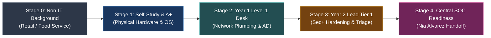

### 1.3 Core Curriculum Architecture Principles
1. **Whole-Task Authenticity:** Learners never study concepts in a vacuum. Every learning unit is anchored in a complete, realistic operational shift featuring live simulated artifacts (ServiceNow/Zendesk tickets, raw terminal dumps, Event Viewer logs, packet captures, and email headers).
2. **Dual-Track Pedagogy:** Every module pairs an immersive first-person narrative chapter (`narrative.md`) illustrating workplace complications, mentor-guided cognitive pivots, and organizational trade-offs with an intensive operational workbench (`workbench.md`) featuring micro-drills, decision heuristics, and evaluated deliverables.
3. **Faded Scaffolding:** Initial modules provide high procedural support and worked examples. By Module 06 (Active Directory), scaffolding fades into semi-guided completion tasks. By Modules 11 and 12, learners operate autonomously under time constraints, culminating in formal incident handoffs.
4. **Epistemic Humility & Forensic Hygiene:** The curriculum trains technicians to recognize the boundary of their own authority. An unguided tier-1 tech who runs an unapproved malware removal tool destroys court-admissible evidence and alerts an attacker; an analytically sound tier-1 tech contains the machine cleanly, documents the observable indicators of compromise (IoCs), and executes a clean handoff to Central SOC.

---

## 2. Performance-First Capability Continuum

Ethan’s journey spans 24 months of narrative time, tracking a realistic progression of cognitive maturity, technical capability, and emotional resilience.

```mermaid
journey
    title Ethan's 24-Month Capability & Confidence Trajectory
    section Foundations
      High School & Retail (Fred Meyer Stocker): 1: Ethan
      Self-Study (A+ Flashcards & PC Tear-Down): 2: Ethan
      First Week at Portland Desk (Imposter Syndrome): 2: Ethan
    section Year 1: Level 1 Desk
      Hardware & Peripheral Triage (Mod 01-02): 3: Ethan, Jules
      Subnetting & Network Plumbing (Mod 03-05): 4: Ethan, Jules
      90-Day Probation Exam (Milestone 1): 5: Ethan, Jules
      AD & Account Lockout Storms (Mod 06): 5: Ethan
    section Year 2: Senior Tier 1
      Remote Access & Boundary Hardening (Mod 07-08): 6: Ethan
      Malware & Endpoint Isolation (Mod 09): 7: Ethan, Jules
      Phishing Triage & Header Analysis (Mod 10): 7: Ethan
      Operational Hygiene & Social Eng (Mod 11): 8: Ethan
    section SOC Gateway
      Major Outage Capstone (Milestone 2): 8: Ethan, Jules
      Central SOC Handoff to Nia Alvarez (Mod 12): 9: Ethan, Nia
```

### 2.1 Capability Continuum Stages

| Stage & Timeline | Operational Role | Cognitive State & Mindset | Technical Competency & Tooling | CompTIA & Industry Mapping |
| :--- | :--- | :--- | :--- | :--- |
| **Stage 0**<br>*(Months -6 to 0)* | Retail Stocker / Delivery Driver $\rightarrow$ Self-Taught Aspirant | **Declarative Memorization:**<br>Knows terms as vocabulary words without causal links. Prone to panic and imposter syndrome. Assumes computers are magical black boxes. | Home PC building, basic BIOS navigation, cable identification (Cat5e vs. Cat6, HDMI vs. DP), installing Windows from USB. | CompTIA A+ Core 1 (220-1101) self-study; flashcards; CompTIA IT Fundamentals. |
| **Stage 1**<br>*(Months 1 to 3)* | Level 1 Service Desk Specialist (Probationary) | **Procedural Novice:**<br>Follows runbooks literally. Prone to "action bias" (touching before thinking). Struggles to isolate variables. Learns Socratic discipline under Jules. | Multimeters, loopback plugs, peripheral drivers, `diskpart`, BitLocker recovery keys, Windows Services console, Event Viewer basics. | CompTIA A+ Core 2 (220-1102); Level 1 Ticket Hygiene; Hardware Break/Fix. |
| **Stage 2**<br>*(Months 4 to 12)* | Level 1 Service Desk Specialist (Permanent) | **Systemic Causal Reasoning:**<br>Understands packet flow and OSI layering. Can differentiate client, local network, gateway, DNS, and server-side failures. Predicts output before running commands. | `ipconfig /all`, `arp -a`, `nslookup`, `netstat -ano`, PowerShell network cmdlets, Active Directory Users & Computers (ADUC), Group Policy (`gpresult`). | CompTIA Network+ (N10-008/009); Domain Networking; L2/L3 Troubleshooting. |
| **Stage 3**<br>*(Months 13 to 20)* | Senior Tier 1 / Escalation Tech | **Security-Conscious Practitioner:**<br>Views every ticket through the lens of confidentiality, integrity, and availability. Understands that user-reported symptoms often mask malicious tradecraft. | Sysinternals Suite (Autoruns, Process Explorer), Wireshark capture analysis, EDR console alerts, email MIME header inspection, WPA3-Enterprise 802.1X. | CompTIA Security+ (SY0-701); Endpoint Hardening; Threat Surface Reduction. |
| **Stage 4**<br>*(Months 21 to 24)* | Lead Tier 1 Security Liaison $\rightarrow$ SOC Junior Candidate | **Forensic First Responder:**<br>Operates with strict chain of custody, need-to-know communication, and evidence preservation. Can compile a professional incident triage package for CSIRT. | Volatile memory preservation concepts, live endpoint isolation, SIEM search triage, IOC extraction, structured handoff to Central SOC. | CompTIA Security+ (SY0-701) Certified; Ready for SOC triage work (Nia Alvarez handoff). |

---

## 3. The 4C/ID Instructional Architecture

The curriculum follows Jeroen van Merriënboer’s **Four-Component Instructional Design (4C/ID)** model. Complex diagnostic skills cannot be acquired through rote lecture; they require repeated practice on authentic whole tasks supported by just-in-time knowledge and targeted part-task micro-drills.

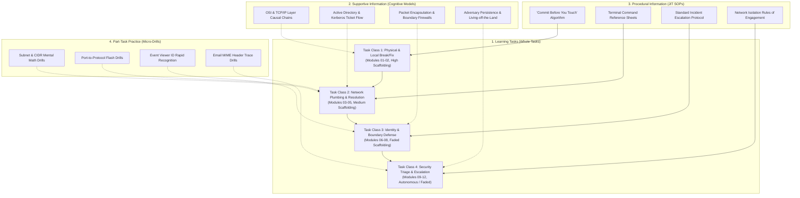

### 3.1 The Four 4C/ID Components in Practice
1. **Learning Tasks (Whole Tasks):** Authentic help desk shifts presenting real-world ambiguity, angry users, imperfect information, and conflicting priorities. Rather than isolated lab exercises, each module contains 3–5 multi-step ticket scenarios where students must troubleshoot across the entire stack.
2. **Supportive Information (Mental Models):** Provided *before* and *during* problem-solving. Explains how systems work theoretically and causally (e.g., how the DNS resolver walks the hierarchy, how Kerberos uses symmetric keys and timestamps to establish trust, how switch MAC tables age out).
3. **Procedural Information (Just-In-Time Rules of Engagement):** Step-by-step algorithms, cheat sheets, and checklists provided at the exact moment of execution (e.g., standard ping sweep syntax, safe endpoint cable-disconnect protocol, BitLocker recovery verification steps).
4. **Part-Task Practice (Automated Micro-Drills):** High-repetition, low-stakes drills embedded in the workbench to build automaticity for routine constituent skills (e.g., converting `/26` to `255.255.255.192`, identifying secure ports, recognizing Event ID 4625 sub-status codes).

---

## 4. The 12 Planned Modules: Detailed Architecture

```mermaid
gantt
    title Book 0: 12-Module Curriculum Progression
    dateFormat  X
    axisFormat Month %s
    section Core A+ & Physical
    Mod 01: Hardware, Peripherals & Bus       :active, m1, 0, 1
    Mod 02: OS Internals & BitLocker          :m2, 1, 2
    section Network Plumbing
    Mod 03: Local Networking & IP/ARP         :m3, 2, 3
    Mod 04: Name Resolution & DNS Plumbing    :m4, 3, 4
    Mod 05: Ports, Protocols & Cleartext      :m5, 4, 5
    section Identity & Boundaries
    Milestone 1: 90-Day Probation Exam        :crit, gate1, 5, 6
    Mod 06: Authentication, AD & Event IDs    :m6, 6, 7
    Mod 07: Remote Access & VPN/RDP           :m7, 7, 8
    Mod 08: Wireless Security & 802.1X        :m8, 8, 9
    section Security Triage & IR
    Mod 09: Endpoint Hardening & Malware      :m9, 9, 10
    Mod 10: Phishing Triage & MIME Headers    :m10, 10, 11
    Mod 11: Physical Security & Hygiene       :m11, 11, 12
    Milestone 2: Major Outage Capstone        :crit, gate2, 12, 13
    Mod 12: Incident Escalation & SOC Handoff :crit, m12, 13, 14
```

---

### Module 00: The Zero Foundation (The Kitchen Table)
*The Metacognitive Study Filter, Core Machine Building Blocks, The $500 Voucher Anxiety, and the Passport vs. the Instrument*

#### 1. Context & Operational Domain Mapping
- **Role:** Pre-IT Aspirant / Warehouse Freight Stocker (Gresham, Oregon).
- **Certification Objectives:** CompTIA A+ Core 1 (220-1101) & Core 2 (220-1102) Foundations (Computer Anatomy, Memory Hierarchy, Peripheral Interconnects, Basic CLI Primitives).
- **Setting:** Month 0 (May). Ethan's kitchen table in an East Portland duplex. $83 left in his checking account after purchasing a Pearson VUE exam voucher. An 800-page CompTIA study guide, 300 index cards, and total cognitive overwhelm.

#### 2. 4C/ID Whole-Task Learning Scenarios
- **Task 0.1 (The Study Panic & Practice Exam Failure):** Ethan scores 58% on a timed practice test, stumbling over laser printer corona wire voltages, DVI dual-link pinouts, and RAM clock timings. Learner must classify 40 practice exam questions into "Exam Passport Trivia" (ephemeral specs to cram for Thursday) vs. "Core Machine Principles" (enduring mental models needed on the job).
- **Task 0.2 (The Machinist's Deconstruction):** Using Ethan's father's machinist heuristics ("What holds tension, what moves?"), learner maps an open PC chassis to the 4 Core Building Blocks of Computing: CPU (compute/engine), RAM (volatile scratchpad), Disk (non-volatile ledger), and NIC (external voice).
- **Task 0.3 (First Contact with the Wire):** Learner launches a local terminal for the first time, executing `whoami`, `hostname`, and `ipconfig`, tracing how the OS queries local hardware identity (MAC address) and logical network identity (IP address).

#### 3. Supportive Information (Cognitive Models)
- **The Dual-Layer Learning Model (Passport vs. Instrument):**
  - *The Passport Layer:* Standardized syllabus terminology required to pass automated HR filters and industry exams.
  - *The Instrument Layer:* The handful of physical and logical fundamentals that govern troubleshooting for the next decade.
- **The Memory Hierarchy & Volatility Spectrum:** CPU Registers $\rightarrow$ L1/L2/L3 Cache $\rightarrow$ Volatile RAM $\rightarrow$ Non-Volatile NVMe/SSD/HDD. Why cutting power wipes RAM (and volatile adversary malware) but preserves the file system.
- **The Identity Triad:** MAC (Hardware factory badge / Layer 2) $\rightarrow$ IP (Logical temporary cubicle / Layer 3) $\rightarrow$ Port (Application office door / Layer 4).

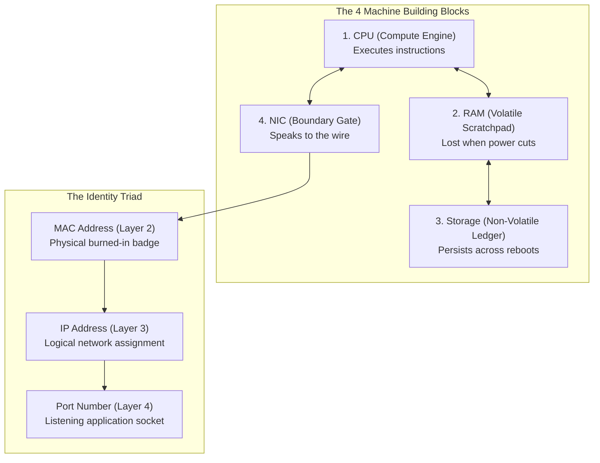

#### 4. Procedural Information (JIT SOPs)
- **The "Four Rubber Bands" Metacognitive Study Filter:**
  1. *Red Band (Passport Trivia):* Obsolete ports, legacy cable pinouts, printer mechanical steps. Cram 48 hours prior, spit out on exam, discard.
  2. *Green Band (Core Machine Building Blocks):* Power rails, volatile vs non-volatile storage, CPU bus limits. Permanent foundation.
  3. *Yellow Band (Identity & Languages):* Core ports (22, 53, 80, 443), MAC vs IP, client vs daemon.
  4. *Blue Band (The Diagnostic Reflex):* Symptom $\rightarrow$ Theory $\rightarrow$ Test $\rightarrow$ Verify $\rightarrow$ Document.

#### 5. Part-Task Practice Micro-Drills
- **Drill 0.1:** Volatile vs. Non-Volatile Sorting: Classify system artifacts (open socket, running process, registry file, clipboard content, saved event log, RAM dump) into volatile or persistent.
- **Drill 0.2:** Identity Triad Mapping: Given an outgoing web connection, map MAC address, source/dest IP address, and destination port (443) to their respective layers and hardware roles.

#### 6. Dialogue Beat (The Kitchen Table)
> *"Who gives a crap?" I threw the card across the linoleum. It landed face-up near the recycling bin: 'DVI-D Dual Link pin count.' "If I ever need to know how many pins are on a monitor cable, I'll look at the plastic connector! Why am I paying two hundred and fifty dollars to memorize a parts catalog?"*  
> *My dad walked in wearing socks, holding an empty mug. He looked at the cards scattered across the floor, then at the study guide propped against the salt shaker.*  
> *"When an apprentice starts in the machine shop," he said, turning the tap on, "he thinks he has to memorize every screw pitch in the McMaster-Carr catalog. He doesn't. He needs to know what holds tension, what takes shear, and what moves. What in this box holds tension, Ethan, and what moves?"*

---

### Module 01: Hardware, Peripherals, & The Local Bus
*The Physical Machine, Motherboard Architecture, Cables, Displays, and Thermal Realities*

#### 1. Context & Operational Domain Mapping
- **Role:** Tier 1 Field / Bench Technician.
- **Certification Objectives:** CompTIA A+ Core 1 (220-1101): Objectives 3.1, 3.2, 3.4 (Cabling, RAM, Motherboard interfaces, Display connectors, Power, Thermal issues).
- **Setting:** Ethan's first two weeks on the desk. The East Portland dispatch desk is cluttered with broken docking stations, shredded patch cables, Dell Precision towers that beep on boot, and thermal-throttling CAD laptops from the Department of Transportation.

#### 2. 4C/ID Whole-Task Learning Scenarios
- **Task 1.1 (The Multimeter & The Dead PSU):** A critical workstation in Fleet Dispatch won't power on. Dispatcher insists the motherboard is fried. Student must test the 24-pin ATX power supply using a paperclip jump test and digital multimeter before ordering replacement parts.
- **Task 1.2 (The USB-C / Thunderbolt Bandwidth Bottleneck):** Civil Engineering reports dual 4K monitors flicker and disconnect when plugging external SSDs into their Dell USB-C docks. Student must diagnose DisplayPort Alt Mode bandwidth limits vs. PCIe Thunderbolt tunneling.
- **Task 1.3 (Thermal Throttling CAD Station):** A GIS engineer complains ArcGIS crashes after 15 minutes of rendering. Task Manager shows CPU locked at 0.79 GHz. Student must identify dried thermal paste and clogged heatsink fins via HWMonitor logs.

#### 3. Supportive Information (Cognitive Models)
- **The PCIe / DMI Bus Architecture:** Diagram illustrating CPU direct lanes (GPU, NVMe) vs. Chipset DMI shared bus (USB, SATA, onboard NIC, audio). Understanding why saturating USB does not stall GPU, but saturating chipset lanes causes peripheral dropouts.
- **Power Delivery & Sign-Wave Realities:** AC to DC rectification, 12V rails (CPU/GPU) vs. 5V/3.3V logic rails. Power supply ripple and capacitor degradation symptoms.

#### 4. Procedural Information (JIT SOPs)
- **The Physical Triage Checklist:**
  1. Inspect physical layer: reseat cable, check link LED, swap known-good patch cable.
  2. POST Beep Code & Diagnostic LED matrix (Dell, HP, Lenovo).
  3. Safe ESD grounding procedures (wrist straps, chassis discharge).

#### 5. Part-Task Practice Micro-Drills
- **Drill 1.1:** Cable & Interface ID Speed Run: Identify USB 3.2 Gen 1 (5Gbps), Gen 2 (10Gbps), USB4, Thunderbolt 3/4, DisplayPort, HDMI, DVI-D, and RJ-45 from pinouts and keying diagrams.
- **Drill 1.2:** RAM Timing & Multi-Channel Matching: Match DDR4/DDR5 SO-DIMM and UDIMM modules into correct motherboard slots (Channels A & B) to prevent single-channel performance degradation.

#### 6. Ethan & Jules Dialogue Beat
> *"You're replacing the motherboard because the screen stayed black?" Jules set down her mug. Her bike helmet was still clipped to her pack.*  
> *"It won't POST," I said. "Fans spin, nothing on the monitor. It has to be the board."*  
> *She reached over, pulled the power cord, and pointed at the power button. "Hold that down for twenty seconds."*  
> *"Why?"*  
> *"Flea power in the capacitors. The embedded controller thinks the lid switch is stuck closed. Drain the board, give it thirty seconds, then try again."*  
> *I pressed it, waited, plugged it back in, and hit power. The Dell splash screen glowed bright blue.*  
> *Jules smiled without looking up from her screen. "Don't sign a death certificate for a machine that just needs to forget its last five minutes."*

---

### Module 02: Operating System Internals & File Systems
*Windows Services, Registry Hives, Process Execution, NTFS Permissions, and BitLocker TPM*

#### 1. Context & Operational Domain Mapping
- **Role:** Tier 1 Systems Support Technician.
- **Certification Objectives:** CompTIA A+ Core 2 (220-1102): Objectives 1.1, 1.2, 1.4, 2.8 (Windows OS features, Services, Registry, BitLocker, Task Manager, Command Line).
- **Setting:** Week 4. Ethan is handling incoming tickets from city employees whose laptops refuse to boot after monthly Cumulative Updates, locked BitLocker drives following BIOS updates, and phantom service failures.

#### 2. 4C/ID Whole-Task Learning Scenarios
- **Task 2.1 (The Spooler That Refuses to Die):** Print Spooler service (`spoolsv.exe`) crashes every 90 seconds, halting printing across the Water Bureau customer counter. Student must use `services.msc`, terminate hung processes in PowerShell, clear `C:\Windows\System32\spool\PRINTERS\`, and fix corrupted driver keys in `HKLM\SYSTEM\CurrentControlSet\Control\Print\Environments`.
- **Task 2.2 (The BitLocker TPM PCR Validation Failure):** After an unattended Dell firmware update, an accounting director's XPS laptop halts at the blue BitLocker Recovery screen. Student must locate the 48-digit recovery key in Active Directory / Azure AD, verify PCR 7/11 integrity, and understand why clearing TPM without suspending BitLocker causes catastrophic lockouts.
- **Task 2.3 (NTFS vs. Share Permission Conflicts):** A payroll specialist cannot save wage adjustment spreadsheets in `\\pdx-fs01\payroll$`. Share permissions are set to `Everyone: Full Control`, but NTFS permissions lack Write access for `SG-Payroll-Clerks`. Student must evaluate effective access.

#### 3. Supportive Information (Cognitive Models)
- **The Windows Architecture Stack:** User Mode (Win32 API, Subsystem, Applications) vs. Kernel Mode (Executive Services, Kernel, HAL, Device Drivers).
- **NTFS Metadata & Security Descriptors:** Master File Table (MFT), Access Control Lists (DACL vs. SACL), Inheritance flow, and the absolute rule: *Most Restrictive Permission Wins when Share and NTFS intersect*.

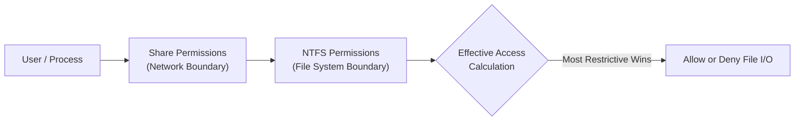

#### 4. Procedural Information (JIT SOPs)
- **BitLocker Recovery SOP:**
  1. Verify employee identity via out-of-band phone/manager confirmation (prevent social engineering).
  2. Search Active Directory Users & Computers (BitLocker Recovery tab) or Intune Device Details.
  3. Have user enter 48-digit numerical password.
  4. Once booted, run `manage-bde -status` and `manage-bde -protectors -get C:`.

#### 5. Part-Task Practice Micro-Drills
- **Drill 2.1:** Registry Hive Navigation: Map registry abbreviations (`HKCU`, `HKLM`, `HKCR`, `HKU`, `HKCC`) to their physical hive files (`NTUSER.DAT`, `SYSTEM`, `SOFTWARE`, `SAM`, `SECURITY`).
- **Drill 2.2:** Service Startup Types: Distinguish `Automatic`, `Automatic (Delayed Start)`, `Manual`, and `Disabled` behavior under system startup stress.

#### 6. Ethan & Jules Dialogue Beat
> *"The permissions say Full Control," I argued, tapping the screen. "Look: Everyone has Full Control on the share."*  
> *Jules didn't even turn her head. "What does NTFS say?"*  
> *"I haven't checked the security tab yet."*  
> *"The Share permission is just the guard at the parking lot gate," she said, taking a sip of coffee. "NTFS is the locked steel door on the building. You just let the user through the gate and left them banging their head against the steel. Check effective access, Ethan. The file system always gets the final word."*

---

### Module 03: Local Networking & IP Addressing
*Subnetting, CIDR, Default Gateways, ARP Dynamics, DHCP DORA, and the 'ipconfig' Reality*

#### 1. Context & Operational Domain Mapping
- **Role:** Tier 1 Network Support Specialist.
- **Certification Objectives:** CompTIA Network+ (N10-008/009): Objectives 1.4, 2.1, 4.1 (IPv4 addressing, Subnetting, Default Gateways, ARP, DHCP, APIPA).
- **Setting:** Month 2. Heavy rainstorms cause intermittent power cuts across East Portland pump stations. Devices come back online with weird IPs, IP conflicts erupt in Building B, and field technicians can't reach remote PLC loggers.

#### 2. 4C/ID Whole-Task Learning Scenarios
- **Task 3.1 (The APIPA Trap):** A desk clerk reports their computer "lost the internet." `ipconfig` displays `169.254.14.88` with a mask of `255.255.0.0`. Student must trace the DHCP DORA failure across the local switch VLAN, determine why the client assigned itself an Automatic Private IP Addressing (APIPA) address, and test switch DHCP relay (ip helper-address).
- **Task 3.2 (The Off-by-One Subnet Mask):** A newly provisioned server at `192.168.10.65/26` can ping `192.168.10.1`, but cannot reach its database peer at `192.168.10.62`. Student must calculate the `/26` block boundaries (`.0–.63` vs. `.64–.127`) and identify that the two servers sit on different broadcast domains.
- **Task 3.3 (The Gratuitous ARP / Duplicate IP Crisis):** Workstation `10.200.4.55` drops off the network every 30 seconds. Running `arp -a` reveals MAC address flapping between a Dell desktop and a rogue HP printer configured with a static address inside the DHCP scope.

#### 3. Supportive Information (Cognitive Models)
- **The Packet Delivery Lifecycle (Host-to-Gateway):** 
  - *Step 1:* Logical ANDing of destination IP and local subnet mask.
  - *Step 2:* If Local, consult ARP cache for target MAC; if Remote, consult ARP cache for Default Gateway MAC.
  - *Step 3:* Frame assembly: IP header untouched (TTL decremented), Ethernet header rewritten at every Layer 3 hop.
- **The DHCP DORA State Machine:** Discover (Broadcast) $\rightarrow$ Offer (Unicast/Broadcast) $\rightarrow$ Request (Broadcast) $\rightarrow$ Acknowledge (Unicast/Broadcast).

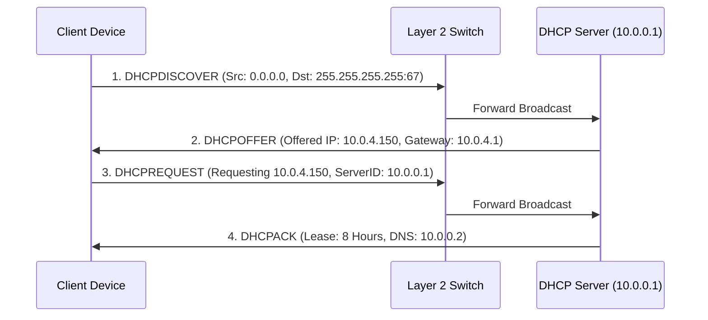

#### 4. Procedural Information (JIT SOPs)
- **Layer 2/3 CLI Diagnostic Flow:**
  ```console
  ipconfig /all              # 1. Verify IP, Mask, Gateway, DNS
  arp -a                     # 2. Check ARP resolution for Gateway IP
  ping 127.0.0.1             # 3. Test local TCP/IP stack integrity
  ping <Local_IP>            # 4. Test local NIC binding
  ping <Default_Gateway>     # 5. Test Layer 2 physical/VLAN path to router
  ping 8.8.8.8               # 6. Test Layer 3 WAN routing (bypassing DNS)
  ```

#### 5. Part-Task Practice Micro-Drills
- **Drill 3.1:** Fast CIDR-to-Host Math: Given `/24`, `/25`, `/26`, `/27`, `/28`, `/29`, `/30`, immediately state: Total IPs, Usable Hosts, and Subnet Mask octet value.
- **Drill 3.2:** DORA Packet Sniffing: Identify packet flags and transaction IDs in Wireshark captures to detect rogue DHCP servers offering bad gateway addresses.

#### 6. Ethan & Jules Dialogue Beat
> *"I can't ping Google, so the WAN link is down," I said, reaching for the ISP escalation ticket.*  
> *Jules wheeled her chair over. "Can you ping the gateway?"*  
> *"I didn't try."*  
> *"Can you ping your own loopback?"*  
> *"Why would I ping loopback? I know my computer is on."*  
> *She crossed her arms. "You don't know if your TCP/IP stack is bound, you don't know if your switch port has an ARP entry for the gateway, and you're already calling CenturyLink to complain about a fiber cut. Start on your side of the glass, Ethan. Ping inside-out. Never jump to the WAN when your own gateway hasn't answered you."*

---

### Module 04: Name Resolution & Basic Plumbing
*DNS Hierarchy, Query Recursion, Hosts File Overrides, DNS Caching, and 'nslookup' Diagnostics*

#### 1. Context & Operational Domain Mapping
- **Role:** Tier 1 Systems & Network Analyst.
- **Certification Objectives:** CompTIA Network+ (N10-008/009): Objective 1.5; CompTIA Security+ (SY0-701): Objective 2.5 (DNS records: A, AAAA, CNAME, MX, PTR, SRV, TXT, DNS sinkholing, hosts file hijacking).
- **Setting:** Month 3. The city migrates its internal intranet portal (`intranet.portlandoregon.local`) to a new server cluster. Half the help desk queue fills with *"Page Cannot Be Found"* errors, while executive assistants are stuck pointing at decommissioned IPs.

#### 2. 4C/ID Whole-Task Learning Scenarios
- **Task 4.1 (The Stale Client Cache):** Users in Community Development report the internal GIS mapper points to an Apache 404 page. The server team updated the DNS record 2 hours ago. Student must inspect `ipconfig /displaydns`, recognize negative caching, execute `ipconfig /flushdns`, and test using authoritative `nslookup`.
- **Task 4.2 (The Malicious / Forgotten Hosts File):** A laptop returns from an off-site conference. When the user navigates to `https://login.microsoftonline.com`, the browser triggers an invalid SSL certificate warning for an IP located in Eastern Europe. Student must inspect `C:\Windows\System32\drivers\etc\hosts`, discover an unauthorized static redirect, and evaluate it for malware tampering.
- **Task 4.3 (The Missing Active Directory SRV Record):** A newly imaged Windows 11 workstation cannot join the domain (`The specified domain either does not exist or could not be contacted`). Student must use `nslookup -type=SRV _ldap._tcp.dc._msdcs.portland.local` to verify if the domain controller's locator records are registered.

#### 3. Supportive Information (Cognitive Models)
- **The Recursive DNS Resolution Hierarchy:** Stub Resolver (Client) $\rightarrow$ Local Resolving DNS Server $\rightarrow$ Root Hints (`.`) $\rightarrow$ TLD Name Server (`.gov` / `.com`) $\rightarrow$ Authoritative Name Server (`ns1.portlandoregon.gov`).
- **Client-Side Resolution Precedence:**
  1. Client checks if queried name matches local host name.
  2. Client checks local DNS Resolver Cache (`ipconfig /displaydns`).
  3. Client checks static `hosts` file (`C:\Windows\System32\drivers\etc\hosts`).
  4. Client dispatches UDP 53 query to configured Primary DNS Server.

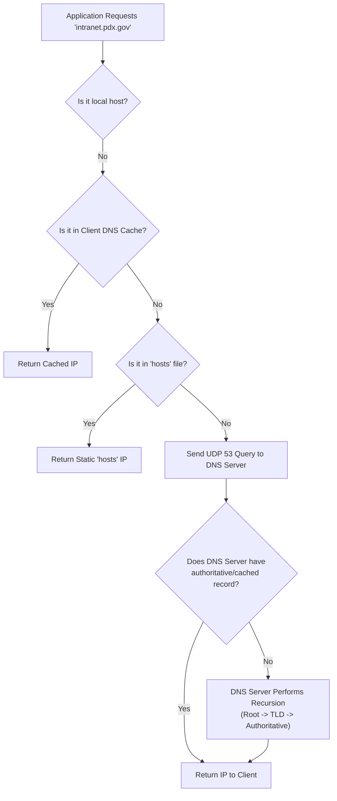

#### 4. Procedural Information (JIT SOPs)
- **Authoritative DNS Troubleshooting SOP:**
  ```console
  nslookup                                # Launch interactive nslookup
  > server 10.0.0.2                      # Set target DNS server explicitly
  > set type=A                            # Specify record type
  > intranet.portlandoregon.local         # Query internal record
  > server 8.8.8.8                        # Switch to public resolver to test split-brain
  > portlandoregon.gov                    # Query public zone
  ```

#### 5. Part-Task Practice Micro-Drills
- **Drill 4.1:** Record Type Rapid Association: Given a technical function (Mail delivery, IPv6 mapping, Alias, Domain Controller location, SPF text), immediately name the DNS record type (`MX`, `AAAA`, `CNAME`, `SRV`, `TXT`).
- **Drill 4.2:** DNS Output Analysis: Differentiate "Non-authoritative answer" vs. "Authoritative answer" vs. "Server failed (SERVFAIL)" vs. "Query refused (REFUSED)" in terminal dumps.

#### 6. Ethan & Jules Dialogue Beat
> *"The website is dead," I announced. "I'm pinging intranet.portland.gov and getting 'Destination host unreachable'."*  
> *Jules looked up over her glasses. "What IP did it try to reach?"*  
> *"It didn't show an IP. It just failed."*  
> *"Then the website isn't dead, Ethan. Your computer doesn't even know what number to dial. If ping can't resolve the name, ping didn't test the web server; it tested your ability to ask for directions. Type `nslookup`. Don't call a web server dead when your DNS server is the one asleep at the wheel."*

---

### Module 05: Ports, Protocols, & Cleartext vs. Encrypted
*Transport Layer Mechanics, Insecure vs. Secure Services, Mail Submission, and Perimeter Hardening*

#### 1. Context & Operational Domain Mapping
- **Role:** Tier 1 Security & Network Support Specialist.
- **Certification Objectives:** CompTIA Security+ (SY0-701): Objectives 1.2, 1.4, 2.1, 2.5 (Ports, Protocols, Cleartext vs Encrypted, In-transit encryption, Jump Hosts).
- **Track Companion Alignment:** Corresponds to `examples/secplus-ports-helpdesk/` (*The Port That Is Open*).
- **Setting:** Month 4. Ethan sits with 14 incoming tickets. Network engineers want Telnet opened to legacy switches; field crews want plain HTTP forms; external contractors request direct RDP access across the WAN.

#### 2. 4C/ID Whole-Task Learning Scenarios
- **Task 5.1 (The Cleartext Telnet Trap):** A senior network technician asks Ethan to temporarily open port 23 to an edge switch. Ethan must inspect a live packet capture ([`jared-telnet-capture.pcap`](../../portland-desk/artifacts/jared-telnet-capture.pcap)), extract administrative credentials typed over cleartext Telnet, deny the request, and configure SSH (port 22).
- **Task 5.2 (The Broken Mobile Mail Client):** An executive traveling internationally cannot send outbound email from their iPad. The client is misconfigured to use SMTP port 25. Ethan must identify hotel ISP port 25 filtering and reconfigure the client to use Submission (Port 587 with STARTTLS) or SMTPS (Port 465).
- **Task 5.3 (The Exposed RDP Request):** A water treatment contractor requests port 3389 forwarded to a pump controller PC. Ethan must enforce desk policy: deny external port exposure, mandate VPN tunnel access, and require routing through an internal hardened Jump Host.

#### 3. Supportive Information (Cognitive Models)
- **The Cleartext vs. Encrypted Security Matrix:**

| Functional Role | Insecure / Cleartext | Secure / Encrypted | Mechanism & Hardening Rule |
| :--- | :--- | :--- | :--- |
| **CLI Management** | Telnet (TCP 23) | SSH (TCP 22) | Encrypted stream; block 23 enterprise-wide |
| **Web Browsing** | HTTP (TCP 80) | HTTPS (TCP 443) | TLS 1.3 / PKI; enforce HSTS |
| **Mail Delivery** | SMTP Relay (TCP 25) | Submission (TCP 587) / SMTPS (TCP 465) | Explicit STARTTLS / Implicit TLS; block outbound 25 on client subnets |
| **Mail Retrieval** | POP3 (110) / IMAP (143) | POP3S (995) / IMAPS (993) | Implicit TLS wrapper; prevent session cookie theft |
| **Directory Queries** | LDAP (TCP 389) | LDAPS (TCP 636) | TLS over LDAP; prevent cleartext credential harvesting |
| **File Transfer** | FTP (TCP 20, 21) | SFTP (TCP 22) / FTPS (989/990) | SFTP over SSH subsystem; FTPS over TLS |
| **Remote Desktop** | RDP (TCP 3389 clear) | RDP over NLA / VPN | Never expose raw 3389 to internet; require Jump Host |

#### 4. Procedural Information (JIT SOPs)
- **The Tier 1 Triage Decision Tree:**
  1. Is the requested protocol cleartext? If YES $\rightarrow$ Deny and substitute secure counterpart.
  2. Does the request cross an untrusted boundary (WAN/Internet)? If YES $\rightarrow$ Deny direct management ports; require VPN + MFA + Jump Host.
  3. Validate certificate trust chain and cipher suite.

#### 5. Part-Task Practice Micro-Drills
- **Drill 5.1:** Port-to-Service Flash Drills: Instantly map ports `20, 21, 22, 23, 25, 53, 67, 68, 80, 110, 123, 143, 161, 389, 443, 445, 465, 587, 636, 993, 995, 3389` to protocol names, security status (Cleartext vs. Secure), and transport layer (TCP vs. UDP).
- **Drill 5.2:** `netstat -ano` Listening Port Triage: Parse netstat output to identify which PID is listening on port 3389 or port 80 and match it to Task Manager processes.

#### 6. Ethan & Jules Dialogue Beat
> *"It's just Telnet inside our own building," the tech had said on the phone. "Nobody is sniffing packets in Building C."*  
> *I had my hand on the firewall ticket, ready to approve the temporary rule. Jules leaned over and tapped the edge of my monitor where her yellow sticky note lived.*  
> *"Which decision?" she asked.*  
> *"It's ten minutes so Jared can fix the trunk VLAN."*  
> *"Ethan. Opening a port is opening a door. If the protocol speaks cleartext, anyone sitting on that segment, any compromised camera, any span port sees the password in plain ASCII. You don't build a secure building by leaving the back door unlocked whenever you're in a hurry. Tell him port 22, or tell him to walk over with a console cable."*

---

### Module 06: Authentication, Authorization, & Active Directory
*Kerberos TGT/TGS, NTLM Fallback, LDAP/LDAPS, Group Policy GPO, and Windows Security Event Logs*

#### 1. Context & Operational Domain Mapping
- **Role:** Tier 1 Identity & Access Specialist.
- **Certification Objectives:** CompTIA Security+ (SY0-701): Objectives 1.3, 3.2, 4.3 (Identity providers, MFA, AAA, Directory services, Kerberos, Event Viewer triage: Event IDs 4624, 4625, 4740).
- **Track Companion Alignment:** Corresponds to `examples/secplus-auth-helpdesk/` (*Prove Who You Are*).
- **Setting:** Month 5. Ethan manages Monday morning account lockouts. A wave of locked accounts hits the Housing Authority, while automated service accounts fail across backend SQL servers.

#### 2. 4C/ID Whole-Task Learning Scenarios
- **Task 6.1 (The Account Lockout Storm):** An executive assistant’s AD account locks out every 15 minutes. Ethan must open Event Viewer on the Domain Controller, filter for **Event ID 4740** (A user account was locked out), identify the Calling Computer Name, locate a cached credential on an old forgotten iPad, and resolve the lockout.
- **Task 6.2 (Kerberos Clock Skew Failure):** All users on the 3rd floor report *"The authentication service is unavailable"* when logging into domain workstations. Ethan discovers an NTP drift of 7 minutes on the local distribution switch, violating Kerberos’s 5-minute maximum tolerance (ticket replay protection).
- **Task 6.3 (The Failed Logon Triage - Event ID 4625):** Ethan inspects a workstation generating hundreds of Event ID 4625 logs. By analyzing the `Logon Type` and `Sub Status` code (`0xC000006A`: correct username, wrong password vs. `0xC0000064`: user does not exist), Ethan determines whether it is a user typo or a brute-force password spray.

#### 3. Supportive Information (Cognitive Models)
- **The Kerberos Authentication Handshake:**
  1. Client sends `AS-REQ` (Authentication Service Request) with timestamp encrypted by user's password hash.
  2. KDC responds with `AS-REP` containing the **Ticket Granting Ticket (TGT)** encrypted by `krbtgt` key.
  3. Client presents TGT via `TGS-REQ` to request access to a specific service (e.g., File Server CIFS).
  4. KDC returns **Ticket Granting Service (TGS)** service ticket encrypted by the target service's secret key.
  5. Client presents TGS ticket to the target service (`AP-REQ`).

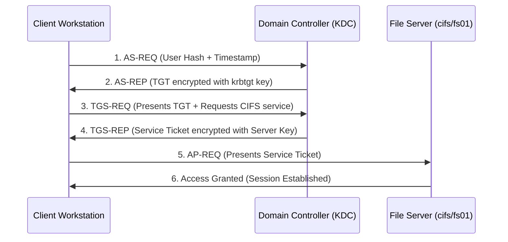

- **Crucial Windows Security Event IDs:**

| Event ID | Description | Triage Focus |
| :--- | :--- | :--- |
| **4624** | An account was successfully logged on | Check `Logon Type`: Type 2 (Interactive/Console), Type 3 (Network/Share), Type 10 (RemoteInteractive/RDP). |
| **4625** | An account failed to log on | Check `Sub Status`: `0xC000006A` (bad password), `0xC0000064` (bad username), `0xC0000234` (locked out). |
| **4740** | A user account was locked out | Look at `Caller Computer Name` to find which device holds the bad cached credential. |
| **4720** | A user account was created | Verify change ticket; unexpected creations indicate rogue persistence. |
| **4728 / 4732** | Member added to security group | Critical monitoring when users are added to Domain Admins or Local Administrators. |

#### 4. Procedural Information (JIT SOPs)
- **Account Lockout Investigation Protocol:**
  1. Search DC Security Log: `Get-WinEvent -FilterHashtable @{LogName='Security'; Id=4740}`.
  2. Identify the `TargetUserName` and `CallerComputerName`.
  3. Navigate to the calling device; check Credential Manager, mapped network drives, hung Outlook sessions, or active mobile ActiveSync connections.
  4. Clear cached credentials before unlocking user account in ADUC.

#### 5. Part-Task Practice Micro-Drills
- **Drill 6.1:** Logon Type Recognition: Given Logon Type `2, 3, 4, 5, 7, 8, 9, 10, 11`, instantly state the access method (Console, Network Share, Batch Job, Windows Service, Unlock, Cleartext Network, RunAs, Remote Desktop, Cached Interactive).
- **Drill 6.2:** Active Directory Permissions Tree: Distinguish Organizational Unit (OU) GPO inheritance from Security Group membership in resolving user access rights.

#### 6. Ethan & Jules Dialogue Beat
> *"I unlocked Sarah's account three times today," I said, rubbing my temples. "She swears she isn't typing her password wrong."*  
> *"She isn't," Jules said, rolling her chair back from her cube. "Stop clicking 'Unlock' and start asking who is typing it for her."*  
> *"You think she's being hacked?"*  
> *"I think she replaced her phone on Saturday, her old phone is sitting in her gym bag trying to sync mail every nine minutes with her expired password, and the domain controller is doing exactly what it was told to do. Open Event Viewer on the DC. Find Event 4740. Read the caller machine name. Don't fight the symptom when the log is screaming the source at you."*

---

### Module 07: Remote Access & Boundary Defense
*VPN Concentrators, IPsec vs. SSL/TLS, Split-Tunneling Risks, Firewalls, Jump Hosts, and Bastion Architecture*

#### 1. Context & Operational Domain Mapping
- **Role:** Tier 1 Remote Infrastructure Technician.
- **Certification Objectives:** CompTIA Security+ (SY0-701): Objectives 2.5, 3.3 (VPN, Split tunneling vs Full tunneling, Jump hosts, Bastions, Network access control).
- **Setting:** Month 6. Remote work expansion. City planners and inspectors work from home, coffee shops, and construction sites. Technicians must balance user bandwidth against corporate data leakage.

#### 2. 4C/ID Whole-Task Learning Scenarios
- **Task 7.1 (The Split-Tunneling Breach Vector):** A remote building inspector's laptop connects to the enterprise network via an unmanaged home Wi-Fi network. The VPN client is set to split-tunneling. The inspector's kid downloads malware on a shared home desktop that pivots across the inspector's open subnet interface. Ethan must explain the risk and migrate the user profile to a **Full-Tunnel** mandatory configuration.
- **Task 7.2 (The Bastion Host Hop):** A third-party SCADA vendor needs to update telemetry software on internal water treatment servers. Policy strictly forbids direct VPN-to-endpoint routing. Ethan provisions an ephemeral account with MFA, directing the vendor to connect via an isolated **Jump Host** in the DMZ with session recording enabled.
- **Task 7.3 (Firewall Rule Ordering & Implicit Deny):** A newly opened firewall rule allowing HTTPS to a test server fails to work. Ethan inspects the firewall rule base and discovers a higher-priority broad `DENY Any-Any` rule placed above the specific `ALLOW` rule.

#### 3. Supportive Information (Cognitive Models)
- **Full-Tunnel vs. Split-Tunnel Architecture:**
  - *Full Tunnel:* All client traffic (corporate LAN + general Internet) is encapsulated and routed through the enterprise VPN concentrator. High corporate security, centralized inspection, higher concentrator bandwidth load.
  - *Split Tunnel:* Only traffic destined for corporate IP subnets traverses the encrypted tunnel; general internet traffic routes directly out the local ISP gateway. Conserves enterprise bandwidth, but creates a dual-homed bridge vulnerability.

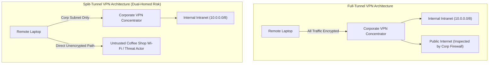

#### 4. Procedural Information (JIT SOPs)
- **Jump Host Administration SOP:**
  1. Verify active change ticket ID and authorized vendor contact.
  2. Ensure vendor connects via VPN with hardware token MFA.
  3. Grant RDP access strictly to the Jump Host IP (`172.16.50.10`), never to internal production subnets.
  4. Ensure session recording daemon (`ObserveIT` / `Guacamole`) is running.

#### 5. Part-Task Practice Micro-Drills
- **Drill 7.1:** Routing Table Triage (`route print`): Inspect client routing tables to verify whether the `0.0.0.0/0` default route points to the local Wi-Fi gateway (Split-Tunnel) or the VPN tunnel adapter interface (Full-Tunnel).
- **Drill 7.2:** Firewall Rule Logic: Reorder a 10-rule firewall rule base to satisfy least privilege while preventing rule shadowing.

#### 6. Ethan & Jules Dialogue Beat
> *"The engineer is complaining that YouTube buffers when he's on the VPN," I said. "He asked if we can turn on split-tunneling so his personal streaming doesn't hit our concentrator."*  
> *Jules stopped typing and turned around completely. "And what did you tell him?"*  
> *"I was about to ask if we had a split-tunnel profile."*  
> *"Ethan, if he turns on split-tunneling while sitting on hotel Wi-Fi, his laptop becomes a bridge between every compromised machine in that hotel and our internal file servers. If an attacker pops his machine over the local subnet, they ride his VPN tunnel straight into Active Directory without touching our perimeter firewall. YouTube buffering isn't a ticket; it's the cost of keeping our perimeter whole. Tell him to watch YouTube on his phone."*

---

### Module 08: Wireless Security & Segmentation
*802.11 Standards, WPA2/WPA3-Enterprise, 802.1X EAP/RADIUS, Rogue APs, Evil Twins, and VLAN Isolation*

#### 1. Context & Operational Domain Mapping
- **Role:** Tier 1 Wireless & Edge Support Specialist.
- **Certification Objectives:** CompTIA Security+ (SY0-701): Objectives 2.1, 2.5, 3.3 (Wireless security, WPA3, 802.1X, EAP-TLS, PEAP, Rogue AP, Evil Twin, Captive portal).
- **Track Companion Alignment:** Corresponds to `examples/secplus-wireless-helpdesk/` (*The Air Is Shared*).
- **Setting:** Month 7. Portland City Hall. Elected officials, press corps, public citizens, and administrative staff share the same physical airspace. Complaints arise about rogue SSIDs and corporate devices connecting to unsecured networks.

#### 2. 4C/ID Whole-Task Learning Scenarios
- **Task 8.1 (The Coffee Shop Evil Twin):** A transportation planner working in an open plaza connects their corporate laptop to an SSID named `PDX-Public-Guest` that does not require a captive portal. Their browser prompts for a root CA installation. Ethan must identify the Evil Twin attack, disconnect the device, verify certificate stores, and explain why 802.1X prevents SSID spoofing.
- **Task 8.2 (The WPA3-Enterprise RADIUS Certificate Expiry):** At 08:00, 300 municipal workers cannot connect to `PDX-Internal-WiFi`. Laptops reject the connection with *"Unable to authenticate server identity."* Ethan uses Wireshark to inspect the 802.1X EAP-TLS exchange and discovers the RADIUS server’s intermediate certificate expired at midnight.
- **Task 8.3 (The Rogue AP in the Closet):** A facility technician plugs an unmanaged Linksys Wi-Fi router into an open wall jack in the Water Bureau maintenance garage to get Wi-Fi on his phone. The router runs its own rogue DHCP server, handing out `192.168.1.x` addresses to city tablets. Ethan locates the rogue device using switch MAC address tables and port security shutdown.

#### 3. Supportive Information (Cognitive Models)
- **WPA-Personal (PSK) vs. WPA-Enterprise (802.1X):**
  - *WPA-Personal:* Shared single pre-shared key. If one person leaves or is compromised, the entire network key must be changed. Vulnerable to offline 4-way handshake brute-force dictionary attacks.
  - *WPA-Enterprise:* Every user authenticates with individual credentials or client certificates against a centralized **RADIUS / AAA** server. Derives unique pairwise master keys (PMK) per session.
- **802.1X EAP Authentication Flow (Supplicant $\rightarrow$ Authenticator $\rightarrow$ Authentication Server):**

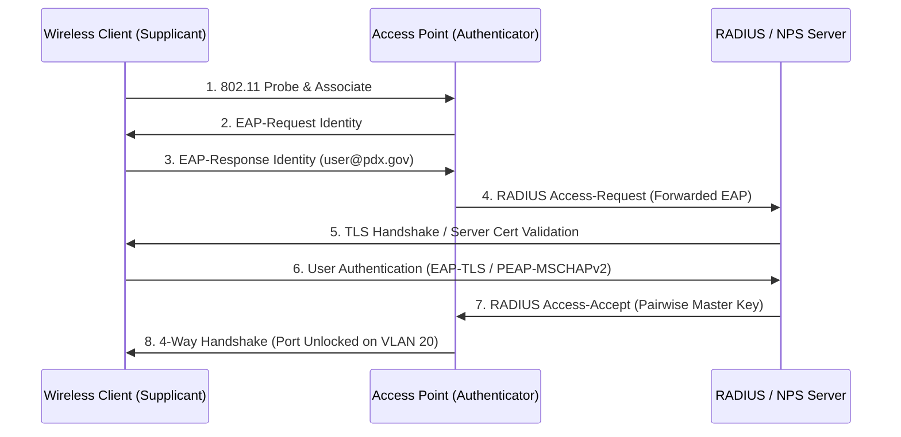

#### 4. Procedural Information (JIT SOPs)
- **Rogue AP Containment SOP:**
  1. Retrieve rogue AP MAC from wireless intrusion detection system (WIDS).
  2. Log into edge switch: `show mac address-table address <Rogue_MAC>`.
  3. Identify physical switch port (e.g., `Gi1/0/24`).
  4. Immediately disable port: `interface Gi1/0/24` $\rightarrow$ `shutdown`.
  5. Dispatch field tech to physically locate and confiscate the unauthorized hardware.

#### 5. Part-Task Practice Micro-Drills
- **Drill 8.1:** Wireless Encryption Acronym Matrix: Match `WEP` (RC4, broken), `WPA` (TKIP, legacy), `WPA2` (AES-CCMP), and `WPA3` (SAE / Simultaneous Authentication of Equals, GCMP-256) to their cryptographic ciphers and vulnerabilities.
- **Drill 8.2:** 802.11 Channel Planning: Optimize 2.4 GHz non-overlapping channels (`1, 6, 11`) and 5 GHz DFS channels across a floor plan to prevent co-channel interference.

#### 6. Ethan & Jules Dialogue Beat
> *"Someone brought an open Linksys router from home so they could listen to Spotify in the mechanical room," I said, holding up the confiscation slip.*  
> *"Did you shut the port?" Jules asked.*  
> *"I shut the port and deleted the DHCP leases. But why do people do it? We have guest Wi-Fi."*  
> *"Because guest Wi-Fi blocks streaming ports and makes them sign a captive portal every four hours," she said, spinning an Allen wrench between her fingers. "Users don't break security because they're evil, Ethan. They break security because security gets in the way of whatever they want to do. If you don't understand the friction you create, you will spend your entire career chasing rogue routers in closets."*

---

### Module 09: Endpoint Hardening & Malware Symptoms
*Living-off-the-Land (LOLBins), Process Triage, Sysinternals Autoruns, Safe Network Isolation, and Anti-Wiping Discipline*

#### 1. Context & Operational Domain Mapping
- **Role:** Tier 1 Endpoint Security Specialist.
- **Certification Objectives:** CompTIA Security+ (SY0-701): Objectives 2.2, 2.4, 4.1 (Malware types, Symptoms of compromise, LOLBins, Persistence mechanisms, Isolation vs. Eradication).
- **Track Companion Alignment:** Corresponds to `examples/secplus-malware-helpdesk/` (*Something on the Box*).
- **Setting:** Month 9. A spike in weaponized PDF invoices and suspicious PowerShell commands across departmental workstations. Ethan faces the ultimate Tier 1 dilemma: the urge to immediately wipe the machine vs. the discipline to isolate and preserve evidence.

#### 2. 4C/ID Whole-Task Learning Scenarios
- **Task 9.1 (The Adware False Alarm vs. Real Intrusion):** Maya from Housing rushes in demanding her laptop be wiped because pop-ups are screaming *"YOUR COMPUTER IS INFECTED."* Ethan must review the AV history, identify a benign browser adware notification push, remove the rogue site permission in Chrome, and return the working laptop without an unneeded 3-hour re-image.
- **Task 9.2 (The Hidden Persistence - Sysinternals Autoruns):** A laptop fans spin at 100% on boot. Task Manager shows `powershell.exe` consuming 95% CPU, but killing the task causes it to respawn 60 seconds later. Ethan must use Sysinternals **Autoruns**, locate a malicious scheduled task masquerading as a Google Update service, inspect the encoded command, isolate the machine from the network, and preserve state.
- **Task 9.3 (The Safe Isolation Protocol):** An accounting workstation displays a ransom note on the desktop background. The user is reaching for the physical power button. Ethan must intervene: halt the power-kill (which would destroy volatile RAM keys), safely disconnect the physical Ethernet cable and disable Wi-Fi, and tag the system for Tier 2 forensics.

#### 3. Supportive Information (Cognitive Models)
- **Living-off-the-Land Binaries (LOLBins):** Attackers no longer bring custom compile binaries (`malware.exe`); they utilize legitimate, digitally signed OS utilities (`powershell.exe`, `certutil.exe`, `bitsadmin.exe`, `wmic.exe`, `mshta.exe`) to download payloads and execute code in memory, bypassing basic hash-based antivirus.
- **Windows Persistence Mechanisms:**
  1. Registry Run Keys (`HKCU\Software\Microsoft\Windows\CurrentVersion\Run`).
  2. Scheduled Tasks (`Taskschd.msc`).
  3. Startup Folder (`shell:startup`).
  4. Malicious Windows Services (`New-Service` / Event ID 7045).
  5. WMI Event Subscriptions (Advanced persistent scripts).

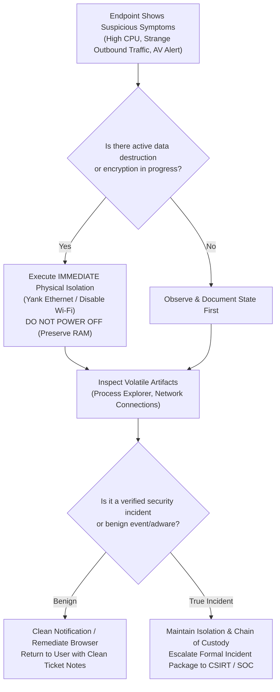

#### 4. Procedural Information (JIT SOPs)
- **First Responder Isolation & Triage SOP:**
  1. **Do NOT Reboot or Power Down:** Power loss wipes volatile RAM where encryption keys, injects, and memory-only payloads reside.
  2. **Sever Network Connections:** Disconnect RJ-45 cable; toggle physical wireless switch or disable Wi-Fi adapter. Do NOT log off the current session.
  3. **Capture Volatile State:** Run `netstat -ano` and tasklist or snap Sysinternals Process Explorer screenshot.
  4. **Document Observable Facts:** Time disconnected, user logged on, visible error messages, active process IDs.

#### 5. Part-Task Practice Micro-Drills
- **Drill 9.1:** Process Explorer Parent-Child Analysis: Spot abnormal process hierarchies (e.g., `winword.exe` spawning `cmd.exe` or `powershell.exe` spawning `certutil.exe`).
- **Drill 9.2:** Autoruns Quick Triage: Filter out digitally signed Microsoft entries to isolate unverified third-party executables in startup locations.

#### 6. Ethan & Jules Dialogue Beat
> *"I was reaching for the USB drive to wipe it," I said. "The user was panicking. She had a standup in twenty minutes."*  
> *Jules placed her coffee cup between my hand and the imaging drive. "What did the machine actually do, Ethan? Besides scare you?"*  
> *"It had popups! Task Manager was pegged!"*  
> *"And if you had wiped it," she said evenly, "you would have wiped the only evidence of what happened. If it was a real intrusion, you just destroyed the indicators the CSIRT needs to see how they got in. And if it was just a scammy Chrome notification, you just cost an employee four hours of work and a day of lost files for a nothingburger. Put the USB drive away. You can have it back when you can tell me what the process actually touched."*

---

### Module 10: Phishing Triage & Social Engineering
*Email Architecture, Raw MIME Headers, SPF/DKIM/DMARC Validation, BEC, and Safe Attachment Sandboxing*

#### 1. Context & Operational Domain Mapping
- **Role:** Tier 1 Email Security Analyst.
- **Certification Objectives:** CompTIA Security+ (SY0-701): Objectives 2.1, 2.3, 4.3 (Phishing, Spear phishing, Whaling, BEC, Email authentication: SPF, DKIM, DMARC, Header analysis).
- **Track Companion Alignment:** Corresponds to `examples/secplus-phishing-helpdesk/` (*Don't Click That*).
- **Setting:** Month 11. An urgent email hits the City Treasurer’s inbox appearing to come from the City Attorney, demanding an immediate bank wire transfer for an eminent domain land purchase. Ethan is assigned the triage ticket.

#### 2. 4C/ID Whole-Task Learning Scenarios
- **Task 10.1 (The Executive Impersonation / Display Name Spoof):** A department admin receives an email: *"From: Commissioner Ryan <commissioner.ryan.pdx@gmail.com>"* asking for $500 Apple gift cards for staff awards. Ethan must inspect the raw headers, identify the mismatched Friendly From vs. Envelope Sender, and educate the user on display name spoofing.
- **Task 10.2 (The Broken DMARC Alignment):** A vendor invoice arrives from `billing@vendor-supply.com`. The mail passes SPF (sent from a legitimate SendGrid IP), but fails DKIM cryptographic signature verification and fails DMARC alignment. Ethan parses the headers to prove the sender domain was spoofed.
- **Task 10.3 (The Silent Forwarding Rule):** An accountant reports not receiving replies to vendor inquiries. Ethan connects via Exchange Online PowerShell, runs `Get-InboxRule`, discovers a hidden inbox rule forwarding all emails containing "invoice" or "wire" to an external ProtonMail address, and executes immediate credential revocation and mailbox remediation.

#### 3. Supportive Information (Cognitive Models)
- **The Email Authentication Triad:**
  - **SPF (Sender Policy Framework):** DNS TXT record listing authorized IP addresses allowed to send mail on behalf of a domain. *Limitation: Only validates Envelope Sender (`Return-Path`), not the visible `From:` header.*
  - **DKIM (DomainKeys Identified Mail):** Cryptographic public-private key signature embedded in email headers (`DKIM-Signature`), ensuring body and headers were not tampered with in transit.
  - **DMARC (Domain-based Message Authentication, Reporting, and Conformance):** Enforces **Alignment** between the SPF domain, the DKIM domain, and the visible `From:` header. Dictates recipient policy: `p=none` (monitor), `p=quarantine` (spam folder), or `p=reject` (drop mail).

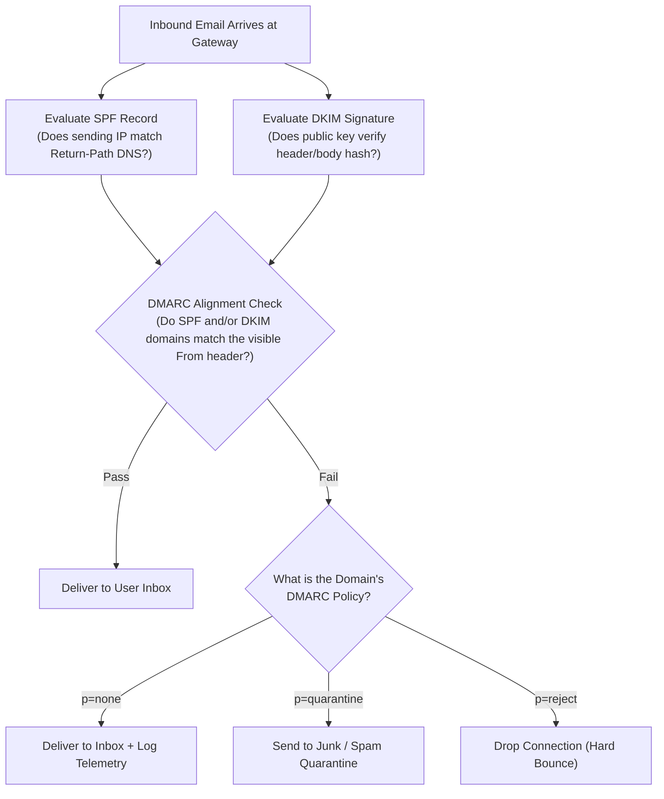

- **Anatomy of a Raw MIME Header (`Received` Hops):**
  - Read **bottom-to-top** for chronological journey:
    - *Bottom hop:* Originating client MUA / first mail submission server.
    - *Middle hops:* Intermediate MTAs (Mail Transfer Agents), anti-spam filters.
    - *Top hop:* Final receiving MX server (e.g., Office 365 gateway).

#### 4. Procedural Information (JIT SOPs)
- **Email Phishing Triage Checklist:**
  1. Export email as raw `.eml` or extract full message headers (never forward inline, which rewrites headers).
  2. Parse the bottom-most `Received: from` header to identify true originating IP and reverse DNS.
  3. Check `Authentication-Results:` for `spf=pass/fail`, `dkim=pass/fail`, `dmarc=pass/fail`.
  4. Defang suspicious URLs before documenting (`hxxps://malicious[.]com`).
  5. Check user mailbox for unauthorized forwarding rules (`Get-InboxRule`).

#### 5. Part-Task Practice Micro-Drills
- **Drill 10.1:** Header Hop Tracing: Given a 6-hop raw header dump, immediately point to the external IP that crossed the public internet boundary.
- **Drill 10.2:** Defanging & URL Inspection: Practice converting live malicious links and IP addresses to defanged format (`hxxp://`, `[.]`, `[:]`) to prevent accidental clicking in ticket documentation.

#### 6. Ethan & Jules Dialogue Beat
> *"The email says it's from the Chief of Police," I told Jules, my fingers hovering over the phone. "The font looks right, and the signature has the city seal."*  
> *Jules slid a pen across my desk. "Open the raw message headers."*  
> *I clicked File $\rightarrow$ Properties $\rightarrow$ Internet Headers. A wall of tiny text filled the box.*  
> *"Look at the 'Received: from' line at the very bottom," she said. "The seal in the body is just an image someone copied off Wikipedia. The body of an email is whatever the sender wanted to draw. The headers are the postmarks the mail trucks stamped on the envelope while carrying it. What does the bottom postmark say?"*  
> *I read the line. "`Received: from mail-relay-4.cloud-vps-nigeria.net (197.210.8.44)`."*  
> *Jules went back to her keyboard. "The Chief of Police didn't send an email from a cloud VPS in Lagos. Defang the link, log the IP, and close the gate."*

---

### Module 11: Physical Security & Operational Hygiene
*Badge Access, RFID Cloning, Tailgating, Clean Desk Policy, Rogue USB Drops, NIST 800-88 Sanitization, and Social Engineering*

#### 1. Context & Operational Domain Mapping
- **Role:** Tier 1 Facilities & IT Operations Specialist.
- **Certification Objectives:** CompTIA Security+ (SY0-701): Objectives 1.2, 2.1, 2.2 (Physical security controls, Tailgating, Shoulder surfing, USB drops, Social engineering: vishing/pretexting, Media sanitization: NIST SP 800-88).
- **Track Companion Alignment:** Corresponds to `examples/secplus-physical-helpdesk/` (*Badge, Lock, Eyes*).
- **Setting:** Month 14. An external compliance audit sweeps through the Portland municipal building. Ethan discovers that high-tech firewalls mean nothing if someone holds the front door open for a contractor holding a ladder.

#### 2. 4C/ID Whole-Task Learning Scenarios
- **Task 11.1 (The Tailgating "Coffee Carrier" Pretext):** During morning rush hour, a well-dressed individual holding two trays of coffee smiles and asks Ethan to hold the badge-access door to the 4th-floor server wing. Ethan must navigate the social engineering confrontation, politely enforce policy, and require badge tap.
- **Task 11.2 (The Parking Lot USB Drop):** A city water inspector brings in three rubber-coated USB drives labeled *"Q3 Budget Draft - Executive Summary"* found scattered by the employee entrance. Ethan must secure the drives in an anti-static bag, prevent curious technicians from plugging them into production machines, and route them to an air-gapped forensic sandbox.
- **Task 11.3 (NIST 800-88 Media Sanitization):** 50 decommissioned workstation SSDs containing confidential public housing records are slated for electronics recycling. Ethan must execute cryptographic erase and multi-pass overwrite compliant with **NIST SP 800-88 Purge/Destroy** standards and generate verifiable destruction certificates.

#### 3. Supportive Information (Cognitive Models)
- **The Physical Defense-in-Depth Ring Model:**
  - *Ring 1 (Perimeter):* Fences, bollards, security gates, exterior CCTV.
  - *Ring 2 (Building Envelope):* Badge-access turnstiles, manned guard desk, visitor logs.
  - *Ring 3 (Internal Zones):* Departmental badge doors, Clean Desk enforcement, visitor escorts.
  - *Ring 4 (Critical Infrastructure):* Server rooms, mantraps, biometric dual-custody locks.
- **NIST SP 800-88 Media Sanitization Levels:**
  - **Clear:** Logical overwrite of all user-addressable storage locations (e.g., standard single-pass zero overwrite).
  - **Purge:** Advanced physical/logical techniques (e.g., ATA Secure Erase, cryptographic erasure) that make data recovery impossible even with lab recovery tools.
  - **Destroy:** Total physical destruction (shredding, degaussing magnetic media, incinerating) rendering media completely unusable.

#### 4. Procedural Information (JIT SOPs)
- **Clean Desk & Physical Hygiene Inspection Protocol:**
  1. Verify zero passwords on sticky notes under keyboards or monitors.
  2. Ensure sensitive paper records are placed in locked shred bins.
  3. Confirm Windows workstations lock automatically after 5 minutes of inactivity (`Win + L` policy).
  4. Secure server room keys in a dual-control physical lockbox.

#### 5. Part-Task Practice Micro-Drills
- **Drill 11.1:** Social Engineering Pretext Identification: Classify real-world scripts into specific attack vectors: *Vishing, Pretexting, Baiting, Quid Pro Quo, Tailgating, Water Hole*.
- **Drill 11.2:** Sanitization Method Selection: Given media types (NVMe SSD, Magnetic Tape, Optical CD, Legacy HDD) and classification levels (Public, Internal, Secret), select the correct NIST 800-88 sanitization standard.

#### 6. Ethan & Jules Dialogue Beat
> *"He was wearing a high-vis vest and carrying a ladder," I told Jules defensively. "He said he was here to fix the HVAC damper in the server room."*  
> *Jules stopped walking. We were standing right in front of the server room door.*  
> *"Did he have a badge?" she asked.*  
> *"No, he said dispatch forgot to issue one."*  
> *"Did you check the facility schedule?"*  
> *"He had a clipboard with the city seal on it."*  
> *She took a deep breath, looking up at the badge reader. "Ethan, a high-vis vest and a ladder cost forty dollars at Home Depot. A clipboard costs three dollars. If you let someone into that room because they look like they're working, every firewall, every bit of encryption, and every certificate we built this year doesn't matter. They can pull the drives right out of the chassis. Next time someone has a ladder and no badge, they wait in the lobby until the facilities manager walks them in personally."*

---

### Module 12: Incident Escalation & Central Handoff (Capstone)
*Defining the Boundary Between Help Desk and Security Incident, SANS/NIST Incident Lifecycle, Evidence Preservation, Chain of Custody, and the Formal SOC Handoff to Nia Alvarez*

#### 1. Context & Operational Domain Mapping
- **Role:** Lead Tier 1 Security Escalation Technician (Apprentice SOC Triage).
- **Certification Objectives:** CompTIA Security+ (SY0-701): Objectives 4.2, 4.4, 4.5 (Incident response lifecycle, Incident classification, Evidence preservation, Chain of custody, Communication plans).
- **Track Companion Alignment:** Corresponds to `examples/secplus-ir-helpdesk/` (*When the Ticket Escalates*).
- **Downstream Bridge:** The handoff to the **Central SOC (incident response under Incident Commander Nia Alvarez)**.
- **Setting:** Month 18. Ethan is now Lead Tier 1. A coordinated ransomware deployment disguised as a routine printer driver update spreads across municipal subnets. Ethan must manage the help desk response, prevent reckless actions, and assemble a formal security escalation package for the Central SOC.

#### 2. 4C/ID Whole-Task Learning Scenarios
- **Task 12.1 (The Boundary Determination):** Six tickets arrive simultaneously from different departments: *"Excel document says weird characters,"* *"Antivirus popped a warning on accounting share,"* *"Can't open files on S: drive."* Ethan must recognize that this is no longer an endpoint break/fix problem; it is a **Major Security Incident (SEV-1 Enterprise Ransomware Outbreak)**.
- **Task 12.2 (The Containment & Preservation Protocol):** While other junior techs want to reboot machines or run unapproved cleaning tools, Ethan takes command of the Tier 1 response: enforces immediate physical network isolation across affected subnets, instructs the team to leave power running to preserve volatile RAM, and documents all actions in real-time.
- **Task 12.3 (The Formal SOC Handoff to Nia Alvarez):** Ethan compiles the complete, forensic-grade Incident Escalation Package: executive summary, timeline of observables, Indicators of Compromise (IoCs: file hashes, malicious IPs, affected hostnames), containment steps taken, and physical chain of custody tags for impounded drives. He submits the package to Central SOC Lead **Nia Alvarez**.

#### 3. Supportive Information (Cognitive Models)
- **The SANS / NIST SP 800-61r2 Incident Response Lifecycle:**
  1. **Preparation:** Policies, training, tools, access controls.
  2. **Detection & Analysis:** The Tier 1 / Help Desk boundary: recognizing anomalies, classifying events vs. incidents.
  3. **Containment:** Stopping the spread (Isolation, VLAN quarantine, account disablement).
  4. **Eradication:** Removing malware, deleting malicious persistence, rebuilding compromised systems.
  5. **Recovery:** Restoring systems from verified clean backups, monitoring for reinfection.
  6. **Lessons Learned:** Post-incident review, updating documentation and prevention controls.

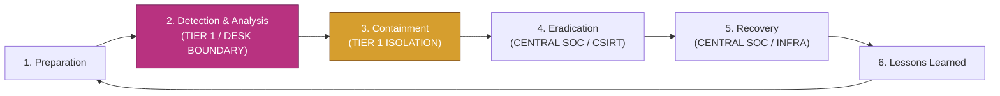

- **The Desk vs. SOC Responsibility Matrix:**

| Phase / Action | Tier 1 Service Desk Role (Ethan) | Central SOC / CSIRT Role (Nia Alvarez) |
| :--- | :--- | :--- |
| **Initial Symptoms** | Log observables, gather user context, verify symptoms. | Monitor enterprise SIEM/EDR telemetry for correlating alerts. |
| **Classification** | Identify when ticket exceeds standard SOP; halt routine closing. | Declare formal Incident Severity level (SEV-1 through SEV-4). |
| **Containment** | Execute approved physical/network isolation; preserve power. | Isolate enterprise firewalls, revoke Kerberos tickets, block egress. |
| **Forensics** | Maintain physical chain of custody; document timestamps. | Pull memory dumps, analyze kernel rootkits, reverse-engineer malware. |
| **Communication** | Enforce "Need-to-Know"; prevent unauthorized Slack panic. | Manage legal, regulatory, executive, and public communications. |

#### 4. Procedural Information (JIT SOPs)
- **The Formal Security Escalation Note Template:**
  ```markdown
  ### SECURITY INCIDENT ESCALATION (TIER 1 -> CENTRAL SOC)
  - **Date/Time:** YYYY-MM-DD HH:MM PST
  - **Escalating Tech:** Ethan Brooks (Lead Tier 1)
  - **Receiving Lead:** Nia Alvarez (Central SOC / CSIRT)
  - **Incident Type:** Suspected Ransomware / Active Lateral Movement
  - **Severity Proposed:** SEV-1 (Critical Enterprise Impact)
  
  #### 1. Executive Summary
  Brief 2-3 sentence statement of what happened, scope, and operational impact.
  
  #### 2. Affected Assets & Users
  - Hostnames: [e.g., PDX-ACC-014, PDX-ACC-019]
  - IP Addresses & VLANs: [e.g., 10.200.12.14, VLAN 24]
  - User Accounts: [e.g., d.morales, s.chen]
  
  #### 3. Observable Indicators of Compromise (IoCs)
  - File Hashes (SHA-256): [e.g., a8f3c... in C:\ProgramData\update.exe]
  - Network Connections / IPs: [e.g., Outbound connection to 185.220.101.5 on TCP 4444]
  - Malicious Artifacts: [e.g., Ransom note 'RESTORE_FILES.txt' dropped on S:\Shared]
  
  #### 4. Immediate Containment Actions Taken
  - [x] Physical network cables pulled on affected endpoints (Power left ON).
  - [x] Compromised user AD accounts disabled and Kerberos tickets revoked.
  - [x] Network share \\pdx-fs01\accounting unmounted and set to Read-Only.
  
  #### 5. Chain of Custody & Physical Evidence
  - Laptop PDX-ACC-014 impounded, tagged, and locked in Evidence Locker B.
  - Key held by: Ethan Brooks.
  ```

#### 5. Part-Task Practice Micro-Drills
- **Drill 12.1:** Event vs. Incident Classification: Given 10 real-world ticket scenarios, categorize each within 60 seconds as either *Standard Event (Handle at Tier 1)* or *Security Incident (Escalate Immediately)*.
- **Drill 12.2:** Chain of Custody Form Execution: Fill out a formal evidence custody log (item description, serial number, source, releasing tech, receiving tech, reason, date/time) without omissions.

#### 6. Ethan & Jules Dialogue Beat
> *"The whole accounting share is turning into files with the extension '.locked'," I said. My voice was higher than usual. The ticket queue was blowing up.*  
> *"Breathe," Jules said. Her voice was steady, like an anchor dropped in mud. "What was your first impulse?"*  
> *"Reboot the server. Reimage the PCs."*  
> *"If you reboot, you kill the memory. If you kill the memory, Central SOC can't pull the encryption keys or the inject point. Call the floor: tell everyone on that switch to pull the network cable out of the wall right now. Do not touch the power buttons."*  
> *She stood up, walked to the cabinet, and grabbed two evidence bags. "Now open the escalation template. We don't write panic; we write facts. Hostnames, timestamps, hashes, IPs. Nia Alvarez is running the incident bridge downstairs. She doesn't need our adrenaline, Ethan. She needs our evidence. Let's give her a clean handoff."*

---

## 5. The "Commit Before You Touch" (CBYT) Triage Algorithm

### 5.1 Cognitive Science Foundation
Novice technicians suffer from **trial-and-error bias**: they execute commands without knowing what the output should look like, hoping that something in the terminal will magically explain the problem. This increases cognitive load, creates noise, and often exacerbates system damage.

The **"Commit Before You Touch" (CBYT)** algorithm is a cognitive forcing function rooted in dual-process theory (Kahneman's System 1 vs. System 2). It forces the technician to engage deliberative, analytical reasoning *before* taking action.

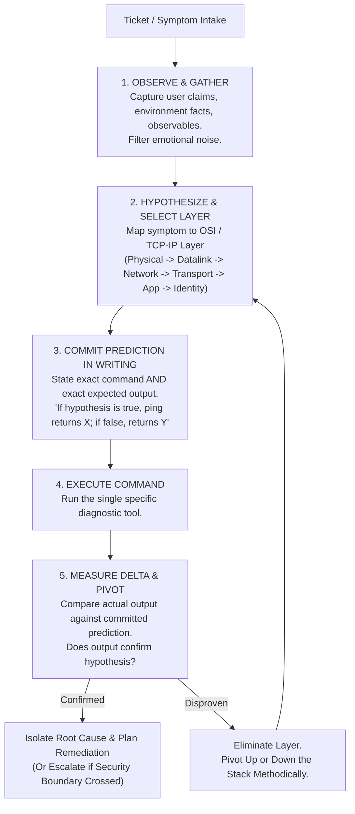

### 5.2 The 5 Steps of CBYT in Practice

#### Step 1: Observe & Gather
- Strip away user interpretation (*"the server is on fire"*, *"the internet is down"*).
- Isolate observable technical symptoms (*"workstation cannot resolve internal hostname"*, *"HTTP error 502"*, *"NIC link light amber"*).
- Document scope: Is it one user, one switch, one subnet, or the entire building?

#### Step 2: Hypothesize & Select Layer
- Select the most probable layer of failure based on scope:
  - *Single machine, no link light:* Layer 1 (Physical).
  - *Single machine, link light active, 169.254.x.x IP:* Layer 2/3 (DHCP / VLAN).
  - *Can ping IP but cannot open hostname:* Layer 7 (DNS / Name Resolution).
  - *Can open web pages but cannot authenticate:* Layer 7 (Authentication / Kerberos / AD).

#### Step 3: Commit Prediction in Writing (The Forcing Gate)
- **The Rule:** The technician must state the command and the *expected output* before pressing Enter.
- *Template:*
  $$\textbf{Prediction:} \quad \text{Running } [\text{command}] \text{ will return } [\text{output}] \text{ because } [\text{causal reason}].$$
- *Example:* *"I will run `ping 10.0.4.1`. If my hypothesis that the switch port VLAN is broken is correct, it will return `Request timed out`. If it returns a reply, Layer 2/3 is healthy, and the problem must be higher up the stack."*

#### Step 4: Execute Command
- Run the single, isolated command. Do not chain multiple unrelated commands together.

#### Step 5: Measure Delta & Pivot
- Compare the actual terminal text against the written prediction:
  - If actual matches prediction $\rightarrow$ Hypothesis strengthened; proceed down causal path.
  - If actual conflicts with prediction $\rightarrow$ Hypothesis falsified; systematically pivot to the adjacent layer.

---

## 6. Formal Milestone Gates

The curriculum features two high-stakes milestone gates that test whether students have internalized the cognitive discipline of the help desk.

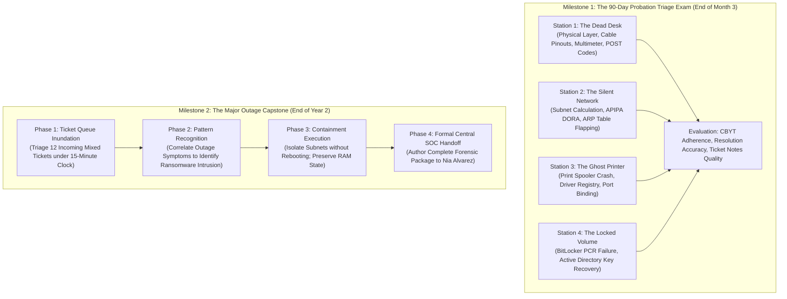

### 6.1 Milestone Gate 1: The 90-Day Probation Triage Exam
- **Narrative Context:** Ethan’s 90-day probationary review at the Portland Desk. Jules sits across the testing bench with a clipboard. Ethan must pass 4 timed diagnostic stations to earn his permanent badge.
- **Structure:** 4 practical hands-on stations, 20 minutes per station.
- **Station Breakdown:**
  1. **Station 1 (Hardware/Power):** Workstation will not power on. Diagnose bad 12V rail on ATX PSU using multimeter; differentiate from stuck power button.
  2. **Station 2 (IP Plumbing):** Laptop cannot reach file server. Diagnose off-by-one subnet mask (`/27` vs `/28`); resolve without breaking static gateway.
  3. **Station 3 (OS/Services):** Critical print spooler continuously terminating. Clean corrupted spool directory and repair registry hive without rebooting.
  4. **Station 4 (BitLocker/Identity):** Blue recovery screen on updated laptop. Locate key in Active Directory, verify TPM status, and safely boot system.
- **Pass Criteria:**
  - 100% adherence to CBYT protocol (written prediction before every command).
  - Accurate technical resolution on at least 3 of 4 stations.
  - Complete, professional ticket resolution notes meeting Rubric 1 standards.

### 6.2 Milestone Gate 2: The Major Outage Capstone
- **Narrative Context:** End of Ethan's second year. Jules is out of the office attending an IT disaster planning conference. Ethan is acting Lead Tier 1. At 09:15, a catastrophic cascade hits East Portland operations.
- **Structure:** 90-minute real-time simulation.
- **Phases:**
  1. **Queue Triage (0–20 min):** 12 incoming tickets ranging from mundane printer jams to alarming file share errors. Ethan must correctly triage priority and spot the common thread.
  2. **Intrusion Correlation (20–40 min):** Recognize that the "network slowdown" is actually lateral movement of a ransomware strain exploiting SMB and compromised domain service accounts.
  3. **Containment Command (40–60 min):** Direct the junior team to physically isolate switch segments, revoke compromised Kerberos credentials, and halt automated imaging scripts that would overwrite evidence.
  4. **The SOC Handoff (60–90 min):** Compile and deliver the formal incident triage package to Central SOC Incident Commander **Nia Alvarez**. Defend findings and containment decisions during an oral briefing.
- **Pass Criteria:**
  - Successfully halt malware lateral movement without turning off endpoint power.
  - Zero unforced errors (no mass reboots, no unverified Slack announcements).
  - Formal Escalation Package achieves $\ge 90\%$ on Rubric 2.

---

## 7. Performance Evaluation Rubrics

### 7.1 Rubric 1: Tier 1 Ticket Resolution Notes
Used across all 12 modules to evaluate standard ticket documentation.

| Evaluation Dimension | Level 1: Deficient (Unacceptable) | Level 2: Developing (Novice) | Level 3: Proficient (Standard) | Level 4: Exemplary (Lead Tier 1) |
| :--- | :--- | :--- | :--- | :--- |
| **1. Problem Statement & Scope** | Vague or emotional (*"User's computer was broken, fixed it."*). No asset or user details. | Mentions user name and symptom, but omits device hostname, IP, or physical location. | Clearly states user, asset hostname, physical location, and objective technical symptom. | Precise technical problem definition, scope (single vs. multi-user), and impact on business operations. |
| **2. Diagnostic Steps & CBYT** | Random actions listed; no clear causal flow; no CLI output recorded. | Lists commands run, but does not explain rationale or state what outputs meant. | Methodical sequence of diagnostic steps following CBYT; key CLI outputs documented. | Flawless diagnostic flow showing systematic elimination of OSI layers; records exact command deltas. |
| **3. Root Cause Analysis (RCA)** | No root cause identified (*"It started working again."*). | States what fixed it, but confuses the symptom with the underlying root cause. | Correctly isolates the specific technical failure (e.g., stale DNS cache, driver crash). | Identifies root cause and contextual trigger (e.g., update conflict, DHCP lease exhaustion). |
| **4. Resolution & Verification** | Fix undocumented or unsafe (e.g., turned off firewall). No verification. | Fix documented, but verification is subjective (*"User said it looked fine."*). | Clearly documents corrective action taken; verifies functionality with objective test. | Complete remediation documented; includes post-fix regression test and preventative adjustment. |
| **5. Professional Tone & Hygiene** | Uses slang, expresses frustration with user, leaves typos and jargon unformatted. | Overly casual tone; minor formatting issues; exposes internal system passwords. | Professional, objective, customer-centric tone; proper formatting of commands and paths. | Impeccable professional documentation; reusable as a knowledge base article for other techs. |

---

### 7.2 Rubric 2: Formal Security Escalation Note
Used in Modules 05, 06, 09, 10, 11, and 12 to evaluate handoffs to Central SOC / CSIRT.

| Evaluation Dimension | Level 1: Deficient (Unacceptable) | Level 2: Developing (Novice) | Level 3: Proficient (Standard) | Level 4: Exemplary (SOC-Ready) |
| :--- | :--- | :--- | :--- | :--- |
| **1. Incident Classification & Severity** | Confuses routine break/fix with security incident, or severely underestimates threat. | Identifies security incident, but cannot articulate appropriate severity level. | Correctly classifies incident type and recommends realistic severity (SEV-1 to SEV-3). | Precise classification (e.g., Ransomware, BEC, Insider); justifies severity with business risk. |
| **2. Timeline & Chronology** | No timestamps provided; chronological order is backwards or disordered. | Timestamps included, but missing critical event markers (e.g., first alert vs isolation). | Detailed chronological timeline with timestamps (PST/UTC) from first observable to handoff. | Microsecond-accurate timeline correlating user report, endpoint logs, and network egress telemetry. |
| **3. Indicators of Compromise (IoCs)** | Vague descriptions (*"weird file," "strange IP"*); no hashes or specific paths. | Lists a file name or IP, but fails to provide cryptographic hashes or defanged URLs. | Documents specific SHA-256 hashes, defanged domains/IPs, registry keys, and port numbers. | Comprehensive, machine-parsable IoC table; categorizes artifacts by MITRE ATT&CK technique. |
| **4. Containment Actions Taken** | Destructive actions taken (wiped machine, rebooted, cleared logs) or no containment. | Partial containment (disabled Wi-Fi but left Ethernet connected, or powered off host). | Safe, non-destructive containment executed (network cable pulled, power maintained). | Flawless containment across network, identity, and storage layers without destroying volatile evidence. |
| **5. Chain of Custody & Actionable Handoff** | Hardware left unattended; no custody log; no clear request for SOC action. | Hardware stored, but chain of custody tag is missing or incomplete; vague next steps. | Evidence physically secured, tagged, and logged; articulates concrete next actions for SOC. | Impeccable forensic chain of custody; provides organized package with RAM state, logs, and artifacts. |

---

### 7.3 Exemplar Benchmarks: Ticket Notes & Escalations

#### Benchmark A: Tier 1 Ticket Resolution Note (Module 04: DNS Triage)

##### Deficient Example (Level 1)
```
Ticket: INC-4091
User called saying the intranet was broken. Told her to restart her computer. She restarted and it still didn't work. I ran some ping commands and flushed something. Working now. Closed ticket.
```

##### Exemplary Example (Level 4)
```markdown
### TICKET RESOLUTION REPORT
- **Ticket ID:** INC-2026-4091
- **User:** Karen Vance (Planning Dept, Rm 302)
- **Asset:** PDX-PLN-W11-042 (10.200.14.68, VLAN 14)
- **Classification:** Network Services / Name Resolution (DNS)
- **Priority:** Medium (Single User Workstation)

#### 1. Problem Description
User reported inability to access the internal GIS planning portal (`https://gis.portlandoregon.local`). Browser returned `ERR_NAME_NOT_RESOLVED`. Other general internet browsing (e.g., `google.com`) was functioning normally.

#### 2. Diagnostic Steps & CBYT Triage
- **Hypothesis:** Local client DNS resolver cache contains a stale or negative record following yesterday's GIS server migration.
- **Commit:** Running `nslookup gis.portlandoregon.local` against local DC (`10.0.0.2`) will return valid IP `10.200.50.88`, while `ipconfig /displaydns` will show a negative response entry.
- **Execution & Findings:**
  1. `nslookup gis.portlandoregon.local 10.0.0.2` returned authoritative IP `10.200.50.88` immediately.
  2. `ipconfig /displaydns` revealed a cached `Record Name: gis.portlandoregon.local` entry with `TTL: 1140` pointing to decommissioned IP `10.200.50.12`.
  3. Identified root cause: Client had cached the old A-record prior to TTL expiration.

#### 3. Corrective Actions Taken
- Flushed local client resolver cache: `ipconfig /flushdns`.
- Re-registered DNS bindings: `ipconfig /registerdns`.
- Verified immediate resolution via `ping -n 1 gis.portlandoregon.local` resolving to `10.200.50.88`.

#### 4. Verification & User Confirmation
Navigated to `https://gis.portlandoregon.local` in Chrome and Edge. GIS mapping portal loaded completely. User successfully opened the 2026 Zoning Overlay map. Confirmed resolution with Karen Vance before closing.
```

---

#### Benchmark B: Formal Security Escalation Note (Module 10: Phishing & BEC)

##### Deficient Example (Level 1)
```
Hey SOC,
Got a phishing email from someone saying they are the Mayor. It looks fake. User almost clicked it. Can you block it? Thanks, Ethan.
```

##### Exemplary Example (Level 4)
```markdown
### FORMAL SECURITY INCIDENT ESCALATION (TIER 1 -> CENTRAL SOC)
- **Date/Time Submitted:** 2026-10-18 10:45 PST
- **Escalating Technician:** Ethan Brooks (Lead Tier 1 Service Desk)
- **Receiving Lead:** Nia Alvarez (Central SOC / CSIRT Incident Commander)
- **Incident Classification:** Business Email Compromise (BEC) / Executive Impersonation
- **Proposed Severity:** SEV-2 (High Potential Impact / Financial Target)

---

#### 1. Executive Summary
At 10:15 PST, Housing Authority Executive Assistant Marcus Bell received an urgent email purporting to be from City Commissioner Dan Ryan requesting an immediate off-cycle wire transfer of $48,500 to an unverified vendor account. Marcus contacted the help desk via phone before taking financial action. Triage of the raw message headers confirms deliberate display name spoofing, failed DMARC alignment, and an originating server in an unauthorized foreign IP block.

#### 2. Affected Assets & Accounts
- **Target User:** Marcus Bell (`m.bell@portlandoregon.gov`)
- **Impersonated Identity:** Commissioner Dan Ryan (`dan.ryan@portlandoregon.gov`)
- **Recipient Workstation:** PDX-HOU-LT08 (10.200.22.45, VLAN 22)
- **Mailbox:** Exchange Online (Tenant: `portlandoregon.onmicrosoft.com`)

#### 3. Observable Indicators of Compromise (IoCs)
- **Visible From Header:** `Commissioner Dan Ryan <dan.ryan.pdx.gov@mail-server-direct.com>`
- **Envelope Sender (Return-Path):** `bounce@mail-server-direct.com`
- **Originating Public IP:** `185.220.101.44` (Reverse DNS: `tor-exit-node.example.org`)
- **Authentication Results:**
  - `SPF:` Fail (IP `185.220.101.44` not in SPF record for `portlandoregon.gov`)
  - `DKIM:` None (No cryptographic signature present)
  - `DMARC:` Fail (Action: quarantined to Junk folder)
- **Extracted Malicious Link:** `hxxps://secure-portland-invoice-review[.]top/auth/login.php?user=m.bell`
- **Target Bank Account Details:** First Horizon Trust, Routing: `061000104`, Account: `8840192451`

#### 4. Immediate Containment Actions Taken
- [x] Extracted raw email file saved as `artifacts/phish_20261018_mbell.eml` and defanged.
- [x] Hard-deleted malicious email from Marcus Bell's mailbox via Security & Compliance PowerShell.
- [x] Ran tenant-wide message trace (`MessageTraceID: 8fa23b91-4412-4c28-912b-102938475610`); discovered 3 identical emails delivered to other executive assistants in Parks & Recreation.
- [x] Executed compliance purge on the 3 identified secondary mailboxes.
- [x] Inspected Marcus Bell's mailbox rules; zero unauthorized forwarding or inbox redirect rules present.

#### 5. Actionable Requests for Central SOC
1. Add domain `mail-server-direct.com` and IP `185.220.101.44` to tenant-wide perimeter blocklist.
2. Submit phishing URL `hxxps://secure-portland-invoice-review[.]top` to threat intelligence feeds.
3. Verify whether any users clicked the phishing link prior to mailbox purge (query EDR web telemetry for the defanged domain).

**Evidence Custody:** Raw `.eml` container encrypted and placed in SOC secure share: `\\pdx-soc01\intake\20261018_INC-9402\`.
```

---

## 8. Implementation Roadmap & Technical Tooling

### 8.1 Dual-Track Repository Integration
Each of the 12 modules will be realized within `examples/<unit_id>/` following the proven Learning Narrative Kit structure:

```
examples/<unit_id>/
  ├── unit.yaml          # Metadata, certification mapping, learning objectives, prerequisites
  ├── glossary.yaml      # Exam-tier (SY0-701/N10-008) and support-tier definitions
  ├── narrative.md       # First-person story: Ethan & Jules on the desk shift (~2500 words)
  ├── workbench.md       # Operational workbench: Rules of engagement, micro-drills, deliverables
  ├── review.yaml        # Review deck questions (flashcards, multi-step scenario items)
  └── artifacts/         # Live simulated artifacts (tickets, terminal dumps, event logs, raw headers)
```

### 8.2 Live Support Telemetry Generation
Simulated technical artifacts will be programmatically generated via `tools/generate_helpdesk_artifacts.py` to ensure high technical accuracy:
- **Terminal Dumps:** Authentic command outputs for `ipconfig /all`, `arp -a`, `nslookup`, `netstat -ano`, `route print`, `manage-bde`, and `Get-WinEvent`.
- **System Event Logs:** Windows EVTX and parsed XML dumps featuring Event IDs 4624, 4625, 4740, 7045, and 1102 with authentic sub-status codes.
- **Email Raw Files:** RFC 5322 compliant `.eml` files with complete `Received` headers, DKIM cryptographic headers, and defanged phishing links.
- **Packet Captures:** Wireshark-compatible terminal text dumps showing TCP three-way handshakes, cleartext Telnet streams, DNS recursion queries, and 802.1X EAP authentication.

### 8.3 The Bridge to the Central SOC
Module 12 serves as the launchpad into **Central SOC incident response**. The separate Network Analyst Development Framework course is an optional next step for reading packet captures. It tells a different story with different characters. 

When students complete Module 12, they have not merely passed a certification test; they have stepped into the shoes of a seasoned Lead Tier 1 technician who understands how to operate in a high-stakes environment without panicking, how to defend their diagnostic choices using the CBYT algorithm, and how to deliver actionable, forensic-grade intelligence to Central SOC Commander **Nia Alvarez**.

---

*Curriculum Architecture Document Author:* Senior Technical Instructional Designer & Curriculum Architect  
*Reference Standard:* CompTIA A+ / Network+ / Security+ (SY0-701) & 4C/ID whole-task design  
*Location:* `C:\Users\charl\learning-narrative-kit\docs\research\PORTLAND_CURRICULUM_PLAN.md`
