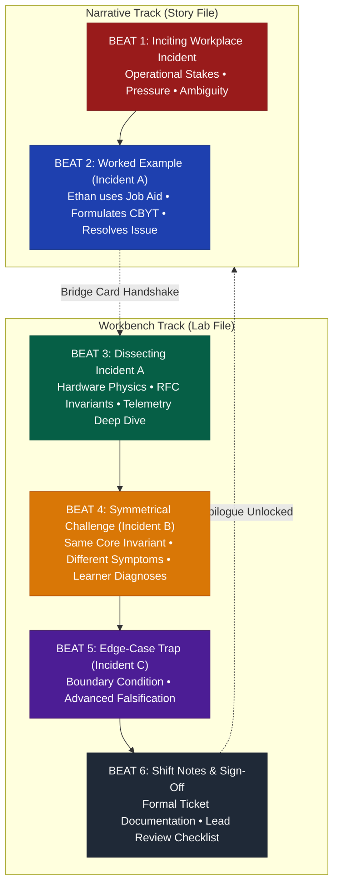
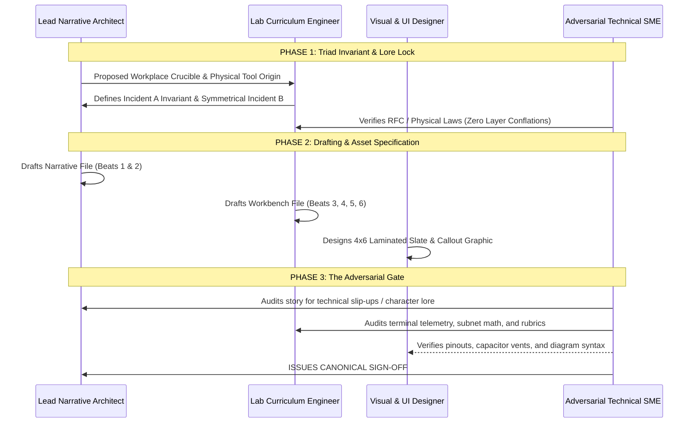

# Master Storyline-to-Workbench Synchronization Specification
## The Pedagogical, Technical, and Narrative Synchronization Standard for the Portland Desk (Modules 00–12)

> **Document Status:** Active standard for story and workbench sync. Story facts here lose to `PORTLAND_TIMELINE.md` and `PORTLAND_AUTHOR_BIBLE.md` (see `AGENTS.md` precedence).  
> **Target System:** Portland Desk Courseware (`learning-narrative-kit`)  
> **Authors:** Principal Technical Instructional Designer & Curriculum Architect, Lead Narrative Architect, Adversarial Technical SME & Protocol Pedant (`technical_nitpicker`)  
> **Theoretical Framework:** 4C/ID Model (van Merriënboer), Cognitive Load Theory (Sweller), Deliberate Practice (Ericsson), Cognitive Apprenticeship (Collins, Brown, & Holum), Recognition-Primed Decision (Klein), Minimum Information Principle (Wozniak)  
> **Governing Standards:** RFC 793/9293 (TCP), RFC 826 (ARP), RFC 2131/2132 (DHCP), RFC 1035/2308/6762 (DNS), RFC 5321/5322/7208/6376/7489 (Email/MIME/SPF/DKIM/DMARC), RFC 3227 (Evidence Volatility), IEEE 802.1Q / 802.1w / 802.1X / 802.11, ATX12V 2.52, NIST SP 800-63B.

---

## 1. Executive Summary & The Core Mandate

### 1.1 The User Mandate
> *"We need to have the same rigor for all storyline sync with workbench/job aid/learning tools. Please continue to run this past the appropriate adversarial SMEs to make sure we don't have to go back and forth with rework on this."*

In high-stakes technical training, narrative fiction and hands-on simulation frequently diverge. When a story depicts a technician performing miraculous, unexplained intuitions while the companion laboratory asks the student to perform disconnected procedural clicks, both learning channels fail:
1. **The Fiction Becomes "Tech Magic":** The narrative protagonist appears to have superhuman diagnostic powers, reinforcing the destructive belief that "real engineers just know what to do."
2. **The Lab Becomes "Mechanical Compliance":** The student enters the workbench stripped of operational stakes, mindlessly copying CLI commands from a cheat sheet without understanding the underlying physical invariants.
3. **The Tools Materialize from Thin Air:** Diagnostic slates, cheat sheets, and scripts appear in the learner's toolkit without physical provenance, breaking narrative immersion and denying the learner the metacognitive tradecraft of how operational tools are constructed.

### 1.2 The Synchronized Solution
This specification establishes the permanent architectural handshake across the entire 13-module Portland Desk curriculum. Every module operates as an unbreakable, bi-directional pedagogical circuit:

```
┌────────────────────────────────────────────────────────────────────────────────────────┐
│                        THE 4-BEAT STORY-TO-WORKBENCH PROGRESSION                       │
├───────────────────────────────────┬────────────────────────────────────────────────────┤
│ IN-STORY (The Narrative)          │ IN-WORKBENCH (The Laboratory)                      │
├───────────────────────────────────┼────────────────────────────────────────────────────┤
│ BEAT 1: Inciting Workplace Event  │ BEAT 3: Dissecting Incident A                      │
│ • Production pressure & stakes    │ • Ground-truth physics & RFC invariants            │
│ • Ambiguous failure symptoms      │ • Deep telemetry analysis & binary search          │
├───────────────────────────────────┼────────────────────────────────────────────────────┤
│ BEAT 2: Worked Example (Inc. A)   │ BEAT 4: Symmetrical Ticket B (The Core Challenge)  │
│ • Ethan applies physical Job Aid  │ • Exact SAME underlying invariant as Incident A    │
│ • CBYT hypothesis formulation     │ • Completely DIFFERENT surface symptoms            │
│ • Stepwise diagnostic resolution  │ • Learner executes diagnosis autonomously          │
├───────────────────────────────────┼────────────────────────────────────────────────────┤
│ FLASHCARD QUARANTINE:             │ BEAT 5: Edge-Case Trap (Incident C - Advanced)     │
│ • Red Band Passport trivia        │ • Boundary condition where naive heuristics fail   │
│ • Under-10s atomic recall         ├────────────────────────────────────────────────────┤
│ • Zero procedural pollution       │ BEAT 6: Shift Notes & Lead Sign-Off Rubric         │
│ • Interleaved multi-module review │ • Intake notes, verification proof, lead checklist │
└───────────────────────────────────┴────────────────────────────────────────────────────┘
```

---

## 2. The Physical Genesis of Learning Tools (Ethan's Toolkit Lore)

To ground the learner in authentic operational tradecraft, **every single learning tool, job aid, and piece of hardware Ethan uses must possess explicit, tactile, narrative provenance**. Ethan does not magically invent tools; he scavenges scrap, learns shop heuristics from older blue-collar mentors, and manufactures his own job aids at low-cost print shops along SE 82nd Avenue in Portland.

```
┌────────────────────────────────────────────────────────────────────────────────────────┐
│                             ETHAN'S SCAVENGED TOOLKIT LORE                             │
├───────────────────┬───────────────────────────┬────────────────────────────────────────┤
│ Tool / Artifact   │ Narrative Provenance      │ Physical Spec & Production Method      │
├───────────────────┼───────────────────────────┼────────────────────────────────────────┤
│ The Red Band   │ Salvaged from Gresham     │ 3x5 unruled white index cards ($1.49 / │
│ "Passport Deck"   │ cross-dock clipboard      │ 100pk at Walgreens on SE 82nd Ave).    │
│                   │ scraps & lunch-break cram.│ Handwritten with fine-point black Bic. │
│                   │ Metacognitive quarantine. │ Held by thick red produce rubber band. │
├───────────────────┼───────────────────────────┼────────────────────────────────────────┤
│ The 4x6 Job    │ Derived from father's     │ 65lb heavy cardstock printed at FedEx  │
│ Aids ("The        │ machine shop setup sheets │ Office counter on SE 82nd ($0.23/page);│
│ Slates")          │ and Hank's clipboards.    │ edge-laminated with 2" Scotch packing  │
│                   │                           │ tape; trimmed with Olfa 9mm snap knife.│
├───────────────────┼───────────────────────────┼────────────────────────────────────────┤
│  Secondhand     │ Bought for $65 cash in    │ Lenovo ThinkPad T430 (2012), scuffed   │
│ Practice Laptop   │ Fred Meyer parking lot    │ magnesium lid, missing battery latch,  │
│                   │ off 82nd & Foster.        │ dual-boot Windows 10 refurb / Linux.   │
├───────────────────┼───────────────────────────┼────────────────────────────────────────┤
│  E-Waste Test   │ Salvaged from scrap bin   │ OEM LGA 1150 green microATX PCB; blown │
│ Motherboard       │ behind Harrowmere freight │ 6.3V 1500µF capacitors; snapped white  │
│                   │ warehouse off Division.   │ plastic RAM retention latch from dark. │
├───────────────────┼───────────────────────────┼────────────────────────────────────────┤
│ Cheap Digital   │ Bought for $14.99 at      │ Cen-Tech 7-function digital DMM, stiff │
│ Multimeter        │ Harbor Freight on SE 82nd │ PVC test leads, battery hatch taped    │
│                   │ and Powell Blvd.          │ with blue painter's tape; measures 5V. │
└───────────────────┴───────────────────────────┴────────────────────────────────────────┘
```

### 2.1 The Red Band "Passport Deck" (3x5 Index Cards)
- **Origin:** During his six weeks picking up graveyard cross-dock shifts after failing his first exam with a 592, Ethan spent his 15-minute breaks at a break-room picnic table copying textbook definitions onto cheap index cards.
- **Physical Characteristics:** 3x5 unruled index cards, edges frayed from being crammed into the hip pocket of Carhartt work pants. Handwritten in hurried, precise black Bic ballpoint ink.
- **The Quarantine Metaphor:** Fished a thick red rubber band from a bunch of supermarket celery in the kitchen mug. Into this bundle go the arbitrary, vendor-specific, disposable facts: pin counts, optical cable distance limits, laser printer drum charge voltages (-600V), and USB 3.2 Gen 2x2 transfer speeds.
- **Cognitive Rule:** *The Red Band is quarantined.* It is drilled for under-10-second rapid retrieval to pass the HR certification filter, and deliberately segregated from procedural troubleshooting so it does not clutter operational judgment.

### 2.2 The 4x6 Packing-Tape Laminated Job Aids ("The Slates")
- **Origin:** Inspired by his father Jules' grease-stained machine shop setup sheets and conveyor mechanic Hank's laminated wiring clipboards.
- **Physical Production Method:** Ethan formats clean two-column decision tables on his secondhand laptop, saves them to a USB flash drive, and walks into the 24-hour FedEx Office on SE 82nd Avenue (near Eastport Plaza) at 6:30 AM after his shift. He prints them on 65lb white cardstock for $0.23 per page. 
- **Lamination Technique:** Unable to afford commercial heat-lamination pouches, Ethan buys a $3.49 roll of 2-inch Scotch heavy-duty packaging tape from the drugstore. At the kitchen table, he overlaps two strips of packaging tape across the front and back of each card, burnishes out the air bubbles with the edge of a plastic library card, and trims the clear plastic borders using his father's Olfa 9mm snap-off utility knife.
- **Field Use:** Ethan carries these 4x6 cards in his back pocket or tucks them behind his clipboard. He writes real-time telemetry, IP addresses, and voltage measurements on the tape surface using an ultra-fine Expo dry-erase marker, wiping it clean with an oily blue shop rag.

### 2.3 The Secondhand Laptop
- **Origin:** Ethan's primary digital workbench. Purchased for $65 cash from a Craigslist seller in the rain-slicked parking lot of the Fred Meyer on SE 82nd and Foster.
- **Physical Characteristics:** A 2012 Lenovo ThinkPad T430 with 8GB of DDR3 RAM and a 128GB SATA SSD. The exterior lid is gouged; the left battery release latch is snapped off (requiring a strip of duct tape to keep the 6-cell battery seated); the webcam lens is covered by a small square of black electrical tape. The trackpoint nub is worn smooth.
- **Operational Role:** Runs a dual-boot setup: Windows 10 Pro (refurbished OEM license) and Linux Mint. Used for offline RFC reading, PowerShell command testing, Wireshark packet capture analysis, PuTTY serial terminal emulation, and ping ladder testing.

### 2.4 The E-Waste Test Motherboard
- **Origin:** Pulled directly out of the metal e-waste recycling roll-off dumpster behind the Harrowmere freight logistics facility on Division Street three weeks before Episode 00.
- **Physical Characteristics:** An OEM microATX green PCB (LGA 1150 socket). Ethan cracked one of the white nylon RAM retention latches when forcing a DDR3 module in backwards in poor light. Adjacent to the CPU socket, two 6.3V 1500µF electrolytic capacitors have domed tops with crusty, dried brown electrolyte residue leaking from the scored vent seams, beside one flat, healthy capacitor.
- **Operational Role:** Ethan's physical tactile anatomy model on the kitchen table. It is where his father uses the water glass to explain voltage ripple, bus state, and mechanical invariants.

### 2.5 The Cheap Multimeter
- **Origin:** Purchased for $14.99 with coupon at the Harbor Freight Tools on SE 82nd and Powell Boulevard.
- **Physical Characteristics:** Cen-Tech 7-Function Digital Multimeter encased in a garish yellow rubberized protective boot. The probe leads are stiff, cheap PVC that freeze rigid in unheated Portland warehouses. The 9-volt battery cover is secured with blue painter's tape because the plastic retaining clip snapped on day two.
- **Operational Role:** Measures DC voltage rails on 24-pin ATX connectors, tests fuse continuity, checks PoE phantom power, and verifies ground reference. Hank teaches Ethan: *"The meter doesn't lie, but it only answers the exact question you ask it."*

### 2.6 Mentor Provenance: Jules Brooks & Hank
- **Jules Brooks (Father, 61):** Retired precision toolmaker (34 years across East Portland machine shops; smells of cutting oil, wool, and sawdust). Imparts the foundational mental models:
  - *"Don't memorize the McMaster-Carr parts catalog; understand what moves, what holds tension, and what carries work across the gap."*
  - *"A machine has no magic. If the power supply delivers dirty water, the processor cannot hold state."*
  - *"Always stone the burrs off your stock before measuring."* (Verify the physical foundation before debugging software).
- **Hank (Warehouse Graveyard Maintenance Mechanic, 58):** Chain-smoking conveyor mechanic in worn denim bib overalls with a battered Simpson 260 analog meter. Imparts raw operational triage:
  - *"The box ain't psychic. Power comes in, signal goes out. If the copper don't have a clean reference to ground, the whole damn circuit is blind."*
  - *"Never touch three adjustments at once out of nervous panic. Turn one screw, measure the change, and write it down."*

---

## 3. The 4-Beat Story-to-Workbench Progression (The Universal Engine)

Every module across the Portland Desk follows a rigorous 6-beat instructional architecture that tightly binds dramatic narrative stakes to empirical technical mastery:



### Beat 1: The Inciting Workplace Incident (In Story)
- **Narrative Function:** Establishes authentic operational pressure, human stakes, and business urgency. 
- **The Constraints:** Real deadlines (e.g., 05:00 AM dispatch bell, cross-dock conveyor line halt, payroll processing cutoff, medical records system freeze). The user is frustrated or anxious; business revenue or physical safety is on the line.
- **Anti-Pattern Guard:** Avoid sterile textbook question setups (*"Alice wants to connect to a file server..."*). The problem must present with dirty, confusing real-world symptoms (flashing amber lights, garbled ASCII scale strings, locked user accounts, burning dust smell).

### Beat 2: The Worked Example / Incident A (In Story)
- **Narrative Function:** Ethan models disciplined tradecraft under the watchful eye of a mentor (Jules, Hank, Maya Lin, or Lead Engineer).
- **The Protocol:**
  1. Ethan does **not** guess or wildly click settings.
  2. Ethan pulls out his physical **4x6 Laminated Job Aid (Slate)** and reviews the triage tree.
  3. Ethan formulates a explicit **Commit-Before-You-Touch (CBYT)** hypothesis: *"If theory X is true, then command/test Y must output Z."*
  4. Ethan executes the simplest, least-invasive test (binary search / ping ladder / voltage check).
  5. Telemetry confirms root cause; Ethan implements the minimal reversible fix.
- **Pedagogical Rationale:** Leverages John Sweller's **Worked Example Effect**. Early learners lack internal cognitive schemas; observing an expert or guided apprentice trace the causal chain prevents working memory overload and builds schema foundations.

### Beat 3: Dissecting Incident A (In Workbench Section 2)
- **Workbench Function:** Breaks down the worked example with uncompromising technical depth.
- **The Scope:**
  - Decomposes the underlying hardware physics, packet frame anatomy, or protocol state machine (referencing governing RFCs, IEEE standards, or hardware signal specs).
  - Analyzes the exact CLI telemetry, register dumps, or wire captures that Ethan observed in the story.
  - Formulates the exact **Job Aid / Slate** layout that governed the decision, explaining *why* the decision tree was ordered from least invasive to most invasive.

### Beat 4: The Symmetrical Challenge / Incident B (In Workbench Section 3)
- **Workbench Function:** Hands the operational controls entirely to the learner.
- **The Invariant Rule:** Ticket B shares the **EXACT SAME underlying technical invariant** as Incident A, but presents with **COMPLETELY DIFFERENT surface symptoms, user descriptions, and error codes**.
  - *Example:* If Incident A was a Layer 3 Default Gateway failure causing internet drops while local intranet pings succeeded, Incident B cannot be another "internet drop" on a desktop. Incident B must be a warehouse network scale that can reach the local dispatch server but cannot reach the cloud shipping API, or a backup agent failing to upload offsite archives while local network shares remain green.
- **The Learner's Task:** The learner must pull up the exact same 4x6 Job Aid used in Incident A, formulate their own CBYT prediction in the browser scratchpad, inspect the simulated terminal telemetry, and document the root cause.

### Beat 5: The Edge-Case Trap / Incident C (In Workbench Section 3 - Extension)
- **Workbench Function:** Adversarial stress-testing for advanced learners.
- **The Trap:** Introduces a confounding variable or boundary condition where naive, rote application of the Job Aid produces a false positive or breaks the system.
  - *Example:* If the Job Aid states *"Thermal shutdown occurs at 100°C,"* Incident C presents a CPU locked at 0.79 GHz at only 42°C due to an Intel BD PROCHOT (Bi-Directional Processor Hot) sensor short tripped by a failing third-party laptop power brick, not CPU thermals. Naively replacing the thermal paste will not fix the machine.
- **Pedagogical Rationale:** Dismantles overgeneralization and trains disciplined falsification (Karl Popper).

### Beat 6: Shift Notes & Lead Sign-Off Checklist (In Workbench Sections 4 & 5)
- **Workbench Function:** Operational accountability, tradecraft hygiene, and performance assessment.
- **Section 4 (Your Ticket Notes):** The learner drafts an authentic Tier 1/2 ticket closure note using a structured template:
  - *Symptom & Impact Statement*
  - *CBYT Hypothesis & Verification Telemetry*
  - *Remediation Action Executed (Minimal & Reversible)*
  - *Post-Fix Verification Proof*
  - *Preventative Guidance Provided to User*
- **Section 5 (What Good Looks Like):** A dual-layered assessment standard:
  1. *Lead Sign-Off Checklist:* Binary pass/fail operational criteria (e.g., "Physical layer verified before software alteration", "Subnet mask ANDed correctly").
  2. *Shift Grading Rubric:* 100-point rubric across four competencies (Component Isolation, Protocol Literacy, Telemetry Interpretation, CBYT Discipline).

---

## 4. The Role of the Flashcards (The Red Band Standard)

### 4.1 Strict Quarantine from Procedural Labs
In accordance with `ATOMIC_CONCEPTUAL_FLASHCARD_STANDARD.md` and `FOUR_RUBBER_BANDS_FRAMEWORK.md`, flashcards are strictly quarantined to **The Red Rubber Band (The Passport Deck)**.

```
┌────────────────────────────────────────────────────────────────────────┐
│                   THE FLASHCARD COGNITIVE QUARANTINE                   │
├───────────────────────────────────┬────────────────────────────────────┤
│ WHAT BELONGS ON FLASHCARDS        │ WHAT IS STRICTLY FORBIDDEN         │
│ (Atomic Conceptual Recall)        │ (Belongs in Slates & Labs)         │
├───────────────────────────────────┼────────────────────────────────────┤
│ • Pure invariant boundaries       │ • Multi-step diagnostic sequences  │
│   (RAM volatile vs Storage non-vol)│ • CLI command syntax chains       │
│ • Hard physical specs & limits    │ • Full code or configuration blocks│
│   (Cat6a 100m vs Cat6 55m @ 10G)   │ • Troubleshooting decision trees   │
│ • Distinct diagnostic tells       │ • Narrative dialogue or plot recap │
│   (Unfused toner smudges = fuser) │ • Opinions or subjective advice    │
└───────────────────────────────────┴────────────────────────────────────┘
```

### 4.2 The "Goldilocks" Atomic Standard
Every flashcard in the courseware must satisfy the **Four Core Research Rules**:
1. **The "One Idea, Under 10 Seconds" Rule:** Each card tests exactly one abstract invariant or boundary condition. If reading the answer aloud at a conversational pace takes more than 10 seconds, the card is overloaded and rejected.
2. **The Triad Architecture:** Complex technical topics cannot be crammed onto a single card. They must be split into a Triad of 3 distinct atomic cards:
   - *Card 1 (The Invariant / Cause):* The underlying physical or protocol law.
   - *Card 2 (The Boundary / Contrast):* Distinguishing it from its closest confusing twin (e.g., Cat6 vs Cat6a; L2 MAC vs L3 IP).
   - *Card 3 (The Diagnostic Tell / Trap):* The physical failure symptom or CompTIA exam trap.
3. **Approved Question Prompt Formats:** Questions must strictly use one of three conceptual prompt formats:
   - *Application & Boundary:* *"Power cuts during an outage. Does RAM hold its data? (Yes/No + Why)"*
   - *Diagnostic Symptom:* *"Toner smudges off printed paper like loose dust. What assembly failed?"*
   - *Compare & Contrast:* *"Which DVI type carries analog VGA signaling: DVI-D or DVI-I?"*
4. **Active Interleaving Mechanics:** Decks are pre-curated and validated. When reviewing Module 05, the flashcard engine automatically interleaves 2–3 cards from Modules 00–04 to force schema contextual reloading and combat the forgetting curve.

---

## 5. Module 00 Golden Benchmark: Complete Synchronization Mapping

Module 00 (*"The Four Rubber Bands"*) serves as the design benchmark for the entire curriculum. Below is the complete, granular mapping of every narrative beat, worked example, workbench lab, and assessment artifact.

```
┌────────────────────────────────────────────────────────────────────────────────────────┐
│                        MODULE 00 SYNCHRONIZATION BENCHMARK                             │
├────────────────────────────────────────────────────────────────────────────────────────┤
│ NARRATIVE: "The Four Rubber Bands" (Ethan's Duplex Kitchen, East Portland, 11:30 PM)   │
│ • The Inciting Stakes: $41.16 in checking; failed Beaverton exam (592); retake in 8 hrs │
│ • The Mentor Intervention: Father Jules Brooks brings a water glass; Hank's ground rule│
│ • The Sorting: 300 scattered cards sorted into 4 colored rubber bands pulled from mug  │
├────────────────────────────────────────────────────────────────────────────────────────┤
│ WORKED EXAMPLE (Incident 00.1): The E-Waste Board & Beaverton Exam PBQ                │
│ • Hardware Physics: Blown 6.3V capacitors create VRM ripple; unlatched RAM loses state │
│ • CompTIA PBQ 1: Workstation has 169.254.x.x (APIPA); link LED is green; DHCP timed out │
│ • CompTIA PBQ 2: Motherboard emits 1 long, 2 short beeps; unlatched PCIe card shifted  │
├────────────────────────────────────────────────────────────────────────────────────────┤
│ WORKBENCH DISSECTION: Section 2 Ground Truth Physics                                   │
│ • The 4 Machine Building Blocks: CPU (Compute), RAM (Volatile), Disk (Non-Vol), NIC    │
│ • The Identity Triad: MAC (L2 Wire Badge), IP (L3 Routing Box), Port (L4 App Doorway)  │
│ • First Command Line Telemetry: whoami, hostname, ipconfig /all, 5-step ping ladder    │
├────────────────────────────────────────────────────────────────────────────────────────┤
│ SYMMETRICAL CHALLENGE (Incident 00.2 / Ticket B): The Panic Power Cut                  │
│ • Ticket: T1-INIT-2026-002 (Accounting User pulls wall plug during fake ransomware)    │
│ • Underlying Invariant: Volatile memory zeroed out vs. Non-Volatile disk persistence   │
│ • Learner Task: Apply Slate 0 to prove why rebooting will reload malware from disk     │
├────────────────────────────────────────────────────────────────────────────────────────┤
│ EDGE-CASE TRAP (Incident 00.3 / Ticket C): The Dead Default Gateway Illusion           │
│ • Ticket: T1-INIT-2026-003 (Workstation pings 127.0.0.1 and local subnet, cannot ping  │
│   192.168.1.1 gateway. Intern replaces NIC. Still broken.)                            │
│ • Underlying Invariant: Layer 2 ARP binding vs Layer 3 Route. Rogue router IP conflict │
├────────────────────────────────────────────────────────────────────────────────────────┤
│ OPERATIONAL DELIVERABLES: Sections 4 & 5                                               │
│ • Section 4: First-Contact Diagnostic Worksheet (T1-INIT-2026-001)                     │
│ • Section 5: Lead Sign-Off Checklist & 100-Point Shift Grading Rubric                  │
│ • Section 6: Shift Resolution Epilogue (02:15 AM kitchen table; passing score 685)     │
└────────────────────────────────────────────────────────────────────────────────────────┘
```

### 5.1 Beat 1: The Inciting Workplace Incident (In Story)
- **Setting:** East Portland duplex kitchen, July night, 11:30 PM. Warped box fan buzzing in doorway. Fluorescent ballast humming at 60 Hz.
- **Human Stakes:** Ethan is 20 years old, lower back aching from hauling 80 lb bags of Quikrete concrete mix at Harrowmere's Gresham freight warehouse. His checking account has exactly $41.16 remaining. Six weeks earlier, he failed CompTIA Core 1 in Beaverton with a 592 (passing is 675), forfeiting $246. Retake voucher #2 is scheduled for tomorrow at 8:00 AM.
- **The Crucible:** He takes an online practice exam on his secondhand ThinkPad. Screen flashes crimson: 61% failure. He panics, knocking his 300 handwritten index cards across the linoleum floor.

### 5.2 Beat 2: The Worked Example / Incident 00.1 (In Story)
- **The Mentor Intervention:** Jules Brooks enters in wool socks, smells of cutting oil, drinks cold water. Points at the e-waste motherboard on the table with blown, crusty capacitors and broken RAM latch:
  > *"When an apprentice starts in the machine shop, he looks at the McMaster-Carr catalog and panics because there are sixty thousand fasteners... But nobody runs a shop that way. What holds tension, and what moves? If you don't know what moves and what stays still, you're just memorizing words for a spelling bee."*
- **Hank's Ground Heuristic:** Ethan recalls conveyor mechanic Hank cuffing his shoulder when an optical scanner died: *"The box ain't psychic. Power comes in, signal goes out. Clean reference to ground."*
- **The Sorting Action:** Ethan fishes four colored rubber bands from the kitchen mug:
  1. *Red:* Disposable passport trivia (printer rollers, DVI pinouts, cable distances).
  2. *Green:* Permanent computer anatomy (CPU compute, volatile RAM vs. non-volatile storage, POST).
  3. *Yellow:* Identity triad (MAC on wire, IP across routers, Port to socket).
  4. *Blue:* Diagnostic troubleshooting reflex (Observe $\rightarrow$ Theory $\rightarrow$ Test $\rightarrow$ Verify $\rightarrow$ Document).
- **The Exam Crucible (Worked Example):** In Beaverton, PBQ 1 presents an unseated GPU causing POST beeps; PBQ 2 presents a workstation with an APIPA (`169.254.x.x`) address after a power drop. Applying the Green and Yellow bands, Ethan recognizes:
  - *PBQ 1:* Firmware POST halts before video initialization; memory/bus seated physically.
  - *PBQ 2:* Workstation has physical L1/L2 link, but DHCP bootstrap timed out; traffic cannot leave local wire.
  - *Outcome:* Passes with 685/900. Earns his license to step through the door.

### 5.3 Beat 3: Dissecting Incident 00.1 (Workbench Section 2)
- **Hardware & Protocol Physics:**
  - *VRM Capacitor Physics:* Electrolytic capacitors smooth switching noise from the +12V rail down to CPU VCore (~1.1V–1.3V). When electrolyte dries and vents through scored seams, Equivalent Series Resistance (ESR) skyrockets, causing ripple voltage that crashes CPU registers during instruction execution.
  - *Memory Volatility Invariant:* Dynamic RAM uses microscopic transistor-capacitor cells requiring refresh cycles every 64ms. Cutting DC power instantly dissipates the charge, zeroing running processes and OS kernel buffers.
  - *Storage Non-Volatility Invariant:* NAND flash floating gates / charge traps retain electron states without electrical current for years.
  - *The Identity Triad Math:* Subnet mask bitwise ANDing ($192.168.10.45 \land 255.255.255.0 = 192.168.10.0$). If destination AND mask matches local network ID, deliver frame to host MAC via local switch ARP. If destination does not match, encapsulate packet in frame addressed to the Default Gateway MAC.

### 5.4 Beat 4: The Symmetrical Challenge / Incident 00.2 (Workbench Section 3, Drill 1)
- **Ticket Drop:** `T1-INIT-2026-002` — *Accounting Department Panic Shutdown.*
- **Symptom:** User Maya Lin clicks a fake invoice attachment; red screen displays "All your files are locked." User panics and violently pulls the power cord from the wall outlet, walking the tower down to the help desk. User insists: *"The computer was shut off instantly, so the virus had no time to infect anything."*
- **Symmetrical Invariant:** Identical to Incident 00.1's Volatile vs. Non-Volatile boundary, but applied to incident response rather than POST boot failure.
- **The Learner's Diagnostic Task:**
  1. Pull up **Slate 0: The Four Rubber Bands Core Slate**.
  2. Explain what happened to the volatile memory space (purged; active decryption keys and C2 sockets destroyed).
  3. Explain what happened to the non-volatile disk space (dropped malicious binary in `%AppData%` and Registry Run keys intact).
  4. Predict what will happen if the technician blindly plugs the machine into power and network (malware reloads from disk and phones home).
  5. Specify the minimal non-destructive first action (disconnect physical Ethernet / disable Wi-Fi before powering on for offline forensic analysis).

### 5.5 Beat 5: The Edge-Case Trap / Incident 00.3 (Workbench Section 3, Drill 3, Case 3)
- **Ticket Drop:** `T1-INIT-2026-003` — *Local Works, Gateway Unreachable.*
- **Symptom:** Workstation can print to office network printer at `192.168.1.200` and ping neighboring workstation at `192.168.1.55`. However, all internet traffic fails. A junior technician looks at the ticket, assumes the network card is broken, and physically replaces the PCIe NIC. The problem persists.
- **The Trap:** The technician jumped straight to replacing hardware without testing the logical layer.
- **Diagnostic Isolation:**
  - *Observation:* Layer 2 Ethernet framing and local Layer 3 subnet communication are 100% operational (local switch forwarding works).
  - *Failure Point:* Packet cannot cross the subnet boundary.
  - *Root Cause:* Default Gateway field in `ipconfig` was misconfigured as `192.168.2.1` instead of `192.168.1.1` after a manual static IP test.
  - *Falsification Proof:* `ping 192.168.1.1` fails immediately; updating gateway IP restores full connectivity in 3 seconds without hardware replacement.

### 5.6 Beat 6: Operational Deliverables (Workbench Sections 4 & 5)
- **Section 4: Your Ticket Notes:** Learner fills out the standardized *First-Contact Diagnostic Intake Worksheet* (`T1-INIT-2026-001`), committing their CBYT hypothesis, documenting the 5-step ping ladder results, and recording actionable, jargon-free advice for the user.
- **Section 5: What Good Looks Like:** Evaluated against the *Shift Grading Rubric* (Component Identification: 25pts; Layer Isolation & Identity: 25pts; Command Telemetry Literacy: 25pts; Diagnostic Discipline [CBYT]: 25pts; Passing Score: 85pts).
- **Section 6: Shift Resolution & Epilogue:** Unlocks the narrative conclusion at 02:15 AM on the duplex kitchen table, Jules' quiet pride, and Ethan's 685 score report in the Beaverton rain.

---

## 6. The 13-Module Handshake Matrix (Modules 00–12)

Below is the master operational matrix governing every module across the Portland Desk curriculum. Every module must strictly adhere to these synchronized parameters.

```
┌─────────────────────────────────────────────────────────────────────────────────────────────────────────────────┐
│                              THE 13-MODULE PORTLAND DESK HANDSHAKE MATRIX                                       │
├────┬─────────────────────────────┬───────────────────────────────┬───────────────────────────────┬──────────────┤
│ Mod│ Title & Core Domain         │ In-Story Worked Example (A)   │ Symmetrical Challenge (B)     │ Edge-Case (C)│
├────┼─────────────────────────────┼───────────────────────────────┼───────────────────────────────┼──────────────┤
│ 00 │ The Four Rubber Bands       │ E-waste motherboard blown VRM │ Accounting tower power cut    │ Default GW   │
│    │ Foundations & Mental Models │ caps; POST memory beep code.  │ volatile vs persistent state. │ misconfig vs │
│    │                             │ Slate: Four Bands Core Mat.   │ Slate: Four Bands Core Mat.   │ bad NIC.     │
├────┼─────────────────────────────┼───────────────────────────────┼───────────────────────────────┼──────────────┤
│ 01 │ The Paper Cert              │ Toledo platform scale baud    │ Zebra thermal label printer   │ BD PROCHOT   │
│    │ Hardware, Serial, ATX Power │ mismatch (9600 vs 19200 UART).│ serial baud clock divider.    │ CPU throttle │
│    │                             │ Slate: ATX Rails & Serial.    │ Slate: ATX Rails & Serial.    │ @ 0.79 GHz.  │
├────┼─────────────────────────────┼───────────────────────────────┼───────────────────────────────┼──────────────┤
│ 02 │ The Live Board              │ Maya Lin's PDX-Pay crash on   │ Dispatch CAD workstation      │ Safe Mode    │
│    │ OS Internals, BSOD, Drivers │ AMD driver amdkmdag.sys.      │ crash on Nvidia Quadro DLL.   │ DCOM timeout │
│    │                             │ Slate: Event Viewer Crash.    │ Slate: Event Viewer Crash.    │ false alarm. │
├────┼─────────────────────────────┼───────────────────────────────┼───────────────────────────────┼──────────────┤
│ 03 │ The Gateway Doesn't Care    │ Frank's shipping PC duplicate │ Warehouse barcode scanner IP  │ Proxy ARP    │
│    │ IPv4 Subnetting & ARP Cache │ IP conflict with HP printer.  │ conflict with HVAC controller.│ mask failure │
│    │                             │ Slate: Subnet Base & ARP.     │ Slate: Subnet Base & ARP.     │ illusion.    │
├────┼─────────────────────────────┼───────────────────────────────┼───────────────────────────────┼──────────────┤
│ 04 │ The Name Is Not the Number  │ Split-horizon DNS race; mDNS  │ Mobile inventory scanner      │ Hosts file   │
│    │ DNS Hierarchy & Leakage     │ .local leaks to router.local. │ fails internal ERP hostname.  │ static trap  │
│    │                             │ Slate: DNS Resolution Tree.   │ Slate: DNS Resolution Tree.   │ overrides IP.│
├────┼─────────────────────────────┼───────────────────────────────┼───────────────────────────────┼──────────────┤
│ 05 │ The Wire Has Two Ends       │ TIME_WAIT socket exhaustion;  │ REST API integration script   │ Silent DROP  │
│    │ TCP State Machine & Sockets │ 16k ephemeral ports locked.   │ exhausts TCP ephemeral pool.  │ vs RST on    │
│    │                             │ Slate: TCP Lifecycle & Flags. │ Slate: TCP Lifecycle & Flags. │ state table. │
├────┼─────────────────────────────┼───────────────────────────────┼───────────────────────────────┼──────────────┤
│ 06 │ The Portland Flood          │ Campus flood DR; 802.1Q trunk │ Temporary trailer switch      │ STP BPDU     │
│    │ VLAN Trunking & STP Loops   │ native VLAN mismatch loop.    │ trunk native VLAN PVID leak.  │ filter storm │
│    │                             │ Slate: 802.1Q & STP Tree.     │ Slate: 802.1Q & STP Tree.     │ blackout.    │
├────┼─────────────────────────────┼───────────────────────────────┼───────────────────────────────┼──────────────┤
│ 07 │ The Port That Is Open       │ Plaintext Telnet/FTP queue    │ Legacy building automation    │ STARTTLS     │
│    │ Cleartext vs Encrypted Wire │ sniffing; credential capture. │ cleartext SNMPv1 string leak. │ downgrade    │
│    │                             │ Slate: Protocol Crypto Map.   │ Slate: Protocol Crypto Map.   │ stripping.   │
├────┼─────────────────────────────┼───────────────────────────────┼───────────────────────────────┼──────────────┤
│ 08 │ Prove Who You Are           │ Todd Miller account lockout;  │ Warehouse supervisor Owen     │ Kerberos     │
│    │ AD Event 4740 & Auth Policy │ Event 4740 cached credential. │ lockout via stale iPad VPN.   │ skew clock   │
│    │                             │ Slate: Event 4740 Triage.     │ Slate: Event 4740 Triage.     │ auth freeze. │
├────┼─────────────────────────────┼───────────────────────────────┼───────────────────────────────┼──────────────┤
│ 09 │ Don't Click That            │ Phishing email spoofing CEO;  │ Wire transfer PDF spoofing    │ Punycode IDN │
│    │ Email MIME & SPF/DKIM/DMARC │ SPF HardFail + DKIM invalid.  │ vendor domain; DKIM pass-thru.│ homograph    │
│    │                             │ Slate: Email Header Parser.   │ Slate: Email Header Parser.   │ domain trap. │
├────┼─────────────────────────────┼───────────────────────────────┼───────────────────────────────┼──────────────┤
│ 10 │ Something on the Box        │ Todd Miller svch0st.exe in    │ Reception kiosk scheduled     │ DLL search   │
│    │ Malware Persistence & Tasks │ %Temp%; Registry Run key persist│ task running PowerShell enc.  │ order hijack │
│    │                             │ Slate: Autoruns Persistence.  │ Slate: Autoruns Persistence.  │ in System32. │
├────┼─────────────────────────────┼───────────────────────────────┼───────────────────────────────┼──────────────┤
│ 11 │ The Air Is Shared           │ Rogue Evil Twin AP mimicking  │ Conference room Wi-Fi jam;    │ 802.11w PMF  │
│    │ 802.11 & 802.1X Enterprise  │ corporate SSID on channel 6.  │ deauth frame flood disconnect.│ deauth trap  │
│    │                             │ Slate: 802.11 BSSID Triage.   │ Slate: 802.11 BSSID Triage.   │ mismatch.    │
├────┼─────────────────────────────┼───────────────────────────────┼───────────────────────────────┼──────────────┤
│ 12 │ When the Ticket Escalates   │ RFC 3227 memory capture;      │ Compromised domain controller │ Write-block  │
│    │ Forensics & CSIRT Handoff   │ SHA-256 chain of custody lock.│ memory dump & timeline lock.  │ hash change  │
│    │                             │ Slate: CSIRT Evidence Dossier.│ Slate: CSIRT Evidence Dossier.│ file access. │
└────┴─────────────────────────────┴───────────────────────────────┴───────────────────────────────┴──────────────┘
```

### Detailed Breakdown for Key Bridge Modules

#### Module 01: The Paper Cert (Hardware & Serial Interfaces)
- **Beat 1 (Inciting Incident):** Cross-dock freight scale freezes during night dispatch; 40 trailers blocked from leaving the yard.
- **Beat 2 (Worked Example / Incident 01.1):** Toledo platform scale serial communication garbled. Ethan checks 24-pin ATX power supply rails with multimeter ($\pm 5\%$ tolerance). Checks serial cable pinout and UART baud rate clock divider. Discovers terminal was configured for 19,200 baud (52.08 µs bit time) while Toledo scale was fixed at 9,600 baud (104.17 µs bit time). Uses **Slate 1 (ATX Tolerances & RS-232 Serial Triage)**.
- **Beat 3 (Workbench Dissection):** Deconstructs UART framing (1 Start bit, 8 Data bits, 1 Stop bit, No Parity: 8-N-1). Demonstrates why a $2\times$ clock mismatch shifts byte sampling into framing errors, outputting gibberish characters (`¿¿¿`).
- **Beat 4 (Symmetrical Challenge / Incident 01.2):** Zebra thermal barcode label printer in Shipping prints continuous solid black lines and ASCII garbage. Learner must inspect serial settings, calculate bit times, and adjust receiver UART clock to match printer DIP switches.
- **Beat 5 (Edge-Case Trap / Incident 01.3):** Dispatch CAD workstation throttling at 0.79 GHz. CPU temps are low (41°C). Learner discovers third-party power adapter tripped BD PROCHOT throttling rail.

#### Module 02: The Live Board (Operating System Internals & Crash Recovery)
- **Beat 1 (Inciting Incident):** Accounting supervisor Maya Lin cannot run monthly payroll; workstation blue-screens every time she opens `PDXPayClient.exe`.
- **Beat 2 (Worked Example / Incident 02.1):** Workstation BSODs with `SYSTEM_THREAD_EXCEPTION_NOT_HANDLED` citing `amdkmdag.sys`. Ethan uses **Slate 2 (Windows Event Viewer & Driver Crash Triage)**. Boots into Safe Mode, inspects Minidump headers, and identifies that an automatic overnight Windows Update pushed an uncertified WHQL graphics driver update. Performs clean driver rollback.
- **Beat 3 (Workbench Dissection):** Analyzes Windows kernel architecture: User Mode (`Ring 3`) vs. Kernel Mode (`Ring 0`). Explains why user applications cannot crash the OS unless they invoke a flawed third-party kernel driver (`.sys`) that violates page memory protections.
- **Beat 4 (Symmetrical Challenge / Incident 02.2):** Fleet Dispatch CAD station crashes with `DRIVER_IRQL_NOT_LESS_OR_EQUAL` referencing `nvlddmkm.sys` during map rendering. Learner parses Event Viewer log 1001, isolates the kernel driver fault, and executes rollback via CLI commands.
- **Beat 5 (Edge-Case Trap / Incident 02.3):** Workstation hangs on boot with Event ID 10016 DCOM error. Novices chase the DCOM red herring; root cause is a failing secondary SATA drive blocking Windows Volume Manager mounts.

#### Module 03: The Default Gateway Doesn't Care (IPv4 Addressing & ARP)
- **Beat 1 (Inciting Incident):** Frank in Shipping cannot scan outbound pallets; network drops every 45 seconds while trailer drivers wait at the manifest desk.
- **Beat 2 (Worked Example / Incident 03.1):** Frank's Dell desktop (`10.100.4.55`, MAC `0014.228a.41ef`) is intermittent. Ethan runs `arp -a` and inspects gateway router telemetry. Observes an IP address conflict with an unmanaged HP JetDirect printer configured with the identical static IP (`10.100.4.55`, MAC `0025.b318.c290`). Uses **Slate 3 (IPv4 Subnet Base & ARP Cache Triage)**. Explains that the switch CAM table remains stable, but the router's **Layer 3 ARP cache** is constantly flapping between the two MAC addresses under RFC 826.
- **Beat 3 (Workbench Dissection):** RFC 826 Address Resolution Protocol mechanics. Disproves the persistent student myth that "IP conflicts poison switch CAM tables." Demonstrates that Layer 2 switches map MAC-to-Port and never track IPs; IP conflicts cause ARP cache oscillation on default gateways and neighboring hosts.
- **Beat 4 (Symmetrical Challenge / Incident 03.2):** Warehouse handheld barcode scanner loses database connectivity intermittently. Learner inspects router ARP cache, discovers static IP conflict with a newly installed facility HVAC environmental sensor, and isolates the conflicting MAC address on the switch port.
- **Beat 5 (Edge-Case Trap / Incident 03.3):** Workstation with netmask `255.255.255.0` communicates with host on `10.100.5.x` because upstream router has Proxy ARP enabled, masking an invalid local subnet mask configuration.

#### Module 08: Prove Who You Are (Identity & Access Management)
- **Beat 1 (Inciting Incident):** Inside Sales representative Todd Miller is locked out of his workstation (`TODD-SALES-14`) thirty minutes before a major client demo; unlocking his account in Active Directory immediately locks out again within 10 seconds.
- **Beat 2 (Worked Example / Incident 08.1):** Active Directory `BadPwdCount` exceeds threshold. Ethan does **not** repeatedly unlock the account. He pulls **Slate 8 (Active Directory Event 4740 & Account Lockout Triage)**. Inspects Domain Controller Security Event 4740 XML data. Identifies `Caller Computer Name: IPAD-SALES-TODD`. Todd updated his domain password yesterday, but his personal iPad in his briefcase was still hammering the Wi-Fi with cached stale credentials. Remediates device before unlocking AD account.
- **Beat 3 (Workbench Dissection):** Kerberos vs. NTLM authentication pathways. Event 4740 event schema decomposition. The danger of brute-force account lockout denial-of-service.
- **Beat 4 (Symmetrical Challenge / Incident 08.2):** Facilities supervisor Owen has his Active Directory account repeatedly locked out. Learner parses Event 4740 on the Domain Controller, traces the caller machine to a retired service terminal with an old mapped network drive script holding expired credentials, removes the persistent credential, and unlocks the user.
- **Beat 5 (Edge-Case Trap / Incident 08.3):** Workstation cannot authenticate against Active Directory domain; error reports "The system cannot contact a domain controller." Network pings succeed. Root cause is Kerberos time skew exceeding 5 minutes (RFC 4120) caused by a dead motherboard CMOS battery.

#### Module 12: When the Ticket Escalates (Forensic Triage & CSIRT Handoff)
- **Beat 1 (Inciting Incident):** EDR alert fires at 03:00 AM on corporate payroll server `PAYROLL-SRV-01`; unauthorized PowerShell encoded script running under `NT AUTHORITY\SYSTEM`.
- **Beat 2 (Worked Example / Incident 12.1):** Ethan resists the amateur urge to reboot or pull the power plug. Pulls **Slate 12 (RFC 3227 Order of Volatility & CSIRT Dossier)**. Preserves volatile live system state:
  1. Dumps volatile memory (RAM) via WinPmem to external write-blocked storage.
  2. Captures network socket tables (`netstat -ano`) and active process trees (`Get-Process`).
  3. Records cryptographic SHA-256 hashes of all acquired evidence files into an immutable chain-of-custody ledger.
  4. Physically severs network link to contain lateral spread while keeping system powered on. Formulates formal handoff dossier for CSIRT Incident Commander Nia Sterling.
- **Beat 3 (Workbench Dissection):** RFC 3227 Order of Volatility hierarchy (Registers/Cache $\rightarrow$ Routing tables/ARP/Memory $\rightarrow$ Temporary file systems $\rightarrow$ Disk $\rightarrow$ Archival media). Cryptographic hashing verification ($Hash_1 == Hash_2$).
- **Beat 4 (Symmetrical Challenge / Incident 12.2):** Critical domain controller shows unauthorized outbound Beaconing to external IP. Learner executes structured volatile triage, preserves memory and network telemetry, calculates SHA-256 validation hashes, and completes formal CSIRT handoff dossier.
- **Beat 5 (Edge-Case Trap / Incident 12.3):** Novice forensic examiner mounts a suspect hard drive image directly in Windows Explorer without a hardware write-blocker, modifying file access timestamps ($MACE$ attributes) and destroying legal chain of custody.

---

## 7. The 3-Role Handshake Matrix & Production Workflow

Every module's development is governed by an adversarial handshake between three primary authoring roles, audited continuously by the Technical Nitpicker:



### 7.1 Role Responsibilities

| Role | Primary Responsibility | Mandatory Artifacts Authored | Quality Gate Metric |
| :--- | :--- | :--- | :--- |
| **Lead Narrative Architect** (`portland_narrative_architect`) | Authors first-person story chapters (Beats 1 & 2); grounds tools in authentic blue-collar Portland lore; ensures emotional stakes and pacing. | `docs/portland-desk/narrative/XX-*.md` | No technical solving without Slate; exact physical tool provenance maintained; zero character lore conflation (Ken vs Todd). |
| **Lab Curriculum Engineer** (`helpdesk_curriculum_designer`) | Authors hands-on laboratory modules (Beats 3–6); constructs Symmetrical Ticket B and Edge-Case C; authors Section 4 & 5 assessment rubrics. | `docs/portland-desk/workbench/XX-*.md` | Ticket B has identical underlying invariant to Incident A; CBYT scratchpads enforce predictive commits; terminal telemetry is 100% syntactically valid. |
| **Visual & UI Designer** (`design_technologist`) | Designs 4x6 Laminated Job Aids ("The Slates"), high-contrast callout panels, interactive CLI console widgets, and scratchpad state managers. | SVG / HTML / CSS / Callout Panels | High contrast (WCAG AAA); tactile packaging-tape manual aesthetic; clean responsive CLI simulation. |
| **Adversarial Technical SME** (`technical_nitpicker`) | Ruthlessly audits text, commands, and diagrams against governing RFCs, IEEE specs, and real operating system kernel telemetry. | Review Reports & Patch Audits | Zero tolerance for layer conflation (CAM vs ARP); zero baud rate inversions; 100% BitLocker/MIME/Kerberos spec compliance. |

---

## 8. Adversarial Edge Cases & Cognitive Scaffolding

### 8.1 How Students Get Stuck (The 4 Novice Failure Modes)
When novices encounter ambiguous systems failure, their mental models collapse into predictable failure modes:

1. **The "Command Gunner" Failure Mode:** The student fires off arbitrary commands (`netsh reset`, `ipconfig /flushdns`, rebooting, reseating cables) without forming a hypothesis. They believe that typing commands quickly equals troubleshooting.
2. **The "Layer Blindness" Failure Mode:** The student cannot isolate which layer has failed. When an application reports "Cannot connect to server," the student assumes the physical cable is unplugged or the entire server is offline, ignoring port bindings and DNS resolution.
3. **The "Persistence Illusion":** The student assumes that rebooting a computer or wiping memory cleans malware, failing to grasp non-volatile persistence mechanisms (Run keys, services, scheduled tasks).
4. **The "Acronym Overwhelm":** The student freezes because an exam objective mentions a four-letter acronym they cannot define, failing to recognize that the machine operates on basic physical switches and electrical continuity.

### 8.2 How the Job Aid Prevents Cognitive Thrashing Without Spoiling Solutions
Our 4x6 Laminated Slates are designed using **faded cognitive scaffolding** that guides the diagnostic process without giving away the answer:

```
┌────────────────────────────────────────────────────────────────────────┐
│                   JOB AID / SLATE SCAFFOLDING RULES                    │
├───────────────────────────────────┬────────────────────────────────────┤
│ WHAT THE JOB AID PROVIDES         │ WHAT THE LEARNER MUST PROVIDE      │
│ (Scaffolding / Structure)         │ (Cognitive Effort / Agency)        │
├───────────────────────────────────┼────────────────────────────────────┤
│ • Binary decision forks           │ • Command execution & telemetry    │
│   (e.g., "Is Local IP local or    │   reading in simulated CLI.        │
│   remote? AND mask to evaluate")  │ • Manual calculation of bitwise    │
│ • Minimum invasive test sequence  │   network IDs.                     │
│   (Ping Loopback -> Host -> GW)   │ • Synthesizing output into a CBYT  │
│ • Falsification conditions        │   testable hypothesis.             │
│   ("If Ping GW fails, STOP. Do not│ • Drafting the formal ticket note  │
│   troubleshoot DNS or HTTP.")     │   for supervisor sign-off.         │
└───────────────────────────────────┴────────────────────────────────────┘
```

1. **Predictive Commitment Gates (CBYT):** The interactive workbench locks the solution behind an explicit requirement: the student must write their prediction in the browser scratchpad before opening the verification panel. This activates the **Hypercorrection Effect**—learners who make an explicit, committed error learn far more deeply when viewing the ground truth than passive readers.
2. **Strict Falsification Trees:** Slates are structured as negative elimination trees. If Step 1 (Physical Link LED) fails, the Slate explicitly forbids proceeding to Step 2 (IP configuration). This halts command spamming dead in its tracks.
3. **Diagnostic Bounding:** Rather than leaving the learner adrift in a full operating system shell with thousands of commands, the workbench terminal defines explicit operational objectives that accept authentic diagnostic syntax while providing realistic, contextual mock output.

---

## 9. Verification & Maintenance Checklist for Authors

Before any module (00 to 12) is merged into the repository, it must pass this 8-point synchronization audit:

- [ ] **1. Tool Provenance Check:** Does the narrative explicitly describe the physical origin, cost, and manufacturing method of any tool, slate, or test device Ethan uses?
- [ ] **2. Character Lore Integrity:** Are characters cleanly distinguished with zero role conflation? (Ken Vance = Gresham cross-dock warehouse supervisor; Todd Miller = Inside Sales representative; Owen = Facilities technician; Maya Lin = Accounting supervisor; Jules Brooks = Retired toolmaker father).
- [ ] **3. Invariant Synchronization:** Does Workbench Ticket B share the **exact same physical/protocol invariant** as Narrative Incident A, while displaying completely different surface symptoms?
- [ ] **4. Protocol & RFC Accuracy:** Has the Adversarial SME audited every technical claim against governing standards? (CAM vs ARP, BitLocker 48 digits [8x6], UART bit times, Kerberos 5-min clock skew, RFC 3227 order of volatility).
- [ ] **5. Flashcard Isolation:** Are flashcards strictly limited to Red Band under-10-second atomic recall cards? Are multi-step troubleshooting sequences, scripts, and narrative plot lines 100% excluded from flashcards?
- [ ] **6. Interactive Terminal Fidelity:** Does the mock CLI terminal widget output authentic, un-hallucinated syntax and responses that match the hostnames, user accounts, and IP subnets established in the lesson text?
- [ ] **7. Shift Notes & Rubric Completeness:** Does the workbench include both Section 4 (*Your Ticket Notes*) with an authentic worksheet template and Section 5 (*What Good Looks Like*) with a 100-point rubric and Lead Sign-Off Checklist?
- [ ] **8. Narrative-to-Workbench Bridge:** Does the narrative file conclude with an authentic `callout-panel` or `bridge-card` linking directly to the companion workbench lab? Does the workbench Section 6 Epilogue provide an emotionally satisfying narrative debrief?

---

*End of Specification.*  
*Reference: `docs/research/STORYLINE_WORKBENCH_SYNC_SPECIFICATION.md`*
