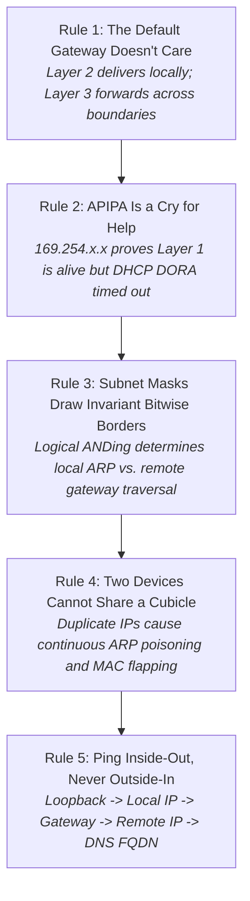
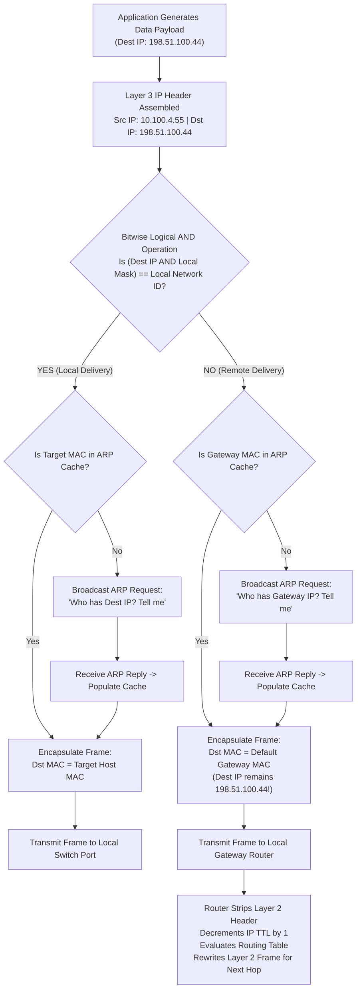
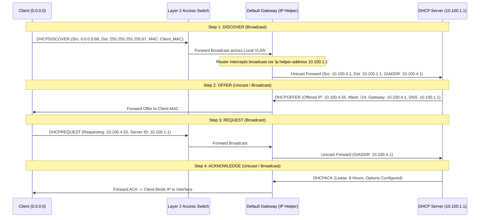

# Portland Desk Workbench: IPv4 Addressing, Subnet Boundaries, & Local Delivery Triage

> **Track:** Portland Desk (Book 0: Zero-to-One)  
> **Unit Companion:** `netplus-addressing-helpdesk` — *The Default Gateway Doesn't Care*  
> **Environment:** Level 1 Service Desk Terminal & Remote Diagnostic Console  
> **Authors:** Ethan Mercer (under Desk Lead Jules Brooks & Network Ops Engineer Jared Vance)  

---

## At a Glance

| Attribute | Specification |
| :--- | :--- |
| **Operational Role** | Tier 1 IT Support Specialist / Junior Network Operations Technician |
| **Target Certification** | CompTIA Network+ (N10-008 / N10-009) & CompTIA A+ Core 1 (220-1101) |
| **Primary Examination Domains** | **Network+ N10-008 Domain 1.0 Networking Fundamentals**<br>• *1.4 Given a scenario, configure and troubleshoot IPv4 addressing, classless subnetting, and default gateways*<br>**Network+ N10-008 Domain 4.0 Network Troubleshooting**<br>• *4.1 Explain the network troubleshooting methodology*<br>• *4.2 Given a scenario, troubleshoot common IP configuration failures (APIPA, duplicate IP conflicts, incorrect subnet mask, unreachable gateway)*<br>**Network+ N10-009 Domain 1.4 & 4.1**<br>• *Network architecture concepts, Layer 2 vs. Layer 3 frame forwarding, ARP table dynamics, DHCP DORA mechanics, and relay agents* |
| **Prerequisites** | Understanding of OSI layering (Physical Layer 1, Data Link Layer 2, Network Layer 3), binary place values, and command-line navigation. |
| **Estimated Completion** | 45–60 minutes |
| **Core Deliverables** | 1. Host-to-Gateway Packet Forwarding & Encapsulation Reference<br>2. Complete IPv4 Subnetting & CIDR Block Boundary Matrix (/24 through /30)<br>3. Command-Line Addressing Diagnostic Toolkit (`ipconfig`, `arp`, `ping`, PowerShell `Get-NetIPConfiguration`)<br>4. DHCP DORA State Machine & IP Helper (Relay Agent) Architecture<br>5. Micro-Drill 1: APIPA vs. DHCP DORA Protocol & VLAN Trunk Failure Analysis<br>6. Micro-Drill 2: CIDR Bitwise Subnet Boundary Math & Off-by-One Troubleshooting<br>7. Micro-Drill 3: "Commit Before You Touch" (CBYT) 5-Case Prediction Gate<br>8. Performance Deliverable: Tier 1 Addressing Triage & Network Passdown Note with Evaluation Rubric |

---

## 1. The Situation & Ground Truth

### The Situation
It is 08:20 on a damp Tuesday morning in late September. Low clouds hang over the Willamette River, and early morning squalls have swept through East Portland. Outside the operations center, rainwater drains along the roof gutters. Inside the facility, the service desk ticket queue has spiked with fourteen critical incidents originating from Building B—the logistics annex and water pump station two miles south.

Workstations on the warehouse intake dock, barcode scanners on shipping line four, and automated water pump loggers cannot connect to central services. The freight clerks report that shipping portals have frozen with socket errors, and facilities technicians report that telemetry feeds have dropped. Desks report that "the internet is dead." 

When apprentice technician Ethan Mercer instinctively grabs the telephone to report an external carrier fiber cut to CenturyLink, Desk Lead Jules Brooks stops him in his tracks:
> *"Put the telephone down, Ethan, and look at your own desk first. Can you ping the gateway for that subnet from our core switch? Can you ping the loopback address on one of their endpoints? You do not know if their local operating system stack is functioning. Start on your side of the glass. Never jump to the WAN when your own gateway hasn't answered you."*

### The Ground Truth Rules of IP Addressing & Local Delivery



1. **Rule 1: The Default Gateway Doesn't Care.** A router does not evaluate user intent, operating system brand, or application urgency. It only checks two criteria: (a) was the incoming Layer 2 Ethernet frame addressed directly to the router's interface MAC address, and (b) does its Layer 3 routing table contain a valid path for the destination IP address? If an endpoint fails to encapsulate packets with the gateway's MAC address, the router never touches the frame.
2. **Rule 2: APIPA Is a Cry for Help, Not an Address.** When an interface displays an IP address in the `169.254.0.1` to `169.254.255.254` range (RFC 3927) with a mask of `255.255.0.0`, the network adapter is physically connected, but the operating system received zero responses to its DHCP Discover broadcasts. An APIPA address cannot route past a router; it isolates the machine to link-local peer communication.
3. **Rule 3: Subnet Masks Draw Invariant Bitwise Borders.** An operating system never looks at classful assumptions (Class A, B, or C). It performs a bitwise logical AND between the destination IP and its configured subnet mask. If the resulting network ID matches the local network ID, the client ARPs for the target host's MAC. If the network IDs differ, the client ARPs for the default gateway's MAC. An off-by-one error in the subnet mask strands devices on different broadcast domains even when they share a physical switch.
4. **Rule 4: Two Devices Cannot Share a Cubicle.** When two devices are assigned the same IPv4 address, each device emits gratuitous ARP announcements and replies. This poisons the ARP cache of neighboring endpoints and triggers MAC address flapping on switch ports. Traffic oscillates randomly between the two devices, causing intermittent TCP drops and session resets.
5. **Rule 5: Ping Inside-Out, Never Outside-In.** Troubleshooting connectivity requires systematic variable isolation:
   - `ping 127.0.0.1`: Verifies that the local TCP/IP protocol stack is bound and functional.
   - `ping <Local_IP>`: Verifies that the local Network Interface Card (NIC) driver and physical hardware are operating.
   - `ping <Default_Gateway>`: Verifies Layer 1/2 physical cabling, switch port state, and local subnet reachability to the local router.
   - `ping <Remote_IP>` (e.g., `8.8.8.8`): Verifies Layer 3 inter-VLAN routing, WAN transport, and upstream ISP transit.
   - `ping <FQDN>` (e.g., `portal.portland.gov`): Verifies Layer 7 DNS name resolution.

---

## 2. Technical Reference & Triage Matrix

### 2.1 The Packet Delivery Decision Tree (Local vs. Remote Delivery)

When a host initiates network communication to a destination IP, the operating system executes a deterministic sequence of Layer 2 and Layer 3 encapsulation operations:



### 2.2 DHCP DORA Mechanics & Relay Agent (IP Helper) Architecture

Dynamic Host Configuration Protocol (DHCP) operates over UDP ports 67 (server) and 68 (client). When a client boots without a static configuration, it enters the four-step DORA state machine:



**Common DHCP Failure Modes:**
1. **Unassigned Trunk Port:** If the switch uplink drops 802.1Q trunking, the client VLAN cannot reach the router interface containing the `ip helper-address`. Discover broadcasts drop at the switch boundary.
2. **Missing Relay Statement:** If the router interface lacks `ip helper-address <DHCP_IP>`, the router drops client Discover broadcasts because routers do not forward Layer 2 broadcasts (`255.255.255.255`).
3. **Scope Exhaustion:** The DHCP scope has leased all available addresses in the pool. The server receives Discover packets but sends no Offer, forcing clients into APIPA (`169.254.x.x`).
4. **Rogue DHCP Server:** An unauthorized router or device on the local VLAN responds to Discover packets faster than the legitimate corporate DHCP server, leasing incorrect IP addresses, subnet masks, and rogue gateways.

---

### 2.3 IPv4 Subnetting & CIDR Block Boundary Reference Table

Technicians must perform fast, accurate mental math to determine network IDs, broadcast IDs, usable host ranges, and block increments without relying on web calculators:

| CIDR Prefix | Subnet Mask (Dotted Decimal) | Binary Representation (4th Octet) | Block Size (Increment) | Total IPs | Usable Hosts ($2^h - 2$) | Example Subnet Ranges (4th Octet) |
| :---: | :--- | :---: | :---: | :---: | :---: | :--- |
| **/24** | `255.255.255.0` | `00000000` | 256 | 256 | 254 | `.0` (Hosts: `.1`–`.254`, Bcast: `.255`) |
| **/25** | `255.255.255.128` | `10000000` | 128 | 128 | 126 | Subnet 1: `.0` (Hosts: `.1`–`.126`, Bcast: `.127`)<br>Subnet 2: `.128` (Hosts: `.129`–`.254`, Bcast: `.255`) |
| **/26** | `255.255.255.192` | `11000000` | 64 | 64 | 62 | Subnet 1: `.0` (Hosts: `.1`–`.62`, Bcast: `.63`)<br>Subnet 2: `.64` (Hosts: `.65`–`.126`, Bcast: `.127`)<br>Subnet 3: `.128` (Hosts: `.129`–`.190`, Bcast: `.191`)<br>Subnet 4: `.192` (Hosts: `.193`–`.254`, Bcast: `.255`) |
| **/27** | `255.255.255.224` | `11100000` | 32 | 32 | 30 | `.0`, `.32`, `.64`, `.96`, `.128`, `.160`, `.192`, `.224`<br>*(Increment: 32; Usable: 30 hosts per block)* |
| **/28** | `255.255.255.240` | `11110000` | 16 | 16 | 14 | `.0`, `.16`, `.32`, `.48`, `.64`, `.80`, `.96`, `.112`, etc.<br>*(Increment: 16; Usable: 14 hosts per block)* |
| **/29** | `255.255.255.248` | `11111000` | 8 | 8 | 6 | `.0`, `.8`, `.16`, `.24`, `.32`, `.40`, `.48`, etc.<br>*(Increment: 8; Usable: 6 hosts per block; common for small WAN pools)* |
| **/30** | `255.255.255.252` | `11111100` | 4 | 4 | 2 | `.0` (Hosts: `.1`–`.2`, Bcast: `.3`)<br>*(Increment: 4; Usable: 2 hosts; standard point-to-point links)* |

**The "Magic Number" Heuristic:**  
To find the block size (increment) of any subnet mask, subtract the non-zero octet from 256:  
$$256 - \text{Mask Octet} = \text{Increment (Block Size)}$$  
- For `/26` (`255.255.255.192`): $256 - 192 = 64$. Subnets start at `.0`, `.64`, `.128`, `.192`.
- For `/27` (`255.255.255.224`): $256 - 224 = 32$. Subnets start at `.0`, `.32`, `.64`, `.96`, etc.
- For `/29` (`255.255.255.248`): $256 - 248 = 8$. Subnets start at `.0`, `.8`, `.16`, `.24`, etc.

---

### 2.4 Command-Line Addressing & ARP Triage Toolkit

```console
# 1. View all network adapter configurations (IP, Mask, Gateway, DNS, MAC, DHCP status)
ipconfig /all

# 2. Release current DHCP lease on active adapters
ipconfig /release

# 3. Request fresh DHCP configuration from server (re-triggers DORA)
ipconfig /renew

# 4. View active Address Resolution Protocol table (IP-to-MAC mappings)
arp -a

# 5. Flush and clear volatile ARP cache (requires elevated administrative privileges)
arp -d *

# 6. Continuous ping to monitor connectivity stability and detect packet drops
ping -t 10.100.4.1

# 7. PowerShell modern network adapter and IP configuration inspection
Get-NetIPConfiguration
Get-NetIPAddress -AddressFamily IPv4 | Format-Table InterfaceAlias, IPAddress, PrefixLength

# 8. Test TCP port reachability directly bypassing ICMP firewall blocks
Test-NetConnection -ComputerName 10.100.1.1 -Port 80
```

---

## 3. Micro-Drills

### Micro-Drill 1: APIPA vs. DHCP DORA Protocol & VLAN Trunk Failure Analysis

**Scenario:** Following a power fluctuation in Building B, workstation `WS-BLDGB-04` reports that all network applications have stopped responding. The technician opens an administrative command prompt on the endpoint:

```console
C:\Users\shipping04> ipconfig /all

Windows IP Configuration

   Host Name . . . . . . . . . . . . : WS-BLDGB-04
   Primary Dns Suffix  . . . . . . . : ops.portland.local
   Node Type . . . . . . . . . . . . : Hybrid
   IP Routing Enabled. . . . . . . . : No
   WINS Proxy Enabled. . . . . . . . : No

Ethernet adapter Local Area Connection:

   Connection-specific DNS Suffix  . : 
   Description . . . . . . . . . . . : Intel(R) Ethernet Connection I219-LM
   Physical Address. . . . . . . . . : 00-14-22-8A-41-EF
   DHCP Enabled. . . . . . . . . . . : Yes
   Autoconfiguration Enabled . . . . : Yes
   IPv4 Address. . . . . . . . . . . : 169.254.88.114(Preferred) 
   Subnet Mask . . . . . . . . . . . : 255.255.0.0
   Default Gateway . . . . . . . . . : 
   DNS Servers . . . . . . . . . . . : 
```

**Diagnostic Analysis Questions:**
1. What does the `169.254.88.114` address signify regarding Layer 1, Layer 2, and Layer 3 operation?
2. Why is the default gateway entry completely blank?
3. In the DHCP DORA process, which specific message failed to reach or return to the client?
4. If a switch uplink port connecting to the campus core reboots as an unassigned access port rather than an 802.1Q trunk, why does DHCP fail while out-of-band management remains functional?

**Worked Resolution & Triage Sequence:**
1. **Layer 1/2 vs. Layer 3 State:** The `169.254.x.x` address proves that Layer 1 physical link carrier is established (link LED lit, interface status "Connected") and Layer 2 frame transmission is functional. The failure is strictly at Layer 3/DHCP: the operating system waited for a DHCP Offer packet, received no answer before the timeout expired, and autoconfigured an APIPA address.
2. **Missing Gateway:** APIPA allocates link-local addresses only. Because an autoconfigured host has no knowledge of the local network topology or router IP, it cannot guess a default gateway. The host can communicate only with other `169.254.x.x` devices on the same physical broadcast domain.
3. **DORA Breakdown:** The client transmitted a Layer 2 broadcast `DHCPDISCOVER` packet (`255.255.255.255` on UDP 67). Because the switch trunk was down or misconfigured, the broadcast could not cross into the router's VLAN interface. The DHCP server never received the Discover, so no `DHCPOFFER` was generated.
4. **Remediation Procedure:**
   - Log into access switch management console.
   - Verify trunk status: `show interfaces trunk` (Cisco) or equivalent.
   - Configure uplink port for 802.1Q trunking: `switchport mode trunk`, `switchport trunk allowed vlan add 10,20,30`.
   - Verify Layer 3 relay agent on router VLAN interface: `ip helper-address 10.100.1.1`.
   - On the client, execute:
     ```console
     ipconfig /release
     ipconfig /renew
     ```
   - Verify client receives `10.100.4.x`, mask `255.255.255.0`, and gateway `10.100.4.1`.

---

### Micro-Drill 2: CIDR Bitwise Subnet Boundary Math & Off-by-One Troubleshooting

**Scenario:** Two newly racked municipal servers sit in the same equipment cabinet in the East Portland pump house, plugged into adjacent ports on the same switch:
- Server A (`PDX-PUMP-DB01`): `192.168.10.62` with mask `255.255.255.192` (/26), Gateway `192.168.10.1`.
- Server B (`PDX-PUMP-LOG02`): `192.168.10.65` with mask `255.255.255.192` (/26), Gateway `192.168.10.1`.

Pinging from Server B to Server A fails with request timeouts. Pinging from Server B to `192.168.10.1` also fails.

**Bitwise Mathematical Decomposition:**
1. **Analyze Subnet Mask:**
   - Decimal: `255.255.255.192`
   - Binary 4th Octet: `1 1 0 0 0 0 0 0`
   - Network bits in 4th octet: 2 ($24 + 2 = \text{/26}$)
   - Host bits remaining: 6 ($h = 6$)
   - Block size (Increment): $2^6 = 64$ (or $256 - 192 = 64$)

2. **Delineate Subnet Blocks:**
   - **Block 1 (Subnet 192.168.10.0/26):**
     - Network ID: `192.168.10.0`
     - First Usable Host: `192.168.10.1`
     - Last Usable Host: `192.168.10.62`
     - Broadcast ID: `192.168.10.63`
   - **Block 2 (Subnet 192.168.10.64/26):**
     - Network ID: `192.168.10.64`
     - First Usable Host: `192.168.10.65`
     - Last Usable Host: `192.168.10.126`
     - Broadcast ID: `192.168.10.127`

3. **Identify the Failure Mechanism:**
   - Server A (`.62`) is the **last usable host** in Block 1.
   - Server B (`.65`) is the **first usable host** in Block 2.
   - When Server B (`.65`) attempts to contact Server A (`.62`), it performs a bitwise logical AND:
     $$\text{Dest IP } (192.168.10.62) \text{ AND } 255.255.255.192 = 192.168.10.0$$
   - Server B compares this result against its own network ID (`192.168.10.64`). Because $192.168.10.0 \neq 192.168.10.64$, Server B determines that Server A is on a **remote network**.
   - Server B refuses to ARP for Server A's MAC address. It looks for its default gateway (`192.168.10.1`).
   - Server B evaluates its gateway: `192.168.10.1` AND `255.255.255.192` = `192.168.10.0`. The gateway is ALSO on a remote subnet!
   - Server B cannot ARP for its own gateway because the gateway sits in Block 1. All outbound packets are dropped.

**Practice Problems:**

| Target IP & Prefix | Subnet ID | First Usable Host | Last Usable Host | Broadcast ID | Can Host X ping Host Y directly? |
| :--- | :---: | :---: | :---: | :---: | :---: |
| **Host X:** `10.20.5.30/28`<br>**Host Y:** `10.20.5.18/28` | `10.20.5.16` | `10.20.5.17` | `10.20.5.30` | `10.20.5.31` | **YES:** Both `.18` and `.30` fall within the `10.20.5.16/28` block (Increment: 16). |
| **Host X:** `172.16.8.94/27`<br>**Host Y:** `172.16.8.98/27` | Subnet 1: `.64`<br>Subnet 2: `.96` | Block 1: `.65`–`.94`<br>Block 2: `.97`–`.126` | Block 1 Bcast: `.95`<br>Block 2 Bcast: `.127` | N/A | **NO:** Host X is in `.64/27` (ends at `.94`); Host Y is in `.96/27` (starts at `.97`). Requires router. |
| **Host X:** `192.168.1.140/29`<br>**Host Y:** `192.168.1.143/29` | `192.168.1.136` | `192.168.1.137` | `192.168.1.142` | `192.168.1.143` | **NO:** Host Y (`.143`) is the **broadcast address** for `192.168.1.136/29`. It cannot be assigned to an endpoint! |

---

### Micro-Drill 3: "Commit Before You Touch" (CBYT) 5-Case Prediction Gate

Before executing any diagnostic command or changing a system setting, enforce the CBYT protocol:
1. **Layer & Subsystem:** What exact layer (L1, L2, L3, L4, L7) and protocol is involved?
2. **Predicted Output:** What concrete output, error code, or status do you anticipate seeing?
3. **Action & Verification:** What specific command tests the hypothesis without destroying evidence?

---

#### Case 3.1: The APIPA Link-Local Lockout
**Scenario:** A shipping desk clerk powers on a desktop following an overnight maintenance reload of access switches. The computer cannot browse the intranet or reach any local servers. The network cable is plugged in, and both RJ-45 LEDs are glowing green.

<details>
<summary>Prediction & Verification Gate (Click to Expand)</summary>

* **Layer & Subsystem:** Layer 3 / Network Configuration (DHCP DORA Failure). Link carrier is up (Layer 1/2), but no DHCP Offer was received.
* **Predicted Output:**
  ```console
  C:\> ipconfig
  IPv4 Address. . . . . . . . . . . : 169.254.x.x
  Subnet Mask . . . . . . . . . . . : 255.255.0.0
  Default Gateway . . . . . . . . . : [blank]
  ```
* **Triage Action:**
  1. Inspect switch port VLAN assignment and uplink trunk status.
  2. Confirm router interface has `ip helper-address <DHCP_IP>` configured.
  3. Execute `ipconfig /renew` to force client DORA re-negotiation.
</details>

---

#### Case 3.2: Duplicate IP Conflict & Layer 2 Flapping
**Scenario:** Workstation `10.100.4.55` drops its session every 30 to 45 seconds. Running a continuous ping to the gateway shows bursts of 3 replies followed by 3 timeouts and duplicate packet notices. A network printer was recently added to the room.

<details>
<summary>Prediction & Verification Gate (Click to Expand)</summary>

* **Layer & Subsystem:** Layer 2 / Data Link Address Resolution Protocol (ARP). Two distinct network adapters (Dell desktop NIC and HP printer JetDirect) are responding to ARP requests for `10.100.4.55`.
* **Predicted Output:**
  ```console
  C:\> arp -a 10.100.4.55
  # First execution:
  10.100.4.55           00-14-22-8a-41-ef     dynamic
  # Fifteen seconds later:
  10.100.4.55           00-25-b3-18-c2-90     dynamic
  ```
* **Triage Action:**
  1. Isolate the rogue device: search switch CAM table for both MAC addresses (`show mac address-table address 0025.b318.c290`).
  2. Disconnect the conflicting device's patch cable.
  3. Move the device (printer) to a static reservation outside the active dynamic DHCP pool (e.g., `10.100.4.240`).
  4. Flush client ARP cache: `arp -d *` in elevated command prompt.
</details>

---

#### Case 3.3: Off-by-One CIDR Subnet Boundary Disconnect
**Scenario:** A newly imaged server with static IP `192.168.10.65/26` cannot communicate with its database server at `192.168.10.62/26`. Both servers are plugged into the same physical rack switch on the same VLAN.

<details>
<summary>Prediction & Verification Gate (Click to Expand)</summary>

* **Layer & Subsystem:** Layer 3 / IPv4 Subnet Mask Boundary. A `/26` prefix creates 64-address blocks. `.62` is in Block 1 (`.0`–`.63`); `.65` is in Block 2 (`.64`–`.127`). Because they occupy different logical subnets, they cannot communicate at Layer 2 without a router.
* **Predicted Output:**
  ```console
  PS C:\> ping 192.168.10.62
  Request timed out.
  Request timed out.
  PS C:\> arp -a
  # No entry for 192.168.10.62 appears in the ARP table because the OS attempted to route rather than ARP locally.
  ```
* **Triage Action:**
  1. Calculate valid host pool for the desired subnet: Block 1 (`192.168.10.1` to `.62`).
  2. Reconfigure Server B's IP to an unused address in Block 1 (e.g., `192.168.10.61/26`).
  3. Verify default gateway on both servers points to `192.168.10.1`.
  4. Re-test ping: latency drops to `<1ms`.
</details>

---

#### Case 3.4: Misconfigured or Missing Default Gateway
**Scenario:** A computer on subnet `10.100.4.0/24` can ping adjacent workstations (`10.100.4.56`, `10.100.4.57`) and print to the local network printer (`10.100.4.240`). However, it cannot browse the internet (`198.51.100.44`) or reach corporate servers on `10.100.1.0/24`.

<details>
<summary>Prediction & Verification Gate (Click to Expand)</summary>

* **Layer & Subsystem:** Layer 3 / Routing Configuration. Local delivery functions because local ARP requests succeed. Remote delivery fails because the host lacks a valid default gateway or the gateway IP is incorrect.
* **Predicted Output:**
  ```console
  C:\> ipconfig
  IPv4 Address. . . . . . . . . . . : 10.100.4.88
  Subnet Mask . . . . . . . . . . . : 255.255.255.0
  Default Gateway . . . . . . . . . : 0.0.0.0  [or blank, or 10.100.5.1]
  
  C:\> ping 8.8.8.8
  PING: transmit failed. General failure. (or Destination host unreachable)
  ```
* **Triage Action:**
  1. Check `ipconfig /all`: verify `Default Gateway` is set to `10.100.4.1`.
  2. If static, correct the default gateway field in IPv4 adapter properties.
  3. If DHCP, verify DHCP Option 003 (Router) is configured correctly on the DHCP server scope.
  4. Execute `ping 10.100.4.1` to verify gateway reachability, then test remote ping to `8.8.8.8`.
</details>

---

#### Case 3.5: Failed Local Loopback / Corrupted TCP/IP Stack
**Scenario:** A user's desktop displays a red "X" on the network icon. The technician assigns a verified static IP and gateway, but the system still cannot communicate with any host. The technician suspects the Windows network stack software itself is corrupted.

<details>
<summary>Prediction & Verification Gate (Click to Expand)</summary>

* **Layer & Subsystem:** Layer 3 / Operating System Protocol Driver (`tcpip.sys`). The software protocol drivers fail to bind or initialize.
* **Predicted Output:**
  ```console
  C:\> ping 127.0.0.1
  PING: transmit failed. General failure.
  ```
* **Triage Action:**
  1. Test loopback address (`127.0.0.1`). If loopback fails, the problem is 100% internal to the OS protocol stack.
  2. Reinstall NIC driver via Device Manager.
  3. Reset Windows TCP/IP stack and Winsock catalog in elevated command prompt:
     ```console
     netsh winsock reset
     netsh int ip reset
     ```
  4. Reboot the machine and re-test `ping 127.0.0.1`.
</details>

---

## 4. Performance Deliverables

### Part A: Tier 1 Standard Incident Resolution Note

```text
================================================================================
TIER 1 RESOLUTION SUMMARY - PORTLAND OPERATIONS SERVICE DESK
================================================================================
Ticket ID:        INC-2026-0922
Requester:        Frank Kowalski (Lead Shipping Dispatcher, Building B)
Technician:       Ethan Mercer (Tier 1 Support Specialist)
Supervising Lead: Jules Brooks (Help Desk Lead)
Date / Time:      2026-09-22 10:45:18 PDT
Category:         Network / IPv4 Addressing / Duplicate IP & DHCP Failure
Affected Host:    WS-BLDGB-04 (IP: 10.100.4.55 / MAC: 00-14-22-8A-41-EF)
Status:           RESOLVED

1. INCIDENT DESCRIPTION:
   Following an early morning power fluctuation and auxiliary generator test 
   at 05:00, fourteen endpoints in Building B (logistics annex) lost network 
   connectivity. Endpoints autoconfigured link-local APIPA addresses (169.254.x.x). 
   After switch trunk restoration, Dispatcher Frank Kowalski reported persistent, 
   intermittent connection drops occurring every 30 to 45 seconds on WS-BLDGB-04.

2. ROOT CAUSE ANALYSIS:
   Two distinct failure mechanisms identified:
   a. Switch Trunk Drop & DHCP Failure: Edge switch in closet B rebooted into an 
      unassigned access VLAN state. Client DHCPDISCOVER broadcasts were confined 
      to an isolated broadcast domain and could not reach the centralized DHCP 
      relay agent (10.100.1.1). Endpoints defaulted to APIPA (169.254.88.114/16).
   b. Duplicate IP Conflict (Layer 2 Flapping): Following DHCP lease renewal, 
      WS-BLDGB-04 received its legitimate lease for 10.100.4.55. However, an HP 
      LaserJet 4050 printer (MAC: 00-25-B3-18-C2-90) moved into the breakroom by 
      facilities yesterday was manually configured with static IP 10.100.4.55. 
      Gratuitous ARPs from the printer repeatedly poisoned the switch CAM table 
      and neighbor ARP caches, dropping Frank's TCP freight sessions.

3. REMEDIATION PERFORMED:
   a. Edge switch trunk port re-enabled for 802.1Q encapsulation with IP helper 
      pointing to 10.100.1.1; executed 'ipconfig /renew' across warehouse endpoints.
   b. Isolated printer duplicate IP: disconnected printer network cable, stabilizing 
      WS-BLDGB-04 ping stream to 10.100.4.1 (<2ms round trip, zero dropped packets).
   c. Reconfigured HP LaserJet network interface from manual static to DHCP client.
   d. Created permanent DHCP MAC reservation for the printer at 10.100.4.240 
      (outside dynamic allocation pool 10.100.4.50 - 10.100.4.200).
   e. Cleared volatile ARP tables ('arp -d *') and reconnected printer.
   f. Verified Frank's shipping portal remained stable for 30 minutes under load.

4. USER EDUCATION & FOLLOW-UP:
   Briefed warehouse lead Ken on static IP policy: all networked peripherals 
   must receive IT-assigned DHCP reservations rather than manual static assignments.
================================================================================
```

---

### Part B: Tier 2 Network Infrastructure Passdown Note

```text
================================================================================
NETWORK INFRASTRUCTURE PASSDOWN & HANDOVER NOTE
================================================================================
Escalation ID:    ESC-2026-0341
Originating Desk: Portland Regional Operations Help Desk
Technician:       Ethan Mercer (Tier 1 Specialist)
Escalated To:     Jared Vance (Network Operations Engineer)
Date / Time:      2026-09-22 11:30:00 PDT
Priority:         P2 - High (Infrastructure Configuration Drift)
Subject:          Building B Edge Switch Startup-Config Drift & Static IP Hygiene

1. DEFECT DESCRIPTION & INFRASTRUCTURE IMPACT:
   During the 05:00 emergency generator transfer cycle, edge switch SW-BLDGB-01 
   reloaded. The startup-config did not reflect previous running-config changes, 
   causing uplink port GigabitEthernet0/48 to revert from an 802.1Q trunk to an 
   untagged access port on VLAN 1. This severed DHCP relay traversal for VLANs 10, 
   20, and 30, driving 14 warehouse endpoints into APIPA link-local isolation.

2. SUB-SURFACE DISCOVERY (PUMP ANNEX SUBNET MISMATCH):
   During post-outage recovery, telemetry logger PDX-PUMP-LOG02 (192.168.10.65/26) 
   was unable to transmit sensor data to database PDX-PUMP-DB01 (192.168.10.62/26). 
   Triage revealed a CIDR boundary defect:
   - Subnet A (192.168.10.0/26): Valid hosts .1 to .62, Gateway .1.
   - Subnet B (192.168.10.64/26): Valid hosts .65 to .126, Gateway .65.
   Contractor assigned Server B host .65 with gateway .1. Server B could not reach 
   Server A (different broadcast domain) and could not reach its gateway (different 
   subnet). Reconfigured Server B to static IP 192.168.10.61/26; telemetry restored.

3. ACTIONS TAKEN & RUNNING AUDIT:
   - Restored 802.1Q trunk on SW-BLDGB-01 Gi0/48; confirmed 'ip helper-address 
     10.100.1.1' active on all SVI interfaces.
   - Executed 'copy running-config startup-config' on SW-BLDGB-01 to prevent state 
     loss during future power cycles.
   - Audited DHCP scope 10.100.4.0/24: verified dynamic exclusion range (.1 to .49 
     and .201 to .254 reserved for static infrastructure and printers).

4. PREVENTATIVE ACTION ITEMS FOR NETWORK ENGINEERING:
   a. Run automated configuration compliance script across all regional edge switches 
      to flag unsaved running-configs ('write memory' discrepancy).
   b. Implement DHCP Snooping and ARP Inspection (DAI) on Building B access switches 
      to drop unauthorized static IP assignments that collide with active DHCP scopes.
   c. Update industrial staging documentation in pump house to explicitly define /26 
      CIDR boundaries and prevent off-by-one addressing errors by third-party contractors.
================================================================================
```

---

## 5. Rubric & Evaluation Criteria

| Performance Criterion | Exemplary (Full Mastery) | Satisfactory (Competent) | Needs Revision (Deficient) |
| :--- | :--- | :--- | :--- |
| **IPv4 Addressing & CIDR Mathematics** | Flawlessly calculates network IDs, broadcast IDs, usable host ranges, and block increments for any prefix (/24 through /30). Accurately explains bitwise ANDing and identifies off-by-one boundary errors. | Calculates standard /24 and /26 ranges accurately with minor hesitation on /29 or /30 point-to-point subnets. | Cannot calculate subnet boundaries without a cheat sheet; confuses broadcast addresses with usable host IPs. |
| **DHCP DORA & Relay Architecture** | Articulates all 4 stages of the DORA state machine (ports, flags, broadcast vs. unicast). Accurately diagnoses APIPA (`169.254.x.x`) root causes, trunk drops, and IP helper requirements. | Explains the 4 DORA steps correctly and recognizes APIPA, but struggles to explain the exact role of the router relay agent. | Believes APIPA is assigned by an external rogue router; fails to identify why Discover broadcasts cannot cross a router. |
| **ARP Dynamics & Layer 2 Troubleshooting** | Flawlessly inspects and interprets `arp -a` output; detects MAC address flapping; isolates duplicate IP address conflicts; explains gratuitous ARP and switch CAM table poisoning. | Uses `arp -a` to find MAC addresses and recognizes duplicate IPs, but cannot explain how switch CAM tables learn and flap. | Relies solely on `ping` to troubleshoot connectivity; unaware of how Layer 2 MAC binding interacts with Layer 3 IP addressing. |
| **Layer 2 vs. Layer 3 Encapsulation** | Clearly articulates how Ethernet frames are stripped and rewritten at each Layer 3 hop while the IP header remains intact. Explains why a host ARPs for the default gateway when destination is remote. | Understands that routers forward packets between subnets, but displays minor confusion regarding MAC address rewriting. | Asserts that a client ARPs for the destination MAC address of a remote web server on the public internet. |
| **Documentation & Escalation Quality** | Submits pristine, audit-ready ticket notes and engineering escalation dossiers containing precise timestamps, root causes, Layer 2/3 evidence, remediation steps, and preventative controls. | Ticket notes are accurate and complete, but lack formal enterprise structure or omit preventative infrastructure controls. | Documentation is vague, omits technical evidence, lacks root-cause isolation, or suggests random trial-and-error actions. |

---

*Workbench complete. Ensure all micro-drills and deliverables are reviewed against the evaluation rubric.*
