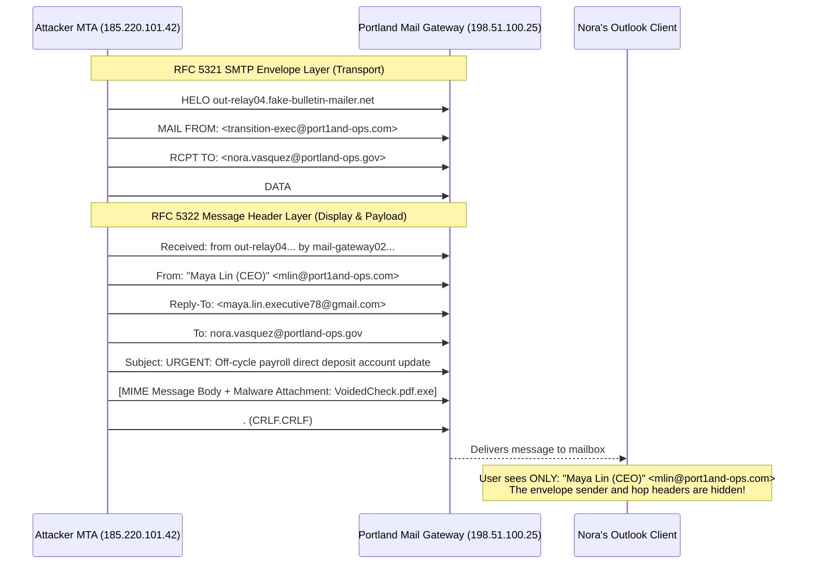
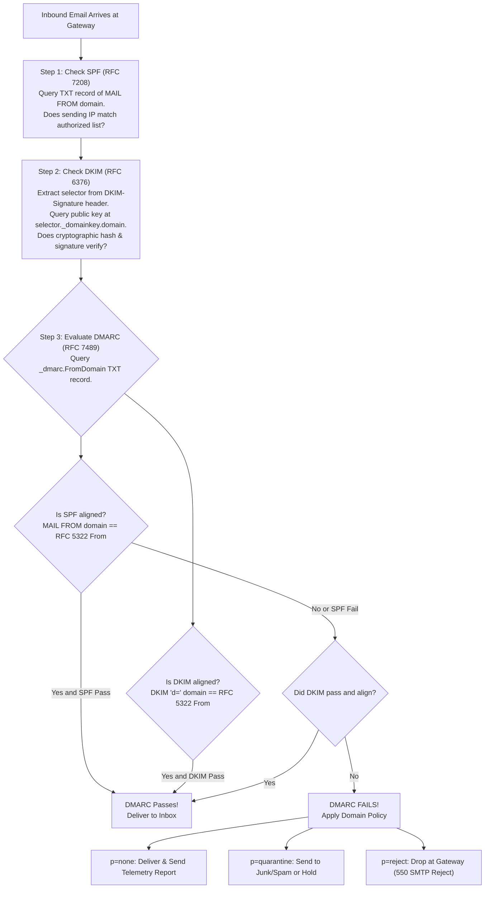
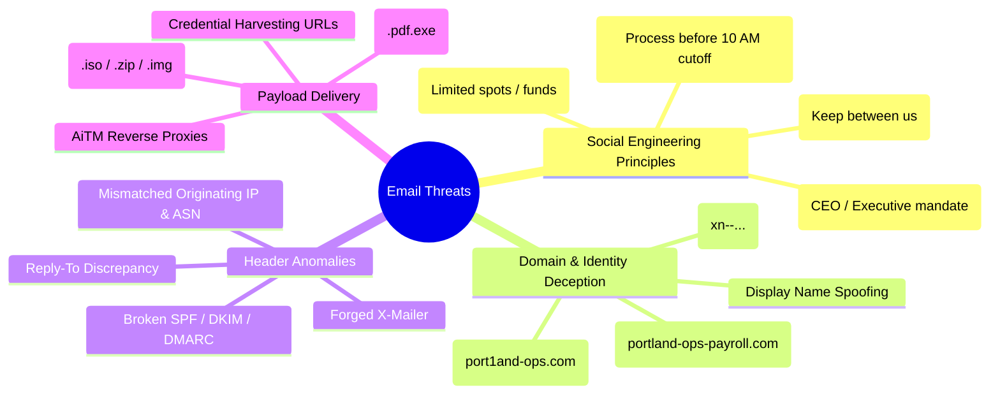

# Portland Desk Workbench: Email Header Decomposition & Phishing Triage

> **Track:** Portland Desk (Book 0: Zero-to-One)  
> **Unit Companion:** `secplus-phishing-helpdesk` — *Don't Click That*  
> **Environment:** Level 1 Service Desk Terminal & Mail Defense Queue  
> **Author:** Ethan Brooks (under Desk Lead Jules Mercer)  
> **Live Artifacts Directory:** [`artifacts/`](artifacts/)

---

## At a Glance

| Attribute | Specification |
| :--- | :--- |
| **Role** | Tier 1 Service Desk Specialist / Email Security Analyst |
| **Target Certification** | CompTIA Security+ (SY0-701) |
| **Primary Domains** | **Domain 1.0 General Security Concepts & Threats**<br>• *1.2 Compare and contrast types of social engineering and phishing attacks (phishing, spear phishing, whaling, business email compromise [BEC], vishing, smishing, pretexting, typosquatting, credential harvesting)*<br>**Domain 2.0 Security Architecture & Concepts**<br>• *2.4 Compare and contrast cryptographic authentication protocols in email (SPF, DKIM, DMARC, S/MIME)* |
| **Prerequisites** | Understanding of RFC 5321 (SMTP envelope) vs. RFC 5322 (message headers), DNS resource records (TXT, MX), public-key cryptography (asymmetric key pairs, digital signatures, hashing), and web URL structures. |
| **Estimated Completion** | 35–45 minutes |
| **Core Deliverables** | 1. RFC 5322 MIME & Email Authentication Triad (SPF / DKIM / DMARC) Matrix<br>2. Micro-Drill 1: Raw MIME Header Trace (`Received:` hop analysis, extracting originator IP, SPF pass/fail)<br>3. Micro-Drill 2: Domain Squatting & Typosquatting Recognition (e.g. `port1and-ops.com` vs `portland-ops.gov`)<br>4. Micro-Drill 3: "Commit Before You Touch" (CBYT) 5-Case Prediction Gate<br>5. Performance Deliverable: Formal Tier 1 Phishing Incident Triage & Security Escalation Note |

---

## 1. The Situation & Ground Truth

### The Situation
It is 08:10 on a rain-lashed Wednesday morning on the east side of Portland. Low, charcoal-colored clouds hang heavy over the Hawthorne Bridge, and the service desk smells of damp wool coats, ozone from the server room exhaust, and dark roast coffee. Two cubes over sits Jules Mercer, desk lead for nine years, bike helmet clipped to her monitor arm, calmly triaging the morning ticket flood.

On the corner of her primary display, the sticky note from yesterday's authentication shift (*which factor?*) has been stripped away. In its place sits a fresh neon-yellow square:

$$\boxed{\textbf{Who benefits if I hurry?}}$$

Ethan’s desk drawer still holds his port flashcards and Active Directory lockout guides, but this morning the red indicator light on the help desk dispatch console is blinking rapidly. Ticket **`INC-2026-1051`** has arrived from Nora Vasquez in Finance, marked with **Priority: High**:

> **Ticket Subject:** URGENT — Direct Deposit Update for Maya Lin (CEO)  
> **Requester:** Nora Vasquez (Payroll & Accounting)  
> **Description:** *"I received an urgent email from Maya Lin asking to change her direct deposit banking routing information for tomorrow morning's payroll run before the 10:00 AM bank cutoff. Maya says she's in an executive retreat offsite in Hood River with no phone service, so she can't take voice calls and told me to update it immediately from the attached voided check. The email has our logo and says 'Confidential'. I was about to type it into ADP, but something felt fast. Can IT verify Maya's message is safe?"*

Jules spins slowly in her chair, holding her ceramic mug. She gestures toward Ethan's terminal:

> *"Memorizing that SPF is a DNS TXT record and DKIM uses RSA keys will earn you points on a multiple-choice exam, Ethan. It will not save you when an executive screams, when payroll is thirty seconds away from wiring eighty thousand dollars to a mule bank in Eastern Europe, or when a user waves a printed email insisting 'the logo is real.' On this desk, email headers are not trivia—they are the cryptographic and forensic crime scene of who touched the packet."*

### The Ground Truth Rules of the Desk

1. **Display Names Lie; The Envelope and DNS Tell the Truth:** An email client's friendly `From:` display name (e.g., `"Maya Lin (CEO)"`) can be forged in any SMTP client with zero technical effort. Never make a security, access, or financial decision based on the visual header shown in an email client. Always inspect the RFC 5321 envelope sender (`Return-Path` / `MAIL FROM`), the `Received:` hops, and the cryptographic authentication headers (`Authentication-Results:`).
2. **Urgency and Secrecy Are Attack Signatures, Not Executive Priorities:** Phishing attacks succeed by weaponizing cognitive biases—specifically **urgency** ("before the 10:00 AM banking cutoff"), **authority** ("Maya Lin, CEO"), and **secrecy** ("keep this strictly confidential until tomorrow"). Whenever an email demands that normal verification procedures be bypassed because the sender "cannot take calls," treat the message as hostile until proven otherwise.
3. **Visual Fidelity Has Zero Cryptographic Value:** High-resolution corporate logos, legal confidentiality footers, and crisp executive headshots can be copied from public websites in seconds. Visual polish is trivial to fabricate; only public-key cryptographic signatures (**DKIM**) and domain alignment (**DMARC**) prove that a message genuinely originated from the declared organization.
4. **Out-of-Band (OOB) Verification is Mandatory for Financial Directives:** Never confirm wire instructions, vendor banking changes, or payroll updates using the communication channel that delivered the request. If an email requests a funds transfer or account modification, verify the directive using a pre-established, trusted telephone number from the corporate directory or through an in-person meeting—never via phone numbers, reply email addresses, or links contained within the suspect email.
5. **Preserve and Report; Never Forward Raw Phishing Bait:** Forwarding a raw phishing email across internal distribution lists ("Hey team, is this real?") duplicates the attack payload, exposes colleagues to accidental clicks, and strips original SMTP transport headers. Train users to click the **Report Phish** button, or save the message as an RFC 822 `.eml` artifact so Tier 1 and SOC analysts can examine intact MIME headers safely in an isolated text viewer.

---

## 2. Technical Reference & Triage Matrix

### RFC 5322 Email MIME Architecture: Envelope vs. Header

To analyze email forgery, you must distinguish between the **SMTP Envelope** (RFC 5321) and the **MIME Message Header** (RFC 5322).



* **RFC 5321 Envelope (`MAIL FROM` / `Return-Path`):** Used by mail transfer agents (MTAs) for routing and non-delivery reports (bounces). This is the identity evaluated by basic **SPF**.
* **RFC 5322 Message Header (`From:`):** The human-readable header parsed and displayed by client software (Outlook, Apple Mail, Gmail). This is what the recipient reads on screen.
* **The Vulnerability:** Without DMARC alignment, an attacker can specify a disposable domain in `MAIL FROM` to pass SPF, while placing an executive's spoofed address in the RFC 5322 `From:` header.

---

### The Email Authentication Triad: SPF, DKIM, and DMARC

Modern email defense relies on three complementary standards working in unison to validate sender identity and prevent spoofing.



#### 1. SPF (Sender Policy Framework — RFC 7208)
* **What it does:** Publishes an authorized list of IP addresses, CIDR subnets, and hostnames permitted to send mail on behalf of a specific domain in a DNS TXT record.
* **Standard DNS TXT Record:**
  ```text
  portland-ops.gov.  IN  TXT  "v=spf1 ip4:198.51.100.0/24 include:_spf.google.com -all"
  ```
* **Mechanism & Qualifiers:**
  * `+all` (Pass): Anyone can send (dangerous; insecure).
  * `?all` (Neutral): No definitive policy stated.
  * `~all` (SoftFail): Unauthorized IPs should be accepted but flagged as suspicious.
  * `-all` (Fail / HardFail): Unauthorized IPs must be rejected outright.
  * `include:<domain>`: Authorizes another domain's SPF record (e.g., Google Workspace, Microsoft 365, SendGrid).
* **Limitation:** SPF validates only the RFC 5321 `MAIL FROM` envelope address. It does **not** evaluate the RFC 5322 `From:` address displayed to the human user, and it breaks upon automated email forwarding.

#### 2. DKIM (DomainKeys Identified Mail — RFC 6376)
* **What it does:** Provides asymmetric cryptographic authentication and tamper-evident integrity for email headers and message body.
* **Mechanism:**
  1. The sending mail server calculates a cryptographic hash (SHA-256) of specified headers (`h=From:To:Subject:Date`) and the message body (`bh=`).
  2. The server encrypts this hash using its **private key** and attaches it to the email header as `DKIM-Signature:`.
  3. The receiving MTA extracts the domain (`d=`) and selector (`s=`) from the header, queries DNS for `<selector>._domainkey.<domain>`, retrieves the sender's **public key**, and verifies the signature.
* **Example DKIM Header:**
  ```text
  DKIM-Signature: v=1; a=rsa-sha256; c=relaxed/relaxed; d=portland-ops.gov;
    s=selector1; t=1697897414;
    bh=9zE8x+W9kY5K1G0fC+6v3u2H1q0=;
    h=From:To:Subject:Date:Message-ID;
    b=X9eF3k...[RSA-2048-SIGNATURE]...
  ```
* **Limitation:** DKIM proves that the message was not modified in transit and that the signing domain owns the cryptographic key. However, DKIM does **not** require the signing domain (`d=attacker.com`) to match the visible `From:` address (`From: ceo@portland-ops.gov`).

#### 3. DMARC (Domain-based Message Authentication, Reporting, and Conformance — RFC 7489)
* **What it does:** Binds SPF and DKIM to the RFC 5322 `From:` header via **Identifier Alignment**, instructs receiving gateways how to handle authentication failures, and generates diagnostic XML reports (`rua`/`ruf`).
* **The Alignment Rule:**
  $$\text{DMARC Pass} = (\text{SPF Pass} \land \text{SPF Alignment}) \lor (\text{DKIM Pass} \land \text{DKIM Alignment})$$
  * **SPF Alignment:** The domain in the RFC 5321 `MAIL FROM` envelope must match the domain in the visible RFC 5322 `From:` header.
  * **DKIM Alignment:** The domain in the `d=` tag of a valid DKIM signature must match the domain in the visible RFC 5322 `From:` header.
* **Standard DNS TXT Record:**
  ```text
  _dmarc.portland-ops.gov.  IN  TXT  "v=DMARC1; p=reject; sp=reject; pct=100; rua=mailto:dmarc-rua@portland-ops.gov; aspf=r; adkim=r"
  ```
* **Policy Parameters (`p=`):**
  * `p=none`: Monitor mode. Delivers mail normally; collects telemetry reports.
  * `p=quarantine`: Delivers failed mail to recipient's Junk/Spam folder or quarantine queue.
  * `p=reject`: Instructs receiving gateways to drop failed mail at SMTP handshake (`550 5.7.1 Message rejected`).

---

### Comparison: The Email Authentication Triad

| Feature | SPF (RFC 7208) | DKIM (RFC 6376) | DMARC (RFC 7489) |
| :--- | :--- | :--- | :--- |
| **Primary Goal** | IP address authorization for senders | Cryptographic message integrity & origin proof | Policy enforcement & identifier alignment |
| **DNS Record Type** | TXT record at domain apex (`example.com`) | TXT record at selector (`<s1>._domainkey.example.com`) | TXT record at `_dmarc.<domain>` |
| **Header Examined** | RFC 5321 `MAIL FROM` / Return-Path | `DKIM-Signature:` and signed headers | RFC 5322 `From:` (aligned with SPF / DKIM) |
| **Cryptographic Basis** | None (IP allowlisting) | Asymmetric cryptography (RSA / Ed25519) | Relies on underlying DKIM cryptographic signatures |
| **Forwarding Resilient** | No (breaks when forwarded through relays) | Yes (signature survives intermediate hops) | Yes (if DKIM signature remains valid and aligned) |
| **Enforcement Actions** | Neutral, SoftFail, HardFail | Pass or Fail | `p=none`, `p=quarantine`, `p=reject` |
| **Core Vulnerability** | Ignores visible `From:` header | Signing domain can differ from `From:` | High deployment complexity; strict alignment misconfig |

---

### Red Flags of Spear Phishing & Business Email Compromise (BEC)

CompTIA Security+ SY0-701 categorizes social engineering attacks by transmission vector, target specificity, and cognitive influence principles:



1. **Domain Squatting & Typosquatting:**
   * **Character Substitution:** Replacing letters with visually similar numbers or symbols (e.g., `port1and-ops.com` substituting digit `1` for lowercase `l`, or `micros0ft.com`).
   * **Combosquatting:** Appending legitimate brand names with operational terms (e.g., `portland-ops-payroll.com`, `login-microsoft-verify.com`).
   * **TLD Swapping:** Switching domain extensions (e.g., registering `.com`, `.net`, or `.co` when the organization operates on `.gov`).
   * **Transposition:** Inverting adjacent letters (e.g., `protland-ops.gov`).
2. **Punycode & IDN Homograph Attacks:**
   * Attackers exploit the Internationalized Domain Name (IDN) standard by registering domains using Cyrillic, Greek, or Latin lookalike characters.
   * A browser or mail client translates Unicode into ASCII via the **Punycode** standard (prefixed with `xn--`). For example, the Cyrillic small letter "о" (U+043E) looks identical to Latin "o" (U+006F), but resolves to `xn--prtland-ops-n8a.com`.
3. **Reply-To Discrepancy:**
   * The visible `From:` address displays a legitimate internal executive (`mlin@portland-ops.gov`), but the hidden `Reply-To:` header points to an external, attacker-controlled inbox (`maya.lin.executive78@gmail.com`). When the victim clicks "Reply," their client quietly addresses the attacker.
4. **Malicious Attachments & Container Smuggling:**
   * **Double Extensions:** Exploiting default Windows file explorer settings that hide known extensions (e.g., `VoidedCheck.pdf.exe`).
   * **Container Archives:** Delivering `.iso`, `.vhd`, `.zip`, or `.img` files to evade email gateway static inspection and bypass Windows Mark of the Web (MOTW) security controls.

---

## 3. Interactive Micro-Drills

### Drill 1: Raw MIME Header Trace

#### The Incident Artifact
Nora Vasquez in Finance forwarded the suspicious email headers from ticket **`INC-2026-1051`** ([`artifacts/eml_samples/sample_spoofed_ceo_payroll.eml`](artifacts/eml_samples/sample_spoofed_ceo_payroll.eml)):

```email
Delivered-To: nora.vasquez@portland-ops.gov
Received: from mail-gateway02.portland-ops.gov (mail-gateway02.portland-ops.gov [198.51.100.25])
	by imap-internal.portland-ops.gov (Postfix) with ESMTPS id 4Y7kL901zZz982b
	for <nora.vasquez@portland-ops.gov>; Wed, 21 Oct 2026 08:12:14 -0700
Received: from out-relay04.fake-bulletin-mailer.net (out-relay04.fake-bulletin-mailer.net [185.220.101.42])
	by mail-gateway02.portland-ops.gov (CipherMail) with ESMTP id 8F21A3011C
	for <nora.vasquez@portland-ops.gov>; Wed, 21 Oct 2026 08:12:12 -0700
Authentication-Results: mail-gateway02.portland-ops.gov;
	dkim=fail reason="signature missing or invalid" header.i=@port1and-ops.com;
	spf=softfail (mail-gateway02.portland-ops.gov: domain of transition-exec@port1and-ops.com does not designate 185.220.101.42 as permitted sender) smtp.mailfrom=transition-exec@port1and-ops.com;
	dmarc=fail (p=quarantine dis=quarantine) header.from=port1and-ops.com
Received-SPF: softfail (mail-gateway02.portland-ops.gov: domain of transition-exec@port1and-ops.com does not designate 185.220.101.42 as permitted sender) client-ip=185.220.101.42;
From: "Maya Lin (CEO)" <mlin@port1and-ops.com>
Reply-To: "Maya Lin (Personal Mobile)" <maya.lin.executive78@gmail.com>
To: nora.vasquez@portland-ops.gov
Subject: URGENT: Off-cycle payroll direct deposit account update - Confidential
Date: Wed, 21 Oct 2026 08:11:45 -0700
Message-ID: <20261021081145.42918.transition-exec@port1and-ops.com>
X-Mailer: WebMail / PHP-Mailer v6.8.0
Attachment: MayaLin_VoidedCheck_RoutingUpdate.pdf.exe
```

#### Diagnostic Questions
1. What is the chronological sequence of MTAs that processed this email? Which server was the untrusted external originator?
2. What IP address sent the email to the Portland perimeter gateway, and why did SPF return `softfail`?
3. What domain is declared in the RFC 5322 `From:` header, and how does it deceive the recipient?
4. What happens if Nora clicks "Reply" in her mail client?
5. What is the security risk of the attached file `MayaLin_VoidedCheck_RoutingUpdate.pdf.exe`?

<details>
<summary>🔍 Drill 1 Forensic Findings & Jules' Debrief</summary>

* **Hop Analysis (Read Bottom to Top):**
  1. **Hop 1 (Origin):** Server `out-relay04.fake-bulletin-mailer.net` at IP `185.220.101.42` connected to Portland's perimeter mail gateway (`mail-gateway02.portland-ops.gov`) at 08:12:12. This is the untrusted external entry point.
  2. **Hop 2 (Internal Relay):** `mail-gateway02.portland-ops.gov` (`198.51.100.25`) relayed the message internally to `imap-internal.portland-ops.gov` at 08:12:14.
* **SPF Failure:**
  The RFC 5321 envelope sender was `transition-exec@port1and-ops.com`. The gateway queried DNS for the SPF record of `port1and-ops.com`. That SPF record did not authorize IP `185.220.101.42`, resulting in `spf=softfail`.
* **Domain Squatting / Typosquatting:**
  The `From:` address is `<mlin@port1and-ops.com>`. Notice the digit **`1`** (one) replacing the lowercase letter **`l`** in `portland`. Furthermore, Portland Municipal Utilities operates under the top-level domain **`.gov`**, whereas the attacker registered a **`.com`** domain.
* **Reply-To Hijack:**
  The `Reply-To:` header is set to `maya.lin.executive78@gmail.com`. Even if Nora did not notice the typosquatted `.com` address, any reply sent from her client would route directly to an attacker-controlled Gmail account.
* **Malicious Executable Dropper:**
  The attachment uses a **double extension** (`.pdf.exe`). On Windows systems with default explorer settings ("Hide extensions for known file types"), the `.exe` extension is hidden, displaying only `MayaLin_VoidedCheck_RoutingUpdate.pdf` with a PDF document icon. Opening this file executes binary shellcode (trojan/stealer) rather than displaying a document.
</details>

---

### Drill 2: Domain Squatting & Typosquatting Recognition

Examine the suspect domain names below and classify the deceptive technique employed against Portland's legitimate domain (`portland-ops.gov`):

| # | Suspect Candidate Domain | Deceptive Technique | Forensic Detection Method |
| :--- | :--- | :--- | :--- |
| **1** | `port1and-ops.com` | **Character Substitution (Typosquatting)** | Digit `1` replaces letter `l`; commercial `.com` TLD replaces government `.gov`. |
| **2** | `xn--prtland-ops-n8a.com` (`pоrtland-ops.com`) | **IDN Homograph / Punycode Attack** | Cyrillic small letter `о` (U+043E) substituted for Latin `o` (U+006F). Browser resolves Punycode `xn--`. |
| **3** | `portland-ops-payroll.com` | **Combosquatting (Keyword Insertion)** | Appending legitimate brand name with trusted departmental keyword (`-payroll`). |
| **4** | `portland-ops.co` | **TLD Swapping / Omission** | Dropping the trailing letter of a commercial TLD (`.com` $\rightarrow$ `.co`) or swapping `.gov` for `.co`. |
| **5** | `protland-ops.gov` | **Transposition** | Inverting adjacent characters (`or` $\rightarrow$ `ro`), taking advantage of fast human reading habits. |
| **6** | `portland-ops.gov.attacker-auth.net` | **Subdomain Prepending** | Creating a third-level subdomain containing the target entity's full domain name on an attacker-owned root. |

#### Micro-Drill Challenge
Evaluate the following four URLs received in user tickets. Identify which are malicious and specify the indicator:
1. `https://login.microsoftonline.com/common/oauth2/authorize`
2. `https://login-micros0ft-secure.ru/auth/login.php?user=maya.lin@portland-ops.gov`
3. `https://portland-ops.gov.identity-verify.org/portal/reset`
4. `https://adp.workday.portland-ops.gov/payroll/`

<details>
<summary>🔍 Solution & Jules' Technique Breakdown</summary>

1. **Legitimate:** Official Microsoft 365 OAuth 2.0 authorization endpoint under apex domain `microsoftonline.com`.
2. **Malicious (Credential Harvesting Phish):** Typosquatting (numeral `0` for letter `o`), brand impersonation, and untrusted foreign country-code top-level domain (`.ru`).
3. **Malicious (Subdomain Prepending):** The root domain is `identity-verify.org`. The string `portland-ops.gov` is merely a deceptive subdomain designed to fool users who read left-to-right without identifying the effective top-level domain (eTLD+1).
4. **Legitimate:** An internal subdomain (`adp.workday`) residing securely under Portland's genuine organizational domain `portland-ops.gov`.
</details>

---

### Drill 3: "Commit Before You Touch" (CBYT) Prediction Gate

> **The Rule of the Desk:** Before clicking any button, moving a ticket, or responding to a department lead, write down your decision, the cryptographic indicator, and your operational rationale. Commit your answer before expanding the analysis.

#### Case 1: Nora Vasquez (Finance) — `INC-2026-1051`
* **Incoming Message:** "Urgent direct deposit bank update for CEO Maya Lin before 10:00 AM payroll cutoff."
* **Header Metadata:** `From: "Maya Lin" <mlin@port1and-ops.com>`, `Return-Path: <transition-exec@port1and-ops.com>`, `Reply-To: <maya.lin.executive78@gmail.com>`. Attachment: `MayaLin_VoidedCheck_RoutingUpdate.pdf.exe`.
* **Your Triage Action:** [ Allow / Quarantine / Drop / Escalate ]
* **Authentication Status:** SPF, DKIM, DMARC?
* **Security Rationale:**

<details>
<summary>🔍 Solution & Jules' Critique</summary>

* **Action:** **DROP & ESCALATE IMMEDIATELY** to Tier 2 Security / SOC.
* **Authentication Status:** SPF SoftFail, DKIM Fail (unaligned), DMARC Fail (`p=quarantine`).
* **Rationale:** Classic **Business Email Compromise (BEC)** / **Whaling** attack employing an executive impersonation pretext, typosquatted domain (`port1and-ops.com`), Reply-To discrepancy, and a malicious Win32 PE binary payload disguised as a PDF document. Instruct Nora via phone/in-person to make no payroll changes. Submit attachment hash to EDR blocklist.
</details>

---

#### Case 2: Sam Kelly (Contractor) — `INC-2026-1052`
* **Incoming Message:** "Statement of Work (SOW) revision attached. Please review deliverables before tonight's change window."
* **Header Metadata:** `From: "Sam Kelly (External)" <skelly@consulting-partner.com>`. `Received-SPF: pass`. `DKIM-Signature: pass (d=consulting-partner.com)`. Attachment: `SOW_Deliverables_Signed.iso.zip`.
* **Your Triage Action:** [ Allow / Quarantine / Sandbox Detonation ]
* **Authentication Status:** SPF, DKIM, DMARC?
* **Security Rationale:**

<details>
<summary>🔍 Solution & Jules' Critique</summary>

* **Action:** **QUARANTINE & DETONATE IN SECURE SANDBOX**.
* **Authentication Status:** SPF Pass, DKIM Pass, DMARC Pass.
* **Rationale:** A passing authentication triad only confirms that the email originated from the legitimate server of `consulting-partner.com`—it does **not** guarantee the message is benign. The partner's email account may be compromised (Account Takeover / BEC). The attachment exhibits a nested archive container pattern (`.iso.zip`). Adversaries distribute `.iso` images to bypass Windows Mark of the Web (MOTW) smart-screen filters. Isolate file in a malware analysis sandbox prior to release.
</details>

---

#### Case 3: Ken in Sales — `INC-2026-1053`
* **Incoming Message:** SMS text message to corporate mobile phone: *"IT Alert: Your Portland Ops cloud storage mailbox has reached 98% capacity. Re-validate credentials immediately at https://bit.ly/pdx-storage-quota to avoid account deactivation."*
* **Your Triage Action:** [ Ignore / Delete / User Security Guidance / Carrier Report ]
* **Threat Classification:**
* **Security Rationale:**

<details>
<summary>🔍 Solution & Jules' Critique</summary>

* **Action:** **FILE SMISHING INCIDENT TICKET & BLOCK DESTINATION URL**.
* **Threat Classification:** **Smishing (SMS Phishing)** with URL shortening and artificial urgency / scarcity.
* **Rationale:** IT service desks do not notify users of storage quotas via third-party commercial SMS links using URL shorteners (`bit.ly`). Expanding the URL reveals a credential-harvesting reverse-proxy page designed to steal username, password, and session cookies. Block the expanded destination domain at the enterprise web proxy and firewall. Remind Ken to never click links in unexpected text messages.
</details>

---

#### Case 4: Dana Okafor (Facilities) — `INC-2026-1054`
* **Incoming Message:** "Vendor HVAC Maintenance Invoice #8841 Past Due. Remit payment to our updated Citibank clearing account."
* **Header Metadata:** `From: "Accounts Receivable" <ar@apex-hvac-services.com>`. `Reply-To: <apex-billing-desk@outlook.com>`. `Authentication-Results: dkim=pass d=apex-hvac-services.com; spf=pass; dmarc=pass`.
* **Your Triage Action:** [ Approve Payment / Reject / Mandatory Out-of-Band Verification ]
* **Authentication Status:** SPF, DKIM, DMARC?
* **Security Rationale:**

<details>
<summary>🔍 Solution & Jules' Critique</summary>

* **Action:** **HOLD PAYMENT & ENFORCE OUT-OF-BAND (OOB) VERIFICATION**.
* **Authentication Status:** SPF Pass, DKIM Pass, DMARC Pass, BUT glaring `Reply-To` discrepancy.
* **Rationale:** This is an **Invoice Fraud / BEC Vendor Compromise** scenario. Even though the sender domain authenticated cleanly (suggesting the vendor's primary email system or compromised mailbox sent the message), the `Reply-To` header shifts communications to an unmonitored consumer webmail account (`@outlook.com`). Dana must place an out-of-band telephone call to the vendor's verified Accounts Receivable controller using the known phone number from the original contract—never using numbers listed on the new invoice.
</details>

---

#### Case 5: Dev in Engineering — `INC-2026-1055`
* **Incoming Message:** Dev reports his phone has buzzed 18 times in 20 minutes with Duo/Okta Push notifications prompting "Approve login from Moscow, Russia?" Dev has pressed "Deny" repeatedly, but his phone won't stop vibrating.
* **Your Triage Action:** [ Tell him to keep pressing Deny / Clear Lockout / Immediate Session Revocation & Credential Reset ]
* **Threat Classification:**
* **Security Rationale:**

<details>
<summary>🔍 Solution & Jules' Critique</summary>

* **Action:** **IMMEDIATELY REVOKE ALL ACTIVE SESSIONS & FORCE PASSWORD ROTATION**.
* **Threat Classification:** **MFA Fatigue Attack (Prompt Bombing)** resulting from compromised primary credentials.
* **Rationale:** An attacker already possesses Dev's username and password (harvested via a prior phishing attack or credential stuffing) and is flooding his authenticator app with push requests in hopes that he will tap "Approve" out of frustration or distraction. Telling the user to "keep pressing Deny" is unacceptable—one accidental tap compromises the corporate network. Terminate all active OAuth refresh tokens, change his Active Directory password immediately, and transition Dev to FIDO2 WebAuthn phishing-resistant hardware keys or number-matching MFA.
</details>

---

## 4. Performance Deliverable

### Tier 1 Phishing Incident Triage & Security Escalation Note

In an enterprise service desk, your incident notes serve as legal documentation and the operational foundation for Tier 2 SOC investigations. Below are the two mandatory deliverables for ticket **`INC-2026-1051`**.

#### Part A: Tier 1 Ticket Triage & Resolution Note

```text
================================================================================
TIER 1 INCIDENT RESOLUTION NOTE - PORTLAND SERVICE DESK
================================================================================
Ticket ID:        INC-2026-1051
Date / Time:      2026-10-21 08:35:22 PST
Technician:       Ethan Brooks (Tier 1 Support)
Supervising Lead: Jules Mercer (Service Desk Lead)
Requester:        Nora Vasquez (Payroll & Accounting - Ext. 4412)
Category:         Security Incident / Email Phishing & Spoofing
Severity:         P2 - High (Attempted Executive Payroll Fraud)
Status:           RESOLVED / ESCALATED TO SOC

1. INCIDENT DESCRIPTION:
   User received an unsolicited email purportedly from CEO Maya Lin requesting 
   an emergency off-cycle direct deposit routing change prior to the 10:00 AM 
   banking cutoff. Message urged confidentiality and claimed executive was 
   traveling offsite with no voice telephone reception.

2. FORENSIC HEADER & ARTIFACT TRIAGE:
   - Header From:          "Maya Lin (CEO)" <mlin@port1and-ops.com>
   - Envelope Sender:      transition-exec@port1and-ops.com
   - Originating IP / ASN: 185.220.101.42 (AS44194 - Bulletproof VPS Hosting)
   - Reply-To Discrepancy: maya.lin.executive78@gmail.com
   - Authentication:       SPF: SoftFail | DKIM: Fail (Unsigned) | DMARC: Fail
   - Attachment:           MayaLin_VoidedCheck_RoutingUpdate.pdf.exe
                           (SHA-256: e3b0c44298fc1c149afbf4c8996fb92427ae41e4649b934ca495991b7852b855)

3. CONTAINMENT & REMEDIATION ACTIONS:
   - Extracted RFC 5322 .eml artifact and isolated in secure repository.
   - Purged malicious email from Nora Vasquez's mailbox via Exchange PowerShell.
   - Verified that user DID NOT execute attachment or enter bank data into ADP.
   - Performed out-of-band voice contact with executive assistant to confirm 
     genuine CEO Maya Lin did not author message.
   - Blocked originating IP (185.220.101.42) and domain (port1and-ops.com) at 
     perimeter mail gateway.

4. USER GUIDANCE & CLOSING:
   - Commended user for recognizing urgency pressure and pausing before execution.
   - Reinforced desk policy: all executive payroll updates require out-of-band 
     in-person or telephone verification.
================================================================================
```

#### Part B: SOC Security Incident Escalation & Threat Advisory

```text
================================================================================
SECURITY ESCALATION & THREAT INTEL ADVISORY - TIER 2 SOC DESK
================================================================================
Incident Tracking: SEC-PHISH-2026-1021
Related Ticket:    INC-2026-1051
Reporter:          Ethan Brooks (Tier 1 Support)
Lead Endorsement:  Jules Mercer (Desk Lead)
Target Unit:       Portland Municipal Utilities & Operations (portland-ops.gov)
Threat Actor TTP:  MITRE ATT&CK T1566.001 (Spearphishing Attachment), 
                   T1566.002 (Spearphishing Link), T1656 (Impersonation)
Threat Level:      HIGH - Active Targeted Whaling / BEC Campaign

1. EXECUTIVE SUMMARY:
   A targeted Business Email Compromise (BEC) and spear-phishing campaign was 
   intercepted targeting Finance personnel. The threat actor impersonated CEO 
   Maya Lin utilizing a lookalike typosquatted domain (port1and-ops.com) to request 
   unauthorized payroll routing modifications and deliver a double-extension 
   malware dropper (Win32 PE executable).

2. INDICATORS OF COMPROMISE (IOCs):
   - Malicious Domains:    port1and-ops.com (Typosquat - digit 1 for letter l)
                           login-micros0ft-secure.ru (Credential harvesting)
   - Originating IPs:      185.220.101.42 (Mailer relay - AS44194)
                           194.26.29.114 (Web hosting - AS209588)
   - Discrepant Accounts:  maya.lin.executive78@gmail.com
                           transition-exec@port1and-ops.com
   - Malicious Hash:       SHA-256: e3b0c44298fc1c149afbf4c8996fb92427ae41e4649b934ca495991b7852b855
                           Filename: MayaLin_VoidedCheck_RoutingUpdate.pdf.exe

3. RECOMMENDED ENTERPRISE MITIGATIONS:
   1. Gateway Rule: Add 'port1and-ops.com' and regex pattern 'port*1*ops' to 
      inbound mail transport blocklist.
   2. DNS Sinkhole: Add domain and subdomains to corporate DNS RPZ sinkhole.
   3. EDR Threat Hunt: Query Microsoft Defender / CrowdStrike telemetry across all 
      workstations for SHA-256 file hash and process spawning of '.pdf.exe'.
   4. Domain Triage: Notify legal and file ICANN UDRP dispute / registrar takedown 
      for typosquatted domain 'port1and-ops.com'.
   5. DMARC Review: Accelerate enterprise migration of 'portland-ops.gov' DMARC 
      policy from 'p=quarantine' to 'p=reject' across all outbound relays.
================================================================================
```

---

## 5. Rubric & Evaluation Criteria

| Performance Criterion | Exemplary (Full Points) | Satisfactory | Needs Revision |
| :--- | :--- | :--- | :--- |
| **Email Header Decomposition & Hop Analysis** | Accurately traces multi-hop `Received:` headers chronologically from origin to destination; identifies untrusted external MTAs, client IPs, and differentiates RFC 5321 envelope senders from RFC 5322 display headers. | Identifies originating IP and basic headers, but confuses hop sequence or overlooks envelope vs. header distinction. | Cannot trace `Received:` hops; evaluates email legitimacy based solely on visible `From:` display name or logo. |
| **Authentication Triad (SPF/DKIM/DMARC) Mastery** | Flawlessly evaluates SPF DNS syntax, DKIM cryptographic key exchange, and DMARC identifier alignment rules (`none`, `quarantine`, `reject`); explains why SPF alone fails to stop display-name spoofing. | Understands purpose of SPF, DKIM, and DMARC, but struggles to calculate alignment or explain qualifier impacts (`~all` vs. `-all`). | Confuses SPF with DKIM; fails to articulate why passing SPF with an unaligned domain permits phishing bypass. |
| **Domain Squatting & Social Engineering Vector Identification** | Rapidly spots typosquatting, character substitution (e.g., `1` for `l`), combosquatting, Punycode/IDN homographs, and weaponized influence principles (urgency, authority, secrecy). | Identifies obvious typosquatting but misses advanced homoglyphs, Punycode indicators, or subtle Reply-To discrepancies. | Fails to detect typosquatted domains; falls victim to visual branding and superficial email formatting. |
| **Incident Documentation, IOC Extraction & SOC Escalation Quality** | Delivers structured, professional ticket notes and escalation advisories complete with extracted IOCs (IPs, domains, hashes), MITRE ATT&CK mapping, and actionable containment steps. | Notes are accurate but lack standardized enterprise formatting, omission of critical IOCs (hashes/ASNs), or unclear remediation steps. | Ticket documentation is vague, lacks forensic evidence, or recommends unsafe actions (e.g., forwarding raw malware). |

---

*Workbench complete. Test your mastery against the interactive assessment scenarios in [`review.yaml`](review.yaml) and inspect companion header artifacts in [`artifacts/`](artifacts/).*
